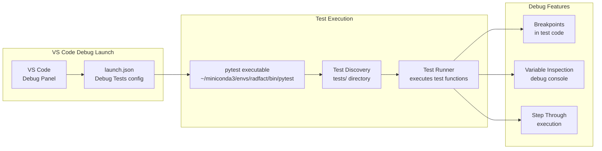
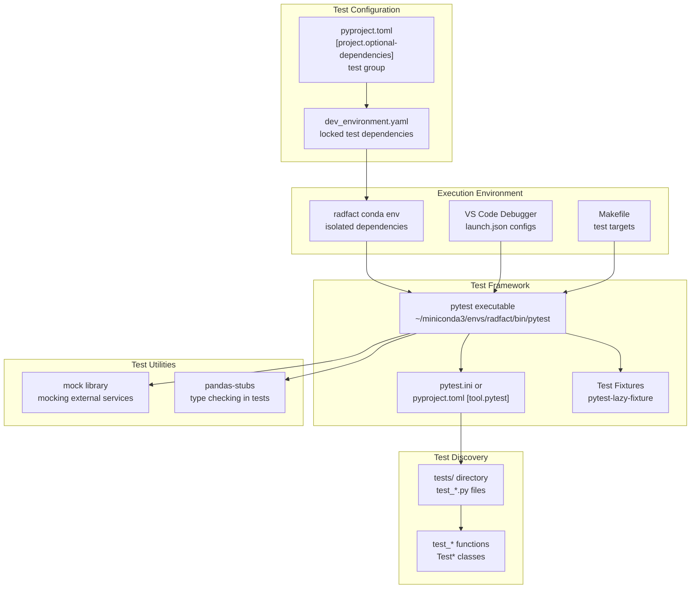
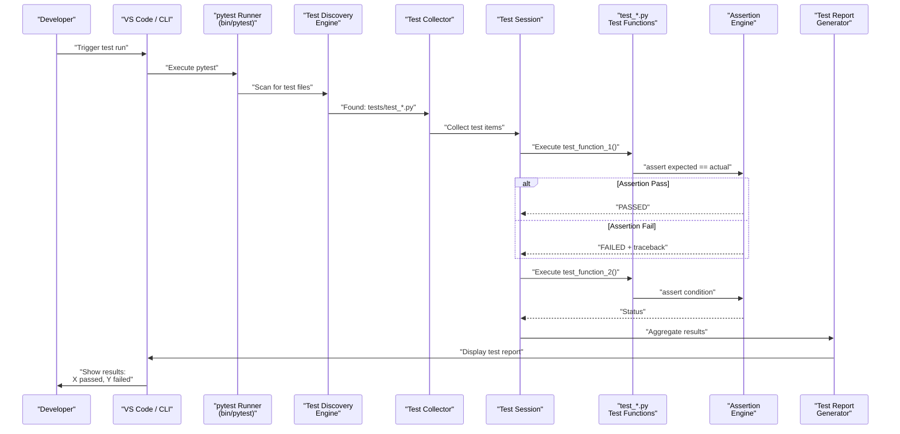
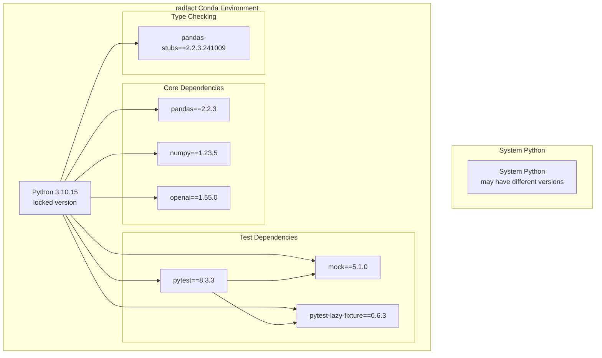

<!-- source: DeepWiki mcp.deepwiki.com · repo microsoft/RadFact · page 7.3 Testing · fetched 2026-10-26 -->

# Testing

<details>
<summary>Relevant source files</summary>

The following files were used as context for generating this wiki page:

- [.vscode/launch.json](.vscode/launch.json)
- [dev_environment.yaml](dev_environment.yaml)
- [pyproject.toml](pyproject.toml)

</details>


This page describes RadFact's testing infrastructure, including how to run tests with pytest, configure test execution, and debug test failures. The testing system is designed to validate the correctness of the LLM processing pipeline, metrics computation, and integration with external services.

For information about code quality tools that complement testing (linting, formatting, type checking), see [Code Quality Tools](#7.2). For CI/CD workflows that automate test execution, see [CI/CD Pipeline](#7.4).

---

## Test Framework Overview

RadFact uses **pytest** as its primary testing framework. The test infrastructure is configured through the project's dependency management system and supports both interactive debugging and automated execution.

### Core Testing Dependencies

The testing stack is defined in [pyproject.toml:77-82]() under the `test` optional dependency group:

| Package | Version | Purpose |
|---------|---------|---------|
| pytest | 8.3.3 | Core test framework and runner |
| mock | 5.1.0 | Mocking and patching for unit tests |
| pytest-lazy-fixture | 0.6.3 | Fixture composition for parameterized tests |
| pandas-stubs | 2.2.3.241009 | Type hints for pandas in test assertions |

These dependencies are installed via the locked environment specification in [dev_environment.yaml:313-314]() which ensures reproducible test environments across development machines and CI/CD pipelines.

**Sources:** [pyproject.toml:77-82](), [dev_environment.yaml:313-314]()

---

## Running Tests

### Command Line Execution

The standard way to run tests is through the `pytest` command in the activated conda environment:

```bash
# Run all tests
pytest

# Run tests with verbose output
pytest -v

# Run specific test file
pytest tests/test_specific_module.py

# Run tests matching pattern
pytest -k "test_llm_engine"

# Run with coverage report
pytest --cov=src/radfact --cov-report=html
```

The pytest executable is located at `${CONDA_PREFIX}/bin/pytest` when the `radfact` conda environment is activated, as specified in the environment configuration.

**Sources:** [dev_environment.yaml:313]()

---

### VS Code Debug Configuration

For interactive debugging of tests, RadFact provides a pre-configured VS Code launch configuration named **"Python: Debug Tests"**.



**VS Code Test Debugging Configuration**

The debug configuration is defined in [.vscode/launch.json:8-16]():

| Setting | Value | Purpose |
|---------|-------|---------|
| name | "Python: Debug Tests" | Configuration name in debug menu |
| type | python | Python debugger |
| request | launch | Launch new process |
| program | `${userHome}/miniconda3/envs/radfact/bin/pytest` | Direct pytest executable path |
| purpose | ["debug-test"] | Marks as test debugging config |
| console | integratedTerminal | Output to VS Code terminal |
| justMyCode | true | Skip library code in debugging |

To use this configuration:
1. Set breakpoints in test files or source code
2. Open the VS Code Debug panel (Ctrl+Shift+D / Cmd+Shift+D)
3. Select "Python: Debug Tests" from the dropdown
4. Press F5 or click the green play button

**Sources:** [.vscode/launch.json:8-16]()

---

### Additional VS Code Debug Configurations

RadFact also provides debug configurations for testing the CLI tools directly, which can be useful for integration testing:

**Debug Report to Phrases CLI** [.vscode/launch.json:27-39]()
```json
{
  "name": "Debug LLM pipeline for report_to_phrases",
  "program": "src/radfact/cli/run_report_to_phrases.py",
  "args": [
    "processing.start_index=0",
    "processing.end_index=10",
    "processing.batch_size=2",
    "dataset.csv_path=<your_path_to_cxr_reports>"
  ]
}
```

**Debug RadFact CLI** [.vscode/launch.json:41-51]()
```json
{
  "name": "Debug run_radfact",
  "program": "src/radfact/cli/run_radfact.py",
  "args": [
    "--input_path=examples/findings_generation_examples.csv",
    "--is_narrative_text"
  ]
}
```

These configurations allow developers to debug the full RadFact pipeline with realistic inputs while maintaining full debugger functionality.

**Sources:** [.vscode/launch.json:27-51]()

---

## Test Infrastructure Architecture



**Test Infrastructure Components**

The testing infrastructure consists of several interconnected components that enable comprehensive testing of RadFact:

1. **Dependency Management**: Test dependencies are defined in [pyproject.toml:77-82]() and locked in [dev_environment.yaml]()
2. **Test Discovery**: pytest automatically discovers tests following naming conventions (`test_*.py`, `test_*` functions)
3. **Execution Contexts**: Tests can run via command line, VS Code debugger, or Make targets
4. **Test Utilities**: Mock library for isolating external dependencies, fixtures for test setup/teardown

**Sources:** [pyproject.toml:77-82](), [dev_environment.yaml:313-314](), [.vscode/launch.json:8-16]()

---

## Test Execution Flow



**Execution Stages**

1. **Initialization**: pytest is invoked via VS Code debug config [.vscode/launch.json:11]() or command line
2. **Discovery**: pytest scans for `test_*.py` files and `test_*` functions/classes
3. **Collection**: Test items are collected and organized into a session
4. **Execution**: Each test function is executed in isolation
5. **Assertion**: Test assertions are evaluated and failures captured with tracebacks
6. **Reporting**: Results are aggregated and presented to the developer

**Sources:** [.vscode/launch.json:8-16]()

---

## Test Dependencies Configuration

The test dependency stack is carefully structured to support RadFact's testing needs while maintaining compatibility with the main application dependencies.

### Dependency Declaration

Test dependencies are declared as an optional dependency group in [pyproject.toml:77-82]():

```toml
[project.optional-dependencies]
test = [
    "mock",
    "pandas-stubs",
    "pytest",
    "pytest-lazy-fixture",
]
```

This structure allows developers to install test dependencies selectively:

```bash
# Install with test dependencies
pip install -e ".[test]"

# Install with dev and test dependencies
pip install -e ".[dev,test]"
```

### Locked Versions

The exact versions used in the development environment are locked in [dev_environment.yaml:252,313-314]():

```yaml
pip:
  - mock==5.1.0
  - pytest==8.3.3
  - pytest-lazy-fixture==0.6.3
```

This ensures reproducible test behavior across different environments and prevents version-related test failures.

**Sources:** [pyproject.toml:77-82](), [dev_environment.yaml:252,313-314]()

---

## Test Utilities and Helpers

### Mock Library

The `mock` library (version 5.1.0) provides powerful mocking and patching capabilities for isolating tests from external dependencies:

```python
# Example usage pattern (not actual code)
from unittest.mock import patch, MagicMock

@patch('radfact.llm_utils.engine.engine.LLMEngine')
def test_radfact_with_mocked_llm(mock_engine):
    # Test RadFact logic without calling real LLM endpoints
    mock_engine.return_value.process.return_value = mock_results
    # ... test code ...
```

This is particularly important for testing LLM-dependent functionality without incurring API costs or requiring network access.

### pytest-lazy-fixture

The `pytest-lazy-fixture` plugin (version 0.6.3) enables advanced fixture composition in parameterized tests:

```python
# Example pattern
import pytest
from pytest_lazyfixture import lazy_fixture

@pytest.mark.parametrize("config", [
    lazy_fixture("azure_config"),
    lazy_fixture("openai_config"),
])
def test_multiple_endpoints(config):
    # Test runs once for each fixture
    # ... test code ...
```

This is useful for testing RadFact's multi-endpoint support where the same test logic needs to run against different LLM configurations.

**Sources:** [pyproject.toml:78,81](), [dev_environment.yaml:252,314]()

---

## Test Configuration Best Practices

### Pytest Configuration

While not explicitly shown in the provided files, pytest configuration typically resides in either `pytest.ini` or the `[tool.pytest.ini_options]` section of `pyproject.toml`. Common configurations include:

```toml
[tool.pytest.ini_options]
testpaths = ["tests"]
python_files = ["test_*.py"]
python_classes = ["Test*"]
python_functions = ["test_*"]
addopts = [
    "-v",
    "--strict-markers",
    "--tb=short",
]
```

### Test Organization

Tests should be organized to mirror the source code structure:

```
src/radfact/
├── cli/
│   ├── run_radfact.py
│   └── run_report_to_phrases.py
├── llm_utils/
│   ├── engine/
│   └── processor/
└── metrics/

tests/
├── cli/
│   ├── test_run_radfact.py
│   └── test_run_report_to_phrases.py
├── llm_utils/
│   ├── engine/
│   └── processor/
└── metrics/
```

**Sources:** [pyproject.toml]()

---

## Integration with Development Workflow

### Pre-commit Hooks

Tests can be integrated with pre-commit hooks to run automatically before commits. See [Code Quality Tools](#7.2) for details on the pre-commit configuration.

### CI/CD Integration

Tests are automatically executed in the GitHub Actions CI/CD pipeline on every pull request. See [CI/CD Pipeline](#7.4) for details on the automated test execution workflow.

### Make Targets

The `Makefile` likely provides convenient targets for running tests:

```bash
# Run all tests
make test

# Run tests with coverage
make test-coverage

# Run specific test suite
make test-unit
make test-integration
```

**Sources:** Related to [Makefile]() and CI/CD configuration

---

## Debugging Test Failures

### Using VS Code Debugger

1. **Set Breakpoints**: Click in the gutter next to line numbers in test files or source code
2. **Launch Debugger**: Use the "Python: Debug Tests" configuration [.vscode/launch.json:8-16]()
3. **Inspect Variables**: Use the Variables panel or debug console to examine state
4. **Step Through Code**: Use F10 (step over), F11 (step into), Shift+F11 (step out)

### Command Line Debugging

```bash
# Run tests with detailed output
pytest -vv

# Show local variables in tracebacks
pytest -l

# Drop into debugger on failures
pytest --pdb

# Drop into debugger at start of each test
pytest --trace

# Run last failed tests only
pytest --lf

# Run specific test by name
pytest tests/test_module.py::test_specific_function
```

### Debug Configuration Settings

The VS Code debug configuration [.vscode/launch.json:8-16]() uses the following settings optimized for test debugging:

- `"justMyCode": true` - Skip stepping through library code, focus on RadFact code
- `"console": "integratedTerminal"` - Display output in VS Code's integrated terminal
- `"purpose": ["debug-test"]` - Marks this as a test-specific debug configuration

**Sources:** [.vscode/launch.json:8-16]()

---

## Test Environment Isolation

Tests run in the isolated `radfact` conda environment, ensuring consistent dependency versions and preventing conflicts with system packages. The environment is defined in [dev_environment.yaml]() and includes all necessary test dependencies.



**Environment Isolation Benefits**

1. **Reproducibility**: Locked versions ensure tests behave consistently across machines
2. **Dependency Resolution**: Conda handles complex dependency trees automatically
3. **Isolation**: No interference from system-wide Python packages
4. **Version Control**: [dev_environment.yaml]() can be version controlled for team consistency

**Sources:** [dev_environment.yaml:1-369](), [pyproject.toml:77-82]()

---

## Summary

RadFact's testing infrastructure is built on pytest with support for:

- **Command-line execution** for automated and manual test runs
- **VS Code debug integration** for interactive debugging [.vscode/launch.json:8-16]()
- **Mock library** for isolating external dependencies [pyproject.toml:78]()
- **pytest-lazy-fixture** for advanced fixture composition [pyproject.toml:81]()
- **Isolated conda environment** for reproducible test execution [dev_environment.yaml]()

The testing system integrates seamlessly with the development workflow through pre-commit hooks, CI/CD automation, and IDE debugging configurations, ensuring code quality and correctness throughout the development lifecycle.

**Sources:** [.vscode/launch.json:8-51](), [pyproject.toml:77-82](), [dev_environment.yaml:313-314]()

---

