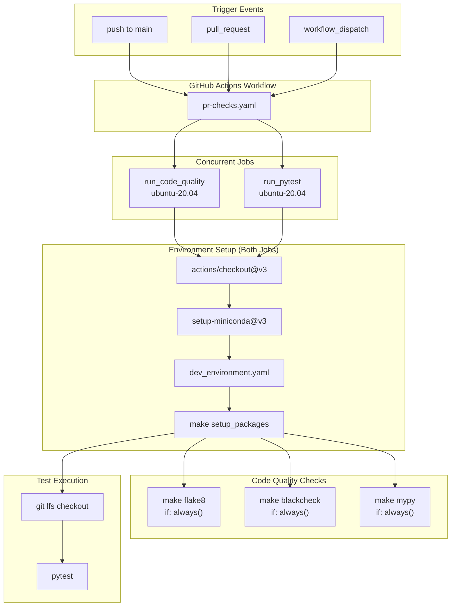
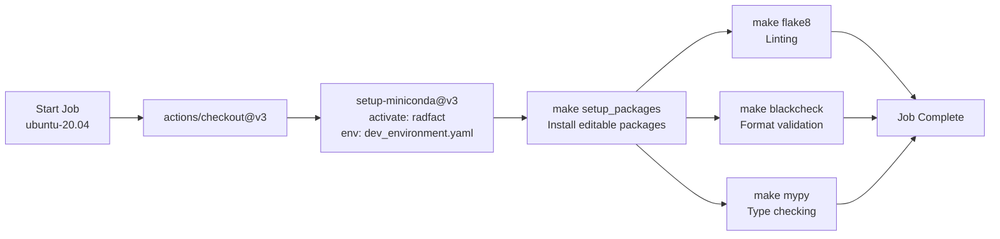
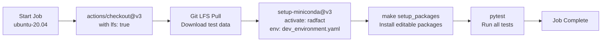
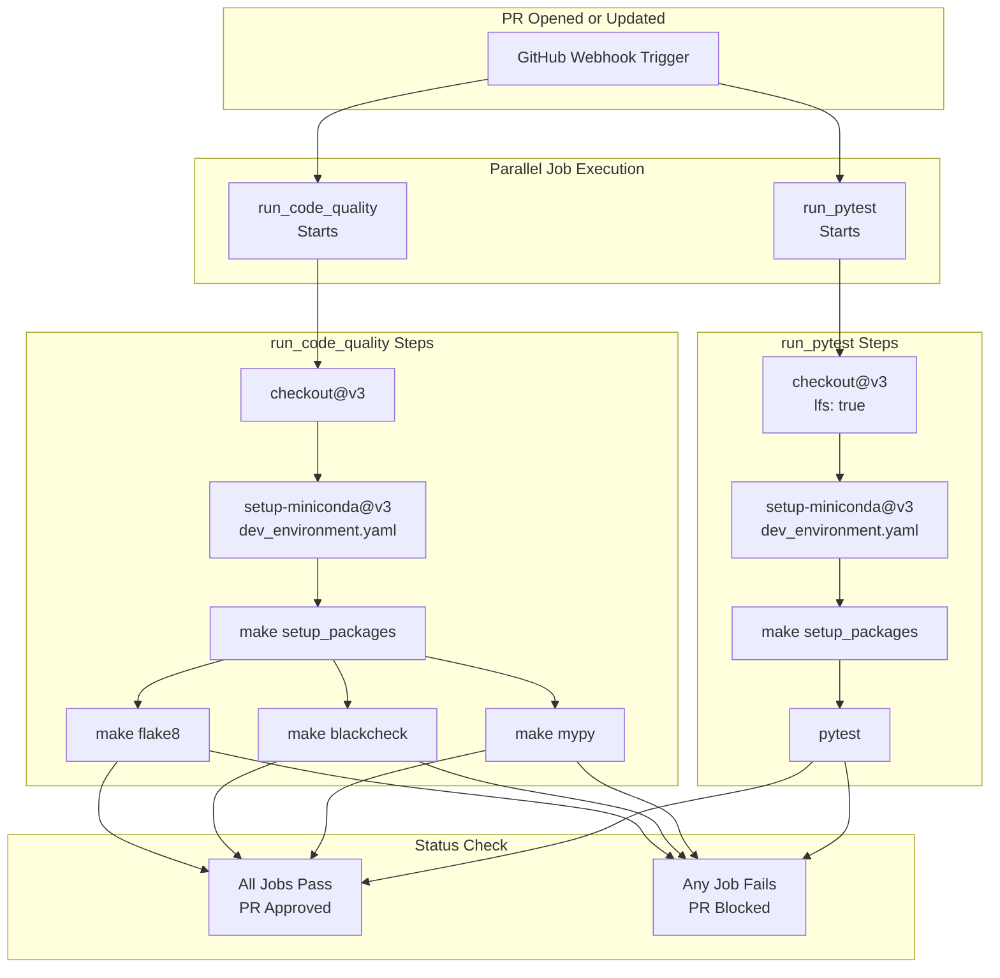

<!-- source: DeepWiki mcp.deepwiki.com · repo microsoft/RadFact · page 7.4 CI/CD Pipeline · fetched 2026-10-26 -->

# CI/CD Pipeline

<details>
<summary>Relevant source files</summary>

The following files were used as context for generating this wiki page:

- [.github/workflows/pr-checks.yaml](.github/workflows/pr-checks.yaml)
- [Makefile](Makefile)

</details>


## Purpose and Scope

This document describes the automated Continuous Integration and Continuous Deployment (CI/CD) pipeline implemented using GitHub Actions for the RadFact repository. The CI/CD pipeline automatically validates code quality and runs tests on every pull request and push to the main branch.

For information about manually running code quality tools during development, see [Code Quality Tools](#7.2). For details on the testing infrastructure and test organization, see [Testing](#7.3).

## Overview

The RadFact CI/CD pipeline is defined in [.github/workflows/pr-checks.yaml:1-71]() and provides automated quality gates for all code changes. The pipeline ensures that:

1. Code formatting adheres to Black standards
2. Code passes Flake8 linting rules
3. Type annotations are correct per MyPy analysis
4. All pytest tests pass

The workflow runs on every push to `main`, every pull request targeting `main`, and can be manually triggered via `workflow_dispatch`.

**Sources**: `.github/workflows/pr-checks.yaml`

## Workflow Triggers and Concurrency Control

### Trigger Configuration

The workflow is triggered by three events:

| Event | Description | Configuration |
|-------|-------------|---------------|
| `push` | Direct pushes to main branch | [.github/workflows/pr-checks.yaml:4-6]() |
| `pull_request` | PRs opened, synchronized, or reopened against main | [.github/workflows/pr-checks.yaml:7-10]() |
| `workflow_dispatch` | Manual trigger from GitHub UI | [.github/workflows/pr-checks.yaml:11]() |

### Concurrency Management

The workflow implements intelligent concurrency control [.github/workflows/pr-checks.yaml:14-16]():

```yaml
concurrency:
  group: ${{ github.ref }}/checks
  cancel-in-progress: ${{ github.ref != 'refs/heads/main' }}
```

This configuration:
- Groups workflow runs by Git reference (branch or PR)
- Cancels in-progress runs when new commits are pushed to PRs
- Preserves all runs on the `main` branch to maintain complete history

**Sources**: `.github/workflows/pr-checks.yaml`

## Pipeline Architecture



**Diagram: CI/CD Workflow Execution Flow**

This diagram shows how trigger events initiate the workflow, which spawns two independent jobs that run in parallel. Both jobs perform identical environment setup before executing their respective validation steps.

**Sources**: `.github/workflows/pr-checks.yaml`

## Job Specifications

### Job 1: `run_code_quality`

The `run_code_quality` job [.github/workflows/pr-checks.yaml:23-50]() executes all static code analysis tools:



**Diagram: Code Quality Job Pipeline**

#### Step Details

| Step | Purpose | Failure Behavior |
|------|---------|------------------|
| `actions/checkout@v3` | Clone repository code | Stops job on failure |
| `setup-miniconda@v3` | Setup conda with `radfact` environment | Stops job on failure |
| `make setup_packages` | Install local packages in editable mode | Stops job on failure |
| `make flake8` | Run linting checks | Reports failure but continues |
| `make blackcheck` | Verify code formatting | Reports failure but continues |
| `make mypy` | Run type checking | Reports failure but continues |

Each code quality step uses `if: ${{ always() }}` [.github/workflows/pr-checks.yaml:38,43,48]() to ensure all checks run even if earlier ones fail, providing complete feedback on all quality issues.

**Sources**: `.github/workflows/pr-checks.yaml`, `Makefile`

### Job 2: `run_pytest`

The `run_pytest` job [.github/workflows/pr-checks.yaml:52-70]() executes the test suite:



**Diagram: Test Execution Job Pipeline**

#### Key Differences from Code Quality Job

1. **Git LFS Support**: The checkout step includes `lfs: true` [.github/workflows/pr-checks.yaml:56-57]() to download large test data files tracked by Git LFS
2. **Direct pytest Execution**: Unlike code quality checks, pytest is invoked directly rather than through a Makefile target [.github/workflows/pr-checks.yaml:68-70]()
3. **No Conditional Steps**: All steps must succeed for the job to pass

**Sources**: `.github/workflows/pr-checks.yaml`

## Environment Setup Process

Both jobs use identical environment setup procedures:

### Conda Environment Initialization

The `setup-miniconda@v3` action [.github/workflows/pr-checks.yaml:28-31]() configures the Python environment:

```yaml
- uses: conda-incubator/setup-miniconda@v3
  with:
    activate-environment: radfact
    environment-file: dev_environment.yaml
```

This action:
1. Installs Miniconda if not present
2. Creates or activates the `radfact` conda environment
3. Installs all dependencies from `dev_environment.yaml`
4. Configures the shell to auto-activate the environment

### Package Installation

After environment setup, `make setup_packages` [.github/workflows/pr-checks.yaml:34,65]() installs local packages:

```bash
make setup_packages
```

This Makefile target [Makefile:40-41]() executes:

```bash
conda run -n $(ENV_NAME) --no-capture-output python setup_packages.py --no-deps
```

The `--no-deps` flag ensures dependencies are not reinstalled (they're already in the conda environment from `dev_environment.yaml`), while the local packages (`azure-utils`, `llm-utils`, `radfact`) are installed in editable mode for development.

**Sources**: `.github/workflows/pr-checks.yaml`, `Makefile`, `dev_environment.yaml`

## Integration with Make Targets

The CI pipeline delegates to Makefile targets for consistency between local development and CI execution:

### Code Quality Targets

| Make Target | Makefile Location | Purpose | CI Usage |
|-------------|-------------------|---------|----------|
| `flake8` | [Makefile:109-110]() | Run flake8 linting with config | [.github/workflows/pr-checks.yaml:39]() |
| `blackcheck` | [Makefile:105-106]() | Verify Black formatting without changes | [.github/workflows/pr-checks.yaml:44]() |
| `mypy` | [Makefile:113-114]() | Run type checking | [.github/workflows/pr-checks.yaml:49]() |

### Shell Configuration

All Make targets in the CI workflow use `shell: bash -el {0}` [.github/workflows/pr-checks.yaml:35,40,45,50,66,70]() to:
- `-e`: Exit immediately on error
- `-l`: Login shell (loads conda initialization)
- `{0}`: Placeholder for GitHub Actions to inject the command

This ensures the conda environment is properly activated before executing each command.

**Sources**: `.github/workflows/pr-checks.yaml`, `Makefile`

## Code Quality Tool Configuration

The pipeline uses three complementary code quality tools:

### Flake8 Configuration

Flake8 checks for code style issues and potential bugs. Configuration is in `.flake8` [Makefile:110]():

```bash
flake8 --config .flake8 .
```

### Black Configuration

Black enforces consistent code formatting. Configuration is in `pyproject.toml` [Makefile:4-6,105-106]():

```bash
black --check --config pyproject.toml .
```

The `--check` flag prevents modifications, returning exit code 1 if formatting changes are needed.

### MyPy Configuration

MyPy performs static type checking. Configuration is in `pyproject.toml` or `mypy.ini` [Makefile:113-114]():

```bash
mypy .
```

For detailed information on these tools and their configurations, see [Code Quality Tools](#7.2).

**Sources**: `Makefile`

## Permissions and Security

The workflow defines minimal required permissions [.github/workflows/pr-checks.yaml:18-20]():

```yaml
permissions:
  contents: read
```

This grants:
- **Read access** to repository contents (required by `actions/checkout`)
- **No write access** to any resources
- **No access** to secrets or sensitive operations

This principle of least privilege ensures the CI pipeline cannot inadvertently modify repository contents or access resources beyond what's necessary for testing.

**Sources**: `.github/workflows/pr-checks.yaml`

## Runner Environment

Both jobs use `ubuntu-20.04` [.github/workflows/pr-checks.yaml:24,53]() as the execution environment:

| Specification | Value | Rationale |
|---------------|-------|-----------|
| Operating System | Ubuntu 20.04 LTS | Long-term support, stable packages |
| Runner Type | GitHub-hosted | No maintenance overhead |
| Python Version | From `dev_environment.yaml` | Ensures consistency with development |

The use of GitHub-hosted runners means:
- No infrastructure management required
- Consistent, clean environment for each run
- Parallel execution across jobs without resource contention
- Automatic scaling based on workflow load

**Sources**: `.github/workflows/pr-checks.yaml`

## Execution Flow and Dependencies



**Diagram: Complete CI/CD Execution Flow with Job Dependencies**

Key characteristics:
1. **Parallel Execution**: Both jobs start simultaneously, reducing total CI time
2. **Independent Failures**: Code quality checks within `run_code_quality` use `if: always()`, allowing all checks to report results even if one fails
3. **Sequential Steps**: Within each job, steps execute sequentially with standard GitHub Actions behavior
4. **Status Reporting**: All jobs must pass for the overall workflow to succeed

**Sources**: `.github/workflows/pr-checks.yaml`

## Workflow Status and Branch Protection

The workflow name "PR checks" [.github/workflows/pr-checks.yaml:1]() appears as a required status check in GitHub branch protection rules. This integration:

1. Prevents merging PRs until all checks pass
2. Displays job status directly in the PR interface
3. Allows administrators to configure required vs. optional checks
4. Provides a centralized view of code quality and test status

To configure branch protection rules that require this workflow, see [Contributing](#9.1) for repository governance policies.

**Sources**: `.github/workflows/pr-checks.yaml`

## Troubleshooting CI Failures

### Common Failure Scenarios

| Failure Type | Symptom | Resolution |
|--------------|---------|------------|
| Flake8 violations | `make flake8` fails | Run `make flake8` locally to see violations |
| Black formatting | `make blackcheck` fails | Run `make black` to auto-format code |
| Type errors | `make mypy` fails | Fix type annotations or add `# type: ignore` |
| Test failures | `pytest` fails | Run `pytest` locally with same environment |
| Environment setup | `setup-miniconda` fails | Check `dev_environment.yaml` syntax |
| Git LFS issues | `pytest` fails with missing files | Ensure Git LFS is installed and files pulled |

### Debugging Workflow Issues

To debug CI-specific issues:

1. Check the Actions tab in the GitHub repository for detailed logs
2. Expand individual step outputs to see command output
3. Look for differences between CI environment (`ubuntu-20.04`) and local development
4. Verify that `dev_environment.yaml` is up to date with environment locking (see [Environment Locking](#7.5))

**Sources**: `.github/workflows/pr-checks.yaml`, `Makefile`

## Relationship to Local Development

The CI pipeline is designed to mirror local development workflows:

| Local Command | CI Equivalent | Purpose |
|---------------|---------------|---------|
| `make check` | `run_code_quality` job | Run all quality checks |
| `pytest` | `run_pytest` job | Execute test suite |
| `make env` | `setup-miniconda` + `make setup_packages` | Setup environment |

Developers can run the same commands locally that CI executes, ensuring no surprises when pushing code. Pre-commit hooks (see [Code Quality Tools](#7.2)) can run a subset of these checks before commit to catch issues earlier.

**Sources**: `.github/workflows/pr-checks.yaml`, `Makefile`

---

