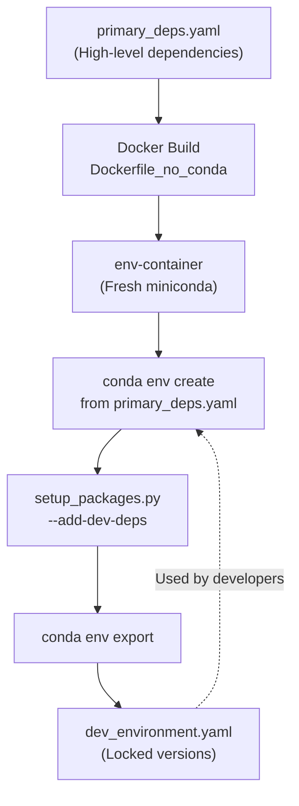
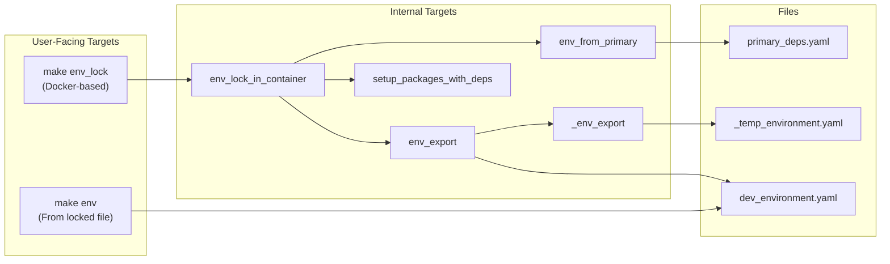
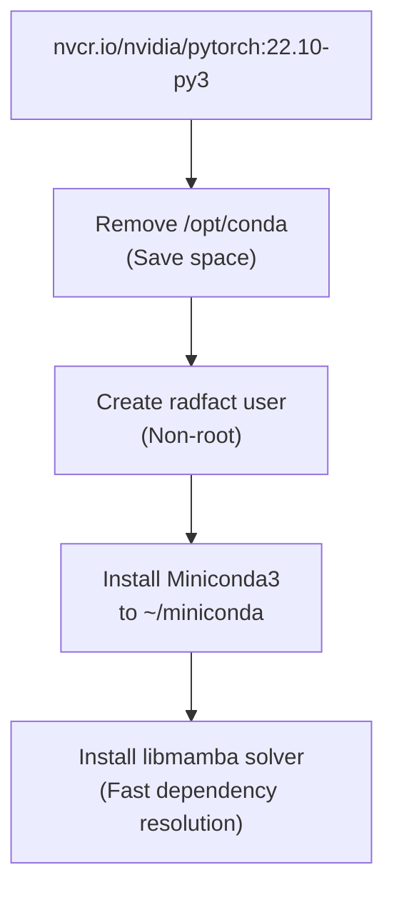
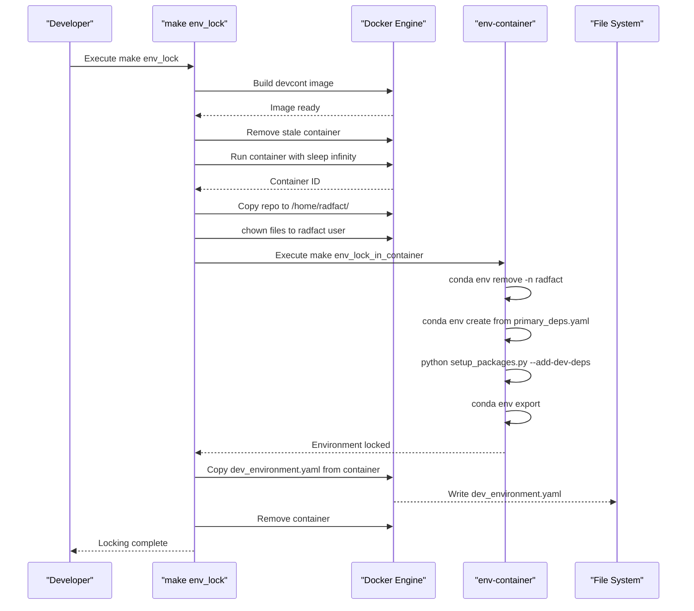
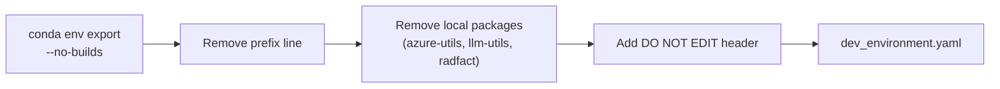
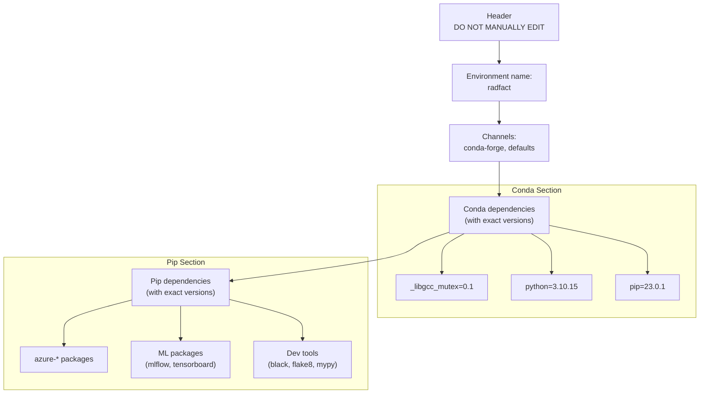
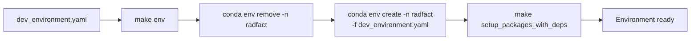
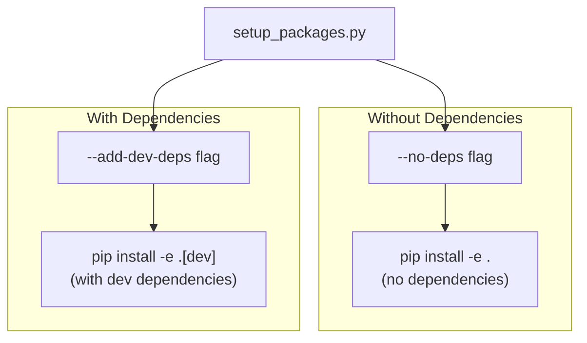

<!-- source: DeepWiki mcp.deepwiki.com · repo microsoft/RadFact · page 7.5 Environment Locking · fetched 2026-10-26 -->

# Environment Locking

Relevant source files

The following files were used as context for generating this wiki page:

- [Dockerfile_no_conda](Dockerfile_no_conda)
- [Makefile](Makefile)
- [dev_environment.yaml](dev_environment.yaml)

## Purpose and Scope

Environment locking is RadFact's Docker-based system for creating reproducible conda environments. It generates a locked environment file ([dev_environment.yaml:1]()) containing exact package versions for all dependencies. This ensures that all developers and CI/CD systems use identical package versions, eliminating "works on my machine" issues.

This page covers the environment locking mechanism and workflow. For general development environment setup, see [Development Setup](#7.1). For code quality tools configuration, see [Code Quality Tools](#7.2).

## Overview

RadFact uses a two-file approach to environment management:

1. **`primary_deps.yaml`** (not shown in files) - Contains high-level dependencies without version pins
2. **`dev_environment.yaml`** - Auto-generated locked file with all dependencies and exact versions

The locking process resolves all transitive dependencies and pins them to specific versions, creating a reproducible environment specification.

**Sources:** [dev_environment.yaml:1](), [Makefile:58-67]()

## The Environment Locking Process

### High-Level Workflow

**Diagram:** Environment locking workflow from primary dependencies to locked environment file

The process creates a clean Docker container with a fresh miniconda installation, builds the environment from scratch, and exports the resolved dependencies.

**Sources:** [Makefile:70-87](), [Dockerfile_no_conda:1-27]()

### Make Target Architecture

**Diagram:** Make target dependencies for environment management

| Make Target | Purpose | Runs In |
|------------|---------|---------|
| `env_lock` | Full Docker-based environment locking | Host machine |
| `env_lock_in_container` | Orchestrates locking inside container | Docker container |
| `env_from_primary` | Creates environment from primary_deps.yaml | Docker container |
| `setup_packages_with_deps` | Installs local packages with dependencies | Conda environment |
| `env_export` | Exports locked environment to file | Conda environment |
| `env` | Creates environment from locked file | Host machine |

**Sources:** [Makefile:21-88]()

## Docker-Based Isolation

### Why Docker?

The environment locking process uses Docker to ensure complete isolation and reproducibility:

1. **Clean slate** - Fresh miniconda installation with no pre-existing packages
2. **Platform consistency** - Same base image for all developers and CI
3. **Isolation** - No interference from host system packages or configurations

### Base Image Configuration

The `Dockerfile_no_conda` defines a minimal base image:

**Diagram:** Docker image construction steps for environment locking

Key characteristics:
- Starts from NVIDIA PyTorch base image ([Dockerfile_no_conda:3]())
- Removes existing conda to ensure clean state ([Dockerfile_no_conda:6]())
- Creates non-root `radfact` user ([Dockerfile_no_conda:8-13]())
- Installs fresh miniconda ([Dockerfile_no_conda:17-19]())
- Configures libmamba solver for fast dependency resolution ([Dockerfile_no_conda:23-24]())

**Sources:** [Dockerfile_no_conda:1-27]()

## Detailed Process Flow

### Container Orchestration

The `env_lock` target orchestrates the Docker-based locking process:

**Diagram:** Sequence of operations during environment locking

The process ([Makefile:70-87]()):

1. **Build base image** - Creates `devcont` image from Dockerfile_no_conda ([Makefile:73]())
2. **Cleanup** - Removes any stale `env-container` ([Makefile:75]())
3. **Start container** - Runs container with `sleep infinity` to keep it alive ([Makefile:77]())
4. **Copy repository** - Copies entire repo to `/home/radfact/` ([Makefile:79]())
5. **Fix permissions** - Changes ownership to `radfact` user ([Makefile:81]())
6. **Execute locking** - Runs `make env_lock_in_container` inside container ([Makefile:83]())
7. **Extract results** - Copies `dev_environment.yaml` back to host ([Makefile:85]())
8. **Cleanup** - Removes container ([Makefile:87]())

**Sources:** [Makefile:70-87]()

### Inside the Container

The `env_lock_in_container` target executes three steps sequentially:

| Step | Target | Action | Result |
|------|--------|--------|--------|
| 1 | `env_from_primary` | `conda env create -f primary_deps.yaml` | Fresh conda environment with base dependencies |
| 2 | `setup_packages_with_deps` | `python setup_packages.py --add-dev-deps` | Local packages installed in editable mode with dev dependencies |
| 3 | `env_export` | `conda env export` filtered and formatted | Locked dev_environment.yaml with all resolved versions |

**Sources:** [Makefile:67]()

### Environment Export

The `env_export` target generates the locked file with specific filtering:

**Diagram:** Export and filtering pipeline for locked environment file

The export process ([Makefile:50-63]()):

1. Exports environment without build strings (`--no-builds` flag) ([Makefile:53]())
2. Removes `prefix:` line which contains local paths ([Makefile:54]())
3. Filters out local packages using grep ([Makefile:55]())
4. Adds warning header ([Makefile:52]())

Local packages (`azure-utils`, `llm-utils`, `radfact`) are excluded because they are installed via `setup_packages.py` in editable mode, not through conda.

**Sources:** [Makefile:50-63]()

## Locked Environment File Structure

The generated `dev_environment.yaml` has a specific structure:

**Diagram:** Structure of the locked dev_environment.yaml file

Example structure:
- **Warning header** - Line 1 indicates auto-generation ([dev_environment.yaml:1]())
- **Environment name** - `radfact` ([dev_environment.yaml:2]())
- **Channels** - `conda-forge` and `defaults` ([dev_environment.yaml:3-5]())
- **Conda dependencies** - System libraries, Python runtime ([dev_environment.yaml:7-29]())
- **Pip dependencies** - Azure packages, ML frameworks, dev tools ([dev_environment.yaml:30-369]())

All versions are pinned exactly (e.g., `python=3.10.15`, `black==24.10.0`).

**Sources:** [dev_environment.yaml:1-369]()

## Developer Workflow

### Creating Environment from Locked File

Developers create environments using the locked file:

**Diagram:** Developer workflow for creating environment from locked file

The `make env` target ([Makefile:22-28]()):
1. Removes existing `radfact` environment if present ([Makefile:24]())
2. Creates fresh environment from locked file ([Makefile:26]())
3. Installs local packages in editable mode ([Makefile:28]())

**Sources:** [Makefile:22-28]()

### When to Run Environment Locking

Environment locking should be executed when:

| Scenario | Reason | Command |
|----------|--------|---------|
| Adding new dependency | Update locked file with new package | `make env_lock` |
| Upgrading dependency version | Pin new version across team | `make env_lock` |
| Resolving conflicts | Generate clean resolution | `make env_lock` |
| CI/CD failures | Ensure environment matches CI | `make env_lock` |

After running `make env_lock`, commit the updated `dev_environment.yaml` to version control.

**Sources:** [Makefile:70-87]()

## Package Installation

### Local Package Setup

The `setup_packages.py` script (not shown in files) installs local packages:

**Diagram:** setup_packages.py installation modes

Two modes:
- **`--no-deps`** - Used by `make setup_packages` for daily development ([Makefile:41]())
- **`--add-dev-deps`** - Used by `make setup_packages_with_deps` for environment locking ([Makefile:46]())

During locking, dependencies must be installed so they can be resolved and pinned. During daily use, dependencies are already present from the locked file.

**Sources:** [Makefile:40-46]()

## Key Dependencies

The locked environment includes several categories of dependencies:

| Category | Key Packages | Purpose |
|----------|-------------|---------|
| **Python Runtime** | python=3.10.15, pip=23.0.1, setuptools=69.5.1 | Core Python environment |
| **Azure Integration** | azure-cli, azure-identity, azure-keyvault | Azure service integration |
| **LLM Infrastructure** | openai, langchain, tiktoken | LLM processing |
| **ML Frameworks** | mlflow, tensorboard, scikit-learn | Experiment tracking |
| **Data Processing** | pandas, numpy, pyarrow | Data manipulation |
| **Dev Tools** | black, flake8, mypy, pytest | Code quality |
| **Utilities** | redis, hydra-core, pydantic | Infrastructure |

All packages have exact version pins to ensure reproducibility.

**Sources:** [dev_environment.yaml:24](), [dev_environment.yaml:158](), [dev_environment.yaml:266](), [dev_environment.yaml:250](), [dev_environment.yaml:276](), [dev_environment.yaml:158](), [dev_environment.yaml:320]()

## Troubleshooting

### Common Issues and Solutions

| Issue | Symptom | Solution |
|-------|---------|----------|
| **Stale container** | "Container name already in use" | `docker rm -f env-container` |
| **Disk space** | "No space left on device" | Clean Docker images: `docker system prune` |
| **Permission errors** | "Permission denied" in container | Ensure chown step executes ([Makefile:81]()) |
| **Slow resolution** | Environment creation hangs | Verify libmamba solver installed ([Dockerfile_no_conda:23-24]()) |
| **Missing packages** | Import errors after locking | Run `make env` to recreate environment |

### Manual Cleanup

If the automated process fails:

1. **Remove container**: `docker rm -f env-container` (mentioned in [Makefile:71]())
2. **Remove environment**: `conda env remove -n radfact`
3. **Clean temp files**: `rm -f _temp_environment.yaml`
4. **Retry**: `make env_lock`

**Sources:** [Makefile:70-87](), [Dockerfile_no_conda:1-27]()

## Integration with CI/CD

The locked environment file is used by CI/CD systems to ensure consistent testing environments. See [CI/CD Pipeline](#7.4) for details on how GitHub Actions uses `dev_environment.yaml`.

The locking mechanism guarantees that:
- CI and local environments are identical
- Tests run against the same package versions
- Dependency conflicts are detected early

**Sources:** [dev_environment.yaml:1](), [Makefile:22-28]()

---

