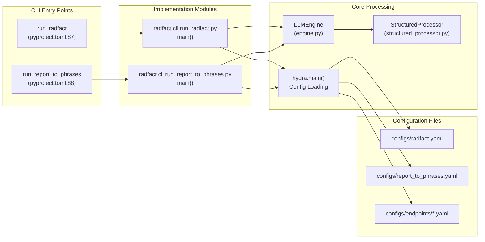
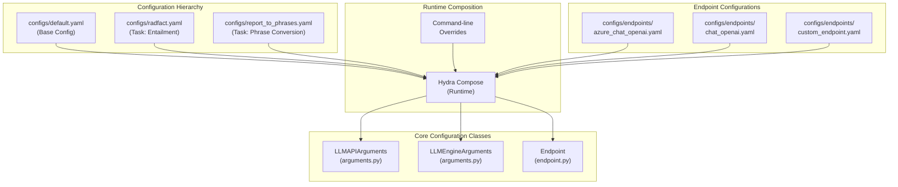
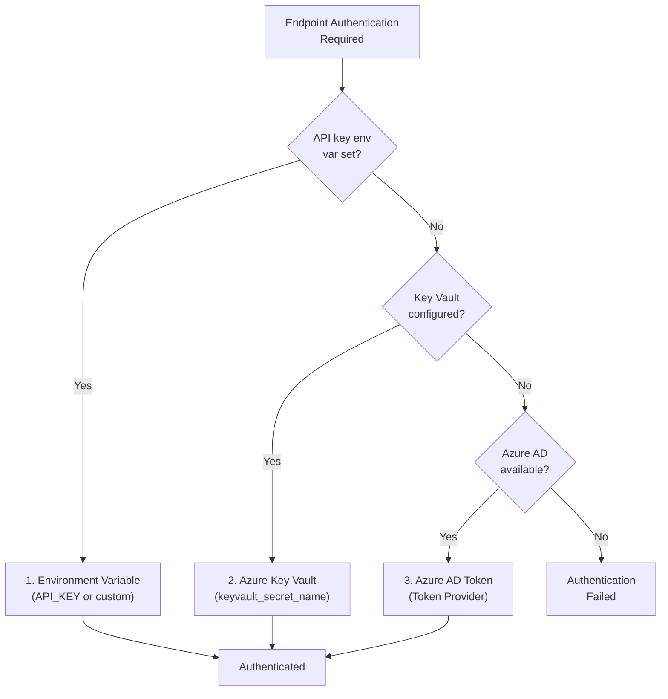
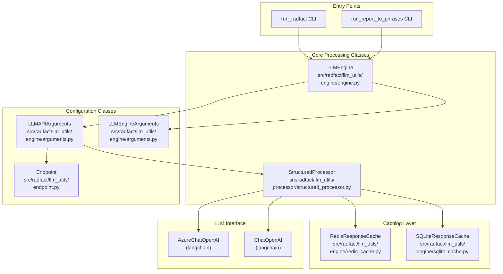

<!-- source: DeepWiki mcp.deepwiki.com · repo microsoft/RadFact · page 8 Reference · fetched 2026-10-26 -->

# Reference

<details>
<summary>Relevant source files</summary>

The following files were used as context for generating this wiki page:

- [README.md](README.md)
- [pyproject.toml](pyproject.toml)

</details>


## Purpose and Scope

This section provides technical reference documentation for RadFact's command-line interfaces, configuration system, and core APIs. This material is intended for users who need detailed specifications of parameters, configuration options, and programmatic interfaces.

For step-by-step usage guides, see [User Guide](#4). For architectural details about how these components work internally, see [Architecture](#5). For configuration setup tutorials, see [Configuration Setup](#2.3).

---

## CLI Command Overview

RadFact provides two primary command-line interfaces, registered as console scripts in [pyproject.toml:86-88]():

| Command | Entry Point | Purpose |
|---------|-------------|---------|
| `run_radfact` | `radfact.cli.run_radfact:main` | Compute RadFact metrics for evaluation |
| `run_report_to_phrases` | `radfact.cli.run_report_to_phrases:main` | Convert narrative reports to phrase lists |



**Sources**: [pyproject.toml:86-88](), [README.md:136-160]()

---

## run_radfact Command Reference

The `run_radfact` command computes RadFact metrics for model-generated reports against ground-truth references.

### Command Signature

```bash
run_radfact [OPTIONS]
```

### Required Parameters

| Parameter | Type | Description |
|-----------|------|-------------|
| `--input_path` | Path | Path to CSV (narrative) or JSON (grounded) file containing samples |

### Optional Parameters

| Parameter | Type | Default | Description |
|-----------|------|---------|-------------|
| `--is_narrative_text` | Flag | False | Indicates input is narrative text requiring phrase conversion |
| `--radfact_config_name` | String | `"radfact"` | Name of config file in `configs/` for entailment verification |
| `--phrases_config_name` | String | `"report_to_phrases"` | Name of config file in `configs/` for report-to-phrases conversion |
| `--output_dir` | Path | `"outputs/radfact"` | Directory for saving results |
| `--bootstrap_samples` | Integer | 500 | Number of bootstrap samples for confidence intervals (0 to disable) |

### Input File Formats

**CSV Format (Narrative Reports)**: Must contain columns `example_id`, `prediction`, `target`

| Column | Type | Description |
|--------|------|-------------|
| `example_id` | String/Integer | Unique identifier for the sample |
| `prediction` | String | Model-generated report text |
| `target` | String | Ground-truth reference report text |

**JSON Format (Grounded Reports)**: Array of objects with bounding box annotations

```json
[
  {
    "example_id": "string",
    "prediction": [
      {"phrase": "string", "bbox": [x, y, w, h]}
    ],
    "target": [
      {"phrase": "string", "bbox": [x, y, w, h]}
    ]
  }
]
```

### Output Structure

Results are saved in a timestamped directory: `outputs/radfact/run_YYYYMMDD_HHMMSS/`

| File/Directory | Description |
|----------------|-------------|
| `outputs.json` | Final aggregated metrics and results |
| `progress.csv` | Processing progress tracking |
| `skipped.csv` | Records of failed/skipped queries |
| `batch_outputs/*.json` | Incremental results per batch |
| `progress/subset_*.csv` | Per-worker progress tracking |
| `skipped/subset_*.csv` | Per-worker skipped records |

### Usage Examples

```bash
# Evaluate narrative reports with default settings
run_radfact --input_path examples/findings_generation_examples.csv --is_narrative_text

# Evaluate grounded reports without bootstrapping
run_radfact --input_path examples/grounded_reporting_examples.json --bootstrap_samples 0

# Use custom configuration and output directory
run_radfact --input_path data/reports.csv \
            --is_narrative_text \
            --radfact_config_name custom_radfact \
            --output_dir results/experiment_1
```

**Sources**: [README.md:136-178]()

---

## run_report_to_phrases Command Reference

The `run_report_to_phrases` command converts narrative radiology reports into structured phrase lists using an LLM.

### Command Signature

```bash
run_report_to_phrases [HYDRA_OVERRIDES]
```

### Configuration Parameters

This command uses Hydra configuration overrides. All parameters are specified using Hydra's dot-notation syntax.

| Parameter | Type | Default | Description |
|-----------|------|---------|-------------|
| `dataset.csv_path` | Path | Required | Path to input CSV with reports |
| `dataset.output_path` | Path | Auto-generated | Path for output phrase lists |
| `endpoints` | String | From config | Endpoint configuration to use |

### Input Format

CSV file with at minimum:
- `example_id`: Unique identifier
- Report text column (configurable via `dataset.text_column`)

### Output Format

JSON file with structure:
```json
[
  {
    "example_id": "string",
    "phrases": ["phrase1", "phrase2", ...]
  }
]
```

### Usage Examples

```bash
# Basic usage with default endpoint
run_report_to_phrases dataset.csv_path=/path/to/reports.csv

# Specify output path
run_report_to_phrases dataset.csv_path=input.csv dataset.output_path=output.json

# Override endpoint configuration
run_report_to_phrases dataset.csv_path=input.csv endpoints=CUSTOM_ENDPOINT
```

**Sources**: [README.md:180-188]()

---

## Configuration System Structure

RadFact uses Hydra for hierarchical configuration management. The configuration system consists of a base configuration with task-specific and endpoint-specific overrides.



**Sources**: [README.md:68-93]()

---

## Configuration File Reference

### Endpoint Configuration Schema

Endpoint configurations define LLM API access parameters and processing settings.

| Field | Type | Required | Description |
|-------|------|----------|-------------|
| `type` | String | Yes | `"AZURE_CHAT_OPENAI"` or `"CHAT_OPENAI"` |
| `url` | String | Yes | API endpoint URL |
| `deployment_name` | String | Yes | Model deployment identifier |
| `api_key_env_var_name` | String | No | Environment variable name for API key (default: `"API_KEY"`) |
| `keyvault_secret_name` | String | No | Azure Key Vault secret name for API key |
| `speed_factor` | Float | No | Relative endpoint speed for load balancing (default: 1.0) |
| `num_parallel_processes` | Integer | No | Number of parallel workers per endpoint (default: 1) |

### Example Endpoint Configuration

```yaml
ENDPOINT_EXAMPLE:
  type: "CHAT_OPENAI"
  url: "https://api.example.com/v1"
  deployment_name: "llama3-70b"
  api_key_env_var_name: "LLAMA3_API_KEY"
  speed_factor: 1.5
  num_parallel_processes: 10
```

**Sources**: [README.md:70-88]()

---

## Authentication Methods

RadFact supports three authentication methods with automatic fallback:



### Authentication Method Details

| Method | Configuration | Requirements | Use Case |
|--------|---------------|--------------|----------|
| Environment Variable | `api_key_env_var_name` in endpoint config | Set environment variable | Development, simple deployments |
| Azure Key Vault | `keyvault_secret_name` in endpoint config | `config.json` with AzureML workspace | Production, secure credential storage |
| Azure AD Token | Automatic fallback | Azure credentials configured | Azure-native deployments, managed identities |

### Key Vault Configuration Requirements

1. **config.json** file in repository root containing:
   - `subscription_id`
   - `resource_group`
   - `workspace_name`

2. Secret must exist in the default Key Vault of the specified AzureML workspace

**Note**: `config.json` is listed in `.gitignore` to prevent accidental commits.

**Sources**: [README.md:54-64]()

---

## Environment Variables Reference

| Variable | Purpose | Default | Required |
|----------|---------|---------|----------|
| `API_KEY` | Default API key for LLM endpoints | None | If no other auth method |
| `OPENAI_API_KEY` | OpenAI API key (langchain default) | None | For OpenAI endpoints |
| `AZURE_OPENAI_API_KEY` | Azure OpenAI API key | None | For Azure endpoints |
| `REDIS_HOST` | Redis cache server hostname | None | If using Redis cache |
| `REDIS_PORT` | Redis cache server port | None | If using Redis cache |
| `REDIS_PASSWORD` | Redis authentication password | None | If Redis requires auth |
| Custom variables | Any name specified in `api_key_env_var_name` | None | Per endpoint config |

**Sources**: [README.md:58]()

---

## Core API Classes Reference

### Key Class Mapping

This diagram maps high-level system components to their concrete Python implementations:



**Sources**: [README.md:64](), [pyproject.toml:86-88]()

---

## Key Classes Overview

### LLMEngine

**Location**: `src/radfact/llm_utils/engine/engine.py`

**Purpose**: Orchestrates parallel processing across multiple LLM endpoints, manages data sharding, batch processing, and result aggregation.

**Key Responsibilities**:
- Shard dataset across endpoints based on `speed_factor`
- Spawn and manage worker processes
- Coordinate incremental result saving
- Aggregate final outputs

### StructuredProcessor

**Location**: `src/radfact/llm_utils/processor/structured_processor.py`

**Purpose**: Handles individual LLM queries with structured prompt templates, few-shot examples, and response parsing.

**Key Responsibilities**:
- Construct prompts with system messages and examples
- Query LLM endpoints via langchain
- Parse and validate LLM responses
- Interact with caching layer

### Endpoint

**Location**: `src/radfact/llm_utils/endpoint.py`

**Purpose**: Represents a single LLM endpoint configuration with authentication and processing parameters.

**Key Responsibilities**:
- Store endpoint metadata (URL, deployment name, type)
- Manage authentication method selection
- Provide langchain model instantiation

### LLMAPIArguments

**Location**: `src/radfact/llm_utils/engine/arguments.py`

**Purpose**: Configuration dataclass for LLM API parameters (temperature, max_tokens, etc.)

### LLMEngineArguments

**Location**: `src/radfact/llm_utils/engine/arguments.py`

**Purpose**: Configuration dataclass for LLMEngine processing parameters (batch size, parallel processes, etc.)

### RedisResponseCache

**Location**: `src/radfact/llm_utils/engine/redis_cache.py`

**Purpose**: Distributed caching of LLM responses using Redis backend.

**Key Features**:
- Endpoint URL normalization for cache sharing across regions
- Automatic expiration support
- Azure Redis integration

### SQLiteResponseCache

**Location**: `src/radfact/llm_utils/engine/sqlite_cache.py`

**Purpose**: Local file-based caching of LLM responses using SQLite.

**Key Features**:
- Disk-persistent cache
- Suitable for single-machine deployments
- No external dependencies

**Sources**: [README.md:64]()

---

## Dependencies Reference

### Core Dependencies

RadFact's core dependencies as specified in [pyproject.toml:41-60]():

| Category | Packages | Purpose |
|----------|----------|---------|
| Azure Integration | `azureml-sdk`, `azureml-tensorboard`, `azure-keyvault`, `hi-ml-azure` | Azure service integration |
| LLM Infrastructure | `langchain==0.2.17`, `langchain-community==0.2.19`, `langchain-openai==0.1.25`, `openai==1.55.0` | LLM API interaction |
| Configuration | `hydra-core==1.3.2` | Hierarchical configuration |
| Caching | `redis` | Distributed response caching |
| Validation | `pydantic==1.10.17` | Configuration validation |
| Data Processing | `numpy`, `pandas` | Data manipulation |

### Development Dependencies

Optional dependencies for development ([pyproject.toml:63-82]()):

| Category | Packages | Purpose |
|----------|----------|---------|
| Code Quality | `black`, `flake8`, `mypy`, `pre-commit` | Formatting, linting, type checking |
| Development | `ipykernel`, `pyyaml` | Interactive development |
| Testing | `pytest`, `pytest-lazy-fixture`, `mock` | Unit and integration testing |
| Type Stubs | `pandas-stubs`, `types-Pillow`, `types-PyYAML`, `types-tqdm` | Type checking support |

### Version Constraints

**Critical Version Pins**:
- `hydra-core==1.3.2` - Required for configuration system compatibility
- `langchain==0.2.17` - API compatibility for LLM interaction
- `pydantic==1.10.17` - Compatibility with langchain dependencies
- `openai==1.55.0` - Stable API interface

**Sources**: [pyproject.toml:41-82]()

---

## Output Schema Reference

### outputs.json Structure

The primary output file contains computed metrics and metadata:

```json
{
  "metrics": {
    "logical_precision": 0.85,
    "logical_recall": 0.92,
    "grounding_precision": 0.78,
    "grounding_recall": 0.81,
    "spatial_precision": 0.72,
    "spatial_recall": 0.75
  },
  "confidence_intervals": {
    "logical_precision": [0.82, 0.88],
    "logical_recall": [0.89, 0.95],
    "grounding_precision": [0.74, 0.82],
    "grounding_recall": [0.77, 0.85],
    "spatial_precision": [0.68, 0.76],
    "spatial_recall": [0.71, 0.79]
  },
  "metadata": {
    "num_samples": 100,
    "num_llm_failures": 2,
    "bootstrap_samples": 500
  },
  "per_sample_results": [
    {
      "example_id": "...",
      "logical_precision": 1.0,
      "logical_recall": 0.8,
      "..."
    }
  ]
}
```

### progress.csv Structure

Progress tracking file with completed example IDs:

| Column | Type | Description |
|--------|------|-------------|
| `example_id` | String | Unique sample identifier |
| `timestamp` | String | Completion timestamp |
| `endpoint` | String | Endpoint that processed the sample |

### skipped.csv Structure

Records of failed processing attempts:

| Column | Type | Description |
|--------|------|-------------|
| `example_id` | String | Unique sample identifier |
| `reason` | String | Failure reason |
| `timestamp` | String | Failure timestamp |

**Sources**: [README.md:104-129](), [README.md:178]()

---

## Hydra Override Syntax

RadFact uses Hydra for configuration management. Command-line overrides follow Hydra's syntax:

### Override Examples

```bash
# Override simple values
run_report_to_phrases dataset.csv_path=/path/to/data.csv

# Override nested values
run_report_to_phrases endpoints.speed_factor=2.0

# Override with multiple values
run_report_to_phrases dataset.csv_path=input.csv dataset.output_path=output.json

# Use different config group
run_report_to_phrases endpoints=custom_endpoint

# Override list values
run_report_to_phrases llm_api.temperature=0.5 llm_api.max_tokens=1024
```

### Common Override Patterns

| Pattern | Example | Effect |
|---------|---------|--------|
| Simple value | `param=value` | Set parameter to value |
| Nested value | `parent.child=value` | Set nested parameter |
| Config group | `group=choice` | Select config from group |
| Multiple overrides | `p1=v1 p2=v2` | Set multiple parameters |

**Sources**: [README.md:184-188]()

---

## Error Handling Reference

### LLM Failure Behavior

**Default Behavior**: When an LLM query fails during entailment verification, RadFact sets the entailment status to `NOT ENTAILED` by default.

**Warning Message**: `WARNING: No response for example {query_id}. Setting as NOT ENTAILED`

**Tracking**: Failed queries are:
1. Counted in `outputs.json` under `metadata.num_llm_failures`
2. Logged with detailed error information
3. Recorded in `skipped/` directory with example IDs and failure reasons

**Impact**: Significant LLM failures (>5% of queries) may render results unreliable.

### Common Failure Causes

| Cause | Indication | Solution |
|-------|-----------|----------|
| Rate limiting | HTTP 429 errors | Reduce `num_parallel_processes` |
| Timeout | Connection timeout | Increase timeout in endpoint config |
| Invalid API key | 401/403 errors | Check authentication setup |
| Model unavailable | 5xx errors | Verify endpoint health |
| Malformed response | Parse errors | Check LLM output format |

**Sources**: [README.md:178]()

---

