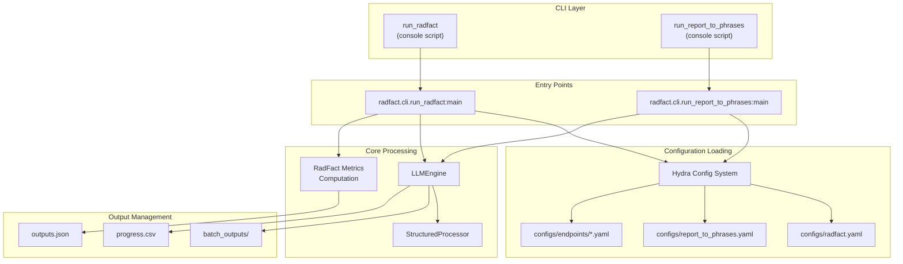
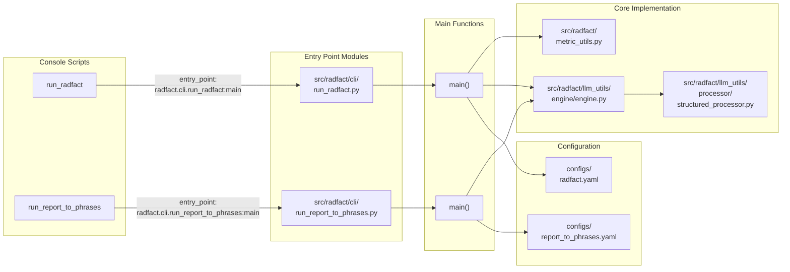

<!-- source: DeepWiki mcp.deepwiki.com · repo microsoft/RadFact · page 8.1 CLI Commands · fetched 2026-10-26 -->

# CLI Commands

<details>
<summary>Relevant source files</summary>

The following files were used as context for generating this wiki page:

- [.vscode/launch.json](.vscode/launch.json)
- [README.md](README.md)
- [pyproject.toml](pyproject.toml)

</details>


## Purpose and Scope

This document provides a complete technical reference for the two command-line interface (CLI) tools provided by RadFact:

- `run_radfact` - Computes RadFact metrics for model-generated reports
- `run_report_to_phrases` - Converts narrative reports into structured phrase lists

For information about configuring LLM endpoints used by these commands, see [Endpoint Configuration](#6.2). For understanding the evaluation metrics computed by `run_radfact`, see [RadFact Metrics](#3.1). For practical usage guidance and examples, see [Running RadFact Evaluation](#4.1) and [Report to Phrases Conversion](#4.2).

**Sources:** [README.md:1-274](), [pyproject.toml:86-88]()

---

## Command Installation

Both CLI commands are installed automatically when the `radfact` package is installed. They are registered as console script entry points and become available in the system PATH.

```bash
pip install .
```

After installation, both commands can be invoked directly from the terminal:

```bash
run_radfact --help
run_report_to_phrases --help
```

**Entry Point Configuration:**

| Command | Module Path | Function |
|---------|-------------|----------|
| `run_radfact` | `radfact.cli.run_radfact` | `main` |
| `run_report_to_phrases` | `radfact.cli.run_report_to_phrases` | `main` |

**Sources:** [pyproject.toml:86-88]()

---

## Command Architecture



**Diagram: CLI Command Architecture**

This diagram illustrates how the CLI commands connect to their underlying implementation. Both commands are registered as console script entry points in `pyproject.toml`, which invoke their respective `main` functions in the `radfact.cli` module. The commands use Hydra for configuration management and delegate processing to the `LLMEngine` and related components.

**Sources:** [pyproject.toml:86-88](), [README.md:48-93](), [README.md:100-130]()

---

## run_radfact Command

### Description

The `run_radfact` command computes the RadFact evaluation metrics for a set of model-generated radiology reports compared against ground-truth reports. It supports both narrative (ungrounded) text and grounded reports with bounding boxes.

**Command Location:** [src/radfact/cli/run_radfact.py]()

### Command Signature

```bash
run_radfact --input_path INPUT_PATH [OPTIONS]
```

### Arguments

| Argument | Type | Required | Default | Description |
|----------|------|----------|---------|-------------|
| `--input_path` | `str` | ✓ | - | Path to CSV (narrative) or JSON (grounded) file containing samples |
| `--is_narrative_text` | `flag` | ✗ | `False` | Set this flag if input contains narrative text requiring phrase conversion |
| `--radfact_config_name` | `str` | ✗ | `radfact` | Name of config file in `configs/` directory (without `.yaml` extension) |
| `--phrases_config_name` | `str` | ✗ | `report_to_phrases` | Name of config file for report-to-phrases conversion |
| `--output_dir` | `str` | ✗ | `outputs/radfact` | Directory where results will be saved |
| `--bootstrap_samples` | `int` | ✗ | `500` | Number of bootstrap samples for confidence intervals (0 to disable) |

**Sources:** [README.md:136-160]()

### Input Formats

**For Narrative (Ungrounded) Reports (CSV):**

The CSV file must contain the following columns:

| Column | Description |
|--------|-------------|
| `example_id` | Unique identifier for each sample |
| `prediction` | Model-generated report text |
| `target` | Ground-truth report text |

**For Grounded Reports (JSON):**

The JSON file must follow the structure shown in `examples/grounded_reporting_examples.json`, where each report includes phrase-level annotations and bounding box coordinates.

**Sources:** [README.md:143-147](), [README.md:174]()

### Usage Examples

**Evaluate narrative reports:**

```bash
run_radfact --input_path examples/findings_generation_examples.csv --is_narrative_text
```

**Evaluate grounded reports:**

```bash
run_radfact --input_path examples/grounded_reporting_examples.json
```

**Custom configuration with disabled bootstrapping:**

```bash
run_radfact \
  --input_path data/my_reports.csv \
  --is_narrative_text \
  --radfact_config_name my_custom_radfact \
  --bootstrap_samples 0 \
  --output_dir results/experiment_1
```

**Sources:** [README.md:162-172](), [.vscode/launch.json:41-51]()

### Output Structure

The command creates a timestamped output directory with the following structure:

```
outputs/radfact/run_20240814_075225/
├── batch_outputs/
│   ├── outputs_0_100.json
│   ├── outputs_100_200.json
│   └── ...
├── progress/
│   ├── subset_0_240.csv
│   ├── subset_240_480.csv
│   └── ...
├── skipped/
│   ├── subset_0_240.csv
│   └── ...
├── outputs.json          # Final aggregated metrics
├── progress.csv          # Overall progress tracking
└── skipped.csv          # Failed queries
```

**Key Output Files:**

| File | Description |
|------|-------------|
| `outputs.json` | Final RadFact metrics with confidence intervals |
| `progress.csv` | List of successfully processed example IDs |
| `skipped.csv` | List of failed queries with error information |
| `batch_outputs/*.json` | Incremental results per batch for fault tolerance |

**Sources:** [README.md:100-130]()

### Error Handling

The command implements robust error handling for LLM API failures:

⚠️ **Important:** When the LLM performing entailment verification fails, the example is **set as NOT ENTAILED by default**. This ensures the metric computation continues but may affect result reliability if many queries fail.

**Failure Tracking:**
- Failed queries are logged with: `WARNING: No response for example {query_id}. Setting as NOT ENTAILED`
- The number of failures is reported in the final metrics under the key `num_llm_failures`
- Failed examples are saved to the `skipped/` directory for inspection

**Sources:** [README.md:178]()

---

## run_report_to_phrases Command

### Description

The `run_report_to_phrases` command converts narrative radiology reports into structured lists of phrases, where each phrase describes at most one finding. This is a preprocessing step for evaluating narrative reports with RadFact.

**Command Location:** [src/radfact/cli/run_report_to_phrases.py]()

### Command Signature

The command uses Hydra configuration syntax, allowing config overrides via command-line arguments:

```bash
run_report_to_phrases [CONFIG_OVERRIDES]
```

### Configuration Parameters

All parameters are specified through Hydra config overrides:

| Parameter | Type | Description | Example |
|-----------|------|-------------|---------|
| `dataset.csv_path` | `str` | Path to CSV file containing narrative reports | `dataset.csv_path=data/reports.csv` |
| `processing.start_index` | `int` | Starting index for processing subset | `processing.start_index=0` |
| `processing.end_index` | `int` | Ending index for processing subset | `processing.end_index=100` |
| `processing.batch_size` | `int` | Number of reports per batch | `processing.batch_size=10` |

Additional processing parameters can be overridden from the `report_to_phrases.yaml` configuration file, including endpoint selection and LLM parameters.

**Sources:** [README.md:182-188](), [.vscode/launch.json:27-39]()

### Usage Examples

**Basic usage:**

```bash
run_report_to_phrases dataset.csv_path=data/mimic_reports.csv
```

**Process a subset with custom batching:**

```bash
run_report_to_phrases \
  dataset.csv_path=data/reports.csv \
  processing.start_index=0 \
  processing.end_index=500 \
  processing.batch_size=25
```

**Debug mode with small batch:**

```bash
run_report_to_phrases \
  processing.start_index=0 \
  processing.end_index=10 \
  processing.batch_size=2 \
  dataset.csv_path=test_data/sample_reports.csv
```

**Sources:** [README.md:185](), [.vscode/launch.json:33-38]()

### Configuration File

The command's behavior is controlled by `configs/report_to_phrases.yaml`, which specifies:

- **Endpoint Selection:** Which LLM endpoint to use for phrase conversion
- **Processing Parameters:** Batch size, parallelism settings, caching configuration
- **Output Settings:** Where to save converted phrases
- **Prompt Configuration:** System message and few-shot examples

The config file can be customized and the command can be instructed to use a different config by modifying the `phrases_config_name` parameter in `run_radfact` or by creating a custom config file.

**Sources:** [README.md:89-92](), [README.md:188]()

---

## Command Execution Flow

```mermaid
sequenceDiagram
    participant User
    participant CLI["CLI Command<br/>(run_radfact or<br/>run_report_to_phrases)"]
    participant Main["main() function"]
    participant Hydra["Hydra Config<br/>Loader"]
    participant Engine["LLMEngine"]
    participant Worker["Worker Processes"]
    participant FS["File System<br/>(batch_outputs)"]
    
    User->>CLI: Execute with arguments
    CLI->>Main: Invoke entry point
    Main->>Hydra: Initialize with config
    Hydra->>Hydra: Load configs/*.yaml
    Hydra->>Hydra: Load configs/endpoints/*.yaml
    Hydra-->>Main: Return config objects
    
    Main->>Main: Parse input data
    Main->>Engine: Initialize with config & data
    
    Engine->>Engine: Shard dataset by speed_factor
    
    par Worker 1
        Engine->>Worker: Process subset 1
        Worker->>Worker: LLM queries with cache
        Worker->>FS: Write batch_outputs/*.json
        Worker->>FS: Update progress CSV
    and Worker 2
        Engine->>Worker: Process subset 2
        Worker->>Worker: LLM queries with cache
        Worker->>FS: Write batch_outputs/*.json
        Worker->>FS: Update progress CSV
    and Worker N
        Engine->>Worker: Process subset N
        Worker->>Worker: LLM queries with cache
        Worker->>FS: Write batch_outputs/*.json
        Worker->>FS: Update progress CSV
    end
    
    Engine->>Engine: Aggregate worker results
    Engine-->>Main: Return processed data
    
    alt run_radfact
        Main->>Main: Compute RadFact metrics
        Main->>Main: Bootstrap confidence intervals
        Main->>FS: Write outputs.json
    else run_report_to_phrases
        Main->>FS: Write phrase outputs
    end
    
    Main-->>CLI: Exit with status
    CLI-->>User: Display results & exit
```

**Diagram: Command Execution Sequence**

This sequence diagram shows the complete execution flow from command invocation to result output. Both CLI commands follow a similar pattern: Hydra loads configuration, the `LLMEngine` shards data across workers, parallel processing occurs with incremental saves, and finally results are aggregated and written to disk.

**Sources:** [README.md:100-130](), [pyproject.toml:86-88](), [.vscode/launch.json:6-53]()

---

## Debugging Commands

The `.vscode/launch.json` file provides pre-configured debugging configurations for both commands:

### Debug run_radfact

```json
{
    "name": "Debug run_radfact",
    "type": "python",
    "request": "launch",
    "program": "src/radfact/cli/run_radfact.py",
    "args": [
        "--input_path=examples/findings_generation_examples.csv",
        "--is_narrative_text"
    ]
}
```

### Debug run_report_to_phrases

```json
{
    "name": "Debug LLM pipeline for report_to_phrases",
    "type": "python",
    "request": "launch",
    "program": "src/radfact/cli/run_report_to_phrases.py",
    "args": [
        "processing.start_index=0",
        "processing.end_index=10",
        "processing.batch_size=2",
        "dataset.csv_path=<your_path_to_cxr_reports>"
    ]
}
```

These configurations can be used in Visual Studio Code to step through command execution with breakpoints.

**Sources:** [.vscode/launch.json:27-51]()

---

## Command Implementation Mapping



**Diagram: Command to Code Entity Mapping**

This diagram maps each CLI command to its concrete implementation in the codebase. The console scripts defined in `pyproject.toml` map to entry point functions in the `src/radfact/cli/` directory, which use Hydra to load task-specific configuration files and delegate processing to core modules in `llm_utils/` and metric computation in `metric_utils.py`.

**Sources:** [pyproject.toml:86-88](), [README.md:48-93](), [README.md:131-189]()

---

## Common Options and Best Practices

### Resumability

Both commands support automatic resumability through the `progress.csv` file. If a command is interrupted, it can be re-run with the same arguments and will skip already-processed examples.

### Batch Size Selection

- **Small batch sizes (10-50):** More frequent disk writes, better fault tolerance, higher overhead
- **Large batch sizes (100-500):** Less frequent disk writes, lower overhead, more work lost on failure
- **Recommended:** Start with 100 and adjust based on endpoint reliability

### Parallel Processing Control

Control parallelism through endpoint configuration files:

```yaml
ENDPOINT_EXAMPLE:
  num_parallel_processes: 10  # Number of concurrent requests per endpoint
  speed_factor: 1.0           # Relative throughput for data sharding
```

### Output Directory Management

The default output directory is `outputs/radfact/run_<timestamp>/`. To organize multiple experiments:

```bash
run_radfact \
  --input_path data/experiment_1.csv \
  --output_dir results/experiment_1 \
  --is_narrative_text

run_radfact \
  --input_path data/experiment_2.csv \
  --output_dir results/experiment_2 \
  --is_narrative_text
```

**Sources:** [README.md:100-130](), [README.md:79-87]()

---

