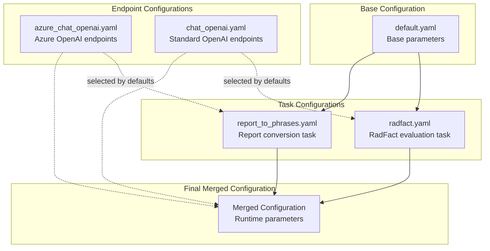
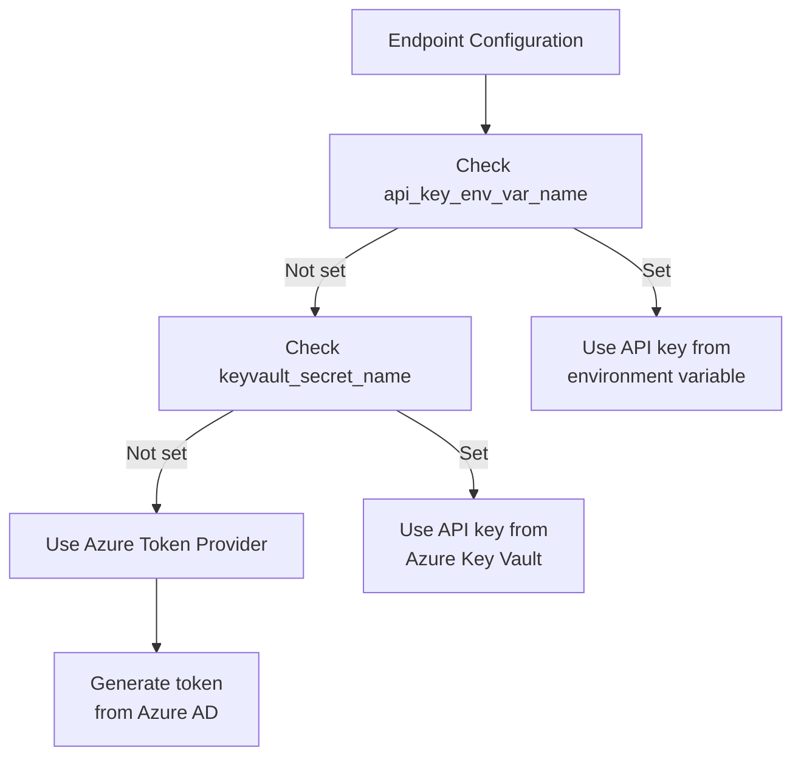
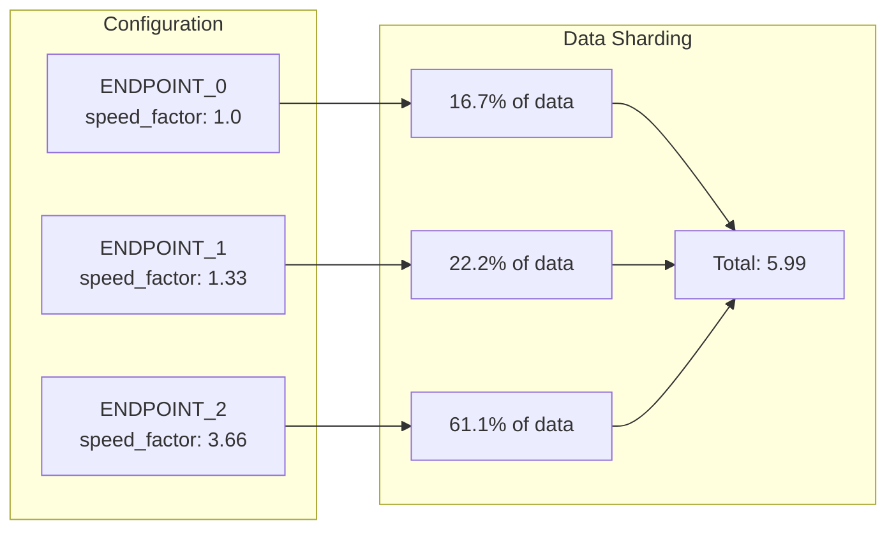
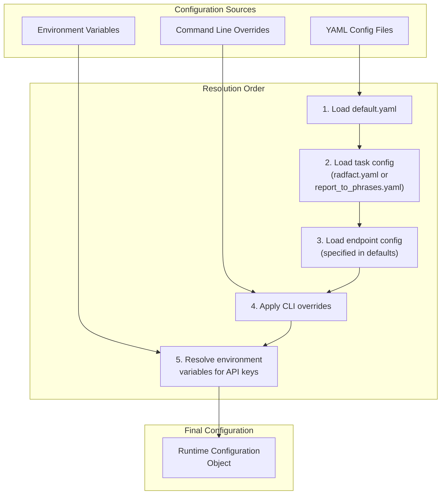

<!-- source: DeepWiki mcp.deepwiki.com · repo microsoft/RadFact · page 8.2 Configuration Reference · fetched 2026-10-26 -->

# Configuration Reference

<details>
<summary>Relevant source files</summary>

The following files were used as context for generating this wiki page:

- [configs/default.yaml](configs/default.yaml)
- [configs/endpoints/azure_chat_openai.yaml](configs/endpoints/azure_chat_openai.yaml)
- [configs/endpoints/chat_openai.yaml](configs/endpoints/chat_openai.yaml)
- [configs/radfact.yaml](configs/radfact.yaml)
- [configs/report_to_phrases.yaml](configs/report_to_phrases.yaml)

</details>


## Purpose

This page provides a complete technical reference for all configuration parameters in RadFact. It documents every parameter that can be set through YAML configuration files, including their data types, default values, valid ranges, and purposes.

For a conceptual understanding of the configuration system and how to use it, see [Configuration System](#6.1). For step-by-step setup instructions, see [Configuration Setup](#2.3). For specific guides on configuring endpoints and authentication, see [Endpoint Configuration](#6.2) and [Authentication](#6.3).

**Sources**: [configs/default.yaml](), [configs/endpoints/azure_chat_openai.yaml](), [configs/endpoints/chat_openai.yaml](), [configs/radfact.yaml](), [configs/report_to_phrases.yaml]()

---

## Configuration File Hierarchy

RadFact uses Hydra for hierarchical configuration management. The following diagram shows how configuration files are structured and merged:



**Sources**: [configs/default.yaml:1-3](), [configs/radfact.yaml:3-6](), [configs/report_to_phrases.yaml:3-6]()

---

## Core Configuration Parameters

### LLM API Parameters

These parameters control the behavior of language model API calls. They are defined in the `llm_api` section of the configuration.

| Parameter | Type | Default | Valid Range/Values | Description |
|-----------|------|---------|-------------------|-------------|
| `api_version` | string | `"2023-07-01-preview"` | Any valid Azure API version | Azure OpenAI API version to use |
| `max_retries` | int | `10` | 0-100 | Maximum number of retry attempts for failed API calls |
| `temperature` | float | `0.0` | 0.0-2.0 | Sampling temperature; 0.0 is deterministic |
| `max_tokens` | int | `1024` | 1-32768 | Maximum tokens in the generated response |
| `n_completions` | int | `1` | 1-10 | Number of completions to generate per request |
| `top_p` | float | `1.0` | 0.0-1.0 | Nucleus sampling parameter |
| `frequency_penalty` | float | `0.0` | -2.0-2.0 | Penalty for token frequency in generated text |
| `presence_penalty` | float | `0.0` | -2.0-2.0 | Penalty for token presence in generated text |
| `stop` | string or list | `null` | Any string(s) | Stop sequences to terminate generation |
| `timeout` | int | `null` | Any positive integer | Request timeout in seconds; null means no timeout |

**Sources**: [configs/default.yaml:5-15]()

### Processing Parameters

These parameters control data processing and output management. They are defined in the `processing` section.

| Parameter | Type | Default | Valid Range/Values | Description |
|-----------|------|---------|-------------------|-------------|
| `index_col` | string | `"study_id"` | Any valid column name | Column name to use as index for identifying rows |
| `batch_size` | int | `100` | 1-10000 | Number of rows to process before writing incremental outputs |
| `start_index` | int | `0` | 0 or higher | Starting row index for processing; enables partial dataset processing |
| `end_index` | int | `null` | Any positive integer | Ending row index; null processes to end of dataset |
| `output_filename` | string | `"outputs.json"` | Any valid filename | Name of the final aggregated output file |

**Sources**: [configs/default.yaml:17-22]()

### Cache Configuration

The `langchain_cache_type` parameter specifies the caching backend for LLM responses.

| Parameter | Type | Default | Valid Values | Description |
|-----------|------|---------|--------------|-------------|
| `langchain_cache_type` | string | `null` | `"redis"`, `"sqlite"`, `null` | Cache type for storing LLM responses. `sqlite` creates `~/.langchain.db` for local development. `redis` enables distributed caching for production. `null` disables caching. |

**Sources**: [configs/default.yaml:24-27]()

---

## Endpoint Configuration Parameters

Endpoints are configured in separate YAML files under the `configs/endpoints/` directory. Each endpoint definition begins with a unique identifier (e.g., `ENDPOINT_0`, `ENDPOINT_1`).

### Common Endpoint Parameters

These parameters are common across all endpoint types:

| Parameter | Type | Required | Default | Description |
|-----------|------|----------|---------|-------------|
| `type` | string | Yes | - | Endpoint type: `"AZURE_CHAT_OPENAI"` or `"CHAT_OPENAI"` |
| `url` | string | Yes | - | Base URL for the LLM endpoint |
| `deployment_name` | string | Yes | - | Model deployment name (e.g., `"gpt-4"`, `"llama3-70b"`) |
| `api_key_env_var_name` | string | No | - | Environment variable name containing the API key |
| `keyvault_secret_name` | string | No | - | Azure Key Vault secret name for API key |
| `speed_factor` | float | No | `1.0` | Relative throughput weight for data sharding across endpoints |
| `num_parallel_processes` | int | No | `1` | Number of parallel worker processes for this endpoint |

**Sources**: [configs/endpoints/azure_chat_openai.yaml:1-23](), [configs/endpoints/chat_openai.yaml:1-23]()

### Authentication Configuration

The following diagram shows the authentication resolution order:



**Authentication priority** (highest to lowest):
1. `api_key_env_var_name`: Environment variable containing API key
2. `keyvault_secret_name`: Azure Key Vault secret
3. Azure Token Provider: Default credential chain (managed identity, Azure CLI, etc.)

**Sources**: [configs/endpoints/azure_chat_openai.yaml:6-14](), [configs/endpoints/chat_openai.yaml:6-14]()

### Azure Chat OpenAI Endpoint Configuration

Example configuration for Azure OpenAI endpoints:

```yaml
ENDPOINT_0:
  type: "AZURE_CHAT_OPENAI"
  url: "<your_url_0>"
  deployment_name: "gpt-4"
  api_key_env_var_name: "API_KEY_AZURE_0"
  speed_factor: 1.0
  num_parallel_processes: 1
```

**Type-specific notes**:
- `url` should be the full Azure OpenAI resource URL (e.g., `https://your-resource.openai.azure.com/`)
- Requires `api_version` from `llm_api` configuration
- Supports Azure-specific authentication mechanisms

**Sources**: [configs/endpoints/azure_chat_openai.yaml:1-24]()

### Chat OpenAI Endpoint Configuration

Example configuration for standard OpenAI-compatible endpoints:

```yaml
ENDPOINT_0:
  type: "CHAT_OPENAI"
  url: "<your_url>"
  deployment_name: "llama3-70b"
  api_key_env_var_name: "API_KEY_CHAT_0"
  speed_factor: 1.0
  num_parallel_processes: 10
```

**Type-specific notes**:
- `url` can be any OpenAI API-compatible endpoint
- Commonly used for custom model deployments (Llama, Mistral, etc.)
- Higher `num_parallel_processes` often appropriate for custom endpoints with high throughput

**Sources**: [configs/endpoints/chat_openai.yaml:1-24]()

### Multi-Endpoint Configuration

Multiple endpoints can be configured for parallel processing with load balancing:



**Load balancing algorithm**: Data is sharded proportionally to `speed_factor` values. Each endpoint receives `(endpoint.speed_factor / sum(all_speed_factors))` of the total dataset.

**Sources**: [configs/endpoints/azure_chat_openai.yaml:25-39](), [configs/endpoints/chat_openai.yaml:25-39]()

---

## Task-Specific Configurations

### RadFact Configuration

File: `configs/radfact.yaml`

```yaml
defaults:
  - default
  - override endpoints: chat_openai
  - _self_
```

**Purpose**: Configuration for the RadFact evaluation task (entailment verification and metrics computation).

**Key characteristics**:
- Inherits all parameters from `default.yaml`
- Defaults to `chat_openai` endpoints
- Can be overridden via command-line: `run_radfact endpoints=azure_chat_openai`

**Sources**: [configs/radfact.yaml:1-7]()

### Report to Phrases Configuration

File: `configs/report_to_phrases.yaml`

```yaml
defaults:
  - default
  - override endpoints: azure_chat_openai
  - _self_

dataset:
  name: reports_to_phrases
  csv_path: "<your_path_to_cxr_reports>"
```

**Purpose**: Configuration for the report-to-phrases conversion task.

**Additional parameters**:

| Parameter | Type | Required | Default | Description |
|-----------|------|----------|---------|-------------|
| `dataset.name` | string | Yes | `"reports_to_phrases"` | Dataset identifier for tracking |
| `dataset.csv_path` | string | Yes | - | Path to input CSV file containing reports |

**Key characteristics**:
- Inherits all parameters from `default.yaml`
- Defaults to `azure_chat_openai` endpoints (Azure typically used for this task)
- Adds dataset-specific configuration

**Sources**: [configs/report_to_phrases.yaml:1-11]()

---

## Configuration Override Mechanism

The following diagram shows how Hydra resolves configuration values at runtime:



**Override priority** (highest to lowest):
1. Command-line arguments (e.g., `run_radfact llm_api.temperature=0.5`)
2. Task-specific configuration file
3. Endpoint configuration file
4. Base default configuration

**Common override examples**:

```bash
# Change endpoint configuration
run_radfact endpoints=azure_chat_openai

# Override LLM parameters
run_radfact llm_api.temperature=0.7 llm_api.max_tokens=2048

# Override processing parameters
run_radfact processing.batch_size=50 processing.start_index=100 processing.end_index=200

# Change cache type
run_radfact langchain_cache_type=redis

# Multiple overrides
run_radfact endpoints=azure_chat_openai llm_api.temperature=0.0 processing.batch_size=200
```

**Sources**: [configs/default.yaml:1-3](), [configs/radfact.yaml:3-6](), [configs/report_to_phrases.yaml:3-6]()

---

## Configuration File Locations

The configuration system expects files in the following structure:

```
configs/
├── default.yaml                  # Base configuration
├── radfact.yaml                  # RadFact task config
├── report_to_phrases.yaml        # Report-to-phrases task config
└── endpoints/                    # Endpoint configurations
    ├── azure_chat_openai.yaml    # Azure OpenAI endpoints
    └── chat_openai.yaml          # Standard OpenAI endpoints
```

**File resolution**:
- Hydra searches for configs relative to the `configs/` directory
- Task configs (e.g., `radfact.yaml`) are top-level config files
- Endpoint configs are in the `endpoints/` subdirectory
- The `defaults` list in each config specifies which files to merge

**Sources**: [configs/default.yaml:1-3](), [configs/radfact.yaml:1-7](), [configs/report_to_phrases.yaml:1-11]()

---

## Complete Parameter Reference Table

This table provides a consolidated view of all configurable parameters:

| Section | Parameter | Type | Default | Location |
|---------|-----------|------|---------|----------|
| **llm_api** | `api_version` | string | `"2023-07-01-preview"` | default.yaml:6 |
| **llm_api** | `max_retries` | int | `10` | default.yaml:7 |
| **llm_api** | `temperature` | float | `0.0` | default.yaml:8 |
| **llm_api** | `max_tokens` | int | `1024` | default.yaml:9 |
| **llm_api** | `n_completions` | int | `1` | default.yaml:10 |
| **llm_api** | `top_p` | float | `1.0` | default.yaml:11 |
| **llm_api** | `frequency_penalty` | float | `0.0` | default.yaml:12 |
| **llm_api** | `presence_penalty` | float | `0.0` | default.yaml:13 |
| **llm_api** | `stop` | string/list | `null` | default.yaml:14 |
| **llm_api** | `timeout` | int | `null` | default.yaml:15 |
| **processing** | `index_col` | string | `"study_id"` | default.yaml:18 |
| **processing** | `batch_size` | int | `100` | default.yaml:19 |
| **processing** | `start_index` | int | `0` | default.yaml:20 |
| **processing** | `end_index` | int | `null` | default.yaml:21 |
| **processing** | `output_filename` | string | `"outputs.json"` | default.yaml:22 |
| **cache** | `langchain_cache_type` | string | `null` | default.yaml:27 |
| **endpoint** | `type` | string | Required | endpoints/*.yaml |
| **endpoint** | `url` | string | Required | endpoints/*.yaml |
| **endpoint** | `deployment_name` | string | Required | endpoints/*.yaml |
| **endpoint** | `api_key_env_var_name` | string | Optional | endpoints/*.yaml |
| **endpoint** | `keyvault_secret_name` | string | Optional | endpoints/*.yaml |
| **endpoint** | `speed_factor` | float | `1.0` | endpoints/*.yaml |
| **endpoint** | `num_parallel_processes` | int | `1` | endpoints/*.yaml |
| **dataset** | `name` | string | `"reports_to_phrases"` | report_to_phrases.yaml:9 |
| **dataset** | `csv_path` | string | Required | report_to_phrases.yaml:10 |

**Sources**: [configs/default.yaml:1-28](), [configs/endpoints/azure_chat_openai.yaml:1-40](), [configs/endpoints/chat_openai.yaml:1-40](), [configs/report_to_phrases.yaml:8-11]()

---

