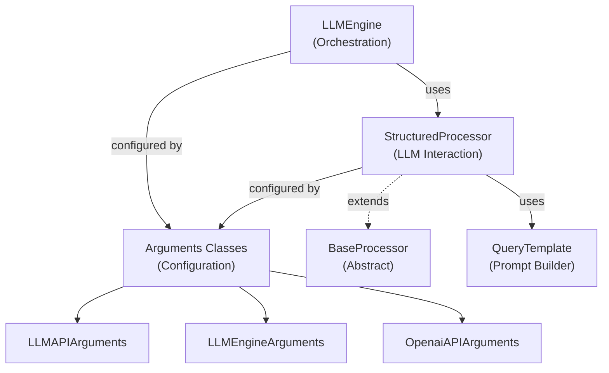
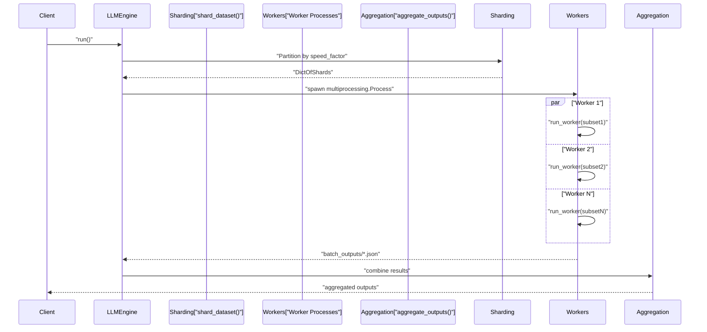
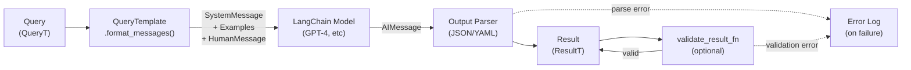
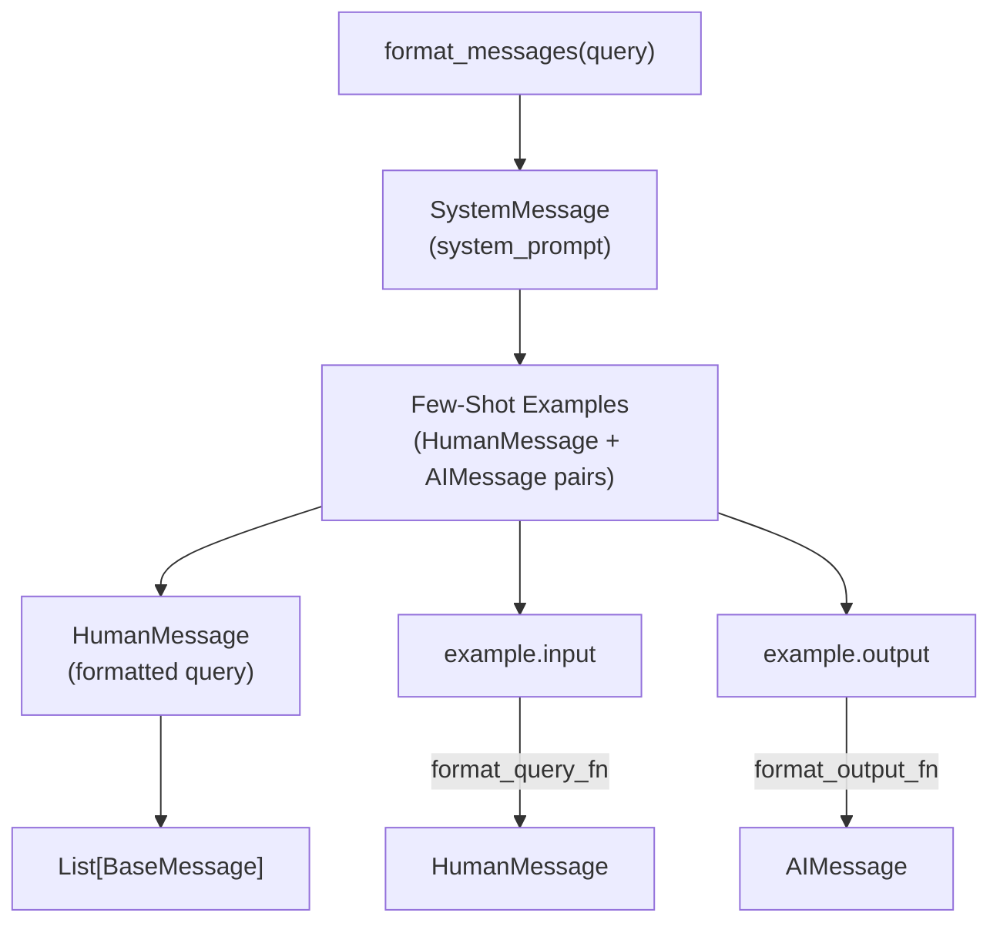
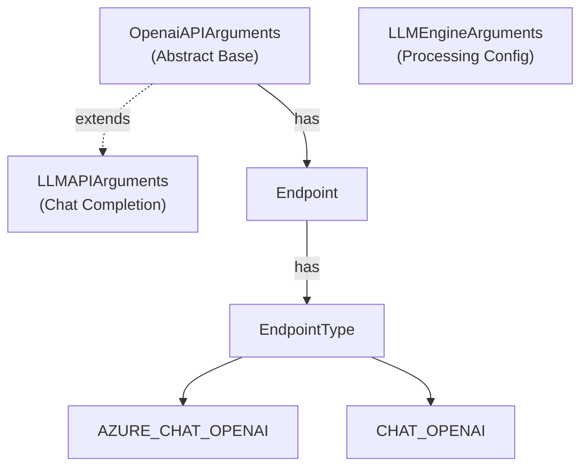

<!-- source: DeepWiki mcp.deepwiki.com · repo microsoft/RadFact · page 8.3 API Documentation · fetched 2026-10-26 -->

# API Documentation

<details>
<summary>Relevant source files</summary>

The following files were used as context for generating this wiki page:

- [src/radfact/llm_utils/engine/arguments.py](src/radfact/llm_utils/engine/arguments.py)
- [src/radfact/llm_utils/engine/engine.py](src/radfact/llm_utils/engine/engine.py)
- [src/radfact/llm_utils/processor/structured_processor.py](src/radfact/llm_utils/processor/structured_processor.py)

</details>


This page provides Python API reference documentation for RadFact's core classes and interfaces. It covers the programmatic APIs for the LLM processing engine, structured processors, and configuration objects.

**Scope**: This document focuses on the Python classes and methods available for programmatic use. For command-line usage, see [CLI Commands](#8.1). For configuration file parameters, see [Configuration Reference](#8.2). For architectural context, see [System Overview](#5.1).

---

## Core API Overview

RadFact's API is organized around three main abstractions:



**Sources**: [src/radfact/llm_utils/engine/engine.py:1-362](), [src/radfact/llm_utils/processor/structured_processor.py:1-234](), [src/radfact/llm_utils/engine/arguments.py:1-136]()

---

## LLMEngine

The `LLMEngine` class orchestrates parallel processing of datasets across multiple LLM endpoints.

### Class Definition

[src/radfact/llm_utils/engine/engine.py:50-362]()

```python
class LLMEngine:
    """Engine for processing data with an LLM api. The dataset is sharded into subsets 
    proportional to the speed factor of each endpoint and processed in parallel."""
```

### Constructor

| Parameter | Type | Description |
|-----------|------|-------------|
| `cfg` | `DictConfig` | Hydra configuration object containing endpoint and processing settings |
| `processor` | `BaseProcessor[Any, Any]` | Processor instance that handles LLM interactions |
| `dataset_df` | `pd.DataFrame` | Input dataset to process |
| `progress_output_folder` | `Path` | Folder for incremental batch outputs and progress tracking |
| `final_output_folder` | `Path \| None` | Optional folder for final aggregated output |
| `row_to_query_fn` | `Callable` | Function to convert DataFrame row to query format (default: identity) |
| `verbose` | `bool` | Enable verbose logging (default: False) |

**Source**: [src/radfact/llm_utils/engine/engine.py:65-98]()

### Key Methods

| Method | Return Type | Description |
|--------|-------------|-------------|
| `run()` | `Any` | Execute parallel processing pipeline and return aggregated outputs |
| `shard_dataset()` | `DictOfShards` | Partition dataset across endpoints by speed_factor |
| `run_worker(dataset_subset, worker_id)` | `None` | Process a single data subset in a worker process |
| `aggregate_outputs()` | `int` | Combine batch outputs into final JSON file |
| `set_llm_cache(langchain_cache_type)` | `None` | Configure caching backend (redis, sqlite, or none) |

**Sources**: [src/radfact/llm_utils/engine/engine.py:338-361](), [src/radfact/llm_utils/engine/engine.py:193-216](), [src/radfact/llm_utils/engine/engine.py:262-296]()

### Key Properties

| Property | Type | Description |
|----------|------|-------------|
| `run_output_folder` | `Path` | Timestamped subfolder in progress_output_folder for this run |
| `batch_output_folder` | `Path` | Subfolder containing incremental batch JSON files |
| `progress_file` | `Path` | CSV file tracking completed query IDs |
| `skipped_file` | `Path` | CSV file tracking skipped query IDs |
| `json_args` | `dict[str, Any]` | Arguments for json.dump (ensure_ascii=False, indent=2) |

**Sources**: [src/radfact/llm_utils/engine/engine.py:114-127](), [src/radfact/llm_utils/engine/engine.py:109-111]()

### Execution Flow



**Sources**: [src/radfact/llm_utils/engine/engine.py:338-361]()

### Sharding Algorithm

The dataset sharding logic uses weighted proportional allocation:

[src/radfact/llm_utils/engine/engine.py:162-178]()

1. Calculate total speed across all endpoints: `total_speed = sum(speed_factors)`
2. Allocate proportionally: `assigned[i] = floor((speed[i] / total_speed) * dataset_length)`
3. Distribute remainder items to endpoints with largest fractional parts
4. Validate disjoint shards and total length matches dataset

**Sources**: [src/radfact/llm_utils/engine/engine.py:162-178](), [src/radfact/llm_utils/engine/engine.py:180-192]()

---

## StructuredProcessor

The `StructuredProcessor` class handles LLM interactions with prompt templating, output parsing, and error handling.

### Class Definition

[src/radfact/llm_utils/processor/structured_processor.py:114-234]()

```python
class StructuredProcessor(BaseProcessor[QueryT, ResultT]):
    """Processor for structured queries and results."""
```

This class is generic over `QueryT` (query type) and `ResultT` (result type), where `ResultT` must be a Pydantic `BaseModel`.

### Constructor

| Parameter | Type | Description |
|-----------|------|-------------|
| `query_type` | `type[QueryT]` | Type of input query (e.g., str, BaseModel) |
| `result_type` | `type[ResultT]` | Pydantic BaseModel type for structured output |
| `system_prompt` | `str \| Path` | System message describing desired behavior |
| `format_query_fn` | `Callable[[QueryT], str]` | Function to format query as human message |
| `format_output_fn` | `Callable[[ResultT], str] \| None` | Function to format output as AI message (optional) |
| `model` | `BaseLanguageModel \| None` | LangChain model instance (can be set later) |
| `log_dir` | `Path \| None` | Directory for error logs (optional) |
| `few_shot_examples` | `Iterable[Example] \| None` | Few-shot examples for prompt (optional) |
| `validate_result_fn` | `Callable \| None` | Custom validation function (optional) |
| `use_schema_in_system_prompt` | `bool` | Include JSON/YAML schema in system prompt (default: True) |
| `output_format` | `FormatStyleOptions` | Output format: JSON or YAML (default: JSON) |

**Source**: [src/radfact/llm_utils/processor/structured_processor.py:120-194]()

### Key Methods

| Method | Return Type | Description |
|--------|-------------|-------------|
| `run(query, query_id)` | `ResultT \| None` | Execute LLM query and parse result (returns None on error) |
| `set_model(model)` | `None` | Set the LangChain model to use |
| `get_processor_stats()` | `ProcessorStats` | Return success/failure counts |
| `aggregate_processor_stats(stats_per_processor)` | `ProcessorStats` | Aggregate stats from multiple processors |

**Sources**: [src/radfact/llm_utils/processor/structured_processor.py:208-220](), [src/radfact/llm_utils/processor/structured_processor.py:196-197](), [src/radfact/llm_utils/processor/structured_processor.py:222-233]()

### Processing Pipeline



**Sources**: [src/radfact/llm_utils/processor/structured_processor.py:208-220]()

### Output Parsing

The processor supports two output formats controlled by `FormatStyleOptions`:

[src/radfact/llm_utils/processor/structured_processor.py:28-33]()

| Format | Parser Class | Use Case |
|--------|--------------|----------|
| `JSON` | `PydanticOutputParser` | Standard structured output (default) |
| `YAML` | `YamlOutputParser` | Human-readable output with comments |

**Parser initialization**: [src/radfact/llm_utils/processor/structured_processor.py:169-178]()

The parser automatically generates format instructions that are appended to the system prompt when `use_schema_in_system_prompt=True` [src/radfact/llm_utils/processor/structured_processor.py:180-181]().

**Sources**: [src/radfact/llm_utils/processor/structured_processor.py:169-181]()

---

## QueryTemplate

The `QueryTemplate` class builds chat prompts with system messages, few-shot examples, and formatted queries.

### Class Definition

[src/radfact/llm_utils/processor/structured_processor.py:58-112]()

```python
class QueryTemplate(BaseChatPromptTemplate, Generic[QueryT, ResultT]):
    """Query template for a structured processor."""
```

### Attributes

| Attribute | Type | Description |
|-----------|------|-------------|
| `system_prompt` | `str` | System message describing task and output format |
| `format_query_fn` | `Callable[[QueryT], str]` | Formats query into human message content |
| `format_output_fn` | `Callable[[ResultT], str]` | Formats result into AI message content |
| `examples` | `Iterable[Example] \| None` | Few-shot examples (input/output pairs) |

**Source**: [src/radfact/llm_utils/processor/structured_processor.py:58-81]()

### Message Formatting

The `format_messages()` method constructs the chat prompt:



**Sources**: [src/radfact/llm_utils/processor/structured_processor.py:99-111](), [src/radfact/llm_utils/processor/structured_processor.py:83-97]()

---

## Arguments Classes

RadFact uses dataclasses to configure LLM API parameters and processing settings.

### Class Hierarchy



**Sources**: [src/radfact/llm_utils/engine/arguments.py:1-136]()

### OpenaiAPIArguments

Base class for OpenAI API configuration.

[src/radfact/llm_utils/engine/arguments.py:19-73]()

| Attribute | Type | Default | Description |
|-----------|------|---------|-------------|
| `endpoint` | `Endpoint \| None` | `None` | Endpoint configuration object |
| `api_version` | `str` | `"2023-06-01-preview"` | Azure OpenAI API version |
| `max_retries` | `int` | `10` | Maximum retry attempts |
| `timeout` | `float \| None` | `None` | Request timeout in seconds |

**Key methods**:
- `set_endpoint(endpoint)`: Assign endpoint configuration [src/radfact/llm_utils/engine/arguments.py:28-30]()
- `get_params()`: Generate API parameters dict based on endpoint type [src/radfact/llm_utils/engine/arguments.py:32-67]()
- `get_model()`: Abstract method to instantiate LangChain model [src/radfact/llm_utils/engine/arguments.py:69-72]()

**Sources**: [src/radfact/llm_utils/engine/arguments.py:19-73]()

### LLMAPIArguments

Chat completion API configuration extending `OpenaiAPIArguments`.

[src/radfact/llm_utils/engine/arguments.py:75-117]()

| Attribute | Type | Default | Description |
|-----------|------|---------|-------------|
| `temperature` | `float` | `0.0` | Sampling temperature (0.0 = deterministic) |
| `max_tokens` | `int` | `1024` | Maximum tokens in completion |
| `top_p` | `float` | `0.95` | Nucleus sampling parameter |
| `frequency_penalty` | `float` | `0.0` | Frequency penalty for repetition |
| `presence_penalty` | `float` | `0.0` | Presence penalty for new topics |
| `stop` | `list[str] \| None` | `None` | Stop sequences |
| `n_completions` | `int` | `1` | Number of completions to generate |

**Key methods**:
- `get_chat_completion_params()`: Return chat-specific parameters [src/radfact/llm_utils/engine/arguments.py:87-100]()
- `get_model()`: Instantiate `ChatOpenAI` or `AzureChatOpenAI` [src/radfact/llm_utils/engine/arguments.py:108-116]()

**Sources**: [src/radfact/llm_utils/engine/arguments.py:75-117]()

### LLMEngineArguments

Processing configuration for `LLMEngine`.

[src/radfact/llm_utils/engine/arguments.py:119-136]()

| Attribute | Type | Default | Description |
|-----------|------|---------|-------------|
| `index_col` | `str` | (required) | Column name for unique query IDs |
| `batch_size` | `int` | `100` | Number of queries per batch for incremental saves |
| `start_index` | `int` | `0` | Starting row index in dataset |
| `end_index` | `int \| None` | `None` | Ending row index (None = process all) |
| `dataset_name` | `str \| None` | `None` | Optional dataset identifier |
| `output_filename` | `str` | `"output.json"` | Name of final aggregated output file |

**Sources**: [src/radfact/llm_utils/engine/arguments.py:119-136]()

---

## Supporting Classes and Types

### BaseProcessor

Abstract base class for processors.

[src/radfact/llm_utils/processor/base_processor.py]() (referenced in [src/radfact/llm_utils/processor/structured_processor.py:19]())

```python
class BaseProcessor(Generic[QueryT, ResultT], ABC):
    @abstractmethod
    def run(self, query: QueryT, query_id: str) -> ResultT | None:
        """Process a single query."""
        
    @abstractmethod
    def set_model(self, model: BaseLanguageModel) -> None:
        """Set the language model."""
        
    @abstractmethod
    def get_processor_stats(self) -> ProcessorStats:
        """Return processing statistics."""
```

### DataSubset

Represents a shard of the dataset assigned to a single endpoint.

[src/radfact/llm_utils/engine/engine.py:23]()

| Attribute | Type | Description |
|-----------|------|-------------|
| `df` | `pd.DataFrame` | Subset of rows to process |
| `start_index` | `int` | Starting index in original dataset |
| `end_index` | `int` | Ending index in original dataset |
| `index_col` | `str` | Column name for unique IDs |
| `output_folder` | `Path` | Folder for progress/skipped CSV files |
| `processed_ids` | `set[str]` | Set of completed query IDs |
| `skipped_ids` | `set[str]` | Set of failed/skipped query IDs |

**Sources**: [src/radfact/llm_utils/engine/data_subset.py]() (referenced in [src/radfact/llm_utils/engine/engine.py:23]())

### Type Aliases

[src/radfact/llm_utils/engine/engine.py:34-35]()

```python
DictOfShards = dict[str, DataSubset]  # Maps endpoint URL to data subset
OutputsType = list[dict[str, Any]]     # List of output dictionaries
```

[src/radfact/llm_utils/processor/structured_processor.py:25]()

```python
ProcessorStats = dict[str, int]  # Maps stat name to count
```

---

## API Usage Example

Complete example showing typical API usage:

```python
from pathlib import Path
import pandas as pd
from omegaconf import DictConfig
from pydantic import BaseModel

from radfact.llm_utils.engine.engine import LLMEngine
from radfact.llm_utils.processor.structured_processor import StructuredProcessor

# Define query and result types
QueryType = str
class ResultType(BaseModel):
    answer: str
    confidence: float

# Create processor
processor = StructuredProcessor(
    query_type=QueryType,
    result_type=ResultType,
    system_prompt="You are a helpful assistant.",
    format_query_fn=lambda q: f"Question: {q}",
    output_format=FormatStyleOptions.JSON,
)

# Load dataset
dataset_df = pd.read_csv("input.csv")

# Create configuration (normally loaded via Hydra)
cfg = DictConfig({
    "endpoints": {...},
    "llm_api": {
        "temperature": 0.0,
        "max_tokens": 512,
    },
    "processing": {
        "index_col": "id",
        "batch_size": 100,
        "output_filename": "results.json",
    },
    "langchain_cache_type": "redis",
})

# Create and run engine
engine = LLMEngine(
    cfg=cfg,
    processor=processor,
    dataset_df=dataset_df,
    progress_output_folder=Path("./progress"),
    final_output_folder=Path("./outputs"),
    verbose=True,
)

results = engine.run()
```

**Key steps**:
1. Define Pydantic models for query and result types
2. Instantiate `StructuredProcessor` with prompt and format functions
3. Load dataset as pandas DataFrame
4. Create Hydra `DictConfig` with endpoint and processing settings
5. Instantiate `LLMEngine` with processor and paths
6. Call `engine.run()` to execute parallel processing

**Sources**: [src/radfact/llm_utils/engine/engine.py:65-98](), [src/radfact/llm_utils/processor/structured_processor.py:120-194]()

---

## Error Handling and Logging

### StructuredProcessor Error Handling

The processor catches all exceptions during LLM invocation and parsing:

[src/radfact/llm_utils/processor/structured_processor.py:208-220]()

```python
def run(self, query: QueryT, query_id: str) -> ResultT | None:
    try:
        response: ResultT = chain.invoke({_QUERY_KEY: query})
        if self.validate_result_fn:
            self.validate_result_fn(query, response)
        self.num_success += 1
        return response
    except Exception as ex:
        self._write_error(ex, query, query_id)
        self.num_failures += 1
        return None
```

Error details are written to `{log_dir}/error_{query_id}.txt` if `log_dir` is provided [src/radfact/llm_utils/processor/structured_processor.py:199-206]().

### LLMEngine Progress Tracking

The engine saves progress incrementally:

| File | Format | Content |
|------|--------|---------|
| `progress.csv` | CSV | Successfully processed query IDs |
| `skipped.csv` | CSV | Failed/skipped query IDs |
| `batch_outputs/outputs_{start}_{end}.json` | JSON | Batch results |
| `{output_filename}` | JSON | Final aggregated results |

**Sources**: [src/radfact/llm_utils/engine/engine.py:59-63](), [src/radfact/llm_utils/engine/engine.py:245-255]()

---

## Statistics and Monitoring

### Processor Statistics

`StructuredProcessor` tracks success and failure counts:

[src/radfact/llm_utils/processor/structured_processor.py:222-226]()

```python
{
    "num_failures": int,  # Count of failed queries
    "num_success": int,   # Count of successful queries
}
```

Stats are aggregated across workers: [src/radfact/llm_utils/processor/structured_processor.py:228-233]()

### Engine Aggregation

`LLMEngine.post_run_aggregation()` combines results from all workers:

[src/radfact/llm_utils/engine/engine.py:324-333]()

1. Aggregate batch outputs into single JSON file
2. Combine processor stats from all workers
3. Merge progress/skipped CSV files
4. Validate total processed count matches aggregated outputs

**Sources**: [src/radfact/llm_utils/engine/engine.py:298-333]()

---

