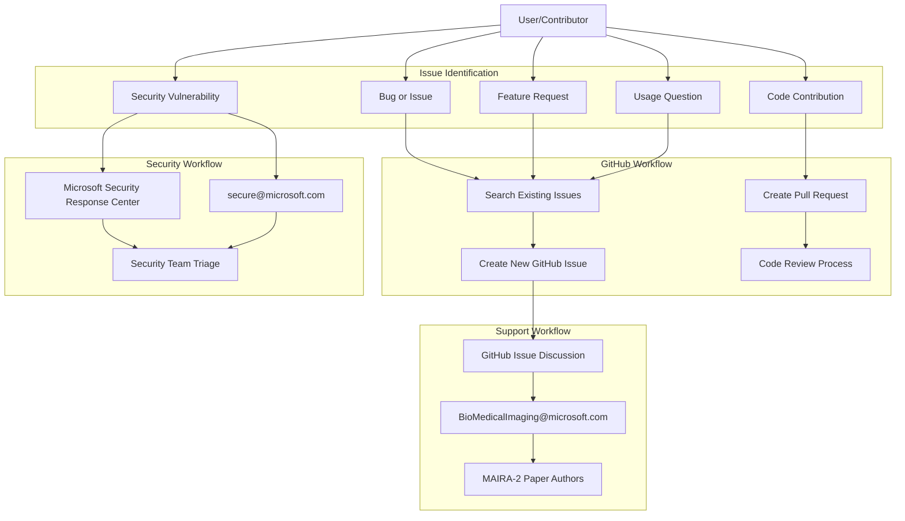
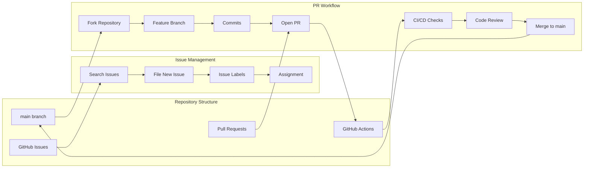
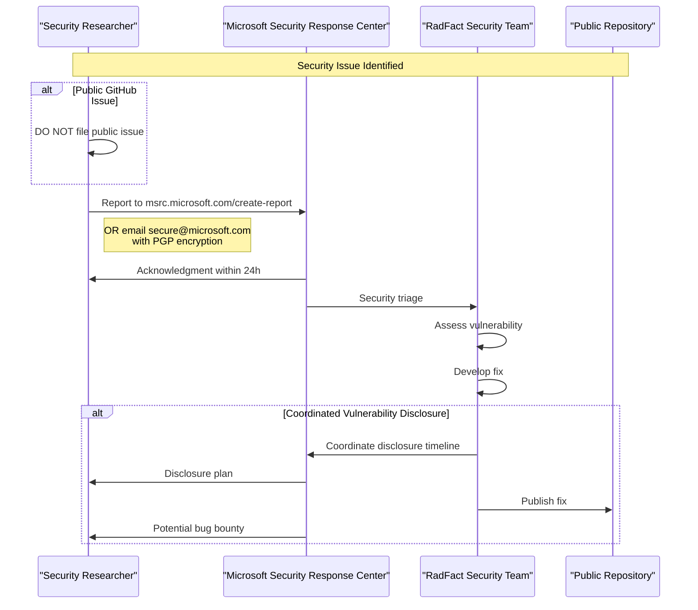

<!-- source: DeepWiki mcp.deepwiki.com · repo microsoft/RadFact · page 9 Community · fetched 2026-10-26 -->

# Community

Relevant source files

The following files were used as context for generating this wiki page:

- [CODE_OF_CONDUCT.md](CODE_OF_CONDUCT.md)
- [SECURITY.md](SECURITY.md)
- [SUPPORT.md](SUPPORT.md)

## Purpose and Scope

This document provides an overview of community resources, communication channels, and governance processes for the RadFact project. It covers how to engage with the project through contributions, support requests, and security reporting.

For detailed instructions on specific topics, see:
- Contributing guidelines and code of conduct: [Contributing](#9.1)
- Support channels and issue reporting: [Getting Support](#9.2)
- Security vulnerability reporting: [Security](#9.3)
- License terms: [License](#9.4)

## Community Resources Overview

RadFact is an open-source project maintained by Microsoft that follows standard GitHub-based collaboration practices. The project provides multiple channels for community engagement depending on the type of interaction needed.

| Resource Type | Primary Channel | Purpose |
|--------------|----------------|---------|
| Bug Reports | GitHub Issues | Track bugs and reproducible issues |
| Feature Requests | GitHub Issues | Propose new functionality |
| General Questions | GitHub Issues (first) | Ask usage questions |
| Security Issues | MSRC | Report security vulnerabilities privately |
| Code Contributions | Pull Requests | Submit code changes |
| Email Support | BioMedicalImaging@microsoft.com | Secondary contact for complex issues |

**Sources:** [SUPPORT.md:1-12]()

## Community Engagement Flow

The following diagram shows how different types of community interactions are routed through the project's channels:

**Description:** This diagram illustrates the community engagement pathways. Non-security issues flow through GitHub Issues after searching for duplicates. Security vulnerabilities bypass public channels and go directly to the Microsoft Security Response Center (MSRC) or secure email. Code contributions follow the pull request workflow. Complex support questions can escalate to email contacts after initial GitHub discussion.

**Sources:** [SUPPORT.md:3-11](), [SECURITY.md:9-17]()

## GitHub-Based Collaboration Model

RadFact uses GitHub as its primary collaboration platform, following standard open-source practices:

**Description:** The repository follows a fork-and-PR model. Contributors fork the repository, create feature branches, and submit pull requests. GitHub Actions automatically run CI/CD checks ([.github/workflows/pr-checks.yaml:1-54]()). Issues are managed through GitHub's issue tracker with labels and assignments for organization.

**Sources:** [SUPPORT.md:5](), [.github/workflows/pr-checks.yaml]()

## Code of Conduct

RadFact adheres to the Microsoft Open Source Code of Conduct. All community participants are expected to follow these guidelines when interacting in project spaces.

| Aspect | Resource |
|--------|----------|
| Primary Policy | Microsoft Open Source Code of Conduct |
| FAQ | https://opensource.microsoft.com/codeofconduct/faq/ |
| Contact for Issues | opencode@microsoft.com |
| Scope | All GitHub interactions, issues, PRs, discussions |

The code of conduct ensures a welcoming, inclusive environment for all contributors regardless of background or experience level.

**Sources:** [CODE_OF_CONDUCT.md:1-10]()

## Security Reporting Process

Security vulnerabilities require special handling to protect users. The following diagram shows the security reporting workflow:

**Description:** Security vulnerabilities must never be reported through public GitHub issues. Instead, researchers report to the Microsoft Security Response Center (MSRC) at https://msrc.microsoft.com/create-report or email secure@microsoft.com. The MSRC acknowledges reports within 24 hours and coordinates with the RadFact security team for triage and remediation. Microsoft follows Coordinated Vulnerability Disclosure principles.

**Sources:** [SECURITY.md:9-40]()

## Security Report Information Requirements

When reporting security vulnerabilities, include the following information to help with triage:

| Field | Description |
|-------|-------------|
| Issue Type | Buffer overflow, SQL injection, XSS, etc. |
| Source File Paths | Full paths of affected files |
| Source Location | Tag/branch/commit or direct URL |
| Configuration | Any special configuration needed to reproduce |
| Reproduction Steps | Step-by-step instructions |
| PoC Code | Proof-of-concept or exploit code if available |
| Impact Assessment | How an attacker might exploit the issue |

More complete reports contribute to higher bug bounty awards under the Microsoft Bug Bounty Program.

**Sources:** [SECURITY.md:19-31]()

## Support Channel Priority

Follow this priority order when seeking help:

1. **Search Existing Issues** - Check if your question has been answered ([SUPPORT.md:5]())
2. **File GitHub Issue** - Create a new issue for bugs, features, or questions ([SUPPORT.md:5-6]())
3. **Email Authors** - Contact MAIRA-2 paper authors or BioMedicalImaging@microsoft.com if necessary ([SUPPORT.md:7]())

GitHub Issues are the preferred primary channel to ensure visibility and benefit the broader community. Email support is available but limited in scope.

**Sources:** [SUPPORT.md:3-11]()

## Microsoft Support Policy

Support for RadFact is limited to the resources listed in this document. As an open-source project, Microsoft provides community-based support through GitHub Issues and limited email support. Enterprise support agreements do not apply to this project.

**Sources:** [SUPPORT.md:9-11]()

## Communication Guidelines

When engaging with the RadFact community:

- **Language**: All communications should be in English ([SECURITY.md:33-35]())
- **Duplicates**: Search existing issues before filing new ones ([SUPPORT.md:5]())
- **Security**: Never disclose security vulnerabilities publicly ([SECURITY.md:11]())
- **Code of Conduct**: Follow Microsoft's Open Source Code of Conduct in all interactions ([CODE_OF_CONDUCT.md:3]())
- **Tone**: Be respectful, constructive, and professional

**Sources:** [SUPPORT.md:5](), [SECURITY.md:11](), [SECURITY.md:33-35](), [CODE_OF_CONDUCT.md:3]()

## Project Maintainers

RadFact is maintained by Microsoft's BioMedical Imaging team. The project is associated with the MAIRA-2 research paper, and paper authors can be contacted for complex technical questions.

| Role | Contact Method |
|------|----------------|
| General Inquiries | BioMedicalImaging@microsoft.com |
| Research Questions | MAIRA-2 paper authors (see paper) |
| Security Issues | Microsoft Security Response Center |
| Code of Conduct | opencode@microsoft.com |

**Sources:** [SUPPORT.md:7](), [CODE_OF_CONDUCT.md:9]()

## Related Documentation

For detailed information on specific community topics:

- **[Contributing](#9.1)** - Contribution guidelines, development workflow, and code standards
- **[Getting Support](#9.2)** - Detailed support procedures and issue templates
- **[Security](#9.3)** - Complete security policy and vulnerability reporting
- **[License](#9.4)** - MIT License terms and copyright information

Additional technical documentation:

- **[Development Setup](#7.1)** - Setting up development environment
- **[Code Quality Tools](#7.2)** - Using Black, Flake8, MyPy
- **[CI/CD Pipeline](#7.4)** - Understanding automated testing

**Sources:** [SUPPORT.md:1-12](), [SECURITY.md:1-42](), [CODE_OF_CONDUCT.md:1-10]()

---

