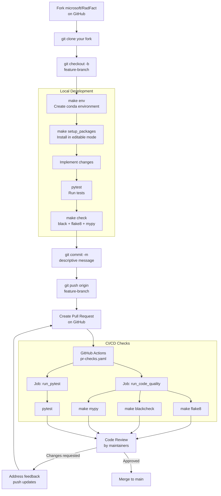
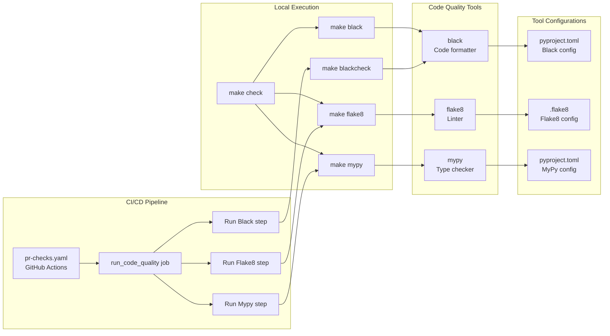
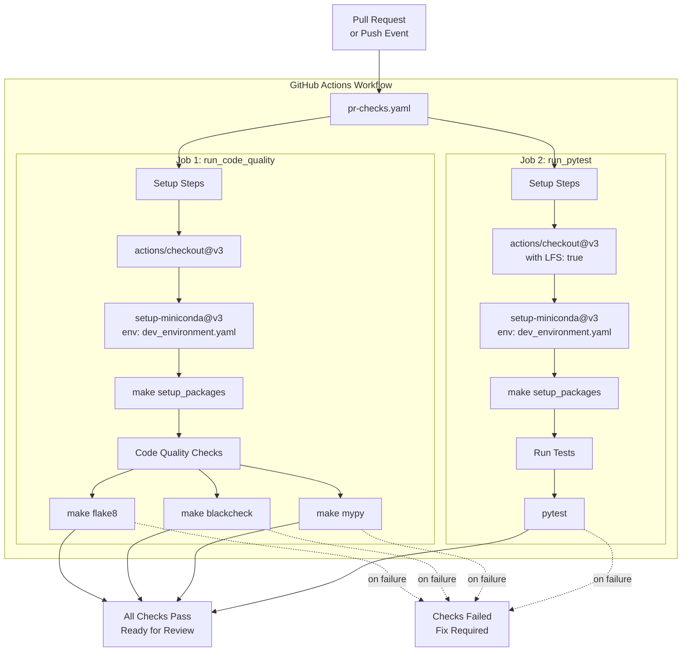

<!-- source: DeepWiki mcp.deepwiki.com · repo microsoft/RadFact · page 9.1 Contributing · fetched 2026-10-26 -->

# Contributing

<details>
<summary>Relevant source files</summary>

The following files were used as context for generating this wiki page:

- [.github/workflows/pr-checks.yaml](.github/workflows/pr-checks.yaml)
- [CODE_OF_CONDUCT.md](CODE_OF_CONDUCT.md)
- [Makefile](Makefile)

</details>


This document describes how to contribute code, documentation, or other improvements to the RadFact project. It covers the contribution process, code quality requirements, and pull request workflow.

For information about setting up your development environment, see [Development Setup](#7.1). For details on the code quality tools used in this project, see [Code Quality Tools](#7.2). For reporting bugs or requesting features, see [Getting Support](#9.2).

---

## Code of Conduct

RadFact has adopted the [Microsoft Open Source Code of Conduct](https://opensource.microsoft.com/codeofconduct/). All contributors are expected to adhere to this code of conduct.

**Key Resources:**
- [Microsoft Open Source Code of Conduct](https://opensource.microsoft.com/codeofconduct/)
- [Microsoft Code of Conduct FAQ](https://opensource.microsoft.com/codeofconduct/faq/)
- Contact: [opencode@microsoft.com](mailto:opencode@microsoft.com) for questions or concerns

**Sources:** [CODE_OF_CONDUCT.md:1-10]()

---

## Contribution Process Overview

The following diagram illustrates the end-to-end contribution workflow, from forking the repository to having your changes merged.



**Sources:** [.github/workflows/pr-checks.yaml:1-71](), [Makefile:1-118]()

---

## Development Environment Setup

Before contributing, set up your development environment using the conda environment defined in `dev_environment.yaml`.

### Initial Setup

| Step | Command | Purpose |
|------|---------|---------|
| 1. Install conda | `make miniconda` | Install Miniconda if not already installed |
| 2. Install mamba solver | `make mamba` | Install faster conda solver |
| 3. Create environment | `make env` | Create `radfact` conda environment |
| 4. Activate environment | `conda activate radfact` | Activate the environment |

The `make env` target performs the following operations:
1. Removes any existing `radfact` conda environment [Makefile:24]()
2. Creates environment from `dev_environment.yaml` [Makefile:26]()
3. Installs all local packages in editable mode via `make setup_packages_with_deps` [Makefile:28]()

**Sources:** [Makefile:21-28]()

### Installing Packages in Editable Mode

The project consists of multiple Python packages that must be installed in editable mode:

```bash
# Install without dependencies (assumes conda environment has them)
make setup_packages

# Install with dependencies (used during environment creation)
make setup_packages_with_deps
```

Both targets execute `setup_packages.py` with different flags [Makefile:40-46]():
- `setup_packages`: Runs with `--no-deps` flag
- `setup_packages_with_deps`: Runs with `--add-dev-deps` flag

**Sources:** [Makefile:40-46]()

---

## Code Quality Requirements

All contributions must pass automated code quality checks before they can be merged. The checks are enforced both locally and in CI/CD.

### Code Quality Tools

The following diagram shows the code quality toolchain and how each tool relates to the Makefile targets and CI/CD jobs.



**Sources:** [Makefile:100-117](), [.github/workflows/pr-checks.yaml:23-50]()

### Running Code Quality Checks Locally

| Tool | Command | Purpose | Configuration |
|------|---------|---------|---------------|
| **Black** | `make black` | Reformat all Python files | `pyproject.toml` [Makefile:101-102]() |
| **Black (check only)** | `make blackcheck` | Check formatting without changes | `pyproject.toml` [Makefile:105-106]() |
| **Flake8** | `make flake8` | Lint Python code for style issues | `.flake8` [Makefile:109-110]() |
| **MyPy** | `make mypy` | Type check Python code | `pyproject.toml` [Makefile:113-114]() |
| **All checks** | `make check` | Run black, flake8, and mypy | Combined [Makefile:117]() |

The `make check` target runs all three tools in sequence:
```bash
make check  # Equivalent to: make black flake8 mypy
```

**Sources:** [Makefile:100-117]()

### Black Configuration

Black is configured via `pyproject.toml`. The Makefile passes arguments to Black:
- `--config pyproject.toml`: Use project configuration
- `.`: Apply to all files in current directory and subdirectories

[Makefile:4]() defines: `BLACK_ARGS := --config pyproject.toml .`

**Sources:** [Makefile:4](), [Makefile:101-106]()

---

## Pull Request CI/CD Pipeline

All pull requests trigger automated checks via GitHub Actions. The workflow is defined in `.github/workflows/pr-checks.yaml`.

### Workflow Triggers

The `pr-checks.yaml` workflow runs on:
- **Push to main branch** [.github/workflows/pr-checks.yaml:4-6]()
- **Pull request events** (opened, synchronize, reopened) targeting main [.github/workflows/pr-checks.yaml:7-10]()
- **Manual trigger** via `workflow_dispatch` [.github/workflows/pr-checks.yaml:11]()

The workflow uses **concurrency control** to cancel previous runs:
```yaml
concurrency:
  group: ${{ github.ref }}/checks
  cancel-in-progress: ${{ github.ref != 'refs/heads/main' }}
```
[.github/workflows/pr-checks.yaml:14-16]()

**Sources:** [.github/workflows/pr-checks.yaml:3-16]()

### CI/CD Jobs Architecture



**Sources:** [.github/workflows/pr-checks.yaml:22-71]()

### Job 1: run_code_quality

This job runs on `ubuntu-20.04` and executes three code quality checks independently. Each check uses `if: ${{ always() }}` to ensure all checks run even if earlier ones fail.

**Setup Steps:**
1. Checkout code with `actions/checkout@v3` [.github/workflows/pr-checks.yaml:26]()
2. Setup conda with `conda-incubator/setup-miniconda@v3` [.github/workflows/pr-checks.yaml:28-31]()
   - Activates environment: `radfact`
   - Uses file: `dev_environment.yaml`
3. Install packages with `make setup_packages` [.github/workflows/pr-checks.yaml:33-35]()

**Code Quality Checks:**
| Check | Command | Always Runs |
|-------|---------|-------------|
| Flake8 | `make flake8` | Yes [.github/workflows/pr-checks.yaml:37-40]() |
| Black | `make blackcheck` | Yes [.github/workflows/pr-checks.yaml:42-45]() |
| MyPy | `make mypy` | Yes [.github/workflows/pr-checks.yaml:47-50]() |

All commands use `shell: bash -el {0}` to ensure conda environment activation.

**Sources:** [.github/workflows/pr-checks.yaml:23-50]()

### Job 2: run_pytest

This job runs on `ubuntu-20.04` and executes the test suite.

**Setup Steps:**
1. Checkout code with `actions/checkout@v3` and **enable Git LFS** [.github/workflows/pr-checks.yaml:55-57]()
   ```yaml
   with:
     lfs: true
   ```
2. Setup conda with `conda-incubator/setup-miniconda@v3` [.github/workflows/pr-checks.yaml:59-62]()
3. Install packages with `make setup_packages` [.github/workflows/pr-checks.yaml:64-66]()

**Test Execution:**
- Command: `pytest` [.github/workflows/pr-checks.yaml:68-70]()
- Shell: `bash -el {0}` (conda-aware)

**Sources:** [.github/workflows/pr-checks.yaml:52-71]()

---

## Testing Requirements

All contributions must include appropriate tests. Tests are executed using `pytest`.

### Running Tests Locally

```bash
# Activate conda environment
conda activate radfact

# Run all tests
pytest

# Run specific test file
pytest tests/test_specific.py

# Run with verbose output
pytest -v
```

For detailed information about the testing infrastructure, see [Testing](#7.3).

**Sources:** [.github/workflows/pr-checks.yaml:68-70]()

---

## Environment Locking

RadFact uses Docker-based environment locking to ensure reproducible builds across different platforms. This is important for contributors working on dependency management.

### Environment Lock Process

The `make env_lock` target rebuilds the conda environment from scratch and exports a locked `dev_environment.yaml` file:

```bash
make env_lock
```

This process:
1. Builds a Docker image from `Dockerfile_no_conda` [Makefile:73]()
2. Starts a container named `env-container` [Makefile:77]()
3. Copies the repository into the container [Makefile:79]()
4. Runs `make env_lock_in_container` inside the container [Makefile:83]()
5. Copies the updated `dev_environment.yaml` back [Makefile:85]()
6. Cleans up the container [Makefile:87]()

**Sources:** [Makefile:69-87]()

### Environment Lock Container Workflow

Inside the container, `make env_lock_in_container` performs:

1. **Rebuild environment** from `primary_deps.yaml` via `env_from_primary` target [Makefile:67]()
   - Removes existing `radfact` environment [Makefile:34]()
   - Creates fresh environment from `primary_deps.yaml` [Makefile:36]()

2. **Install packages** with dependencies via `setup_packages_with_deps` [Makefile:67]()

3. **Export environment** to `dev_environment.yaml` via `env_export` [Makefile:67]()
   - Calls `_env_export` to write to temporary file [Makefile:62]()
   - Filters out local packages (azure-utils, llm-utils, radfact) [Makefile:55]()
   - Adds header comment: "DO NOT MANUALLY EDIT THIS FILE, USE 'make env_lock' INSTEAD" [Makefile:52]()

**Sources:** [Makefile:32-67]()

### When to Run Environment Lock

Contributors should run `make env_lock` when:
- Adding or updating dependencies in `primary_deps.yaml`
- Updating package versions
- Making changes to `setup_packages.py`

⚠️ **Important:** Do not manually edit `dev_environment.yaml`. It is auto-generated by `make env_lock`.

**Sources:** [Makefile:52]()

---

## Pull Request Guidelines

### Creating a Pull Request

1. **Fork the repository** on GitHub
2. **Clone your fork** locally
3. **Create a feature branch** from `main`
   ```bash
   git checkout -b feature/your-feature-name
   ```
4. **Make your changes** and commit with descriptive messages
5. **Run all checks** before pushing
   ```bash
   make check  # Run code quality checks
   pytest      # Run tests
   ```
6. **Push to your fork**
   ```bash
   git push origin feature/your-feature-name
   ```
7. **Create a pull request** on GitHub targeting the `main` branch

### Pull Request Content

Your pull request should include:

| Component | Description |
|-----------|-------------|
| **Clear title** | Concise description of the change |
| **Description** | What the PR does and why |
| **Testing** | How you tested the changes |
| **Related issues** | Link to any related issue numbers |
| **Breaking changes** | Note any breaking changes |

### Commit Message Guidelines

- Use clear, descriptive commit messages
- Start with a verb in present tense (e.g., "Add", "Fix", "Update")
- Keep the first line under 72 characters
- Add detailed explanation in the body if needed

**Example:**
```
Add spatial metric computation for grounded reports

Implements spatial precision and recall metrics that evaluate
grounding quality by comparing bounding box overlaps between
generated and ground truth reports.

Fixes #123
```

---

## Review Process

After submitting a pull request:

1. **Automated checks run** via GitHub Actions [.github/workflows/pr-checks.yaml]()
   - All checks must pass (code quality and tests)
   
2. **Maintainer review**
   - Maintainers will review your code
   - They may request changes or ask questions
   
3. **Address feedback**
   - Make requested changes
   - Push updates to your branch
   - CI checks will re-run automatically
   
4. **Approval and merge**
   - Once approved, maintainers will merge your PR
   - Your contribution will be included in the next release

### Responding to Review Feedback

- Address all feedback thoroughly
- Ask questions if anything is unclear
- Update your PR by pushing new commits to your branch
- Avoid force-pushing once review has started (unless requested)
- Mark conversations as resolved after addressing them

**Sources:** [.github/workflows/pr-checks.yaml:14-16]()

---

## Getting Help

If you need help with your contribution:

- **Questions about the codebase**: Open a discussion on GitHub
- **Bug reports**: See [Getting Support](#9.2)
- **Security issues**: See [Security](#9.3)
- **Code of conduct concerns**: Email [opencode@microsoft.com](mailto:opencode@microsoft.com)

For detailed information on development tools and processes, refer to:
- [Development Setup](#7.1)
- [Code Quality Tools](#7.2)
- [Testing](#7.3)
- [CI/CD Pipeline](#7.4)

**Sources:** [CODE_OF_CONDUCT.md:9]()

---

