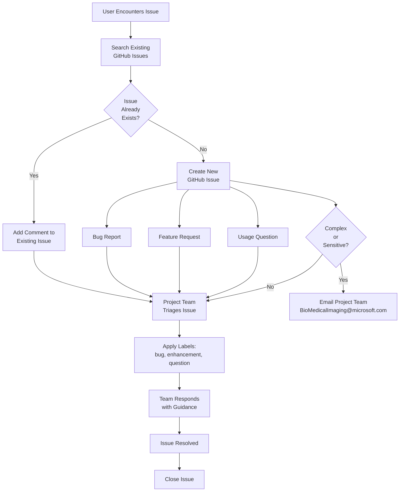
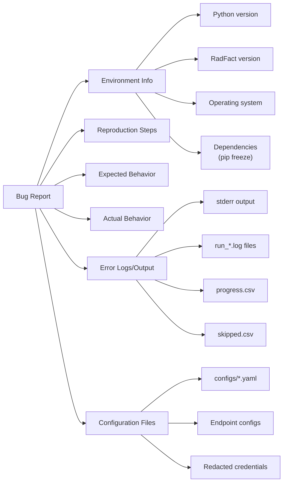
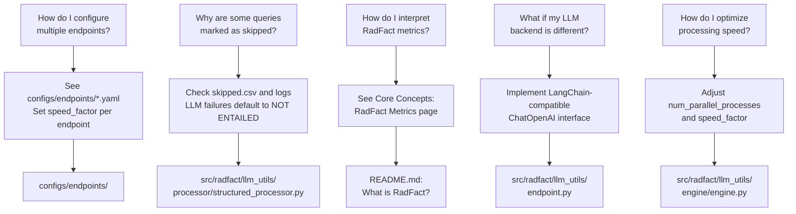
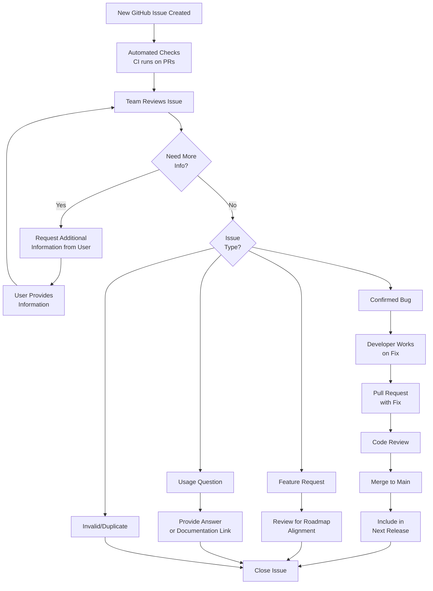

<!-- source: DeepWiki mcp.deepwiki.com · repo microsoft/RadFact · page 9.2 Getting Support · fetched 2026-10-26 -->

# Getting Support

<details>
<summary>Relevant source files</summary>

The following files were used as context for generating this wiki page:

- [README.md](README.md)
- [SUPPORT.md](SUPPORT.md)

</details>


This document describes how to get help with RadFact, report bugs, request features, and contact the development team. It covers the available support channels, the issue reporting process, and what information to provide for effective assistance.

For information about contributing code or documentation, see [Contributing](#9.1). For security vulnerability reporting, see [Security](#9.3).

## Support Channels Overview

RadFact provides support through GitHub Issues as the primary mechanism for tracking bugs, feature requests, and questions. The project follows Microsoft's standard support policy for open-source projects, with community-driven support supplemented by direct contact options for complex issues.



**Sources:** [SUPPORT.md:1-12]()

## GitHub Issues: Primary Support Channel

GitHub Issues is the primary mechanism for tracking and resolving problems with RadFact. All bugs, feature requests, and usage questions should be filed through the GitHub Issues system at `https://github.com/microsoft/RadFact/issues`.

### Searching Existing Issues

Before filing a new issue, search the existing issues to avoid duplicates. This helps consolidate discussions and prevents fragmentation of information.

**Search strategies:**
- Use keywords related to your problem (e.g., "Azure authentication", "LLMEngine timeout")
- Search by component names (e.g., "StructuredProcessor", "redis_cache")
- Check both open and closed issues for previous resolutions
- Review issue labels: `bug`, `enhancement`, `question`, `documentation`

### When to Use GitHub Issues

| Situation | Use GitHub Issues |
|-----------|-------------------|
| RadFact crashes or produces errors | ✅ Yes - File bug report |
| Unexpected metric values | ✅ Yes - File bug report |
| LLM endpoint configuration fails | ✅ Yes - File question |
| Request new metric or feature | ✅ Yes - File feature request |
| Documentation unclear or missing | ✅ Yes - File documentation issue |
| Installation problems | ✅ Yes - File question or bug |
| Performance optimization questions | ✅ Yes - File question |
| Azure integration issues | ✅ Yes - File question or bug |

**Sources:** [SUPPORT.md:5-7]()

## Filing Bug Reports

When reporting a bug, provide detailed information to help the team reproduce and diagnose the issue. Well-structured bug reports lead to faster resolution.

### Required Information for Bug Reports



### Bug Report Template

```markdown
**Environment:**
- Python version: 
- RadFact version: 
- Operating System: 
- Installation method: (pip install / conda environment)

**Description:**
Clear and concise description of the bug.

**Steps to Reproduce:**
1. Run command: `run_radfact --input_path ...`
2. Configuration used: (attach radfact.yaml if modified)
3. Endpoint configuration: (redact sensitive information)

**Expected Behavior:**
What should have happened.

**Actual Behavior:**
What actually happened, including error messages.

**Logs and Outputs:**
- Error traceback (full stack trace)
- Relevant log files from outputs/radfact/run_*/ directory
- Contents of skipped.csv if relevant
- Number of failed queries (num_llm_failures from outputs.json)

**Configuration Files:**
- Attach or paste relevant sections from configs/radfact.yaml
- Endpoint configuration (redact API keys and URLs)
- Any custom configuration overrides

**Additional Context:**
Any other information that might be relevant.
```

### Common Bug Categories

| Category | Relevant Code | Typical Issues |
|----------|---------------|----------------|
| LLM API failures | [src/radfact/llm_utils/processor/structured_processor.py]() | Timeouts, rate limits, authentication |
| Caching problems | [src/radfact/llm_utils/engine/redis_cache.py]() | Redis connection, cache invalidation |
| Data format errors | [src/radfact/cli/run_radfact.py]() | Invalid CSV/JSON structure |
| Metric computation | [src/radfact/metric_calculator.py]() | Incorrect precision/recall values |
| Parallel processing | [src/radfact/llm_utils/engine/engine.py]() | Worker failures, data sharding |

**Sources:** [README.md:177-179](), [SUPPORT.md:5-7]()

## Requesting Features

Feature requests help guide the project's development priorities. When requesting a feature, explain the use case and motivation.

### Feature Request Structure

```markdown
**Feature Description:**
Clear description of the requested feature.

**Use Case:**
Explain why this feature would be valuable and what problem it solves.

**Proposed Implementation:**
(Optional) Suggestions for how this could be implemented.

**Alternatives Considered:**
Other approaches you've considered to solve the problem.

**Related Issues:**
Links to related discussions or issues.
```

### Common Feature Request Areas

| Area | Examples |
|------|----------|
| New metrics | Additional precision/recall variants, domain-specific metrics |
| LLM backends | Support for new model types, custom inference endpoints |
| Data formats | Additional input/output formats, schema extensions |
| Performance | Optimization strategies, caching improvements |
| Configuration | New configuration options, simplified setup |
| Integration | Azure ML pipelines, MLflow integration, CI/CD tools |

**Sources:** [SUPPORT.md:5-7]()

## Getting Help with Usage

For questions about using RadFact, file a GitHub issue with the "question" label. Include relevant context about what you're trying to accomplish.

### Usage Question Template

```markdown
**Question:**
What are you trying to accomplish?

**Current Approach:**
What have you tried so far?

**Configuration:**
Relevant parts of your configuration (redact sensitive info).

**Documentation Consulted:**
Which documentation pages have you reviewed?

**Related Code/Commands:**
Commands or code you're working with.
```

### Self-Service Resources

Before filing a question, check these resources:

| Resource | Location | Coverage |
|----------|----------|----------|
| Getting Started Guide | [Getting Started](#2) | Installation, quick start |
| Configuration Setup | [Configuration Setup](#2.3) | Endpoint and auth setup |
| Running RadFact | [Running RadFact Evaluation](#4.1) | CLI usage, parameters |
| Understanding Outputs | [Understanding Outputs](#4.4) | Interpreting results |
| Configuration Reference | [Configuration Reference](#8.2) | All configuration options |
| Example notebooks | `getting_started.ipynb` | End-to-end workflows |

### Common Usage Questions



**Sources:** [README.md:132-160](), [SUPPORT.md:5-7]()

## Direct Contact

For complex issues that may not be suitable for public GitHub Issues, or for sensitive topics, direct email contact is available.

### When to Use Direct Contact

Use direct email contact for:
- **Sensitive information:** Issues involving private data or security concerns
- **Collaboration inquiries:** Research partnerships, integration discussions
- **Complex debugging:** Multi-faceted problems requiring extensive back-and-forth
- **Azure-specific deployment:** Enterprise deployment assistance

**Note:** Security vulnerabilities should be reported through the security policy channels, not public issues. See [Security](#9.3) for vulnerability reporting procedures.

### Contact Methods

| Contact Method | Address | Use For |
|----------------|---------|---------|
| Project Team Email | BioMedicalImaging@microsoft.com | General inquiries, complex issues |
| Paper Authors | Listed in [MAIRA-2](https://aka.ms/maira-2) | Research questions, collaboration |
| Security Team | See [Security](#9.3) | Security vulnerabilities |

### Email Guidelines

When contacting the team directly:

1. **Subject line format:** `[RadFact] Brief description of issue`
2. **Include GitHub issue link:** Reference a GitHub issue if one exists
3. **Provide context:** Explain why the issue requires direct contact
4. **Attach relevant information:** Configuration files, logs (redact sensitive data)
5. **Be specific:** Include version numbers, environment details

**Sources:** [SUPPORT.md:7-8]()

## Support Scope and Limitations

RadFact is provided as a research tool with community-driven support. Understanding the support scope helps set appropriate expectations.

### What is Supported

| Category | Support Level |
|----------|---------------|
| Bug fixes in core functionality | ✅ Community and team support |
| Documentation improvements | ✅ Community and team support |
| Feature requests (research-aligned) | ✅ Considered for roadmap |
| Configuration assistance | ✅ Community and team support |
| LLM endpoint setup | ✅ Documentation and examples |
| Azure integration guidance | ✅ Documentation and examples |

### What is Not Supported

| Category | Reason |
|----------|--------|
| Medical diagnosis or clinical use | Research tool only, not FDA-cleared |
| Production deployment guarantees | No SLA, best-effort support |
| Custom model training | Out of scope for evaluation framework |
| Data collection or annotation | User responsibility |
| Third-party API issues | Contact API provider directly |
| Custom enterprise integrations | May require professional services |

### Research Use Only Disclaimer

From [README.md:250-252]():

> RadFact is provided for research use only. RadFact is not designed, intended, or made available for use in the diagnosis, prevention, mitigation, or treatment of a disease or medical condition nor to perform any medical function, and the performance of RadFact for such purposes has not been established. You bear sole responsibility for any use of RadFact, including incorporation into any product intended for a medical purpose.

**Sources:** [SUPPORT.md:9-11](), [README.md:250-252]()

## Support Workflow

The following diagram illustrates how issues are processed by the project team:



**Sources:** [SUPPORT.md:1-12]()

## Issue Labels and Priority

The project uses GitHub labels to categorize and prioritize issues:

| Label | Description | Typical Response Time |
|-------|-------------|----------------------|
| `bug` | Confirmed defect in code | Days to weeks |
| `enhancement` | New feature request | Weeks to months |
| `question` | Usage or configuration question | Hours to days |
| `documentation` | Documentation improvement | Days to weeks |
| `good first issue` | Suitable for new contributors | Community-driven |
| `help wanted` | Community contributions welcome | Community-driven |
| `wontfix` | Issue will not be addressed | Immediate closure |
| `duplicate` | Duplicate of existing issue | Immediate closure |

## Response Expectations

Given RadFact's status as a research project:

- **Acknowledgment:** Issues typically receive acknowledgment within a few days
- **Resolution:** Bug fixes depend on severity and complexity
- **Feature requests:** Evaluated based on alignment with research goals
- **Questions:** Usually answered within a few days if information is complete

**Note:** Response times are best-effort estimates. The project has no formal SLA.

**Sources:** [SUPPORT.md:9-11]()

## Troubleshooting Before Filing Issues

Before filing an issue, attempt these troubleshooting steps:

### For Installation Issues

1. Verify Python version compatibility (check `dev_environment.yaml`)
2. Try installation in a clean virtual environment
3. Check for conflicting dependencies: `pip check`
4. Review installation logs for error messages

### For LLM Endpoint Issues

1. Test endpoint authentication independently
2. Verify API key is set correctly: `echo $API_KEY`
3. Check endpoint URL format matches config requirements
4. Test endpoint with simple LangChain query outside RadFact
5. Review logs in `outputs/radfact/run_*/` for detailed errors

### For Processing Failures

1. Check `skipped.csv` for error patterns
2. Review `num_llm_failures` in `outputs.json`
3. Verify input data format matches examples in `examples/`
4. Test with smaller dataset to isolate issues
5. Enable verbose logging to capture detailed execution flow

### For Unexpected Metrics

1. Run `run_radfact_test_examples.py` to verify LLM behavior
2. Check that backend LLM is appropriate for entailment verification
3. Review few-shot examples in `src/radfact/llm_utils/nli/prompts.py`
4. Verify input data format, especially bounding boxes for grounded reports

**Sources:** [README.md:94-98](), [README.md:177-179]()

## Code References for Common Issues

| Issue Area | Relevant Files |
|------------|---------------|
| CLI entry points | [src/radfact/cli/run_radfact.py]()<br/>[src/radfact/cli/run_report_to_phrases.py]() |
| Endpoint configuration | [src/radfact/llm_utils/endpoint.py]()<br/>[configs/endpoints/]() |
| LLM processing | [src/radfact/llm_utils/processor/structured_processor.py]()<br/>[src/radfact/llm_utils/engine/engine.py]() |
| Caching | [src/radfact/llm_utils/engine/redis_cache.py]() |
| Authentication | [src/radfact/llm_utils/endpoint.py:38-65]() |
| Configuration | [configs/default.yaml]()<br/>[configs/radfact.yaml]()<br/>[configs/report_to_phrases.yaml]() |

**Sources:** [README.md:64](), [src/radfact/llm_utils/endpoint.py](), [src/radfact/llm_utils/engine/engine.py]()

---

