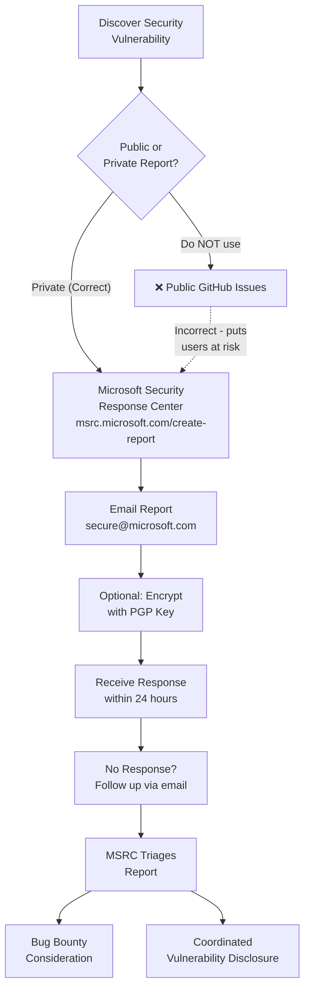
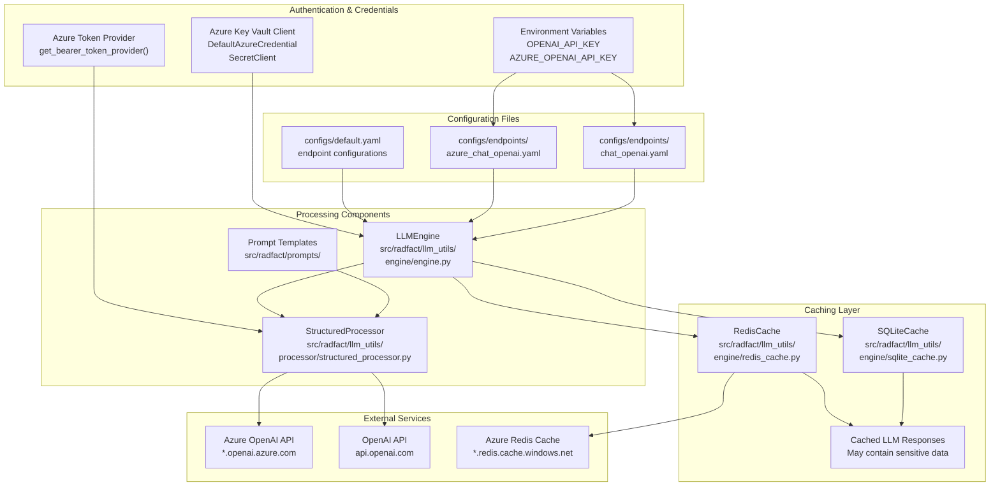
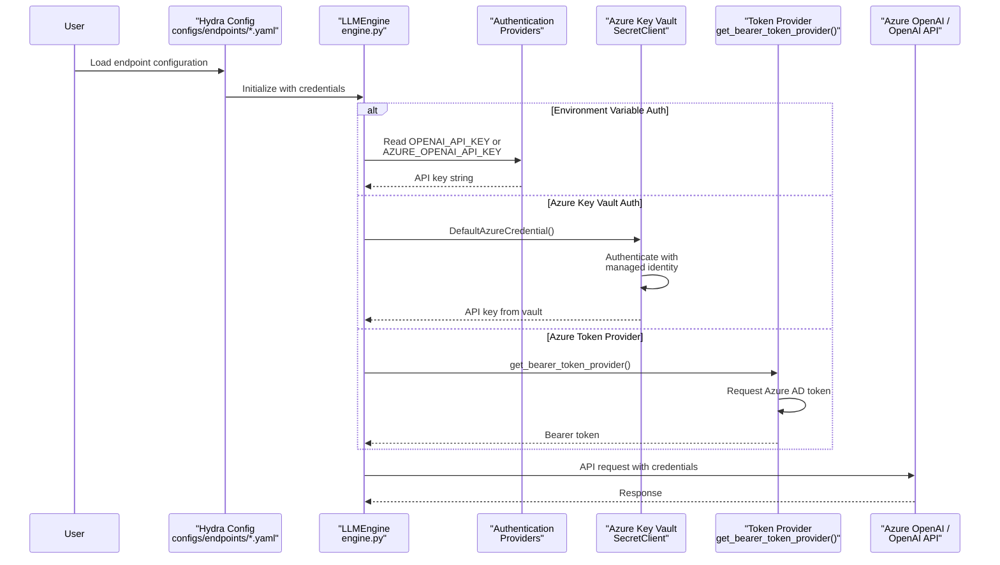
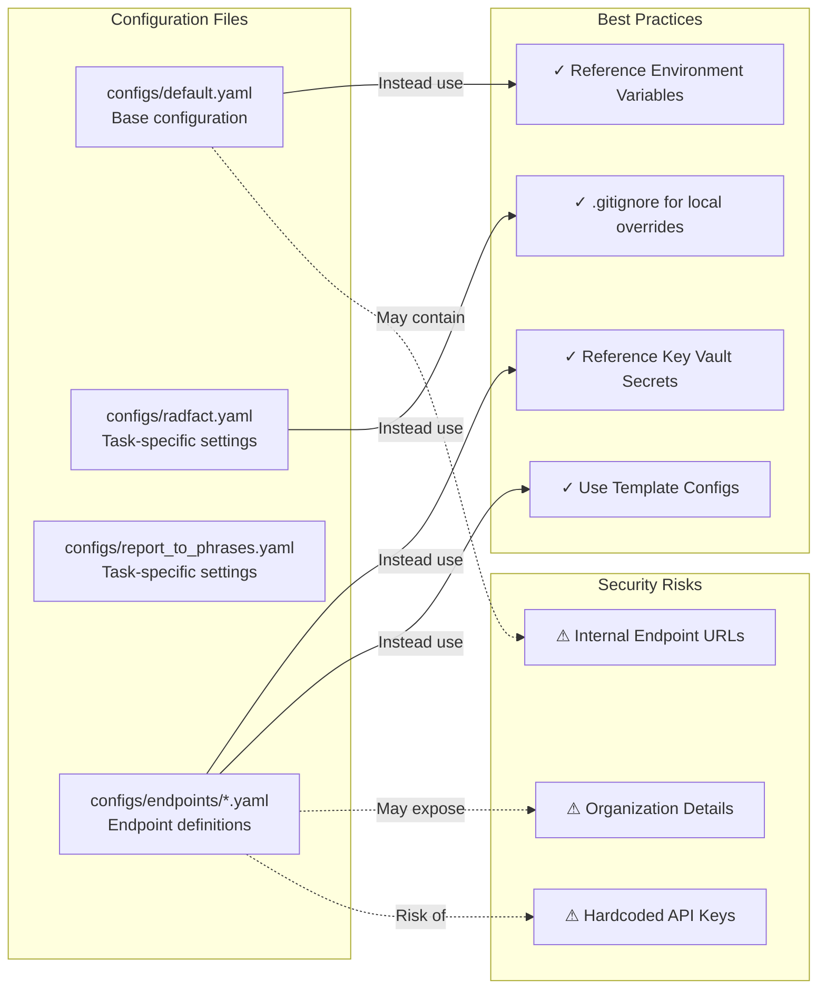

<!-- source: DeepWiki mcp.deepwiki.com · repo microsoft/RadFact · page 9.3 Security · fetched 2026-10-26 -->

# Security

Relevant source files

The following files were used as context for generating this wiki page:

- [SECURITY.md](SECURITY.md)

**Purpose and Scope**: This page documents RadFact's security policy, including procedures for reporting security vulnerabilities and security considerations when deploying RadFact. For technical details on configuring authentication mechanisms, see [Authentication](#6.3). For information about secure development practices and code quality enforcement, see [Code Quality Tools](#7.2).

---

## Security Policy

Microsoft takes the security of software products and services seriously, including all source code repositories managed through GitHub organizations such as Microsoft, Azure, DotNet, AspNet, and Xamarin.

RadFact follows Microsoft's standard security policy as defined in [SECURITY.md:1-42](). The project adheres to the principle of Coordinated Vulnerability Disclosure.

**Sources**: [SECURITY.md:1-42]()

---

## Reporting Security Vulnerabilities

### Critical: Do Not Use Public Channels

**Security vulnerabilities must never be reported through public GitHub issues.** Public disclosure of security issues can put users at risk before fixes are available.

**Sources**: [SECURITY.md:11]()

---

## Vulnerability Reporting Process

The following diagram illustrates the proper workflow for reporting security vulnerabilities in RadFact:

### Reporting Channels

| Channel | Method | Use Case |
|---------|--------|----------|
| **Primary** | [https://msrc.microsoft.com/create-report](https://aka.ms/security.md/msrc/create-report) | Preferred method with account login |
| **Email** | [secure@microsoft.com](mailto:secure@microsoft.com) | Alternative without account |
| **Encrypted** | Use [Microsoft Security Response Center PGP Key](https://aka.ms/security.md/msrc/pgp) | For sensitive disclosures |

**Sources**: [SECURITY.md:13-17]()

---

## Required Information for Security Reports

To help Microsoft triage security reports efficiently, include as much of the following information as possible:

| Information Type | Description | Example |
|------------------|-------------|---------|
| **Issue Type** | Classification of vulnerability | Buffer overflow, injection, XSS, authentication bypass |
| **Source Files** | Full paths to affected files | `src/radfact/llm_utils/engine/redis_cache.py` |
| **Location** | Tag, branch, commit, or URL | `main` branch, commit SHA, specific release tag |
| **Configuration** | Special setup to reproduce | Specific Azure deployment, endpoint configuration |
| **Reproduction Steps** | Step-by-step instructions | Detailed procedure to trigger the vulnerability |
| **Proof-of-Concept** | Exploit code if available | Code demonstrating the vulnerability |
| **Impact Assessment** | Potential exploitation scenarios | Data exposure, privilege escalation, denial of service |

**Sources**: [SECURITY.md:19-29]()

---

## Bug Bounty Program

More complete and detailed reports may contribute to higher bounty awards. For information about active Microsoft bug bounty programs, visit:

- [Microsoft Bug Bounty Program](https://aka.ms/security.md/msrc/bounty)

**Sources**: [SECURITY.md:31]()

---

## Security-Sensitive Components in RadFact

The following diagram maps security-sensitive components in the RadFact codebase to their implementation:

**Sources**: [SECURITY.md:1-42]() (general policy context)

---

## Security Considerations for RadFact Deployments

### Credential Management

RadFact handles multiple types of sensitive credentials that require careful management:

| Credential Type | Storage Location | Security Recommendation |
|----------------|------------------|------------------------|
| **OpenAI API Keys** | Environment variable `OPENAI_API_KEY` | Never commit to version control; use secure secret management |
| **Azure OpenAI Keys** | Environment variable `AZURE_OPENAI_API_KEY` | Use Azure Key Vault or managed identities instead |
| **Azure Key Vault** | `DefaultAzureCredential` authentication | Preferred method for production deployments |
| **Redis Connection** | Configuration or environment variable | Use SSL/TLS connections; restrict network access |

#### Authentication Flow in Code

**Configuration Files**: Never store credentials directly in configuration YAML files such as [configs/endpoints/azure_chat_openai.yaml]() or [configs/endpoints/chat_openai.yaml](). These files should only contain endpoint URLs and configuration parameters.

**Sources**: [SECURITY.md:1-42]() (general security context)

---

### Caching and Data Sensitivity

RadFact implements two caching mechanisms that may store sensitive data:

#### RedisCache Security Considerations

The `RedisCache` class in [src/radfact/llm_utils/engine/redis_cache.py]() stores LLM responses, which may contain:

- Patient health information (PHI) from medical reports
- Generated medical findings and impressions
- Entailment verification results

**Security Recommendations**:

| Risk | Mitigation |
|------|------------|
| **Data at Rest** | Use Azure Redis Cache with encryption at rest enabled |
| **Data in Transit** | Enable SSL/TLS for all Redis connections |
| **Access Control** | Restrict Redis access to authorized services only; use Azure Private Link |
| **Key Exposure** | Use Azure Managed Identities; avoid hardcoding connection strings |
| **Cache Poisoning** | Validate endpoint URL normalization in cache key generation |

#### SQLiteCache Security Considerations

The `SQLiteCache` class in [src/radfact/llm_utils/engine/sqlite_cache.py]() stores cached responses locally:

**Security Recommendations**:

| Risk | Mitigation |
|------|------------|
| **File Permissions** | Ensure cache files have restricted permissions (600 or 640) |
| **Sensitive Data** | Consider cache location on encrypted filesystems |
| **Cleanup** | Implement cache expiration and cleanup policies |
| **Multi-tenant** | Isolate cache databases by user or organization |

**Sources**: [SECURITY.md:1-42]() (general security context)

---

### Configuration File Security

Configuration files contain deployment-specific settings that may reveal sensitive information:

**Secure Configuration Practices**:

1. **Use Environment Variable References**: Instead of `api_key: "sk-..."`, use `api_key: ${OPENAI_API_KEY}`
2. **Template Configurations**: Provide example configurations with placeholder values
3. **Local Overrides**: Use `.gitignore` to exclude `configs/local/*.yaml` for deployment-specific settings
4. **Azure Key Vault Integration**: Reference secrets by name rather than storing values

**Sources**: [SECURITY.md:1-42]() (general security context)

---

### Prompt Injection and LLM Security

RadFact processes user-provided medical reports through LLM APIs. Consider these security aspects:

| Risk Category | Description | Mitigation |
|--------------|-------------|------------|
| **Prompt Injection** | Malicious content in reports attempting to manipulate LLM behavior | Validate input format; use structured prompts in [src/radfact/prompts/]() |
| **Output Manipulation** | Crafted inputs producing malicious outputs | Implement output validation and sanitization |
| **Data Leakage** | Sensitive data exposed through LLM responses | Use Azure OpenAI with data isolation guarantees |
| **Cost Attacks** | Inputs designed to maximize token usage | Implement rate limiting; set `max_tokens` limits |

**Sources**: [SECURITY.md:1-42]() (general security context)

---

### Network Security

RadFact communicates with external APIs. Secure these connections:

| Component | Security Requirement |
|-----------|---------------------|
| **Azure OpenAI** | Use Azure Private Link for endpoint isolation |
| **OpenAI API** | Verify TLS certificate validation is enabled |
| **Azure Redis** | Use VNet injection or Private Link |
| **Azure Key Vault** | Restrict network access with firewall rules |

**Sources**: [SECURITY.md:1-42]() (general security context)

---

## Coordinated Vulnerability Disclosure

Microsoft follows the principle of Coordinated Vulnerability Disclosure (CVD). This process ensures:

1. **Private Disclosure**: Vulnerabilities are reported privately to Microsoft
2. **Development Period**: Microsoft develops and tests a fix
3. **Coordinated Release**: Fix is released with public disclosure
4. **User Protection**: Users can patch before details are widely known

The CVD process protects RadFact users by ensuring fixes are available before vulnerability details become public.

**Sources**: [SECURITY.md:39]()

---

## Communication Language

All security communications should be in English to ensure efficient processing by the Microsoft Security Response Center.

**Sources**: [SECURITY.md:33-35]()

---

## Response Timeline

- **Initial Response**: Within 24 hours of reporting
- **Follow-up**: If no response received, follow up via email to ensure message delivery
- **Additional Information**: Available at [microsoft.com/msrc](https://www.microsoft.com/msrc)

**Sources**: [SECURITY.md:17]()

---

## Security Checklist for RadFact Deployments

Use this checklist to ensure secure RadFact deployments:

- [ ] Credentials stored in Azure Key Vault or environment variables, never in code
- [ ] Configuration files reviewed to ensure no hardcoded secrets
- [ ] Redis cache uses SSL/TLS connections with access restrictions
- [ ] Local SQLite cache files have restricted permissions
- [ ] Azure OpenAI endpoints use managed identities where possible
- [ ] Network access restricted to required services only
- [ ] Input validation enabled for user-provided reports
- [ ] Rate limiting configured to prevent abuse
- [ ] Logging configured to audit access without exposing sensitive data
- [ ] Regular dependency updates applied to address CVEs
- [ ] Security monitoring enabled for Azure resources

**Sources**: [SECURITY.md:1-42]() (general security context)

---

## Related Documentation

- For authentication configuration details, see [Authentication](#6.3)
- For secure development practices, see [Code Quality Tools](#7.2)
- For CI/CD security considerations, see [CI/CD Pipeline](#7.4)
- For Azure service integration security, see [Azure Integration](#5.6)

---

