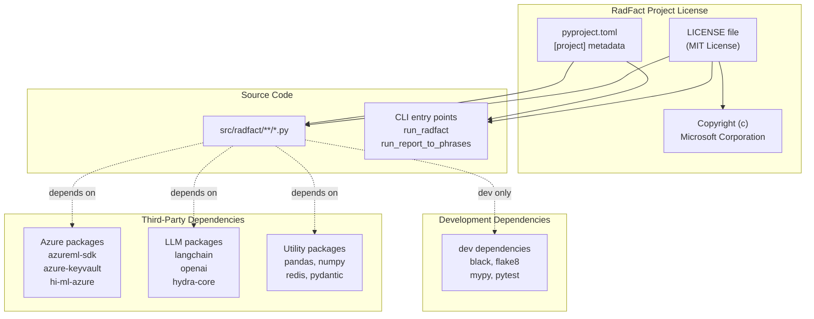
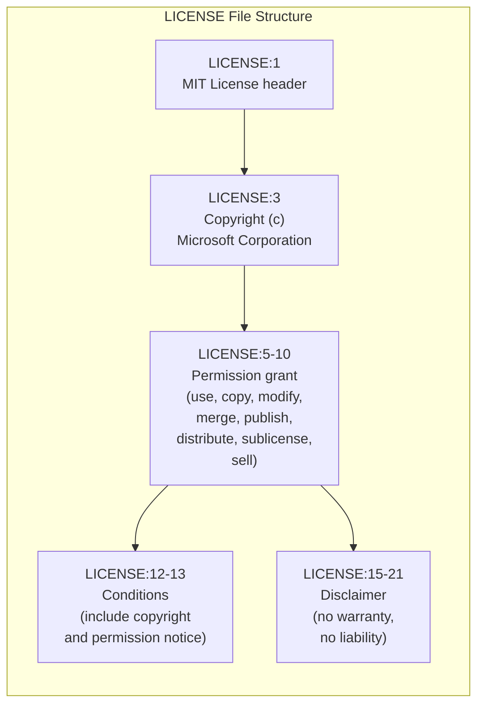

<!-- source: DeepWiki mcp.deepwiki.com · repo microsoft/RadFact · page 9.4 License · fetched 2026-10-26 -->

# License

<details>
<summary>Relevant source files</summary>

The following files were used as context for generating this wiki page:

- [LICENSE](LICENSE)
- [pyproject.toml](pyproject.toml)

</details>


## Purpose and Scope

This page documents the licensing terms for the RadFact project, including copyright information, license type, and practical implications for users and contributors. For information about contributing code to the project, see [Contributing](#9.1). For security policies and vulnerability reporting, see [Security](#9.3).

## License Type

RadFact is distributed under the **MIT License**, one of the most permissive open-source licenses. The copyright is held by **Microsoft Corporation**.

The MIT License grants broad permissions to use, modify, and distribute the software with minimal restrictions, making RadFact suitable for both academic research and commercial applications.

**Sources:** [LICENSE:1-21]()

## License File Location

The complete license text is located in the repository root:

```
RadFact/
├── LICENSE
└── ...
```

The license file contains the full MIT License text with Microsoft Corporation as the copyright holder.

**Sources:** [LICENSE:1-21]()

## License Terms

The MIT License grants the following permissions and includes these conditions:

### Permissions Granted

| Permission | Description |
|------------|-------------|
| **Commercial Use** | Use RadFact in commercial applications without restriction |
| **Modification** | Modify the source code for any purpose |
| **Distribution** | Distribute original or modified versions |
| **Private Use** | Use RadFact privately without disclosure requirements |
| **Sublicensing** | Grant sublicenses to others |

### Conditions

| Condition | Requirement |
|-----------|-------------|
| **License and Copyright Notice** | Include the MIT License text and copyright notice in all copies or substantial portions of the software |

### Limitations

| Limitation | Description |
|------------|-------------|
| **No Warranty** | Software is provided "AS IS" without warranty of any kind |
| **No Liability** | Copyright holders are not liable for any claims or damages arising from the software |

**Sources:** [LICENSE:1-21]()

## License Declaration in Project Metadata

The license is not explicitly declared in the project metadata file `pyproject.toml`, but the presence of the `LICENSE` file in the repository root serves as the authoritative license declaration. The project metadata includes:

```toml
[project]
name = "radfact"
version = "1.0.0"
description = "RadFact: Code for the entailment verification metric RadFact"
```

The project is maintained by the Biomedical Imaging Team - Health Futures UK at Microsoft, as indicated in the authors and maintainers fields.

**Sources:** [pyproject.toml:28-39]()

## License Architecture

The following diagram illustrates how licensing information is structured in the RadFact project:



**Sources:** [LICENSE:1-21](), [pyproject.toml:28-89]()

## Dependency Licenses

RadFact depends on numerous third-party packages, each with its own license. Key dependencies include:

### Azure Ecosystem Dependencies

The following Azure packages are used, which are typically licensed under the MIT License:
- `azureml-sdk` - Azure Machine Learning SDK
- `azureml-tensorboard` - Azure ML TensorBoard integration
- `azure-keyvault` - Azure Key Vault client
- `hi-ml-azure` - Health Intelligence ML Azure utilities

### LLM Infrastructure Dependencies

Core LLM processing dependencies:
- `langchain` (v0.2.17) - MIT License
- `langchain-community` (v0.2.19) - MIT License  
- `langchain-openai` (v0.1.25) - MIT License
- `openai` (v1.55.0) - MIT License
- `hydra-core` (v1.3.2) - MIT License
- `pydantic` (v1.10.17) - MIT License

### Other Dependencies

- `pandas`, `numpy` - BSD License
- `redis` - MIT License

**Users are responsible for ensuring compliance with all third-party dependency licenses when using or distributing RadFact.**

**Sources:** [pyproject.toml:41-60]()

## Practical Implications

### For End Users

The MIT License allows you to:
- Use RadFact for medical report evaluation in research or production environments
- Integrate RadFact into proprietary systems without source code disclosure requirements
- Deploy RadFact on any infrastructure (cloud, on-premise, hybrid)

You must:
- Include the copyright notice and license text when distributing RadFact or substantial portions of it
- Comply with licenses of third-party dependencies listed in [pyproject.toml:41-60]()

### For Contributors

The MIT License means:
- Your contributions will be licensed under the same MIT License terms
- Microsoft Corporation retains copyright on the project
- Contributions are made without warranty or liability on your part
- You retain copyright on your own contributions but grant broad usage rights to others

See [Contributing](#9.1) for the complete contributor guidelines and code of conduct.

### For Commercial Applications

The MIT License is highly permissive for commercial use:
- No royalties or fees required for commercial use
- No requirement to open-source derivative works
- Can be integrated into commercial medical imaging products
- Suitable for use in FDA-regulated or other compliance-driven contexts (subject to validation requirements)

**The software is provided WITHOUT WARRANTY. Users must validate RadFact for their specific use cases, especially in clinical or regulated environments.**

**Sources:** [LICENSE:1-21]()

## License Text Mapping

The following diagram maps specific license terms to their location in the LICENSE file:



**Sources:** [LICENSE:1-21]()

## Version Information

The current version of RadFact is **1.0.0**, as declared in the project metadata:

```toml
[project]
name = "radfact"
version = "1.0.0"
```

This version number applies to the entire RadFact package, including all modules under `src/radfact/` and the CLI entry points `run_radfact` and `run_report_to_phrases`.

**Sources:** [pyproject.toml:29-30]()

## Summary

| Aspect | Details |
|--------|---------|
| **License Type** | MIT License |
| **Copyright Holder** | Microsoft Corporation |
| **License File** | `LICENSE` in repository root |
| **Commercial Use** | Permitted without restriction |
| **Modification** | Permitted without restriction |
| **Distribution** | Permitted with copyright notice |
| **Warranty** | None - provided "AS IS" |
| **Liability** | None - use at your own risk |

For questions about licensing or to report licensing issues, see [Getting Support](#9.2).

**Sources:** [LICENSE:1-21](), [pyproject.toml:28-39]()