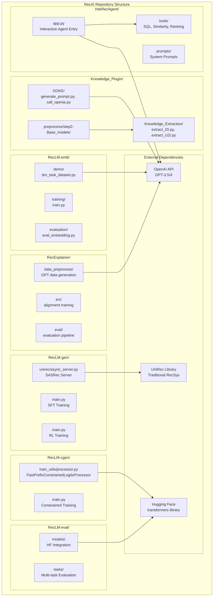
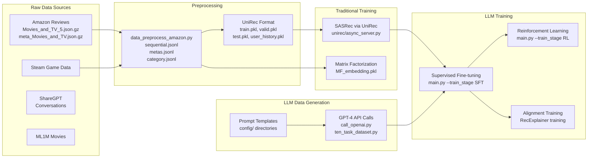

<!-- source: DeepWiki mcp.deepwiki.com · repo microsoft/RecAI · page 1 Overview · fetched 2026-10-26 -->

# Overview

Relevant source files

The following files were used as context for generating this wiki page:

- [InteRecAgent/README.md](InteRecAgent/README.md)
- [Knowledge_Plugin/README.md](Knowledge_Plugin/README.md)
- [RAI_FAQ.md](RAI_FAQ.md)
- [README.md](README.md)
- [RecLM-cgen/README.md](RecLM-cgen/README.md)
- [RecLM-gen/README.md](RecLM-gen/README.md)

This document provides a comprehensive overview of the RecAI repository architecture, which implements various strategies for integrating Large Language Models (LLMs) into recommender systems. RecAI addresses the fundamental challenge that while LLMs excel at natural language interaction, they lack domain-specific recommendation knowledge, and while traditional recommender systems are effective with in-domain data, they lack interactivity and explainability.

The repository contains six main systems that explore different LLM4Rec integration approaches: conversational agents, knowledge injection, specialized LLM training, model explanation, and evaluation frameworks. For specific implementation details of individual systems, see [InteRecAgent](#4), [RecLM-emb](#2), [RecExplainer](#3), [RecLM-gen and RecLM-cgen](#5), [Knowledge_Plugin](#), and [RecLM-eval](#6).

## System Architecture Overview

RecAI implements four distinct approaches to LLM-recommender integration, each addressing different aspects of the recommendation pipeline:

Sources: [README.md:1-234](), [InteRecAgent/README.md:1-196](), [RecLM-gen/README.md:1-310](), [RecLM-cgen/README.md:1-289](), [Knowledge_Plugin/README.md:1-69]()

## LLM Integration Approaches

RecAI implements four distinct strategies for combining LLMs with recommender systems:

| Approach | System | Key Components | Training Required | Benefits |
|----------|--------|----------------|-------------------|----------|
| **Tool-based Orchestration** | InteRecAgent | `app.py`, `tools/`, LLM API | No LLM training | Natural interaction, preserves domain expertise |
| **Knowledge Injection** | Knowledge_Plugin | `generate_prompt.py`, CF extractors | No LLM training | Selective knowledge use, maintains LLM capabilities |
| **LLM Specialization** | RecLM-gen/cgen/emb | `main.py`, SFT/RL training | Extensive training | End-to-end optimization, task-specific adaptation |
| **Model Explanation** | RecExplainer | Alignment training, behavior analysis | Moderate training | Interpretability, trust building |

Sources: [README.md:13-68](), [RAI_FAQ.md:7-19]()

## Core System Components

### Data Processing Pipeline

Sources: [RecLM-gen/README.md:60-66](), [RecLM-cgen/README.md:20-35](), [Knowledge_Plugin/README.md:7-17]()

### Technology Stack

The RecAI implementation leverages several key libraries and frameworks:

**Core ML Libraries:**
- `transformers` (Hugging Face) - LLM training and inference [RecLM-gen/README.md:8](), [RecLM-cgen/README.md:18]()
- `UniRec` - Traditional recommender model training [RecLM-gen/README.md:69](), [RecLM-cgen/README.md:78]()
- `vllm` - Fast LLM serving for inference [RecLM-gen/README.md:262]()

**LLM Integration:**
- OpenAI API integration for GPT-3.5/4 [InteRecAgent/README.md:74-88]()
- FastChat for local model serving [InteRecAgent/README.md:112-141]()
- Custom constrained generation via `FastPrefixConstrainedLogitsProcessor` [RecLM-cgen/README.md:251-276]()

**Data Processing:**
- Amazon dataset preprocessing pipelines [RecLM-gen/README.md:61-66](), [RecLM-cgen/README.md:21-34]()
- Collaborative filtering knowledge extraction [Knowledge_Plugin/README.md:19-35]()
- Multi-task dataset generation for LLM training

Sources: [README.md:102-107](), [InteRecAgent/README.md:56-141](), [RecLM-gen/README.md:1-310]()

## Evaluation and Deployment

RecAI provides comprehensive evaluation through `RecLM-eval` and multiple deployment options:

**Evaluation Framework:**
- Multi-task evaluation across retrieval, ranking, explanation capabilities [README.md:64-66]()
- User simulator for conversational evaluation [RAI_FAQ.md:25-27]()
- GPT-4 based comparative analysis

**Deployment Options:**
- Gradio interfaces for interactive demos [InteRecAgent/README.md:91-99]()
- REST API endpoints for model serving [RecLM-gen/README.md:262-276]()
- Docker containerization support for production deployment

The system is designed for both research experimentation and practical deployment, with responsible AI considerations documented in [RAI_FAQ.md:1-59]().

Sources: [README.md:62-68](), [RAI_FAQ.md:21-37](), [RecLM-gen/README.md:258-289]()

---

