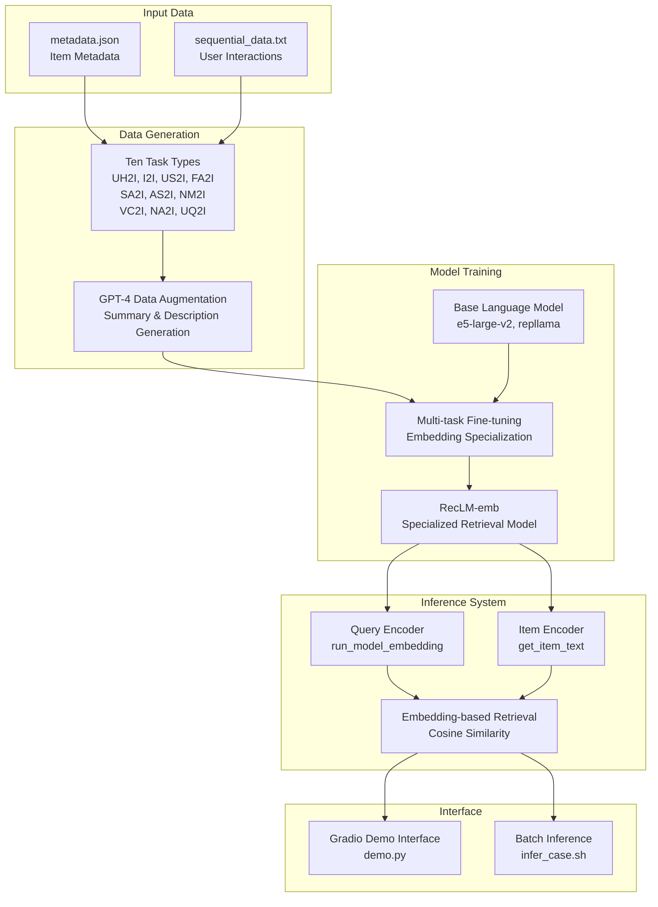
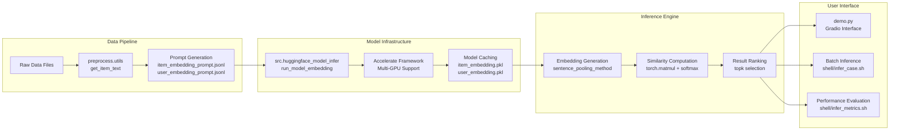
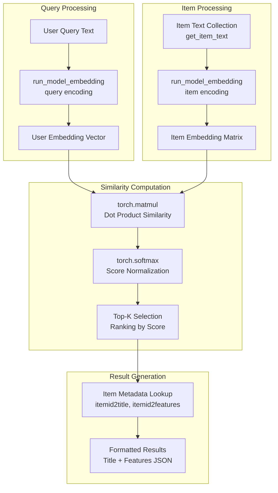

<!-- source: DeepWiki mcp.deepwiki.com · repo microsoft/RecAI · page 2 RecLM-emb · fetched 2026-10-26 -->

# RecLM-emb

<details>
<summary>Relevant source files</summary>

The following files were used as context for generating this wiki page:

- [RecLM-emb/.gitignore](RecLM-emb/.gitignore)
- [RecLM-emb/README.md](RecLM-emb/README.md)
- [RecLM-emb/demo.py](RecLM-emb/demo.py)
- [RecLM-emb/shell/demo.sh](RecLM-emb/shell/demo.sh)

</details>


## Purpose and Scope

RecLM-emb is a specialized text embedding system designed for versatile text-based item retrieval in recommendation systems. This system refines general-purpose language models to encode diverse query formats—including dialogues, detailed descriptions, formatted instructions, and sparse attributes—for effective embedding-based item matching. The system implements a comprehensive ten-task training framework to handle various retrieval scenarios encountered in real-world recommender systems.

For information about generative recommendation models, see [RecLM-gen and RecLM-cgen](#5). For evaluation frameworks, see [RecLM-eval](#6).

## System Overview

RecLM-emb addresses the limitation of general-purpose text embedding models that often produce overly generic semantic representations for item retrieval tasks. The system specializes language models through a multi-task training approach, enabling them to process user queries in various formats while maintaining consistent item representations.



Sources: [RecLM-emb/README.md:19-25](), [RecLM-emb/demo.py:122-131]()

## Ten-Task Training Framework

RecLM-emb implements a comprehensive training framework encompassing ten distinct task types to ensure robust query understanding across various retrieval scenarios:

| Task Code | Task Name | Description | Query Format |
|-----------|-----------|-------------|--------------|
| UH2I | User History | Behavior history of a user | Sequential item interactions |
| I2I | Item-to-Item | Source item searching similar items | Single item representation |
| US2I | User Summary | Summary about user behavior | Natural language user profile |
| FA2I | Full Attributes | Complete item attributes | Concatenated full metadata |
| SA2I | Sparse Attributes | Randomly sampled attributes | Partial metadata fields |
| AS2I | Attributes Summary | Item summary with user tone | Natural language item description |
| NM2I | Name Misspell | Item name with misspellings | Intentionally corrupted titles |
| VC2I | Vague Condition | Non-precise attribute terms | Ambiguous descriptive language |
| NA2I | Negative Attributes | Items lacking certain features | Exclusion-based queries |
| UQ2I | User History and Query | Combined implicit/explicit preferences | History + explicit intent |

Sources: [RecLM-emb/README.md:5-16]()

## Architecture Components

The system architecture integrates multiple components for data processing, model training, and inference:



Sources: [RecLM-emb/demo.py:16-17](), [RecLM-emb/demo.py:116-121](), [RecLM-emb/shell/demo.sh:9-20]()

## Data Requirements and Formats

The system requires two primary input files with specific formats:

### metadata.json Structure
Each line contains a JSON object representing item metadata:
```json
{"title": "item title", "tags": ["tag1", "tag2"], "price": 29.99}
```

**Supported Fields:**
- `title` (required): Primary item identifier
- `tags`, `genres`: Item categorization
- `game_details`, `specs`: Technical specifications  
- `publisher`, `developer`: Content creators
- `price`, `release_date`: Commercial metadata
- `description`: Detailed item information

### sequential_data.txt Structure
Space-separated user-item interaction sequences:
```
userid_1 itemid_11 itemid_12 itemid_13
userid_2 itemid_21 itemid_22
```

Sources: [RecLM-emb/README.md:60-80](), [RecLM-emb/README.md:82-89]()

## Model Configuration and Training

The system supports multiple base models and training configurations:

**Supported Base Models:**
- `intfloat/e5-large-v2`: General-purpose embedding model
- `castorini/repllama-v1-7b-lora-passage`: LLaMA-based retrieval model

**Key Configuration Parameters:**
- `query_max_len`: Maximum query sequence length (default: 512)
- `passage_max_len`: Maximum item text length (default: 280)
- `sentence_pooling_method`: Embedding pooling strategy (`cls`, `mean`, `last`)
- `per_device_eval_batch_size`: Inference batch size
- `normlized`: L2 normalization flag
- `has_template`: Template-based text formatting

Sources: [RecLM-emb/demo.py:72-96](), [RecLM-emb/shell/demo.sh:12-20]()

## Inference and Retrieval Process

The retrieval process implements efficient embedding-based similarity computation:



Sources: [RecLM-emb/demo.py:36-53](), [RecLM-emb/demo.py:122-131]()

## Demo Interface Features

The Gradio-based demo interface provides interactive item retrieval capabilities:

**Interface Components:**
- Text area for user query input
- Submit and clear functionality  
- Ranked result display with item titles
- Expandable JSON metadata view
- Pre-configured example queries

**Example Query Types:**
- Natural language requests: "I'd like to find shooting games not made for kids"
- Attribute-based searches: "Sports game with high quality graphics, released after 2021"
- Conversational contexts: Multi-turn dialogue scenarios
- Budget constraints: "Games under $100"

Sources: [RecLM-emb/demo.py:136-164](), [RecLM-emb/demo.py:149-158]()

---

