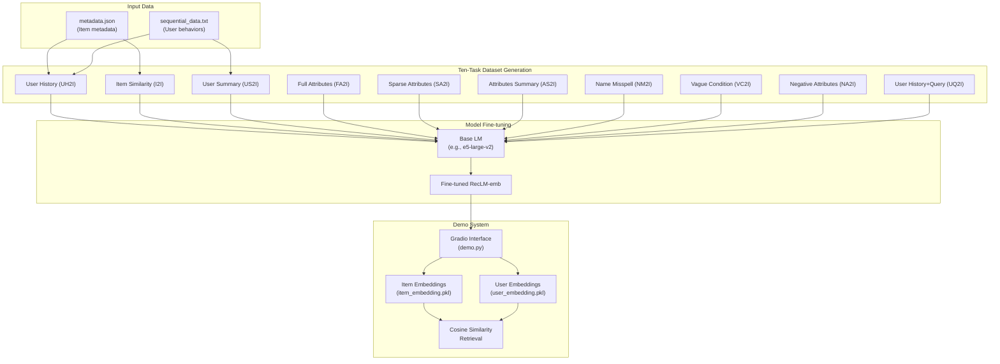
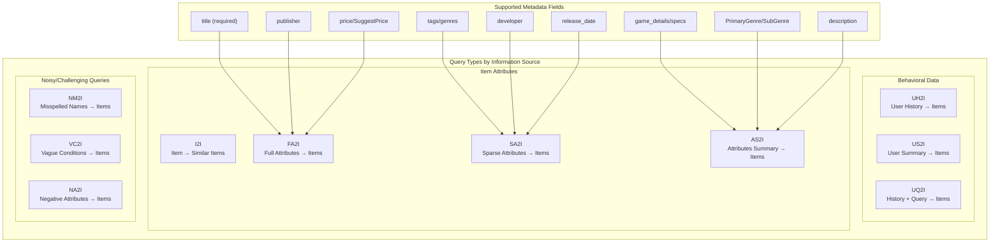
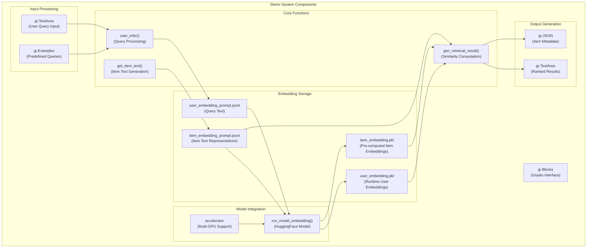
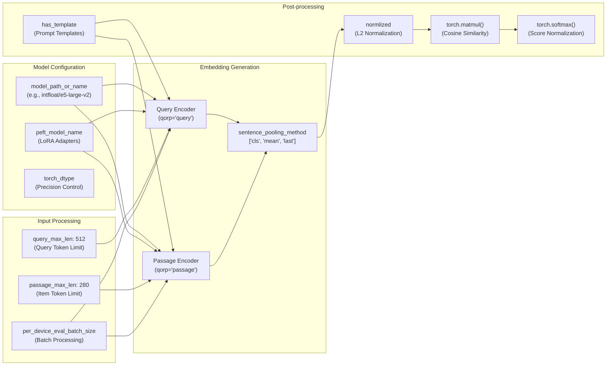
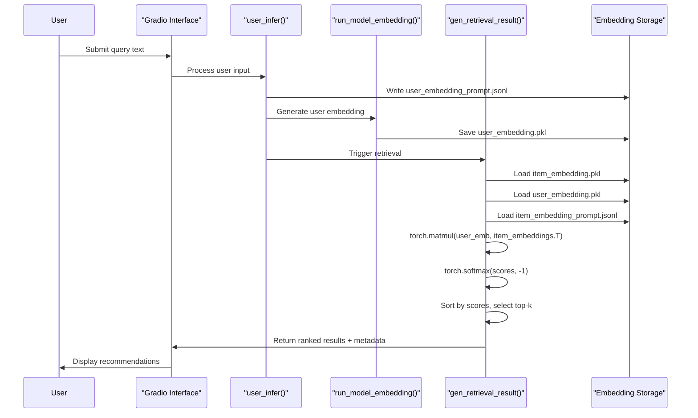

<!-- source: DeepWiki mcp.deepwiki.com · repo microsoft/RecAI · page 2.1 RecLM-emb Architecture · fetched 2026-10-26 -->

# RecLM-emb Architecture

Relevant source files

The following files were used as context for generating this wiki page:

- [RecLM-emb/.gitignore](RecLM-emb/.gitignore)
- [RecLM-emb/README.md](RecLM-emb/README.md)
- [RecLM-emb/demo.py](RecLM-emb/demo.py)
- [RecLM-emb/shell/demo.sh](RecLM-emb/shell/demo.sh)

This document covers the architecture of the RecLM-emb system, which specializes general-purpose text embedding models for versatile text-based item retrieval. This includes the ten-task dataset generation framework and the interactive demo system for real-time item retrieval.

For information about RecLM-emb training pipelines, see [2.2](#2.2). For data processing and GPT integration details, see [2.3](#2.3). For inference and evaluation systems, see [2.4](#2.4).

## System Overview

RecLM-emb transforms general-purpose text embedding models into specialized item retrieval systems by fine-tuning on a comprehensive dataset of ten distinct task types. The system processes two raw input files (`metadata.json` and `sequential_data.txt`) to generate diverse training samples, then fine-tunes embedding models to handle various query formats including dialogues, descriptions, and sparse attributes.

Sources: [RecLM-emb/README.md:1-168]()

## Ten-Task Dataset Architecture

The core innovation of RecLM-emb is its comprehensive ten-task dataset that covers diverse query formats for item retrieval. Each task type represents a different way users might express their preferences or search intents.

Sources: [RecLM-emb/README.md:6-16](), [RecLM-emb/README.md:69-80]()

## Demo System Architecture

The RecLM-emb demo system provides an interactive web interface built with Gradio for real-time item retrieval. The system pre-computes item embeddings and generates user query embeddings on-demand for efficient retrieval.

Sources: [RecLM-emb/demo.py:1-165](), [RecLM-emb/shell/demo.sh:1-20]()

## Model Integration Architecture

The system supports various embedding models through a unified interface, with configurable parameters for different deployment scenarios. The architecture separates query and passage encoding to optimize for retrieval performance.

Sources: [RecLM-emb/demo.py:56-98](), [RecLM-emb/demo.py:122-131]()

## Retrieval Pipeline Architecture

The demo system implements an efficient retrieval pipeline that combines pre-computed item embeddings with real-time user query processing to generate ranked recommendations with metadata enrichment.

Sources: [RecLM-emb/demo.py:20-54](), [RecLM-emb/demo.py:122-131]()

---

