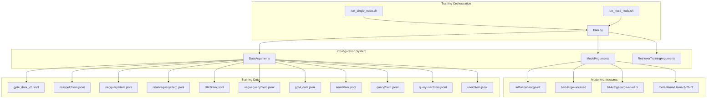
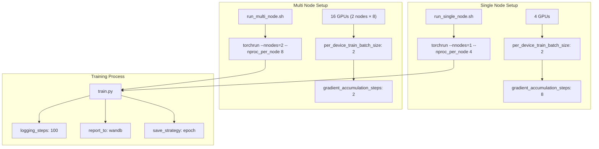
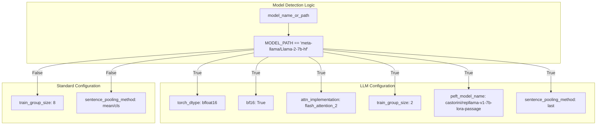

<!-- source: DeepWiki mcp.deepwiki.com · repo microsoft/RecAI · page 2.2 RecLM-emb Training · fetched 2026-10-26 -->

# RecLM-emb Training

Relevant source files

The following files were used as context for generating this wiki page:

- [RecLM-emb/shell/run_multi_node.sh](RecLM-emb/shell/run_multi_node.sh)
- [RecLM-emb/shell/run_single_node.sh](RecLM-emb/shell/run_single_node.sh)
- [RecLM-emb/src/arguments.py](RecLM-emb/src/arguments.py)

This document covers the training orchestration, configuration management, and distributed training infrastructure for RecLM-emb models. The training system supports multiple embedding architectures and provides both single-node and multi-node distributed training capabilities for fine-tuning text embedding models on recommendation tasks.

For information about the RecLM-emb architecture and ten-task dataset, see [RecLM-emb Architecture](#2.1). For data preprocessing and template generation, see [RecLM-emb Data Processing](#2.3).

## Training Orchestration Overview

The RecLM-emb training system uses PyTorch's `torchrun` distributed launcher to coordinate model training across multiple GPUs and nodes. The training process supports both single-node and multi-node configurations with different parameter settings optimized for each deployment scenario.

**Sources:** [RecLM-emb/shell/run_single_node.sh:1-87](), [RecLM-emb/shell/run_multi_node.sh:1-91](), [RecLM-emb/src/arguments.py:1-94]()

## Configuration System

The training configuration is managed through three main dataclasses that define model, data, and training-specific parameters. This modular configuration system allows for flexible experimentation across different model architectures and training setups.

### Model Configuration

The `ModelArguments` class handles model selection and architecture-specific settings:

| Parameter | Purpose | Supported Values |
|-----------|---------|------------------|
| `model_name_or_path` | Base model identifier | e5-large-v2, bert-large-uncased, bge-large-en-v1.5, Llama-2-7b-hf |
| `sentence_pooling_method` | Embedding pooling strategy | mean, cls, last |
| `peft_model_name` | PEFT model for efficient training | castorini/repllama-v1-7b-lora-passage |
| `attn_implementation` | Attention mechanism | eager, sdpa, flash_attention_2 |
| `torch_dtype` | Model precision | bfloat16, float16, float32, auto |

### Data Configuration

The `DataArguments` class defines training data parameters:

| Parameter | Purpose | Default |
|-----------|---------|---------|
| `train_group_size` | Positive + negative examples per query | 8 |
| `query_max_len` | Maximum query sequence length | 512 |
| `passage_max_len` | Maximum item description length | 128 |
| `has_template` | Whether data includes prompt templates | True |
| `max_example_num_per_dataset` | Examples per dataset limit | 100000000 |

### Training Configuration

The `RetrieverTrainingArguments` extends Transformers' `TrainingArguments` with retrieval-specific settings:

| Parameter | Purpose | Default |
|-----------|---------|---------|
| `temperature` | Contrastive learning temperature | 0.01 |
| `negatives_cross_device` | Share negatives across GPUs | False |
| `in_batch_negatives` | Use in-batch negatives | True |
| `fix_position_embedding` | Freeze position embeddings | False |

**Sources:** [RecLM-emb/src/arguments.py:12-53](), [RecLM-emb/src/arguments.py:55-87](), [RecLM-emb/src/arguments.py:88-94]()

## Distributed Training Setup

The training system provides two deployment modes with different resource requirements and performance characteristics.

### Single Node Configuration

Single node training uses 4 GPUs with higher gradient accumulation to maintain effective batch size:

- **GPUs**: 4 per node
- **Batch size**: 2 per device 
- **Gradient accumulation**: 8 steps
- **Effective batch size**: 64 examples
- **Port**: 29501

### Multi Node Configuration  

Multi node training distributes across 2 nodes with 8 GPUs each, requiring node coordination parameters:

- **Nodes**: 2 nodes with 8 GPUs each
- **Batch size**: 2 per device
- **Gradient accumulation**: 2 steps  
- **Effective batch size**: 64 examples
- **Coordination**: `node_rank`, `master_addr`, `master_port` required

**Sources:** [RecLM-emb/shell/run_single_node.sh:30-56](), [RecLM-emb/shell/run_single_node.sh:62-84](), [RecLM-emb/shell/run_multi_node.sh:30-56](), [RecLM-emb/shell/run_multi_node.sh:61-83]()

## Model-Specific Training Configurations

Different embedding model architectures require specialized configuration settings for optimal performance. The training scripts automatically detect the model type and apply appropriate settings.

### Standard Embedding Models

For models like `intfloat/e5-large-v2`, `bert-large-uncased`, and `BAAI/bge-large-en-v1.5`:

| Setting | Value | Purpose |
|---------|-------|---------|
| `train_group_size` | 8 | Higher negative sampling |
| `has_template` | True | Use prompt templates |
| Pooling methods | mean (e5, BERT), cls (BGE) | Architecture-specific pooling |

### Large Language Models

For `meta-llama/Llama-2-7b-hf`, additional efficiency optimizations are enabled:

| Setting | Value | Purpose |
|---------|-------|---------|
| `torch_dtype` | bfloat16 | Memory efficiency |
| `bf16` | True | Mixed precision training |
| `attn_implementation` | flash_attention_2 | Optimized attention |
| `train_group_size` | 2 | Reduced due to memory constraints |
| `peft_model_name` | castorini/repllama-v1-7b-lora-passage | LoRA fine-tuning |
| `sentence_pooling_method` | last | LLM-appropriate pooling |

**Sources:** [RecLM-emb/shell/run_single_node.sh:22-36](), [RecLM-emb/shell/run_single_node.sh:58-64](), [RecLM-emb/shell/run_multi_node.sh:22-36](), [RecLM-emb/shell/run_multi_node.sh:58-64]()

## Training Pipeline and Monitoring

The training process integrates with Weights & Biases for experiment tracking and implements epoch-based checkpointing for model persistence.

### Environment Configuration

Essential environment variables for training execution:

| Variable | Purpose | Value |
|----------|---------|-------|
| `WANDB_PROJECT` | Experiment grouping | "RecLM-emb" |
| `WANDB_DIR` | Logging directory | "$HOME/.cache/" |
| `DISABLE_MLFLOW_INTEGRATION` | Disable MLflow | true |

### Training Parameters

Core training hyperparameters used across all model configurations:

| Parameter | Value | Purpose |
|-----------|-------|---------|
| `learning_rate` | 3e-5 | Learning rate |
| `num_train_epochs` | 3 | Training epochs |
| `warmup_ratio` | 0.1 | Learning rate warmup |
| `temperature` | 0.01 | Contrastive loss temperature |
| `normlized` | True | Normalize embeddings |
| `dataloader_num_workers` | 2 | Data loading parallelism |

### Ten-Task Training Data

The training process loads eleven JSONL files representing different recommendation tasks:

1. `gpt4_data_v2.jsonl` - GPT-4 generated queries (enhanced)
2. `misspell2item.jsonl` - Misspelled query handling
3. `negquery2item.jsonl` - Negative query examples
4. `relativequery2item.jsonl` - Relative preference queries
5. `title2item.jsonl` - Title-based item retrieval
6. `vaguequery2item.jsonl` - Ambiguous query handling
7. `gpt4_data.jsonl` - GPT-4 generated queries (original)
8. `item2item.jsonl` - Item similarity tasks
9. `query2item.jsonl` - Query-item matching
10. `queryuser2item.jsonl` - User-contextualized queries
11. `user2item.jsonl` - User preference modeling

**Sources:** [RecLM-emb/shell/run_single_node.sh:6-21](), [RecLM-emb/shell/run_single_node.sh:40-41](), [RecLM-emb/shell/run_single_node.sh:68-84](), [RecLM-emb/shell/run_multi_node.sh:6-21](), [RecLM-emb/shell/run_multi_node.sh:40-41](), [RecLM-emb/shell/run_multi_node.sh:67-83]()

---

