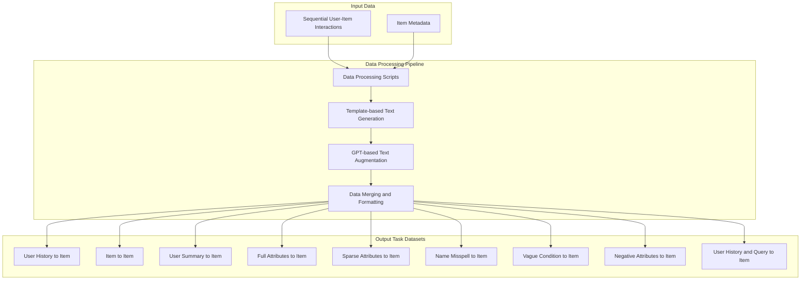
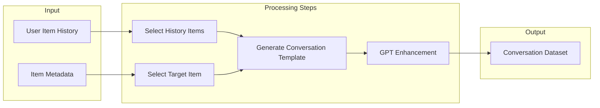
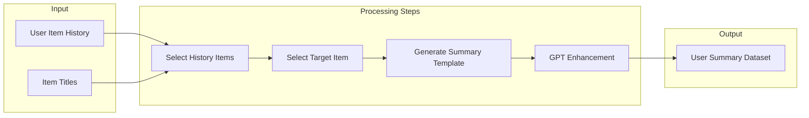
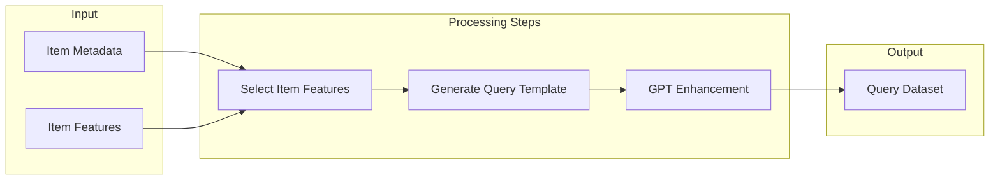
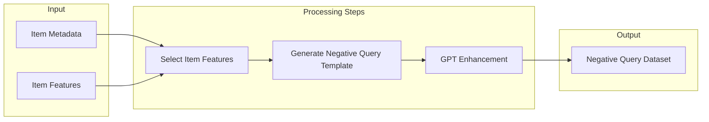
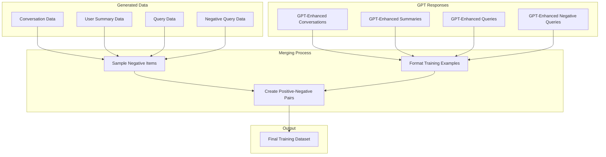
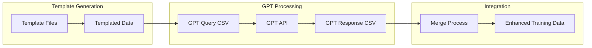

<!-- source: DeepWiki mcp.deepwiki.com · repo microsoft/RecAI · page 2.3 RecLM-emb Data Processing · fetched 2026-10-26 -->

# RecLM-emb Data Processing

<details>
<summary>Relevant source files</summary>

The following files were used as context for generating this wiki page:

- [RecLM-emb/preprocess/data_process_v2.py](RecLM-emb/preprocess/data_process_v2.py)
- [RecLM-emb/preprocess/genera_query_file.py](RecLM-emb/preprocess/genera_query_file.py)
- [RecLM-emb/preprocess/merge.py](RecLM-emb/preprocess/merge.py)
- [RecLM-emb/preprocess/merge_v2.py](RecLM-emb/preprocess/merge_v2.py)
- [RecLM-emb/preprocess/template.py](RecLM-emb/preprocess/template.py)
- [RecLM-emb/preprocess/test_merge.py](RecLM-emb/preprocess/test_merge.py)
- [RecLM-emb/requirements.txt](RecLM-emb/requirements.txt)
- [RecLM-emb/shell/data_pipeline.sh](RecLM-emb/shell/data_pipeline.sh)
- [RecLM-emb/shell/test_data_pipeline.sh](RecLM-emb/shell/test_data_pipeline.sh)

</details>


## Purpose and Scope

This document details the data preprocessing and generation pipelines used for training and testing RecLM-emb, the embedding-based recommendation system component of RecAI. The RecLM-emb data processing pipeline transforms raw interaction data and item metadata into structured training and evaluation datasets for language model fine-tuning.

For information about the overall RecLM-emb architecture, see [RecLM-emb Architecture](#2.1). For details on the training process itself, see [RecLM-emb Training](#2.2).

## Data Processing Pipeline Overview

The RecLM-emb data processing system transforms raw sequential user-item interaction data and item metadata into diverse training and evaluation datasets designed to optimize embedding-based recommendation tasks.



Sources: [RecLM-emb/shell/data_pipeline.sh:1-85](), [RecLM-emb/preprocess/data_process_v2.py:1-257]()

### Pipeline Execution

The data processing pipeline is orchestrated using shell scripts that coordinate the execution of multiple Python scripts:

1. **Initial data processing**: Transforms raw data into structured formats
2. **Template-based generation**: Creates templated text for different recommendation tasks
3. **GPT augmentation**: Uses GPT to enhance data quality and diversity
4. **Data merging**: Combines processed data into final training datasets

The pipeline is run separately for both training and testing data.

Sources: [RecLM-emb/shell/data_pipeline.sh:1-85](), [RecLM-emb/shell/test_data_pipeline.sh:1-66]()

## Input Data Format

The RecLM-emb data processing pipeline starts with two main input data sources:

1. **Sequential Data**: User-item interaction sequences in the format:
   ```
   user_id item_id1 item_id2 item_id3 ...
   ```
   Each line represents one user's chronological item interaction history.

2. **Metadata**: JSON file containing detailed information about each item, including:
   - Title
   - Description
   - Tags/categories
   - Developer/publisher
   - Price
   - Release date
   - Other item-specific attributes

Sources: [RecLM-emb/preprocess/data_process_v2.py:51-71](), [RecLM-emb/preprocess/data_process_v2.py:114-134]()

## Task-Specific Data Generation

RecLM-emb processes data for multiple recommendation tasks, each requiring specific data preparation approaches.

### Conversation Data Generation

Generates simulated conversations between users and recommendation assistants:



The conversation generation process:
1. Selects a target item from a user's history
2. Uses previous items as context
3. Creates conversation templates with placeholders
4. Configures parameters like difficulty level
5. Processes with GPT to generate natural conversations

Sources: [RecLM-emb/preprocess/data_process_v2.py:51-102](), [RecLM-emb/preprocess/template.py:251-272]()

### User Summary Generation

Creates text summaries of user preferences based on interaction history:



The summary generation process:
1. Extracts user interaction history
2. Formats history items into readable text
3. Configures parameters (word count, clarity, style)
4. Uses GPT to generate natural language summaries

Sources: [RecLM-emb/preprocess/data_process_v2.py:113-162](), [RecLM-emb/preprocess/template.py:274-283]()

### Query Generation

Creates natural language queries describing desired item attributes:



The query generation process:
1. Selects random items from metadata
2. Extracts key attributes (tags, features, price, etc.)
3. Configures parameters (difficulty, clarity, word count)
4. Uses GPT to generate natural language queries

Sources: [RecLM-emb/preprocess/data_process_v2.py:164-203](), [RecLM-emb/preprocess/template.py:285-298]()

### Negative Query Generation

Creates queries that express preferences for excluding certain attributes:



The negative query generation process:
1. Selects random items from metadata
2. Extracts key attributes to be excluded
3. Configures parameters (difficulty, clarity, word count)
4. Uses GPT to generate natural language negative queries

Sources: [RecLM-emb/preprocess/data_process_v2.py:205-247](), [RecLM-emb/preprocess/template.py:300-311]()

## Template-Based Data Generation

RecLM-emb uses extensive template libraries to generate diverse training examples:

| Task Type | Example Templates | Purpose |
|-----------|------------------|---------|
| User-to-Item | "I have played several games before: {}. Can you recommend other games for me?" | Generate user history-based recommendation queries |
| Query-to-Item | "I want to find some games with several features: {}." | Generate attribute-based search queries |
| Title-to-Item | "I'm looking for a game called {}." | Generate title-based search queries |
| Item-to-Item | "Can you recommend me some items similar to {}?" | Generate similar item recommendation queries |
| QueryUser-to-Item | "Based on my gaming history {0}, suggest some games that have these attributes: {1}." | Generate combined history and attribute queries |
| Negative Queries | "I want to find some games excluding several features: {}." | Generate exclusion-based queries |

The system uses these templates to:
1. Generate diverse training examples
2. Create natural language variants of the same query
3. Support different recommendation scenarios

Sources: [RecLM-emb/preprocess/template.py:4-249]()

## Data Merging and Sampling

After generating raw data and GPT responses, the pipeline merges them and performs sampling:



The merging process:
1. Loads GPT-enhanced responses for each data type
2. Samples negative items for contrastive learning
3. Formats data into query-positive-negative triplets
4. Writes the final training dataset to disk

The output format contains:
- `query`: Natural language query
- `pos`: List of positive item examples
- `neg`: List of negative item examples

Sources: [RecLM-emb/preprocess/merge_v2.py:56-241](), [RecLM-emb/preprocess/merge.py:47-161]()

## GPT Integration

RecLM-emb uses GPT to enhance the quality and diversity of training data:



The GPT integration process:
1. Prepares query files from template data
2. Formats queries for GPT API processing
3. Processes responses from GPT
4. Merges responses with original data
5. Creates the final enhanced training data

Sources: [RecLM-emb/shell/data_pipeline.sh:41-85](), [RecLM-emb/preprocess/genera_query_file.py:124-164]()

## Test Data Generation

The test data generation pipeline follows a similar process to training data but with some key differences:

1. Samples a smaller subset of data for evaluation
2. Creates evaluation-specific formats
3. Removes duplicate examples between training and test sets
4. Creates specific evaluation task datasets

The resulting test datasets evaluate the model's performance on various recommendation tasks.

Sources: [RecLM-emb/shell/test_data_pipeline.sh:1-66](), [RecLM-emb/preprocess/test_merge.py:17-131]()

## Dependencies

The RecLM-emb data processing pipeline requires the following key dependencies:

- pandas: For data manipulation
- transformers: For tokenization
- tqdm: For progress tracking
- nltk: For text processing
- numpy: For numerical operations
- wandb: For experiment tracking

Sources: [RecLM-emb/requirements.txt:1-24]()

---

