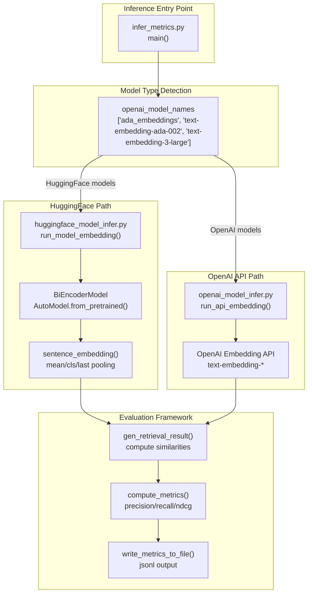
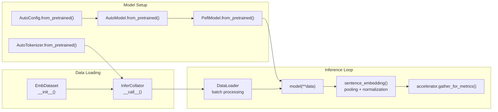
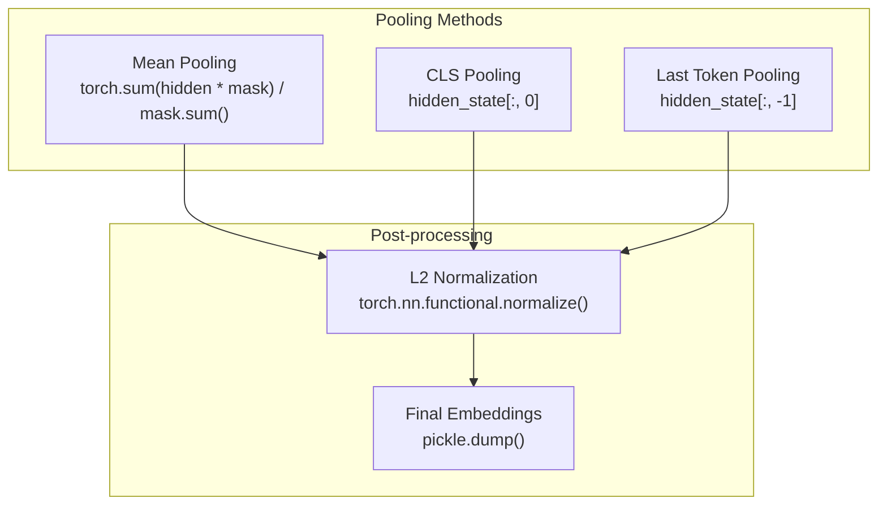
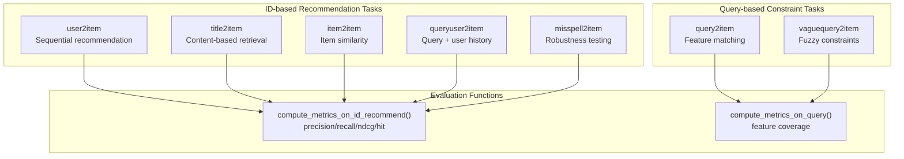
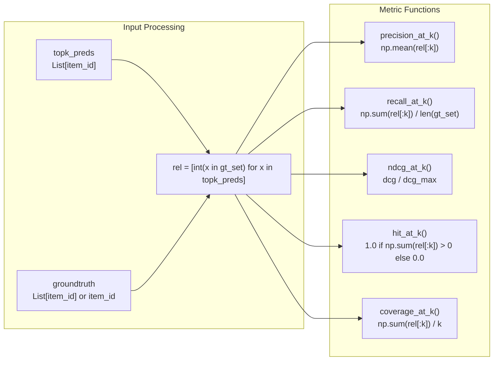
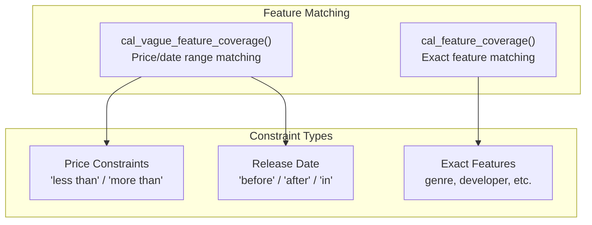

<!-- source: DeepWiki mcp.deepwiki.com · repo microsoft/RecAI · page 2.4 RecLM-emb Inference and Evaluation · fetched 2026-10-26 -->

# RecLM-emb Inference and Evaluation

<details>
<summary>Relevant source files</summary>

The following files were used as context for generating this wiki page:

- [RecLM-emb/infer_metrics.py](RecLM-emb/infer_metrics.py)
- [RecLM-emb/shell/infer_metrics.sh](RecLM-emb/shell/infer_metrics.sh)
- [RecLM-emb/src/data.py](RecLM-emb/src/data.py)
- [RecLM-emb/src/huggingface_model_infer.py](RecLM-emb/src/huggingface_model_infer.py)
- [RecLM-emb/src/model.py](RecLM-emb/src/model.py)
- [RecLM-emb/src/trainer.py](RecLM-emb/src/trainer.py)
- [RecLM-emb/train.py](RecLM-emb/train.py)

</details>


This document covers the model inference pipeline and evaluation framework for RecLM-emb, including embedding generation, retrieval evaluation, and multi-task performance measurement. For information about RecLM-emb training procedures, see [RecLM-emb Training](#2.2). For data processing and preparation, see [RecLM-emb Data Processing](#2.3).

## Purpose and Scope

The RecLM-emb inference and evaluation system provides:
- Model inference for both Hugging Face transformers and OpenAI API models
- Text embedding generation with configurable pooling strategies
- Multi-task evaluation across ten recommendation scenarios
- Performance metrics computation including precision, recall, NDCG, and coverage
- Distributed inference capabilities using Accelerate framework

## Inference Pipeline Overview

The inference system supports two primary model types through a unified interface, handling both local Hugging Face models and remote OpenAI API services.



Sources: [RecLM-emb/infer_metrics.py:411-449](), [RecLM-emb/src/huggingface_model_infer.py:64-104]()

## Model Inference Implementation

The inference system uses the `EmbDataset` class and specialized data collators to handle text processing and tokenization across different model architectures.

### HuggingFace Model Inference

The `run_model_embedding` function orchestrates the complete inference pipeline for transformer models:



The `EmbDataset` class handles template formatting and text preprocessing:

| Parameter | Purpose | Implementation |
|-----------|---------|---------------|
| `has_template` | Apply query/passage prefixes | [RecLM-emb/src/huggingface_model_infer.py:28-29]() |
| `qorp` | Query or passage designation | Used in template: `f'{self.qorp}: {data}'` |
| `max_seq_len` | Sequence length limit | Passed to tokenizer truncation |

Sources: [RecLM-emb/src/huggingface_model_infer.py:14-31](), [RecLM-emb/src/huggingface_model_infer.py:64-104]()

### Embedding Generation and Pooling

The `sentence_embedding` function implements multiple pooling strategies for converting token-level representations to sentence-level embeddings:



The pooling implementation handles attention masking for variable-length sequences:

```python
# Mean pooling with attention mask weighting
s = torch.sum(hidden_state * mask.unsqueeze(-1).float(), dim=1)
d = mask.sum(axis=1, keepdim=True).float()
sentence_embeddings = s / d
```

Sources: [RecLM-emb/src/huggingface_model_infer.py:48-62]()

## Multi-Task Evaluation Framework

The evaluation system processes ten distinct recommendation tasks through a unified metrics computation pipeline.

### Task Types and Evaluation Methods

The system handles different evaluation methodologies based on task characteristics:



Sources: [RecLM-emb/infer_metrics.py:306-311](), [RecLM-emb/shell/infer_metrics.sh:25-261]()

### Retrieval and Ranking Process

The `gen_retrieval_result` function computes similarity scores and generates ranked recommendations:

| Step | Operation | Implementation |
|------|-----------|---------------|
| Load embeddings | `pickle.load()` | User and item embeddings from disk |
| Compute similarities | `torch.matmul(user_emb, item_emb.T)` | Cosine similarity matrix |
| Apply constraints | `scores[idx][history] = -2` | Remove seen items |
| Generate rankings | `get_topk_index()` | Top-k retrieval with numpy |

The similarity computation uses softmax normalization and constraint masking:

```python
scores = torch.softmax(torch.matmul(user_embeddings, item_embeddings.T), -1)
scores[idx][data["history"]] = -2  # Mask historical items
topk_index = get_topk_index(scores, max(eval(args.topk)))
```

Sources: [RecLM-emb/infer_metrics.py:321-347]()

## Performance Metrics Implementation

The evaluation framework implements standard information retrieval metrics with specialized handling for recommendation scenarios.

### Core Metrics Computation



### NDCG Implementation

The Normalized Discounted Cumulative Gain computation uses ideal ranking for normalization:

```python
def ndcg_at_k(r, k, gt_set, method=1):
    gt_rel = [1]*len(gt_set) + [0]*(k-len(gt_set)) if len(gt_set)<k else [1]*k
    dcg_max = dcg_at_k(gt_rel, k, method)
    return dcg_at_k(r, k, method) / dcg_max if dcg_max else 0.0
```

Sources: [RecLM-emb/infer_metrics.py:107-138](), [RecLM-emb/infer_metrics.py:140-189]()

### Feature Coverage Evaluation

For constraint-based tasks, the system evaluates whether recommended items satisfy specified features:



The feature coverage computation processes item metadata to verify constraint satisfaction:

```python
# Price constraint checking
if ground_truth[1][0]=='less than' and meta['price']>=ground_truth[1][1]:
    flag=0
elif ground_truth[1][0]=='more than' and meta['price']<=ground_truth[1][1]:
    flag=0
```

Sources: [RecLM-emb/infer_metrics.py:208-262](), [RecLM-emb/infer_metrics.py:264-304]()

## Distributed Inference Configuration

The system uses Accelerate for distributed inference across multiple GPUs and nodes. Configuration files specify hardware allocation and parallelization strategies.

### Accelerate Configuration

The inference pipeline supports multiple distributed configurations through YAML files:

| Configuration | File | Use Case |
|---------------|------|----------|
| Standard | `shell/infer.yaml` | HuggingFace models |
| Case-specific | `shell/infer_case.yaml` | OpenAI API models |

The `accelerator.prepare()` call handles model and dataloader distribution:

```python
model, dataloader = accelerator.prepare(model, dataloader)
sentence_embeddings = accelerator.gather_for_metrics(sentence_embeddings)
```

Sources: [RecLM-emb/src/huggingface_model_infer.py:87](), [RecLM-emb/src/huggingface_model_infer.py:99](), [RecLM-emb/shell/infer_metrics.sh:19-23]()

---

