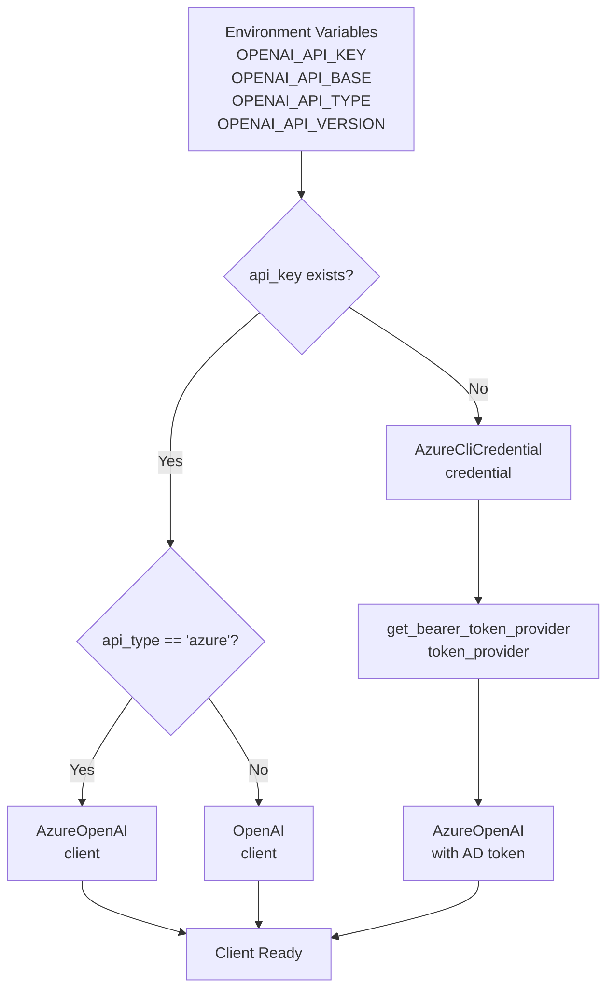
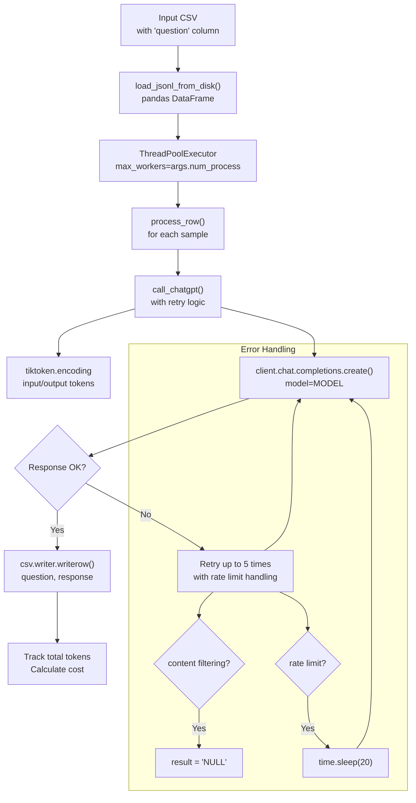
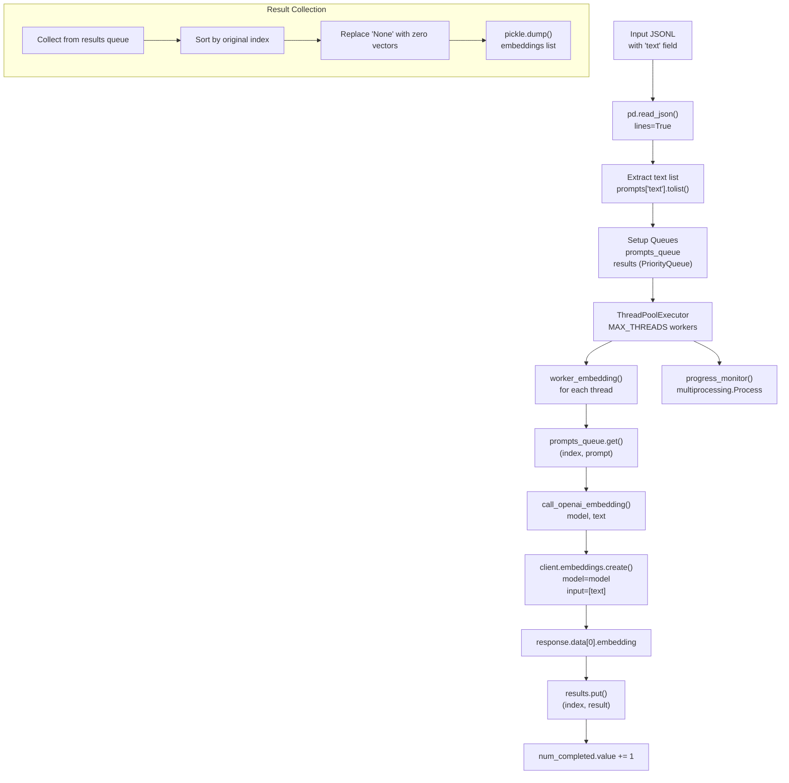
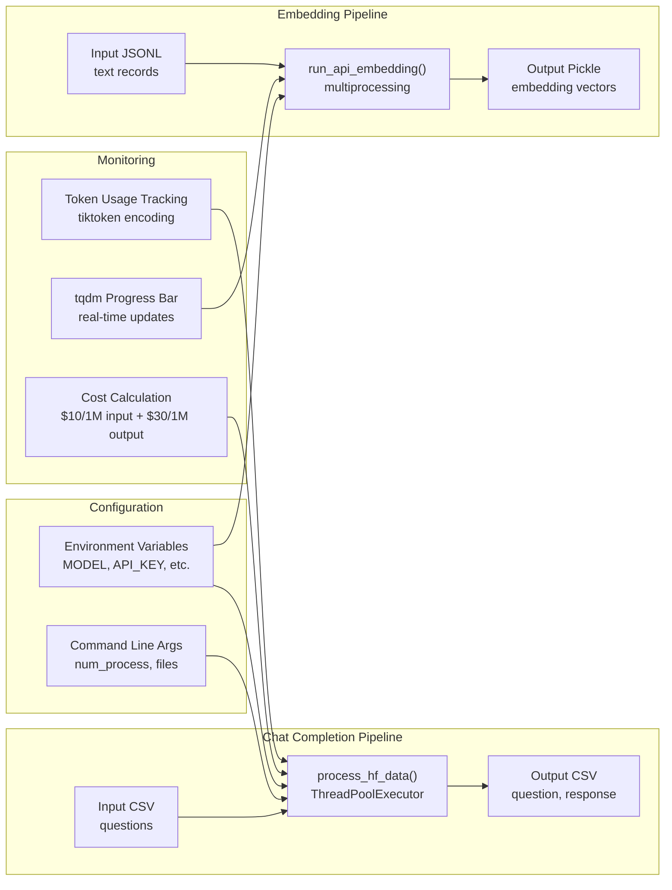

<!-- source: DeepWiki mcp.deepwiki.com · repo microsoft/RecAI · page 2.5 RecLM-emb API Integration · fetched 2026-10-26 -->

# RecLM-emb API Integration

Relevant source files

The following files were used as context for generating this wiki page:

- [RecLM-emb/preprocess/gpt_api/api.py](RecLM-emb/preprocess/gpt_api/api.py)
- [RecLM-emb/src/openai_model_infer.py](RecLM-emb/src/openai_model_infer.py)

This document covers the OpenAI API integration components within the RecLM-emb system, focusing on external service interaction, concurrent processing, and authentication mechanisms. The integration enables RecLM-emb to leverage OpenAI's chat completion and embedding models for data preprocessing and inference tasks.

For information about RecLM-emb architecture and core training components, see [RecLM-emb Architecture](#2.1). For data processing pipelines and template systems, see [RecLM-emb Data Processing](#2.3).

## Authentication and Client Configuration

The RecLM-emb system supports multiple authentication methods for OpenAI API access, including direct API keys and Azure credential-based authentication.

**OpenAI Client Initialization**

The system initializes clients based on available authentication credentials:

| Authentication Method | Client Type | Required Environment Variables |
|----------------------|-------------|-------------------------------|
| API Key + Standard OpenAI | `OpenAI` | `OPENAI_API_KEY` |
| API Key + Azure OpenAI | `AzureOpenAI` | `OPENAI_API_KEY`, `OPENAI_API_BASE`, `OPENAI_API_TYPE=azure`, `OPENAI_API_VERSION` |
| Azure AD Authentication | `AzureOpenAI` with token provider | `OPENAI_API_BASE`, `OPENAI_API_VERSION` |

Sources: [RecLM-emb/preprocess/gpt_api/api.py:16-45](), [RecLM-emb/src/openai_model_infer.py:23-52]()

## Chat Completion API Integration

The `api.py` module handles GPT model interactions for generating synthetic training data and responses.

**Key Functions and Parameters**

| Function | Purpose | Key Parameters |
|----------|---------|----------------|
| `call_chatgpt()` | Single API call with retry logic | `prompt` (str) |
| `process_row()` | Process single data sample | `writer`, `sample` dict |
| `process_hf_data()` | Batch processing with concurrency | `dataset`, `output_file`, `args` |

The system implements comprehensive error handling for content filtering, rate limits, and network issues, with configurable retry counts and sleep intervals.

Sources: [RecLM-emb/preprocess/gpt_api/api.py:54-129]()

## Embedding API Integration

The `openai_model_infer.py` module handles OpenAI embedding model inference for text representation tasks.

**Concurrent Processing Architecture**

| Component | Type | Purpose |
|-----------|------|---------|
| `prompts_queue` | `queue.Queue` | Thread-safe prompt distribution |
| `results` | `queue.PriorityQueue` | Ordered result collection |
| `num_completed` | `multiprocessing.Value` | Shared progress counter |
| `progress_monitor` | `multiprocessing.Process` | Real-time progress display |

The embedding system maintains result ordering through indexed queue operations and implements robust error handling with configurable retry intervals.

Sources: [RecLM-emb/src/openai_model_infer.py:54-127]()

## Data Flow and Processing Pipeline

**Input/Output Formats**

| Module | Input Format | Output Format | Key Fields |
|--------|-------------|---------------|------------|
| `api.py` | CSV with headers | CSV with headers | `question` → `question, response` |
| `openai_model_infer.py` | JSONL | Pickle binary | `text` → embedding vectors |

**Performance Characteristics**

- **Concurrency**: Configurable thread pools (default 1 thread for embeddings, configurable for chat)
- **Rate Limiting**: Automatic 20-second delays on rate limit errors
- **Retry Logic**: Up to 5 retries with exponential backoff
- **Progress Tracking**: Real-time progress bars with `tqdm` integration
- **Memory Efficiency**: Streaming processing for large datasets

Sources: [RecLM-emb/preprocess/gpt_api/api.py:94-129](), [RecLM-emb/src/openai_model_infer.py:85-127]()

---

