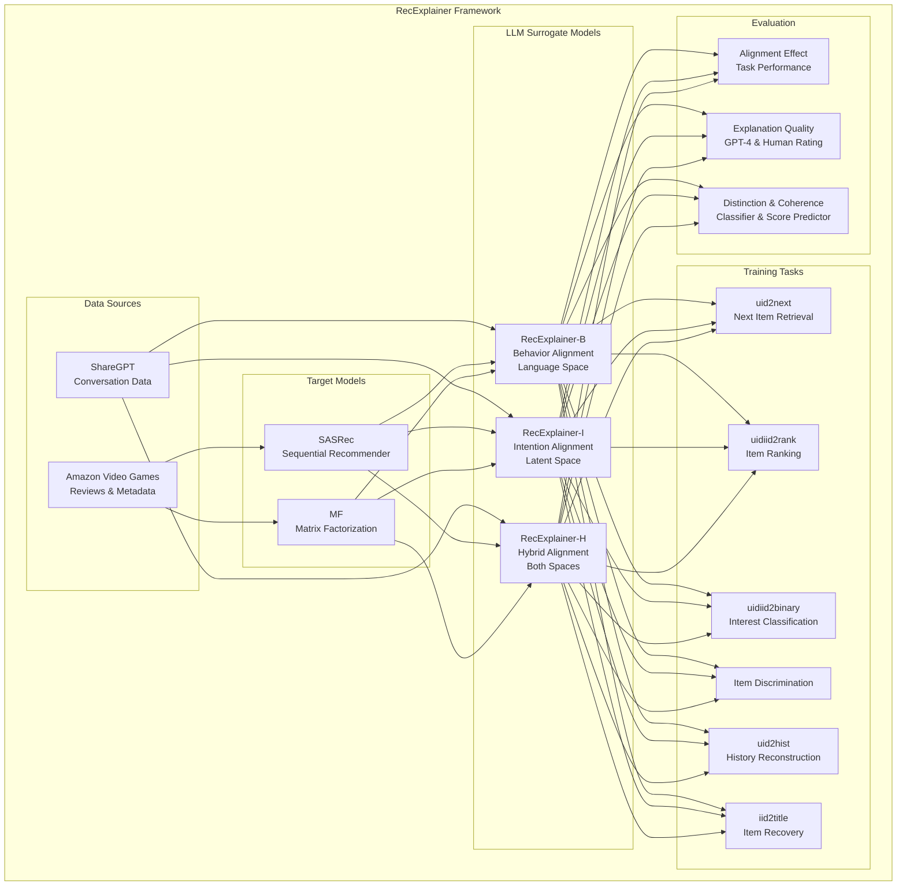
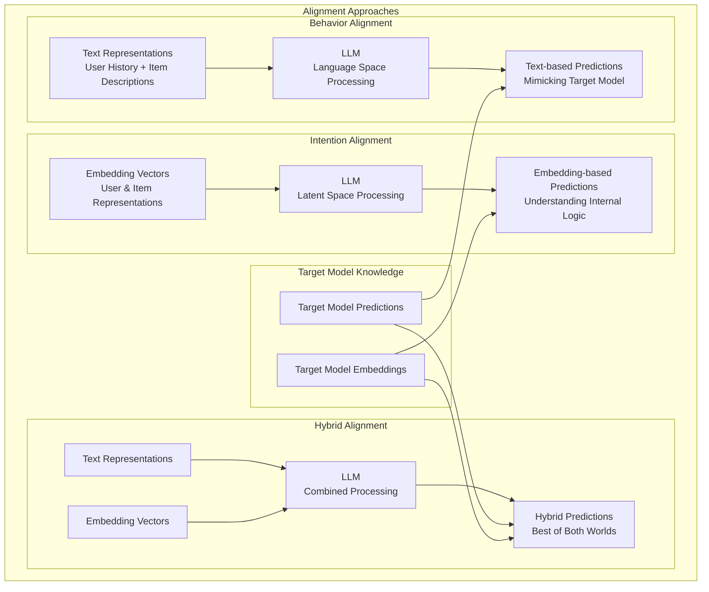
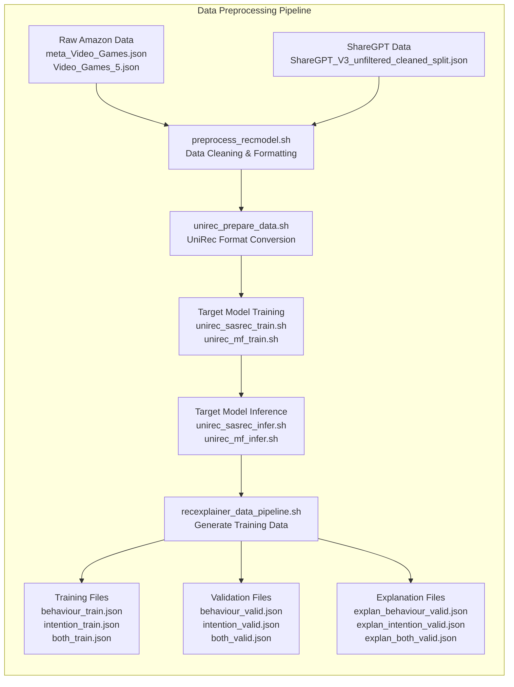
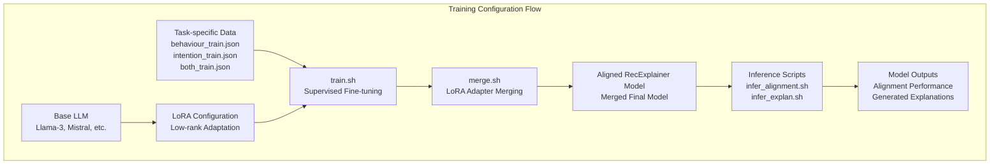
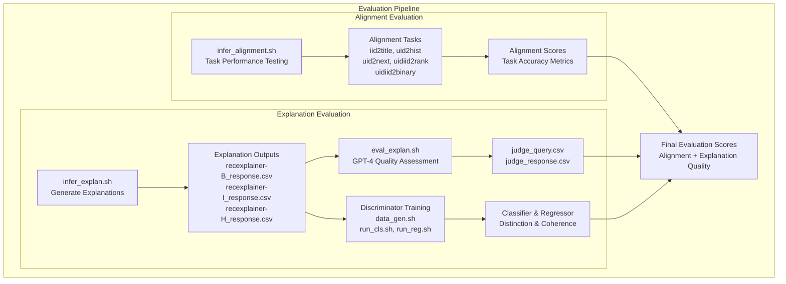
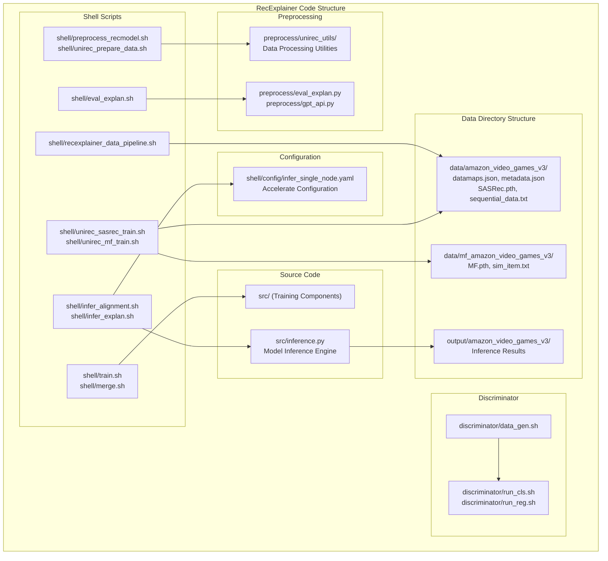

<!-- source: DeepWiki mcp.deepwiki.com · repo microsoft/RecAI · page 3 RecExplainer · fetched 2026-10-26 -->

# RecExplainer

Relevant source files

The following files were used as context for generating this wiki page:

- [RecExplainer/README.md](RecExplainer/README.md)
- [RecExplainer/shell/eval_explan.sh](RecExplainer/shell/eval_explan.sh)
- [RecExplainer/shell/infer_alignment.sh](RecExplainer/shell/infer_alignment.sh)

RecExplainer is a framework for aligning Large Language Models (LLMs) to understand and explain the behavior of black-box recommendation models. The system trains LLMs as surrogate models that can mimic target recommender models and generate natural language explanations for their predictions.

For information about other LLM-based recommendation approaches, see [RecLM-gen and RecLM-cgen](#5) for generative models and [InteRecAgent](#4) for conversational recommendation agents.

## System Overview

RecExplainer consists of two main components: a target recommender model (such as SASRec or Matrix Factorization) that generates recommendations, and an LLM that learns to mimic and explain the target model's behavior through specialized training tasks.

Sources: [RecExplainer/README.md:1-20]()

## Alignment Approaches

RecExplainer implements three distinct alignment strategies to train LLMs as surrogate models for recommendation systems:

### Behavior Alignment (RecExplainer-B)
Operates entirely in the language space by representing user preferences and item information as text. The LLM learns to mimic the target model's behavior using textual representations of users and items.

### Intention Alignment (RecExplainer-I) 
Works in the latent space of the recommendation model, using user and item embeddings to understand the model's internal decision-making process.

### Hybrid Alignment (RecExplainer-H)
Combines both language and latent spaces to leverage the benefits of textual understanding and embedding-based reasoning.

Sources: [RecExplainer/README.md:10-13]()

## Training Tasks and Data Pipeline

The system uses five core training tasks to align the LLM with the target recommender model's behavior patterns:

| Task | Task Type | Description | Inference Mode |
|------|-----------|-------------|----------------|
| Next Item Retrieval | `uid2next` | Predict next item in user sequence | `uid2next` |
| Item Ranking | `uidiid2rank` | Rank candidate items for user | `uidiid2rank` |
| Interest Classification | `uidiid2binary` | Binary classification of user interest | `uidiid2binary` |
| Item Discrimination | - | Distinguish between similar items | - |
| History Reconstruction | `uid2hist` | Reconstruct user interaction history | `uid2hist` |
| Item Recovery | `iid2title` | Recover item information from ID | `iid2title` |

Sources: [RecExplainer/README.md:51-117](), [RecExplainer/shell/infer_alignment.sh:1-142]()

## Training and Inference Configuration

The system supports multiple LLM templates and can be configured for different target recommendation models:

### Supported Models and Templates
- **Target Models**: SASRec, Matrix Factorization (MF)
- **LLM Templates**: mistral, vicuna, llama-2, llama-3, phi3
- **Task Types**: behaviour, intention, both, none

### Key Training Parameters

| Parameter | Description | Example Values |
|-----------|-------------|----------------|
| `rec_model_type` | Target recommender model type | `SASRec`, `MF` |
| `task_type` | Alignment method | `behaviour`, `intention`, `both` |
| `template_name` | LLM chat template | `llama-3`, `mistral` |
| `max_hist_len` | Maximum history length | `9` |
| `model_max_length` | Maximum sequence length | `1024` |

Sources: [RecExplainer/README.md:119-133](), [RecExplainer/shell/infer_alignment.sh:13-21]()

## Evaluation Framework

RecExplainer employs a comprehensive two-fold evaluation approach to assess both alignment effectiveness and explanation quality:

### Alignment Effect Evaluation
Measures how well the LLM understands the target model's predictive patterns through task-specific performance metrics across the six training tasks.

### Explanation Generation Evaluation

#### Overall Ratings
Uses GPT-4 and human experts to evaluate explanation quality through comparative analysis.

#### Distinction and Coherence
Employs trained classifiers and score predictors to verify that explanations are distinct from other LLMs and coherent with the model's own predictions.

Sources: [RecExplainer/README.md:134-194](), [RecExplainer/shell/eval_explan.sh:1-18]()

## Implementation Architecture

The RecExplainer codebase follows a modular structure with distinct components for data processing, model training, and evaluation:

Sources: [RecExplainer/README.md:76-98](), [RecExplainer/shell/infer_alignment.sh:23-46]()

---

