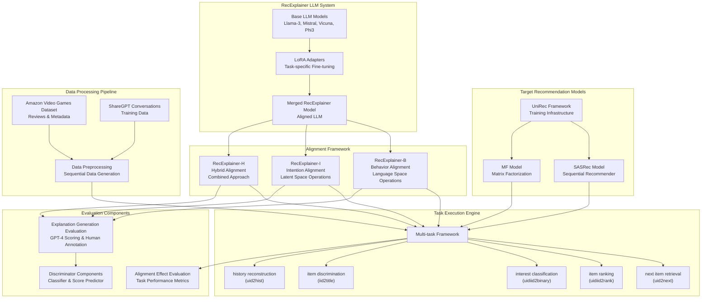
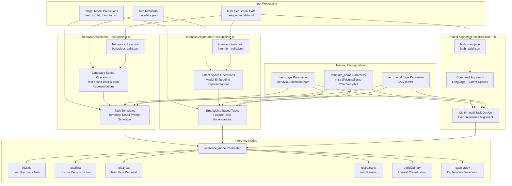
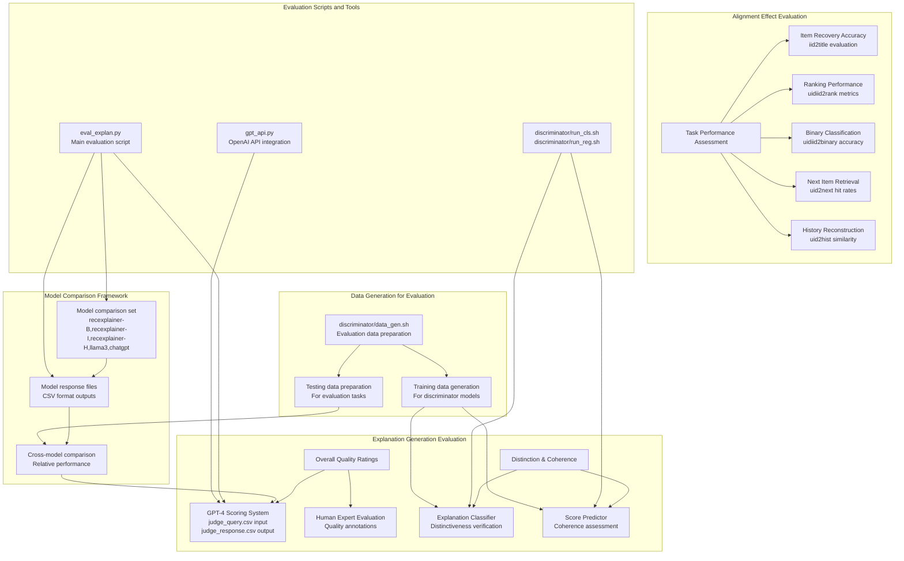
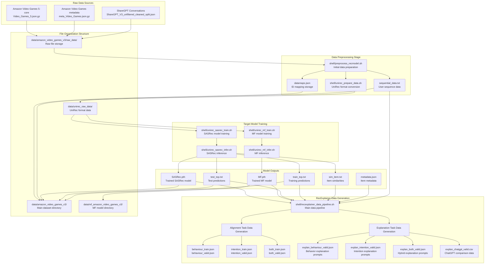

<!-- source: DeepWiki mcp.deepwiki.com · repo microsoft/RecAI · page 3.1 RecExplainer Architecture · fetched 2026-10-26 -->

# RecExplainer Architecture

Relevant source files

The following files were used as context for generating this wiki page:

- [RecExplainer/README.md](RecExplainer/README.md)
- [RecExplainer/shell/eval_explan.sh](RecExplainer/shell/eval_explan.sh)
- [RecExplainer/shell/infer_alignment.sh](RecExplainer/shell/infer_alignment.sh)

## Purpose and Scope

This document provides an architectural overview of RecExplainer, a framework designed to align Large Language Models (LLMs) for understanding and explaining black-box recommender models. RecExplainer serves as a surrogate model that mimics target recommendation model behavior and generates natural language explanations for recommendation decisions.

For information about data pipeline and preprocessing components, see [RecExplainer Data Pipeline](#3.2). For training configuration and model merging details, see [RecExplainer Training](#3.3).

## System Architecture Overview

RecExplainer operates as a two-component framework where an LLM learns to mimic and explain a target recommender model through various alignment strategies. The system supports multiple target recommendation models and provides comprehensive evaluation capabilities.

### Core Components Architecture

Sources: [RecExplainer/README.md:5-20](), [RecExplainer/shell/infer_alignment.sh:20-46]()

## Alignment Approaches Architecture

RecExplainer implements three distinct alignment strategies to train LLMs to understand and explain recommendation model behavior. Each approach operates in different representational spaces and targets different aspects of model understanding.

### Alignment Strategy Framework

Sources: [RecExplainer/README.md:10-13](), [RecExplainer/shell/infer_alignment.sh:13-14](), [RecExplainer/README.md:125-128]()

## Task Framework and Execution Pipeline

The RecExplainer system implements a comprehensive multi-task framework designed to align LLMs with target recommendation models across different dimensions of understanding. Each task targets specific aspects of recommendation model behavior and contributes to overall model alignment.

### Multi-Task Execution Architecture

| Task ID | Task Name | Inference Mode | Purpose | Output Type |
|---------|-----------|----------------|---------|-------------|
| Task 1 | Next Item Retrieval | `uid2next` | Predict next items for user sequences | Item titles/IDs |
| Task 2 | Item Ranking | `uidiid2rank` | Rank items by user preference | Ranking scores |
| Task 3 | Interest Classification | `uidiid2binary` | Binary interest prediction | Yes/No classification |
| Task 4 | Item Discrimination | `iid2title` | Recover item information from embeddings | Item metadata |
| Task 6 | History Reconstruction | `uid2hist` | Reconstruct user interaction history | Historical item sequences |
| Explanation | Case Study Generation | `case study` | Generate natural language explanations | Explanation text |

### Task Processing Pipeline

```mermaid
graph TB
    subgraph "Data Input Layer"
        ValidationFile["validation_file<br/>JSON task data"]
        SequentialFile["sequential_file<br/>User sequence data"]
        MetadataFile["metadata_file<br/>Item information"]
        TestTopFile["test_top_file<br/>Model predictions"]
    end
    
    subgraph "Task Configuration"
        MaxHistLen["max_hist_len: 9<br/>History window size"]
        ModelMaxLength["model_max_length: 1024<br/>Context window"]
        TaskType["task_type<br/>Alignment approach"]
        TemplateName["template_name<br/>Chat template format"]
        InferenceMode["inference_mode<br/>Task specification"]
    end
    
    subgraph "Task Execution Engine"
        PreprocessingWorkers["preprocessing_num_workers: 4<br/>Parallel data processing"]
        BatchProcessor["per_device_eval_batch_size<br/>Batch processing"]
        AccelerateFramework["accelerate launch<br/>Distributed execution"]
    end
    
    subgraph "Generation Parameters"
        MaxNewTokens["max_new_tokens<br/>50-500 tokens"]
        NumBeams["num_beams<br/>1-5 beam search"]
        NumReturnSeqs["num_return_sequences<br/>1-5 outputs"]
        TorchDtype["torch_dtype: bfloat16<br/>Memory optimization"]
        AttnImpl["attn_implementation<br/>flash_attention_2"]
    end
    
    subgraph "Task-Specific Processing"
        ItemRecovery["Item Recovery<br/>max_new_tokens: 200<br/>beam_search: 1"]
        ItemRanking["Item Ranking<br/>max_new_tokens: 500<br/>beam_search: 1"]
        InterestClassification["Interest Classification<br/>max_new_tokens: 100<br/>beam_search: 1"]
        NextItemRetrieval["Next Item Retrieval<br/>max_new_tokens: 150<br/>beam_search: 5"]
        HistoryReconstruction["History Reconstruction<br/>max_new_tokens: 500<br/>beam_search: 1"]
    end
    
    subgraph "Output Processing"
        ResponseFiles["Task response files<br/>Model predictions"]
        EvaluationMetrics["Performance metrics<br/>Task-specific scores"]
        ExplanationOutput["Explanation texts<br/>Natural language output"]
    end
    
    %% Data flow connections
    ValidationFile --> PreprocessingWorkers
    SequentialFile --> PreprocessingWorkers
    MetadataFile --> PreprocessingWorkers
    TestTopFile --> PreprocessingWorkers
    
    %% Configuration connections
    MaxHistLen --> BatchProcessor
    ModelMaxLength --> BatchProcessor
    TaskType --> BatchProcessor
    TemplateName --> BatchProcessor
    InferenceMode --> BatchProcessor
    
    %% Processing connections
    PreprocessingWorkers --> BatchProcessor
    BatchProcessor --> AccelerateFramework
    AccelerateFramework --> ItemRecovery
    AccelerateFramework --> ItemRanking
    AccelerateFramework --> InterestClassification
    AccelerateFramework --> NextItemRetrieval
    AccelerateFramework --> HistoryReconstruction
    
    %% Parameter connections
    MaxNewTokens --> ItemRecovery
    MaxNewTokens --> ItemRanking
    MaxNewTokens --> InterestClassification
    MaxNewTokens --> NextItemRetrieval
    MaxNewTokens --> HistoryReconstruction
    
    %% Output connections
    ItemRecovery --> ResponseFiles
    ItemRanking --> ResponseFiles
    InterestClassification --> ResponseFiles
    NextItemRetrieval --> ResponseFiles
    HistoryReconstruction --> ResponseFiles
    ResponseFiles --> EvaluationMetrics
    ResponseFiles --> ExplanationOutput
```

Sources: [RecExplainer/shell/infer_alignment.sh:25-142](), [RecExplainer/README.md:141-143]()

## Evaluation Architecture

RecExplainer employs a comprehensive two-fold evaluation framework that assesses both alignment effectiveness and explanation generation quality. The evaluation system integrates automated metrics, GPT-4 scoring, and discriminator components for thorough model assessment.

### Evaluation Framework Components

### Evaluation Parameter Configuration

| Component | Parameters | Values | Purpose |
|-----------|------------|--------|---------|
| Model Comparison | `model_names` | `recexplainer-B,recexplainer-I,recexplainer-H,llama3,chatgpt` | Multi-model evaluation |
| Response Processing | `model_response_files` | CSV file paths | Input for comparative analysis |
| GPT-4 Judging | `judge_query_file` | `judge_query.csv` | Evaluation prompts |
| GPT-4 Judging | `judge_response_file` | `judge_response.csv` | GPT-4 evaluation scores |
| API Integration | `input_columns` | `model,label,history,target item,question` | Data structure for evaluation |

Sources: [RecExplainer/shell/eval_explan.sh:8-18](), [RecExplainer/README.md:158-193]()

## Data Flow and Processing Pipeline

The RecExplainer system implements a comprehensive data processing pipeline that transforms raw recommendation datasets into training and evaluation data for LLM alignment. The pipeline supports multiple data sources and generates task-specific datasets for different alignment approaches.

### End-to-End Data Processing Architecture

Sources: [RecExplainer/README.md:51-117](), [RecExplainer/README.md:88-98]()

---

