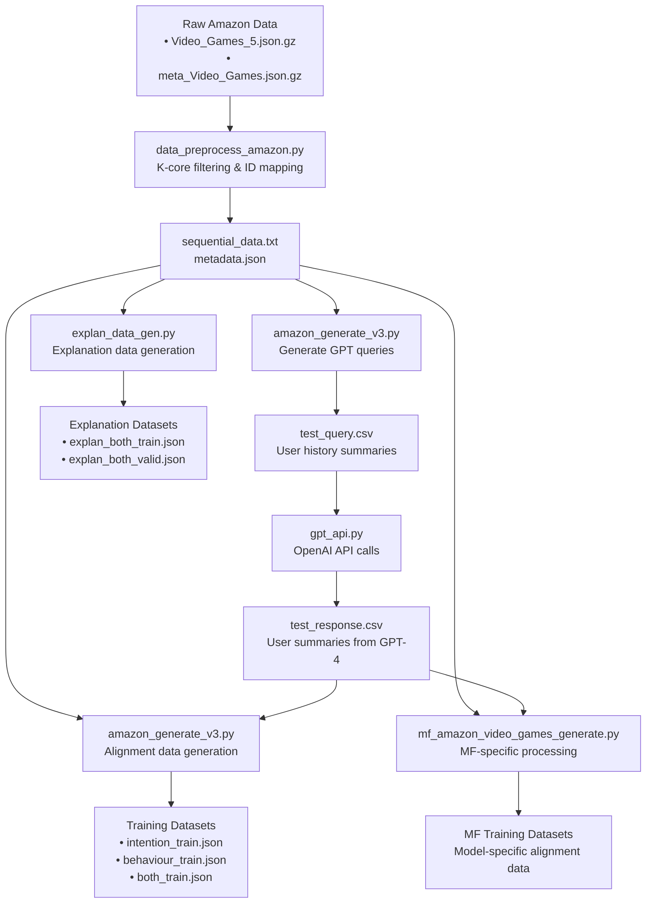
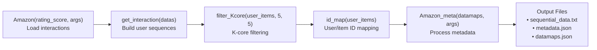
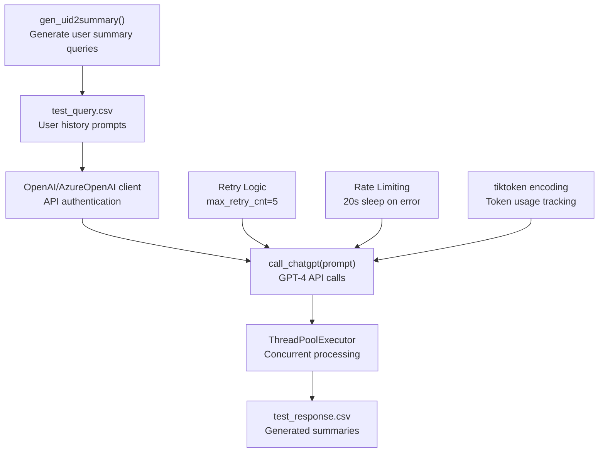
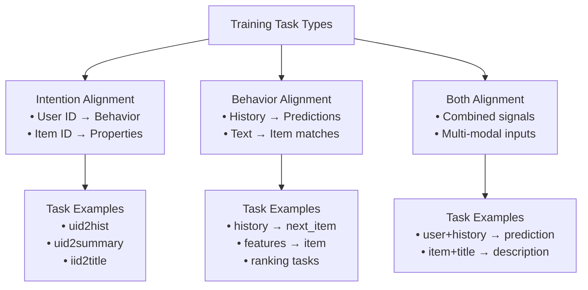
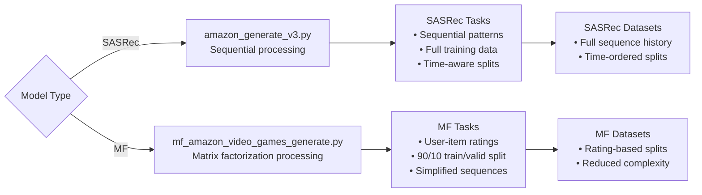
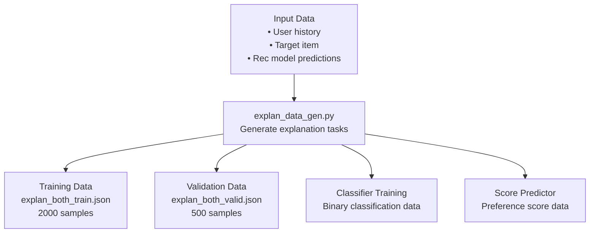
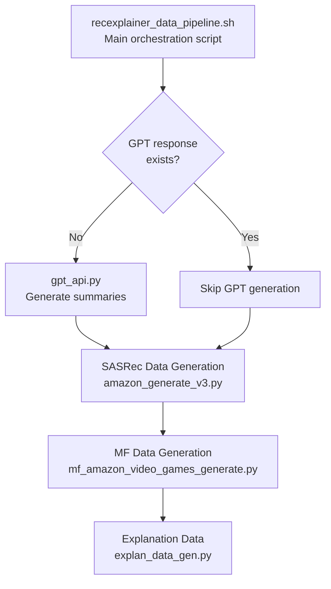

<!-- source: DeepWiki mcp.deepwiki.com · repo microsoft/RecAI · page 3.2 RecExplainer Data Pipeline · fetched 2026-10-26 -->

# RecExplainer Data Pipeline

<details>
<summary>Relevant source files</summary>

The following files were used as context for generating this wiki page:

- [RecExplainer/preprocess/amazon_generate_v3.py](RecExplainer/preprocess/amazon_generate_v3.py)
- [RecExplainer/preprocess/data_preprocess_amazon.py](RecExplainer/preprocess/data_preprocess_amazon.py)
- [RecExplainer/preprocess/eval_explan.py](RecExplainer/preprocess/eval_explan.py)
- [RecExplainer/preprocess/gpt_api.py](RecExplainer/preprocess/gpt_api.py)
- [RecExplainer/preprocess/mf_amazon_video_games_generate.py](RecExplainer/preprocess/mf_amazon_video_games_generate.py)
- [RecExplainer/preprocess/unirec_utils/unirec_split.py](RecExplainer/preprocess/unirec_utils/unirec_split.py)
- [RecExplainer/preprocess/utils.py](RecExplainer/preprocess/utils.py)
- [RecExplainer/requirements.txt](RecExplainer/requirements.txt)
- [RecExplainer/shell/infer_explan.sh](RecExplainer/shell/infer_explan.sh)
- [RecExplainer/shell/merge.sh](RecExplainer/shell/merge.sh)
- [RecExplainer/shell/preprocess_recmodel.sh](RecExplainer/shell/preprocess_recmodel.sh)
- [RecExplainer/shell/recexplainer_data_pipeline.sh](RecExplainer/shell/recexplainer_data_pipeline.sh)
- [RecExplainer/shell/unirec_prepare_data.sh](RecExplainer/shell/unirec_prepare_data.sh)

</details>


## Purpose and Scope

This document covers the RecExplainer data preprocessing pipeline, which transforms raw Amazon product data and user interaction sequences into training datasets for LLM alignment tasks. The pipeline generates synthetic training data using GPT-4 API calls and creates model-specific datasets for both SASRec and Matrix Factorization recommendation models.

For information about the RecExplainer training process, see [RecExplainer Training](#3.3). For the overall RecExplainer architecture, see [RecExplainer Architecture](#3.1).

## Pipeline Overview

The RecExplainer data pipeline orchestrates multiple preprocessing stages to create training data that aligns LLMs with recommendation model behavior. The main pipeline script coordinates data transformation from raw Amazon datasets through GPT-4 augmentation to final training datasets.

### End-to-End Data Flow



Sources: [RecExplainer/shell/recexplainer_data_pipeline.sh:1-71]()

## Data Sources and Raw Data Processing

The pipeline begins with raw Amazon product review data and metadata, applying K-core filtering to ensure data quality and generating sequential interaction datasets.

### Raw Data Structure

| Data Source | Format | Content |
|-------------|--------|---------|
| `Video_Games_5.json.gz` | Gzipped JSON | User reviews with ratings, timestamps, text |
| `meta_Video_Games.json.gz` | Gzipped JSON | Product metadata with titles, descriptions, features |
| `ShareGPT_V3_unfiltered_cleaned_split.json` | JSON | Conversational data for training augmentation |

### Data Preprocessing Pipeline



The preprocessing applies 5-core filtering to ensure both users and items have at least 5 interactions, removing low-activity entities that would create sparse training data.

Sources: [RecExplainer/preprocess/data_preprocess_amazon.py:59-97](), [RecExplainer/preprocess/data_preprocess_amazon.py:203-257](), [RecExplainer/preprocess/data_preprocess_amazon.py:259-291]()

## GPT-4 Integration for User Summaries

The pipeline generates user behavior summaries using GPT-4 API calls to create rich textual representations of user preferences for alignment training.

### GPT API Processing Architecture



The system supports both OpenAI and Azure OpenAI endpoints with automatic retry logic and rate limiting to handle API constraints.

Sources: [RecExplainer/preprocess/gpt_api.py:54-82](), [RecExplainer/preprocess/gpt_api.py:99-137](), [RecExplainer/preprocess/utils.py:103-118]()

### User Summary Template

The pipeline uses a standardized template for generating user summaries:

```
"Based on a user's purchase history, create a concise user summary under 100 words, 
highlighting patterns and traits from past items so that it is helpful to identify 
preferences and predict future item choices."
```

Sources: [RecExplainer/preprocess/utils.py:105]()

## Training Data Generation

The pipeline generates multiple types of training data for different alignment tasks, creating structured datasets that teach LLMs to understand recommendation behavior.

### Data Generation Components

| Component | Purpose | Output Format |
|-----------|---------|---------------|
| `gen_iid2text()` | Item-to-text mappings | Title, features, descriptions |
| `gen_uid2text()` | User-to-text mappings | History, summaries |
| `gen_uid2next_rank()` | Ranking predictions | Top-k item rankings |
| `gen_sharegpt()` | Conversational data | Multi-turn dialogues |

### Task Type Classification

The pipeline generates three alignment approaches:



Sources: [RecExplainer/preprocess/amazon_generate_v3.py:71-113](), [RecExplainer/preprocess/amazon_generate_v3.py:114-184]()

### Template-Based Data Generation

The system uses extensive prompt templates for different task types stored in `prompt_templates` dictionary:

- **iid2title**: Item ID to title mapping (14 variations)  
- **uid2next**: User history to next item prediction (13 variations)
- **uidiid2rank**: User and items to preference ranking (13 variations)
- **uidiid2binary**: User and item to yes/no preference (13 variations)

Sources: [RecExplainer/preprocess/utils.py:165-326]()

## Model-Specific Data Processing

The pipeline supports both SASRec and Matrix Factorization models with specialized data generation approaches tailored to each model's characteristics.

### SASRec vs MF Data Processing



### Key Differences in Processing

| Aspect | SASRec Processing | MF Processing |
|--------|------------------|---------------|
| **History Length** | Full sequence up to `max_seq_len` | Last `max_seq_len-1` items |
| **Data Splits** | Time-based train/valid/test | User-based 90/10 split |
| **Task Complexity** | Full ranking and binary tasks | Simplified ranking tasks |
| **ShareGPT Data** | 10,000 train + 1,000 valid | 9,000 train + 900 valid |

Sources: [RecExplainer/preprocess/amazon_generate_v3.py:151-183](), [RecExplainer/preprocess/mf_amazon_video_games_generate.py:160-186]()

## Explanation Data Generation

The pipeline creates specialized datasets for training models to generate explanations for recommendation decisions using the `explan_data_gen.py` script.

### Explanation Task Structure



The explanation data generation supports both SASRec and MF models through the `--rec_model_type` parameter, creating model-specific explanation training datasets.

Sources: [RecExplainer/shell/recexplainer_data_pipeline.sh:43-50](), [RecExplainer/shell/recexplainer_data_pipeline.sh:64-70]()

## Pipeline Configuration and Execution

The main pipeline script coordinates all processing stages with configurable parameters for different datasets and models.

### Pipeline Parameters

| Parameter | Default Value | Purpose |
|-----------|---------------|---------|
| `max_seq_len` | 9 | Maximum sequence length for user history |
| `model_max_length` | 1024 | Maximum token length for LLM inputs |
| `model_name` | `meta-llama/Meta-Llama-3-8B-Instruct` | Base LLM for tokenization |

### Execution Flow Control



The pipeline includes conditional execution logic to skip expensive GPT-4 API calls if response files already exist.

Sources: [RecExplainer/shell/recexplainer_data_pipeline.sh:24-31](), [RecExplainer/shell/recexplainer_data_pipeline.sh:33-71]()

---

