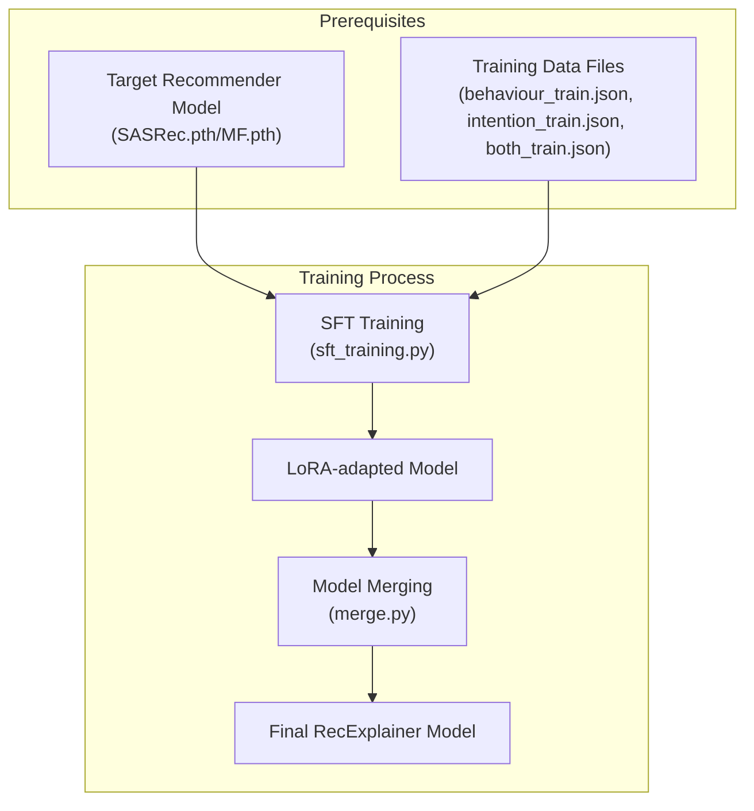
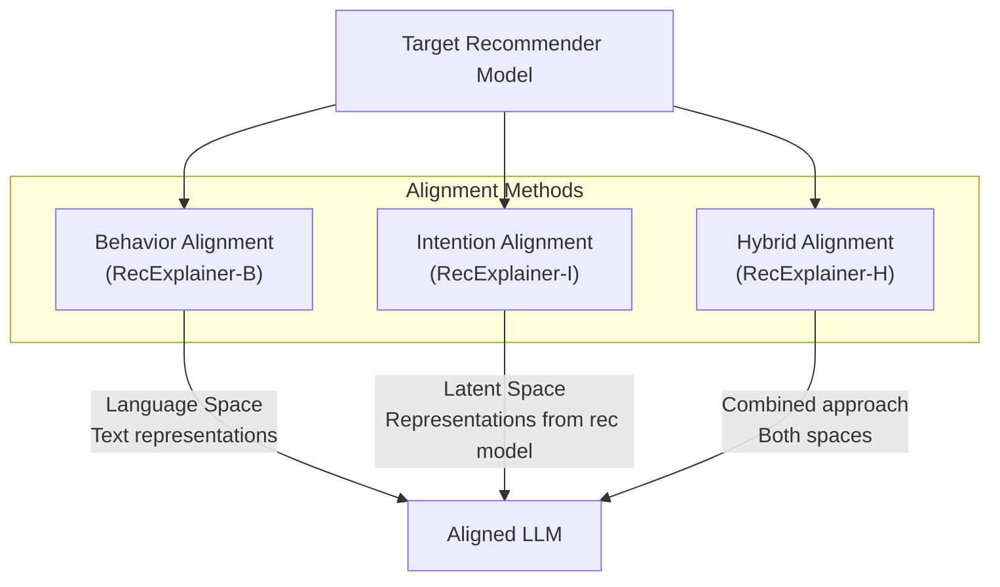
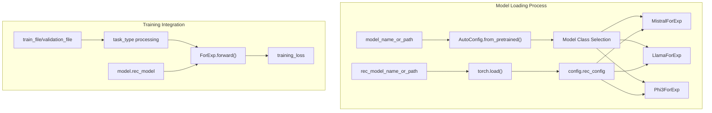
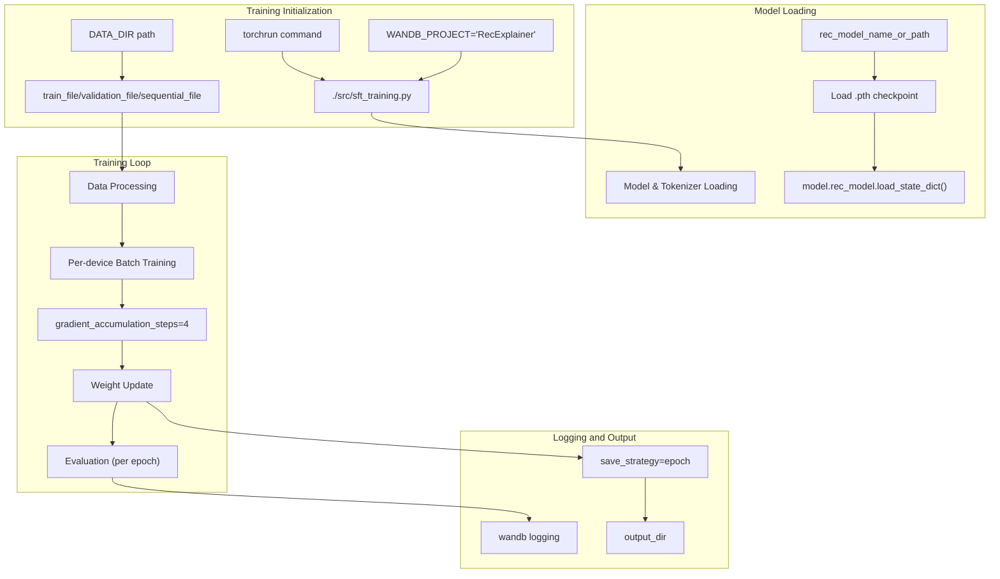
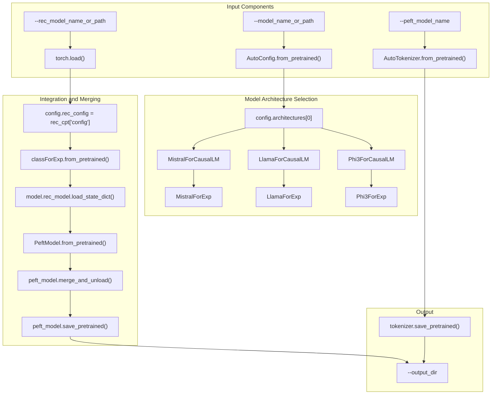
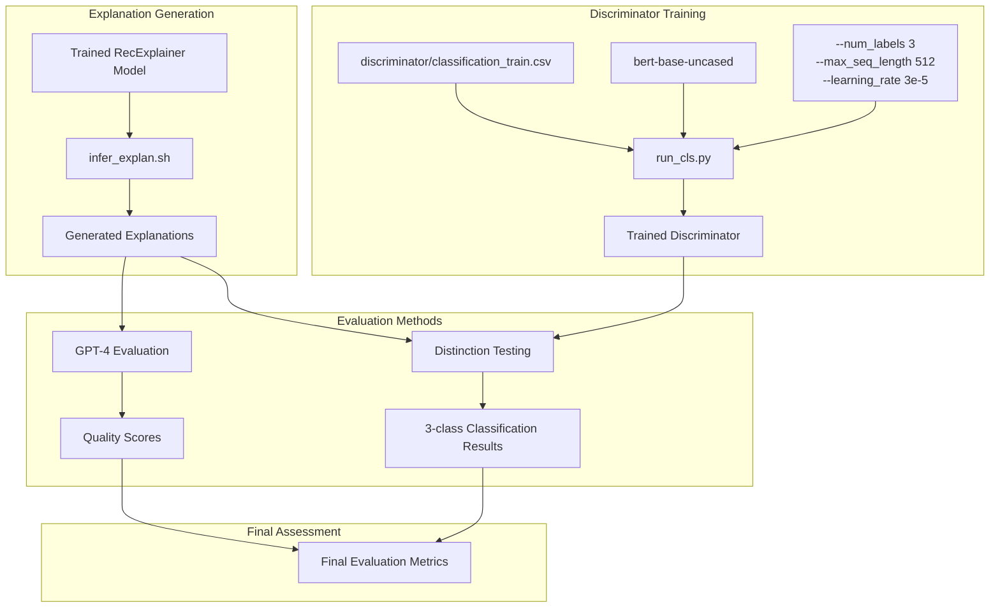

<!-- source: DeepWiki mcp.deepwiki.com · repo microsoft/RecAI · page 3.3 RecExplainer Training · fetched 2026-10-26 -->

# RecExplainer Training

<details>
<summary>Relevant source files</summary>

The following files were used as context for generating this wiki page:

- [RecExplainer/discriminator/run_cls.sh](RecExplainer/discriminator/run_cls.sh)
- [RecExplainer/shell/train.sh](RecExplainer/shell/train.sh)
- [RecExplainer/src/merge.py](RecExplainer/src/merge.py)

</details>


## Purpose and Scope

This document describes the technical process of training RecExplainer models, which are Large Language Models (LLMs) aligned with recommendation systems to generate natural language explanations. It covers the training workflow, configuration parameters, supported models, and the model merging process. For information about the data preparation pipeline, see [RecExplainer Data Pipeline](#4.2). For details about the architecture, see [RecExplainer Architecture](#4.1).

## Training Workflow

The RecExplainer training process involves fine-tuning an LLM using one of three alignment approaches. The process starts with a pre-trained target recommender model and ends with a fine-tuned LLM capable of explaining recommendations.



Sources: [RecExplainer/README.md:7-13](), [RecExplainer/shell/train.sh:5-63]()

## Alignment Approaches

RecExplainer supports three alignment approaches, each focusing on different aspects of the recommendation model:



Sources: [RecExplainer/README.md:10-13](), [RecExplainer/shell/train.sh:24-25]()

## Training Configuration

### Core Training Parameters

The `sft_training.py` script accepts the following key parameters as defined in the training shell script:

| Parameter | Value | Description |
|-----------|-------|-------------|
| `rec_model_type` | SASRec, MF | Target recommender model architecture |
| `task_type` | both | Alignment approach (behaviour+intention hybrid) |
| `template_name` | llama-3 | Chat template for LLM formatting |
| `model_name_or_path` | meta-llama/Meta-Llama-3-8B-Instruct | Base LLM checkpoint |
| `model_max_length` | 1024 | Maximum sequence length |
| `torch_dtype` | bfloat16 | Model precision for training |
| `attn_implementation` | flash_attention_2 | Attention mechanism optimization |

### Training Hyperparameters

| Parameter | Value | Description |
|-----------|-------|-------------|
| `learning_rate` | 1e-4 | AdamW learning rate |
| `num_train_epochs` | 20 | Total training epochs |
| `per_device_train_batch_size` | 4 | Batch size per GPU device |
| `gradient_accumulation_steps` | 4 | Steps before weight update |
| `warmup_ratio` | 0.1 | Learning rate warmup proportion |
| `weight_decay` | 0.0 | L2 regularization weight |

Sources: [RecExplainer/shell/train.sh:13-58]()

### Model Architecture Integration

The `sft_training.py` script integrates target recommender models with LLMs through specialized wrapper classes:



Sources: [RecExplainer/src/merge.py:119-141]()

## Training Execution

### Distributed Training Setup

RecExplainer uses `torchrun` for multi-GPU distributed training:

```bash
torchrun --nnodes=1 --nproc_per_node 4 --master_port=29501 ./src/sft_training.py
```

### Training Process Flow



Sources: [RecExplainer/shell/train.sh:31-63]()

## Alignment Tasks

The LLM is trained on multiple tasks that help it align with the target recommender model:

| Task ID | Task Name | Description | Inference Mode |
|---------|-----------|-------------|----------------|
| Task 1 | Next Item Retrieval | Predict the next item based on user history | uid2next |
| Task 2 | Item Ranking | Rank items based on user preferences | uidiid2rank |
| Task 3 | Interest Classification | Classify user interest in items | uidiid2binary |
| Task 4 | Item Discrimination | Distinguish between similar items | - |
| Task 6 | History Reconstruction | Reconstruct user history from user ID | uid2hist |

Additional evaluation includes item recovery (iid2title) which tests if the model can accurately identify items.

Sources: [RecExplainer/README.md:8](), [RecExplainer/shell/infer_alignment.sh:26-142]()

## Post-Training: Model Merging

### LoRA Adapter Merging Process

The `merge.py` script combines LoRA adapters with the base model to create the final RecExplainer model:



### Configuration Processing

The merge process handles recommender model configuration by removing deployment-specific keys:

```python
del_keys = ['device', 'item_emb_path', 'text_emb_path']
```

Sources: [RecExplainer/src/merge.py:90-151]()

## Evaluation

After training and merging, the RecExplainer model is evaluated in two ways:

### Alignment Effect Evaluation

Tests how well the model understands the recommender system using the following tasks:
- Item recovery (`iid2title`)
- Item ranking (`uidiid2rank`)
- Interest classification (`uidiid2binary`)
- Next item retrieval (`uid2next`)
- History reconstruction (`uid2hist`)

Each task evaluates different aspects of the model's understanding of the recommendation system.

Sources: [RecExplainer/shell/infer_alignment.sh:26-142](), [RecExplainer/README.md:135-143]()

### Explanation Quality Evaluation

Evaluates the quality of generated explanations through multiple approaches including discriminator training:



### Discriminator Training Configuration

The discriminator uses BERT for 3-class classification with the following parameters:

| Parameter | Value | Description |
|-----------|-------|-------------|
| `num_labels` | 3 | Number of classification labels |
| `max_seq_length` | 512 | Maximum input sequence length |
| `learning_rate` | 3e-5 | BERT fine-tuning learning rate |
| `num_train_epochs` | 3 | Training epochs for discriminator |
| `per_device_train_batch_size` | 8 | Batch size for discriminator training |

Sources: [RecExplainer/discriminator/run_cls.sh:8-32]()

## Supported Target Recommender Models

RecExplainer currently supports two types of recommender models:

1. **SASRec (Self-Attentive Sequential Recommendation)**: A sequential recommender model that uses self-attention mechanisms to capture user sequential behavior patterns.

2. **MF (Matrix Factorization)**: A classic collaborative filtering approach that decomposes the user-item interaction matrix into latent factors.

The choice of recommender model affects the training process and the types of explanations that can be generated.

Sources: [RecExplainer/shell/train.sh:5-63](), [RecExplainer/shell/train.sh:66-124]()

---

