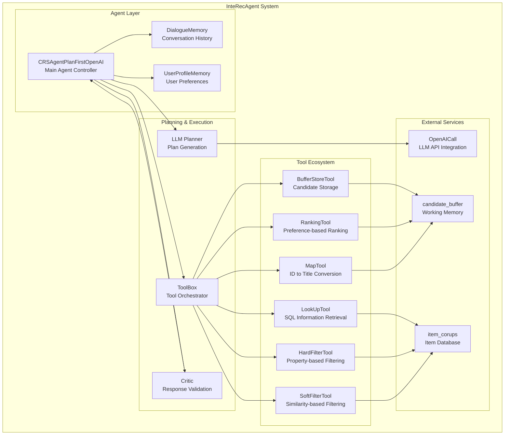
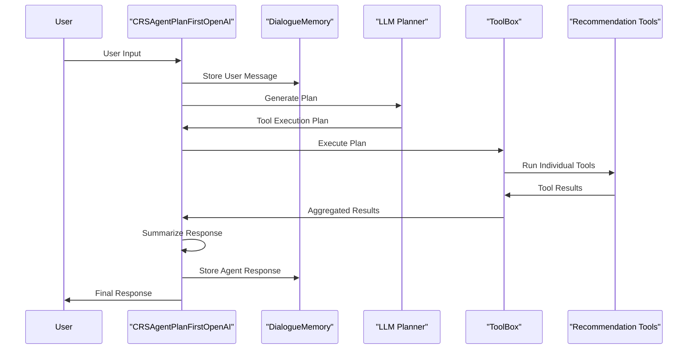
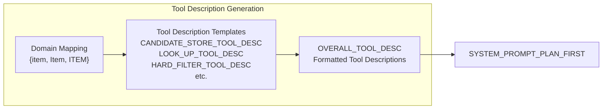
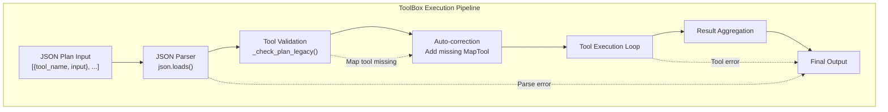
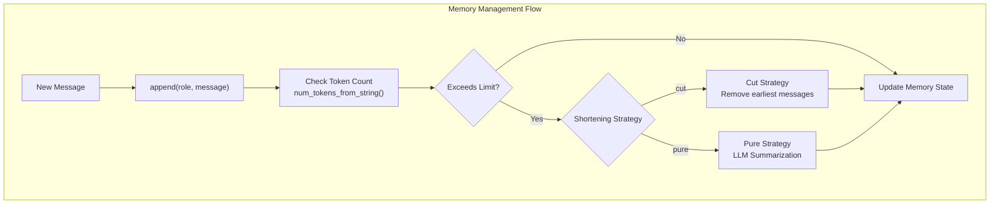
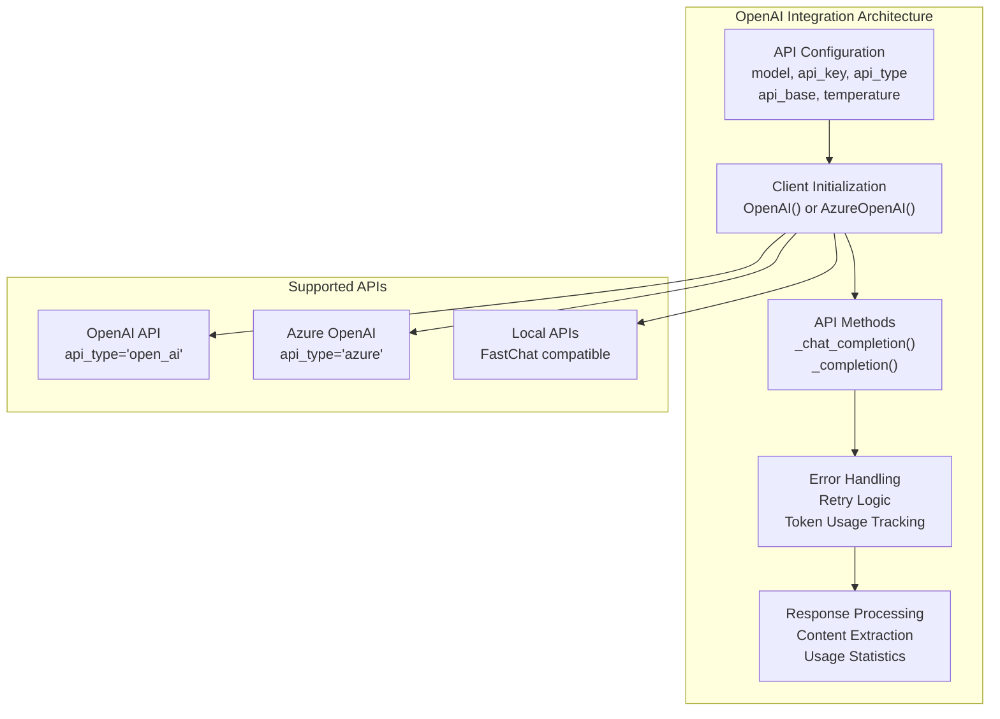
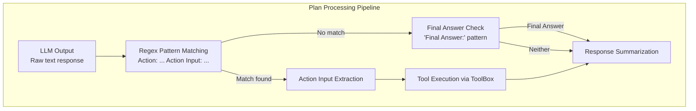

<!-- source: DeepWiki mcp.deepwiki.com · repo microsoft/RecAI · page 4 InteRecAgent · fetched 2026-10-26 -->

# InteRecAgent

Relevant source files

The following files were used as context for generating this wiki page:

- [InteRecAgent/llm4crs/agent_plan_first_openai.py](InteRecAgent/llm4crs/agent_plan_first_openai.py)
- [InteRecAgent/llm4crs/prompt/tool.py](InteRecAgent/llm4crs/prompt/tool.py)
- [InteRecAgent/llm4crs/utils/open_ai.py](InteRecAgent/llm4crs/utils/open_ai.py)
- [InteRecAgent/requirements.txt](InteRecAgent/requirements.txt)

## Purpose and Scope

InteRecAgent is a conversational recommendation agent that uses tool-based LLM orchestration to provide interactive item recommendations. The system employs a plan-first execution framework where an LLM acts as the brain to understand user intent, plan tool usage, and orchestrate recommendation tools to generate contextual responses. This document covers the agent architecture, tool system, memory management, and integration patterns.

For information about other LLM-enhanced recommendation approaches, see [RecLM-emb](#2), [RecExplainer](#3), and [RecLM-gen and RecLM-cgen](#5).

## Architecture Overview

InteRecAgent implements a plan-first agent architecture where the LLM generates execution plans that are then executed by specialized recommendation tools.

### Core Components Architecture

**Sources:** [InteRecAgent/llm4crs/agent_plan_first_openai.py:245-585]()

### Execution Flow

**Sources:** [InteRecAgent/llm4crs/agent_plan_first_openai.py:417-490]()

## Tool System

InteRecAgent employs six specialized tools for different recommendation tasks, each with specific input formats and behaviors.

### Tool Definitions and Capabilities

| Tool Name | Code Class | Purpose | Input Format |
|-----------|------------|---------|--------------|
| `BufferStoreTool` | Item Candidates Storing Tool | Store candidate items for processing | String of item names split by ";;" |
| `LookUpTool` | Item Information Look Up Tool | Query item database with SQL | SQL SELECT command |
| `HardFilterTool` | Item Properties Filtering Tool | Filter items by hard constraints | SQL SELECT with WHERE conditions |
| `SoftFilterTool` | Item Similarity Filtering Tool | Find similar items using embeddings | Python list of seed item titles |
| `RankingTool` | Item Candidates Ranking Tool | Rank items by preference/similarity | JSON with "schema", "prefer", "unwanted" |
| `MapTool` | Mapping Tool | Convert item IDs to titles | Integer (number of items needed) |

**Sources:** [InteRecAgent/llm4crs/prompt/tool.py:7-14](), [InteRecAgent/llm4crs/prompt/tool.py:82-101]()

### Tool Description System

The system uses dynamic tool descriptions that are formatted based on the domain:

**Sources:** [InteRecAgent/llm4crs/prompt/tool.py:17-101](), [InteRecAgent/llm4crs/agent_plan_first_openai.py:267-274]()

### Tool Execution Framework

The `ToolBox` class orchestrates tool execution with validation and error handling:

**Sources:** [InteRecAgent/llm4crs/agent_plan_first_openai.py:23-153]()

## Memory Management

InteRecAgent implements sophisticated memory management for maintaining conversation context and user profiles.

### DialogueMemory Implementation

The `DialogueMemory` class handles conversation history with automatic shortening capabilities:

| Feature | Implementation | Configuration |
|---------|---------------|---------------|
| Memory Storage | List of role-content dictionaries | `self.memory = []` |
| Token Limiting | Configurable max tokens per dialogue | `max_dialogue_tokens = 512` |
| Shortening Strategy | "cut" (truncate) or "pure" (LLM summarize) | `shortening_strategy` |
| Auto-shortening | Triggered on token limit exceeded | `enable_shorten = True` |

**Sources:** [InteRecAgent/llm4crs/agent_plan_first_openai.py:155-243]()

### User Profile Integration

The system optionally maintains user profiles through `UserProfileMemory`:

- **Profile Updates**: Triggered every N turns based on `user_profile_update` parameter
- **Profile Integration**: Automatically injected into ranking tools
- **Profile Structure**: Contains "prefer", "unwanted", and historical interaction data

**Sources:** [InteRecAgent/llm4crs/agent_plan_first_openai.py:361-363](), [InteRecAgent/llm4crs/agent_plan_first_openai.py:481-484]()

## LLM Integration and API Management

### OpenAI API Integration

The `OpenAICall` class provides robust API integration with multiple provider support:

**Sources:** [InteRecAgent/llm4crs/utils/open_ai.py:32-145]()

### Token Usage Tracking

The system implements context-aware token usage tracking:

- **Context Variables**: Uses `ContextVar` for thread-safe token counting
- **Automatic Aggregation**: Accumulates tokens across multiple API calls
- **Usage Categories**: Tracks completion, prompt, and total tokens separately

**Sources:** [InteRecAgent/llm4crs/utils/open_ai.py:14-29](), [InteRecAgent/llm4crs/utils/open_ai.py:132-139]()

## Plan Generation and Execution

### System Prompt Structure

The agent uses `SYSTEM_PROMPT_PLAN_FIRST` which includes:

- Tool descriptions formatted for the specific domain
- Tool execution format specifications
- Action/Action Input parsing patterns
- Final Answer generation instructions

### Plan Parsing and Validation

**Sources:** [InteRecAgent/llm4crs/agent_plan_first_openai.py:523-537]()

## Dependencies and Requirements

The system requires the following key dependencies:

| Category | Dependencies | Purpose |
|----------|-------------|---------|
| LLM Integration | `openai>=1.5.0`, `langchain==0.0.312` | API communication and agent framework |
| Data Processing | `pandasql==0.7.3`, `sqlparse==0.4.2` | SQL query processing for tool operations |
| Vector Operations | `faiss-cpu==1.7.4`, `sentence_transformers==2.2.2` | Similarity-based filtering |
| Web Interface | `gradio==3.40.1` | Interactive demo interface |
| Utilities | `loguru==0.7.0`, `tiktoken==0.4.0` | Logging and token counting |

**Sources:** [InteRecAgent/requirements.txt:1-17]()

---

