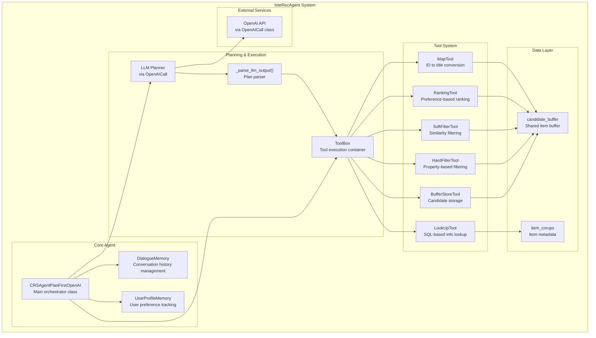
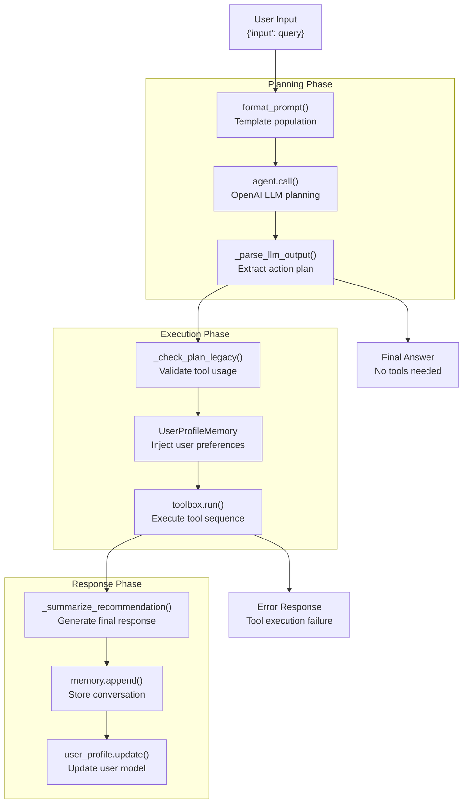
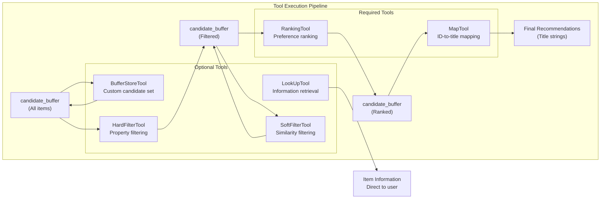
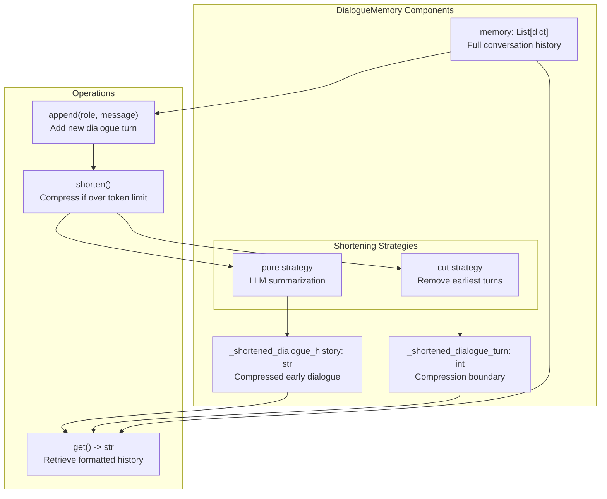
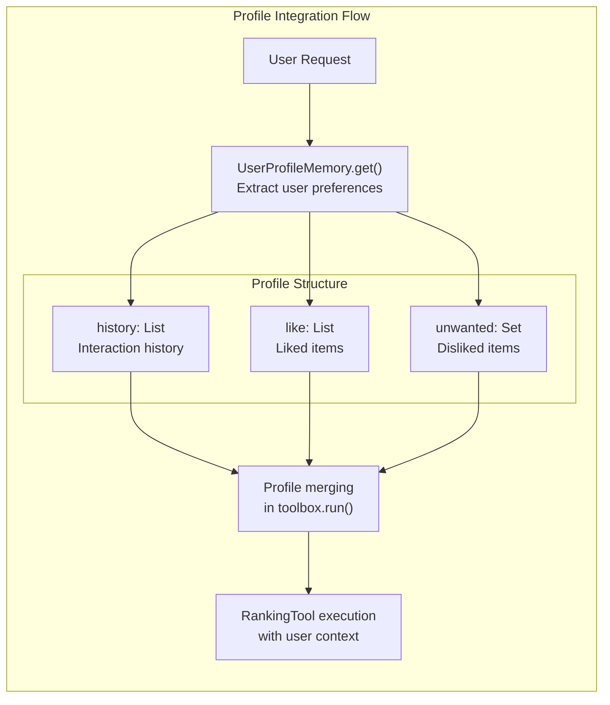
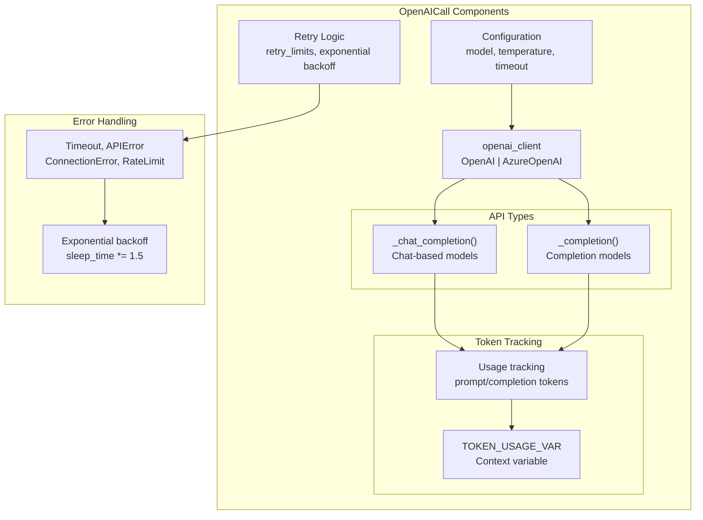

<!-- source: DeepWiki mcp.deepwiki.com · repo microsoft/RecAI · page 4.1 InteRecAgent Architecture · fetched 2026-10-26 -->

# InteRecAgent Architecture

Relevant source files

The following files were used as context for generating this wiki page:

- [InteRecAgent/llm4crs/agent_plan_first_openai.py](InteRecAgent/llm4crs/agent_plan_first_openai.py)
- [InteRecAgent/llm4crs/prompt/system.py](InteRecAgent/llm4crs/prompt/system.py)
- [InteRecAgent/llm4crs/prompt/tool.py](InteRecAgent/llm4crs/prompt/tool.py)
- [InteRecAgent/llm4crs/utils/open_ai.py](InteRecAgent/llm4crs/utils/open_ai.py)
- [InteRecAgent/requirements.txt](InteRecAgent/requirements.txt)

## Purpose and Scope

This document covers the architecture of InteRecAgent, a conversational recommendation agent that uses tool-based LLM orchestration for interactive item recommendations. InteRecAgent implements a plan-first execution framework where the LLM creates a structured plan using available tools, then executes that plan to provide personalized recommendations. For usage instructions and deployment setup, see [InteRecAgent Usage](#4.2).

## Core Architecture Overview

InteRecAgent follows a tool-orchestrated architecture where a large language model acts as the central planner and coordinator, utilizing specialized tools to handle different aspects of the recommendation process.

**Sources:** [InteRecAgent/llm4crs/agent_plan_first_openai.py:245-362](), [InteRecAgent/llm4crs/prompt/tool.py:7-14]()

## Plan-First Execution Framework

The agent implements a plan-first approach using the `SYSTEM_PROMPT_PLAN_FIRST` template, where the LLM first creates a structured plan, then executes it through the `ToolBox`.

**Sources:** [InteRecAgent/llm4crs/agent_plan_first_openai.py:492-521](), [InteRecAgent/llm4crs/prompt/system.py:104-179]()

## Tool System Architecture

InteRecAgent uses six specialized tools that operate on a shared `candidate_buffer` to provide different aspects of recommendation functionality.

| Tool | Purpose | Input Format | Buffer Interaction |
|------|---------|--------------|-------------------|
| `BufferStoreTool` | Store user-specified candidates | `"item1;; item2;; item3"` | Initializes buffer |
| `LookUpTool` | Query item metadata | SQL command string | Read-only |
| `HardFilterTool` | Property-based filtering | SQL SELECT command | Filters buffer |
| `SoftFilterTool` | Similarity-based filtering | Python list of seed items | Filters buffer |
| `RankingTool` | Preference-based ranking | JSON with schema/prefer/unwanted | Reorders buffer |
| `MapTool` | Convert IDs to titles | Integer (number of items) | Retrieves from buffer |

**Sources:** [InteRecAgent/llm4crs/prompt/tool.py:17-89](), [InteRecAgent/llm4crs/agent_plan_first_openai.py:23-152]()

## Memory and Profile Management

### DialogueMemory System

The `DialogueMemory` class manages conversation history with automatic shortening capabilities to stay within token limits.

**Sources:** [InteRecAgent/llm4crs/agent_plan_first_openai.py:155-243]()

### UserProfileMemory Integration

The agent optionally maintains user profiles that are integrated into the ranking tool execution:

**Sources:** [InteRecAgent/llm4crs/agent_plan_first_openai.py:63-127](), [InteRecAgent/llm4crs/agent_plan_first_openai.py:482-484]()

## LLM Integration and API Management

### OpenAICall Architecture

The system uses the `OpenAICall` class for LLM interactions, supporting both OpenAI and Azure OpenAI endpoints with comprehensive error handling.

**Sources:** [InteRecAgent/llm4crs/utils/open_ai.py:32-195]()

### System Prompt Structure

The agent uses the `SYSTEM_PROMPT_PLAN_FIRST` template which structures the LLM's reasoning process:

| Prompt Section | Purpose | Template Variables |
|---------------|---------|-------------------|
| Role Definition | Establish conversational recommender identity | `{item}`, `{Item}`, `{ITEM}` |
| Tool Descriptions | Define available tools and usage | `{tools_desc}`, `{tool_names}` |
| Planning Format | Specify plan structure and execution | `{tool_exe_name}` |
| Context Integration | Include conversation history and examples | `{history}`, `{examples}`, `{table_info}` |

**Sources:** [InteRecAgent/llm4crs/prompt/system.py:104-179](), [InteRecAgent/llm4crs/agent_plan_first_openai.py:364-374]()

## Configuration and Initialization

The `CRSAgentPlanFirstOpenAI` class supports extensive configuration for different deployment scenarios:

| Parameter | Purpose | Default | Options |
|-----------|---------|---------|---------|
| `domain` | Item type (games, movies, etc.) | Required | String |
| `engine` | LLM model identifier | `"text-davinci-003"` | Any OpenAI model |
| `bot_type` | API interaction type | `"completion"` | `"chat"`, `"completion"` |
| `demo_mode` | Few-shot learning mode | `"zero"` | `"zero"`, others |
| `reply_style` | Response verbosity | `"detailed"` | `"concise"`, `"detailed"` |
| `user_profile_update` | Profile update frequency | `-1` | Integer (turns) |
| `reflection_limits` | Max self-correction attempts | `3` | Integer |

**Sources:** [InteRecAgent/llm4crs/agent_plan_first_openai.py:245-332]()

---

