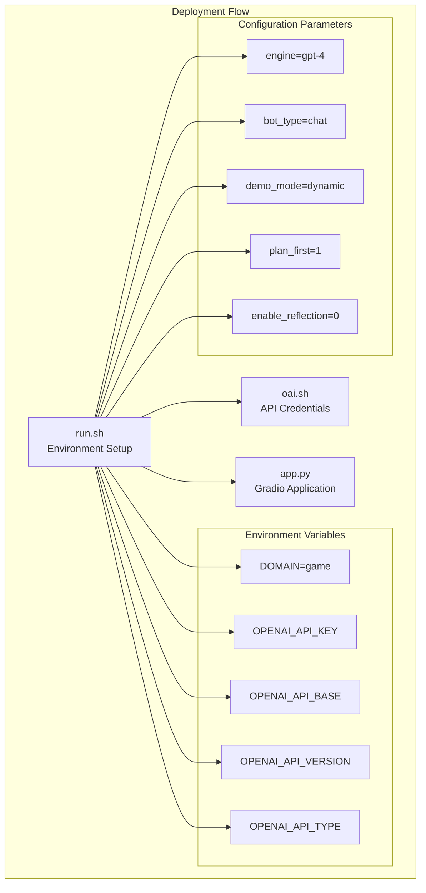
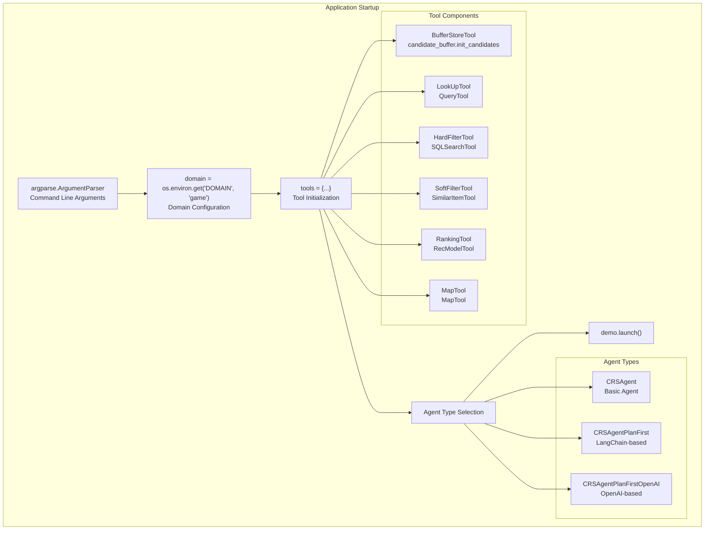
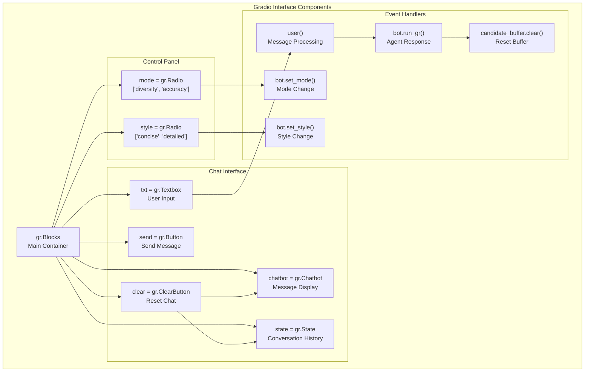
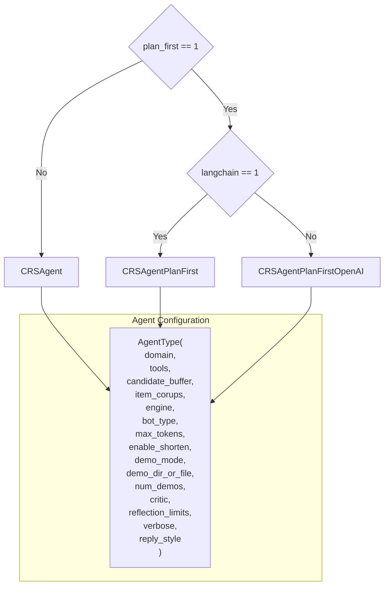
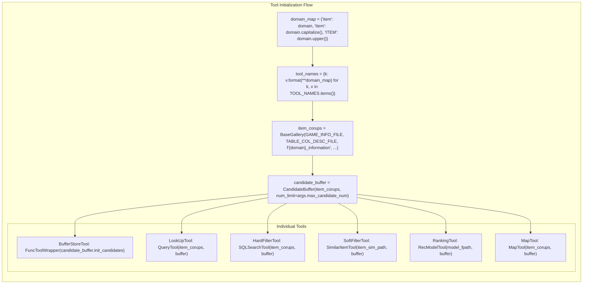
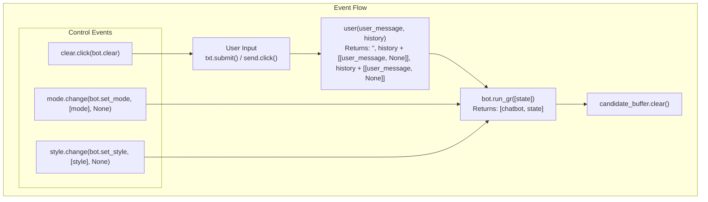

<!-- source: DeepWiki mcp.deepwiki.com · repo microsoft/RecAI · page 4.2 InteRecAgent Usage · fetched 2026-10-26 -->

# InteRecAgent Usage

Relevant source files

The following files were used as context for generating this wiki page:

- [InteRecAgent/app.py](InteRecAgent/app.py)
- [InteRecAgent/demonstration/seed_demos.jsonl](InteRecAgent/demonstration/seed_demos.jsonl)
- [InteRecAgent/demonstration/seed_demos_placeholder.jsonl](InteRecAgent/demonstration/seed_demos_placeholder.jsonl)
- [InteRecAgent/run.sh](InteRecAgent/run.sh)

This document covers the deployment, configuration, and user interface aspects of InteRecAgent, the conversational recommendation agent. It focuses on running the Gradio web application, configuring agent parameters, and understanding the demonstration system. For information about the underlying architecture and tool-based framework, see [InteRecAgent Architecture](#4.1).

## Purpose and Scope

This page documents how to deploy and use InteRecAgent through its Gradio web interface, including:
- Configuration parameters and deployment scripts
- Gradio interface components and user interactions
- Demonstration system and example usage patterns
- Environment setup and API integration

## Application Deployment

### Deployment Script Configuration

The primary deployment mechanism uses the `run.sh` script which sets environment variables and launches the Gradio application.

**Sources:** [InteRecAgent/run.sh:1-68]()

### Key Configuration Options

The deployment script supports several critical configuration parameters:

| Parameter | Default | Description |
|-----------|---------|-------------|
| `engine` | `gpt-4` | OpenAI model name or Azure deployment name |
| `bot_type` | `chat` | Model type: `chat` or `completion` |
| `domain` | `game` | Item domain for recommendations |
| `demo_mode` | `dynamic` | Demonstration mode: `zero`, `fixed`, or `dynamic` |
| `num_demos` | `5` | Number of demonstrations for in-context learning |
| `plan_first` | `1` | Enable plan-first agent architecture |
| `enable_reflection` | `0` | Enable reflection mechanism |
| `langchain` | `0` | Use LangChain in plan-first agent |

**Sources:** [InteRecAgent/run.sh:26-48]()

## Gradio Interface Architecture

### Application Initialization

The `app.py` file creates a comprehensive Gradio interface with multiple agent types and configuration options.

**Sources:** [InteRecAgent/app.py:24-234]()

### Interface Components

The Gradio interface consists of several interactive components that control agent behavior and user interaction.

**Sources:** [InteRecAgent/app.py:256-301]()

### Agent Selection Logic

The application dynamically selects the appropriate agent type based on configuration parameters.

**Sources:** [InteRecAgent/app.py:211-234]()

## Configuration Parameters

### Command Line Arguments

The application accepts numerous command-line arguments for fine-tuning behavior:

| Argument | Type | Default | Description |
|----------|------|---------|-------------|
| `--port` | int | 7891 | Gradio server port |
| `--max_candidate_num` | int | 1000 | Maximum candidates in buffer |
| `--similar_ratio` | float | 0.05 | Ratio for similar item retrieval |
| `--rank_num` | int | 100 | Number of items from ranking tool |
| `--max_output_tokens` | int | 1024 | Maximum LLM output tokens |
| `--engine` | str | text-davinci-003 | OpenAI API engine |
| `--bot_type` | str | chat | Model type (chat/completion) |
| `--enable_shorten` | int | 0 | Enable chat history shortening |
| `--demo_mode` | str | dynamic | Demonstration mode |
| `--num_demos` | int | 5 | Number of demonstrations |
| `--enable_reflection` | int | 0 | Enable reflection mechanism |
| `--plan_first` | int | 1 | Use plan-first agent |
| `--langchain` | int | 0 | Use LangChain integration |
| `--reply_style` | str | detailed | Response detail level |

**Sources:** [InteRecAgent/app.py:24-128]()

### Tool Configuration

Tools are initialized with domain-specific parameters and descriptions:

**Sources:** [InteRecAgent/app.py:130-197]()

## Demonstration System

### Demonstration Modes

The system supports three demonstration modes for in-context learning:

1. **Zero-shot** (`zero`): No demonstrations provided
2. **Fixed** (`fixed`): Uses first N demonstrations from file
3. **Dynamic** (`dynamic`): Retrieves most relevant demonstrations

### Example Demonstrations

The demonstration files contain request-plan pairs that teach the agent how to decompose user requests into tool sequences:

| Request Type | Example Plan |
|--------------|--------------|
| Category Filter | `"I want some TAG games."` → `"1. hard condition filter tool (for TAG games); 2. ranking tool (by popularity); 3. map tool"` |
| Similarity Search | `"Games similar to GAME"` → `"1. soft condition filter tool (similar to GAME); 2. ranking tool (by similarity); 3. map tool"` |
| History-based | `"I have played GAME1 and GAME2"` → `"1. ranking tool (user history GAME1 and GAME2, by preference); 2. map tool"` |
| Complex Query | Multi-constraint requests with filtering, similarity, and ranking steps |

**Sources:** [InteRecAgent/demonstration/seed_demos_placeholder.jsonl:1-14](), [InteRecAgent/demonstration/seed_demos.jsonl:1-14]()

## Interface Features

### Interactive Controls

The Gradio interface provides several user controls:

- **Recommendation Mode**: Toggle between "diversity" and "accuracy" modes
- **Reply Style**: Choose between "concise" and "detailed" responses  
- **Chat History**: Persistent conversation state with clear functionality
- **Real-time Response**: Streaming responses from the agent

### Event Handling

The interface implements several event handlers for user interaction:

**Sources:** [InteRecAgent/app.py:283-300]()

### Default Behavior

The application initializes with default settings:
- Default chat message welcomes users to the recommendation system
- Mode defaults to "accuracy"
- Style defaults to the agent's configured `reply_style`
- State and chatbot are initialized with the welcome message

**Sources:** [InteRecAgent/app.py:133-138](), [InteRecAgent/app.py:280-281]()

---

