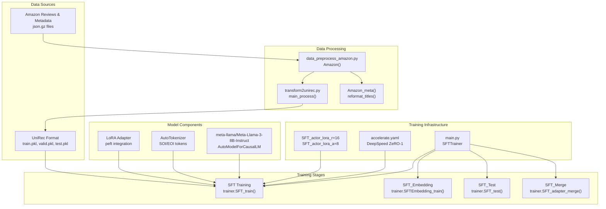
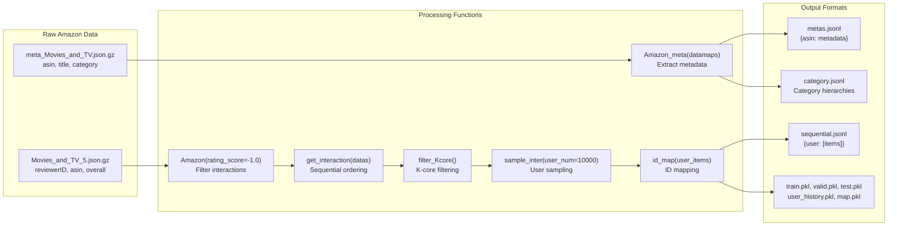
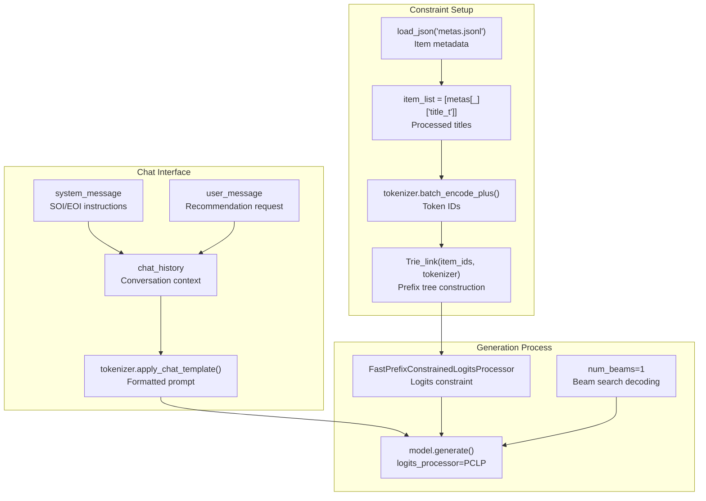
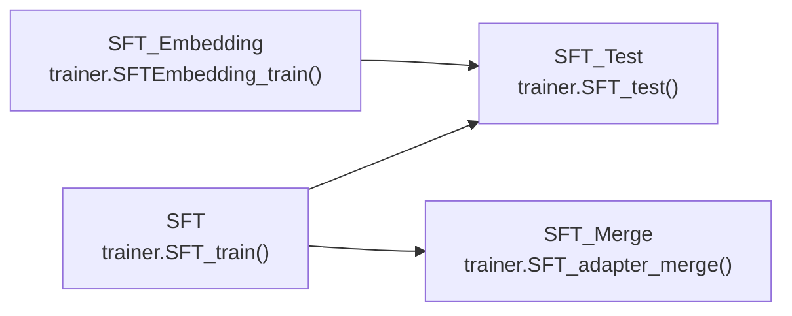

<!-- source: DeepWiki mcp.deepwiki.com · repo microsoft/RecAI · page 5 RecLM-gen and RecLM-cgen · fetched 2026-10-26 -->

# RecLM-gen and RecLM-cgen

Relevant source files

The following files were used as context for generating this wiki page:

- [RecLM-cgen/.gitignore](RecLM-cgen/.gitignore)
- [RecLM-cgen/accelerate.yaml](RecLM-cgen/accelerate.yaml)
- [RecLM-cgen/cli_serve.py](RecLM-cgen/cli_serve.py)
- [RecLM-cgen/main.py](RecLM-cgen/main.py)
- [RecLM-cgen/preprocess/data_preprocess_amazon.py](RecLM-cgen/preprocess/data_preprocess_amazon.py)
- [RecLM-cgen/preprocess/transform2unirec.py](RecLM-cgen/preprocess/transform2unirec.py)
- [RecLM-cgen/requirements.txt](RecLM-cgen/requirements.txt)
- [RecLM-cgen/scripts/data_preprocess_amazon.sh](RecLM-cgen/scripts/data_preprocess_amazon.sh)
- [RecLM-cgen/scripts/run_SFT_merge.sh](RecLM-cgen/scripts/run_SFT_merge.sh)

This document covers the RecLM-gen and RecLM-cgen systems, which are generative and constrained generative language models fine-tuned for recommendation tasks. RecLM-gen provides end-to-end generation capabilities for recommendation scenarios, while RecLM-cgen adds prefix-constrained output to ensure generated items match a predefined vocabulary.

For embedding-based recommendation models, see [RecLM-emb](#2). For evaluation frameworks, see [RecLM-eval](#6). For conversational recommendation agents, see [InteRecAgent](#4).

## System Overview

RecLM-gen and RecLM-cgen transform pre-trained language models into recommendation engines through supervised fine-tuning (SFT) and optional reinforcement learning. The key differentiator is that RecLM-cgen employs constrained generation using prefix trees to ensure all generated item titles match exactly with items in the training catalog.

Both systems support multiple domains including movies, toys, and Steam games, and can be trained using teacher knowledge from traditional recommender models like SASRec.

**Core Components:**
- **Data Processing Pipeline**: Amazon dataset preprocessing and UniRec format transformation
- **SFT Training**: Supervised fine-tuning with LoRA adapters
- **Constrained Generation**: Prefix-constrained decoding using trie-based search
- **Serving Interface**: Gradio-based chat interface with domain selection

Sources: [RecLM-cgen/main.py:1-34](), [RecLM-cgen/cli_serve.py:12-17]()

## Architecture and Training Pipeline

**Training Configuration Table:**

| Parameter | Value | Purpose |
|-----------|-------|---------|
| `SFT_actor_lora_r` | 16 | LoRA rank for adaptation |
| `SFT_actor_lora_a` | 8 | LoRA alpha parameter |
| `zero_stage` | 1 | DeepSpeed ZeRO optimization stage |
| `mixed_precision` | bf16 | Mixed precision training |
| `num_processes` | 2 | Multi-GPU training processes |

Sources: [RecLM-cgen/main.py:9-34](), [RecLM-cgen/accelerate.yaml:1-19](), [RecLM-cgen/scripts/run_SFT_merge.sh:1-16]()

## Data Processing Pipeline

The data processing pipeline transforms raw Amazon datasets into formats suitable for both traditional recommender training (UniRec) and language model fine-tuning.

**Data Statistics after Processing:**

| Metric | Value |
|--------|-------|
| Users | 10,000 |
| Items | Variable per domain |
| Max sequence length | 17 |
| Rating threshold | > -1.0 |
| K-core filtering | User 1-core, Item 1-core |

Sources: [RecLM-cgen/preprocess/data_preprocess_amazon.py:53-394](), [RecLM-cgen/preprocess/transform2unirec.py:96-139]()

## Constrained Generation System

RecLM-cgen implements constrained generation to ensure all generated item titles exactly match items in the training catalog. This prevents hallucination of non-existent items.

**Special Tokens:**

| Token | Purpose | Token ID |
|-------|---------|-----------|
| `<SOI>` | Start of item marker | `tokenizer.soi_token_id` |
| `<EOI>` | End of item marker | `tokenizer.eoi_token_id` |
| `<|eot_id|>` | End of turn token | `tokenizer.eos_token_id` |
| `<|reserved_special_token_250|>` | Padding token | 128255 |

Sources: [RecLM-cgen/cli_serve.py:20-26](), [RecLM-cgen/train_utils/processor.py:9]()

## Serving Interface

The system provides a Gradio-based chat interface for interactive recommendation generation with domain-specific constraints.

**Interface Components:**

| Component | Function | Implementation |
|-----------|----------|----------------|
| `chatbot` | Chat history display | `gr.Chatbot(height=500, show_copy_button=True)` |
| `msg` | User input textbox | `gr.Textbox(placeholder="Input instruction...")` |
| `domain_choice` | Domain selector | `gr.Radio(choices=domains + ["None"])` |
| `clear_btn` | Reset conversation | `clear_history()` function |

**Supported Domains:**
- `steam`: Steam game recommendations
- `movies`: Movie recommendations  
- `toys`: Toy product recommendations
- `None`: Unconstrained generation

The serving system loads domain-specific prefix constraint processors and maintains conversation state through the `chat_history` global variable.

Sources: [RecLM-cgen/cli_serve.py:60-100]()

## Training Stages and Model Integration

The system supports multiple training stages orchestrated through the `main.py` entry point:

**Training Stage Flow:**

**Key Training Parameters:**

- `share_chat_gpt_ratio`: Enables ShareChatGPT task integration
- `SFT_train_tasks`: Comma-separated list of training tasks
- `SFT_test_task`: Specific test task (e.g., "SFTTestSeqRec-CS-MR")
- `train_stage`: Controls execution flow

The system integrates with the `transformers` ecosystem using `peft` for LoRA adaptation and `accelerate` for distributed training coordination.

Sources: [RecLM-cgen/main.py:9-34](), [RecLM-cgen/requirements.txt:1-18]()

---

