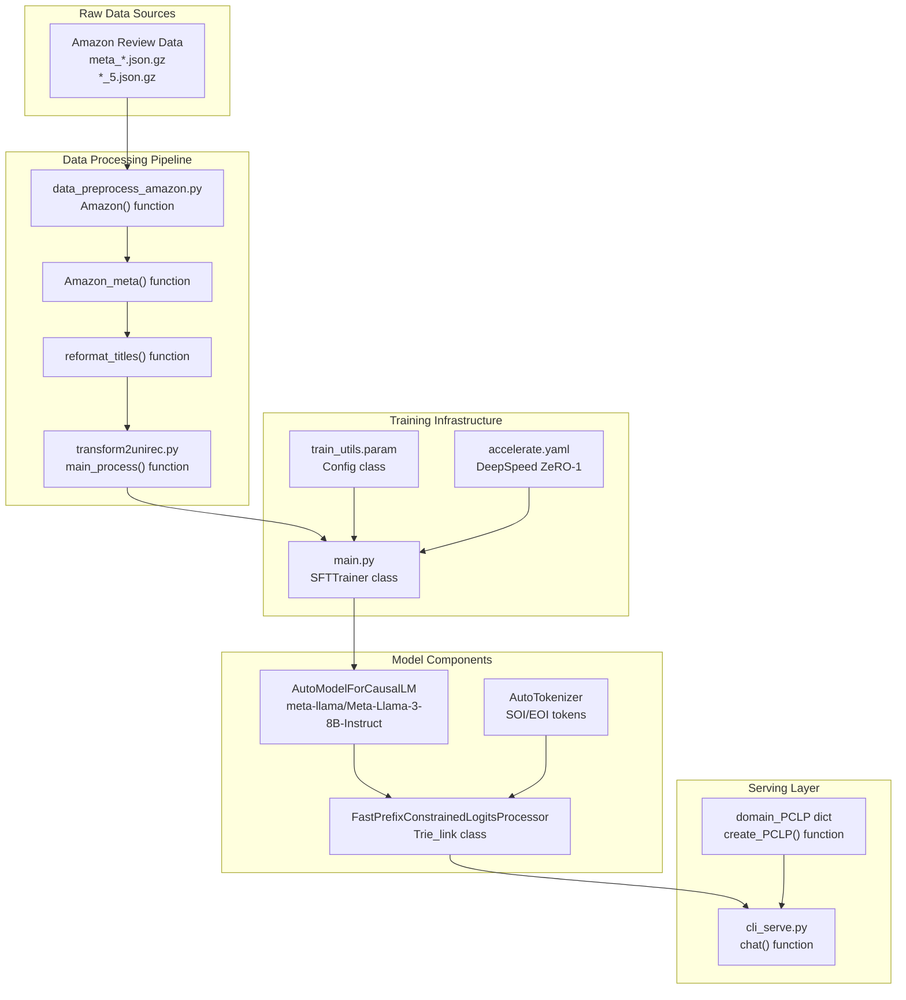
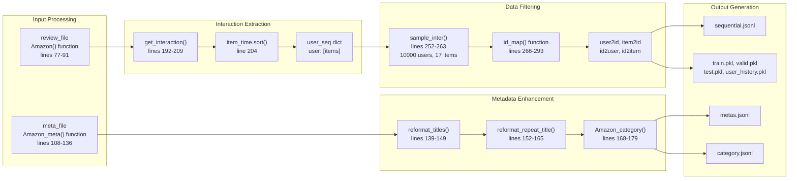
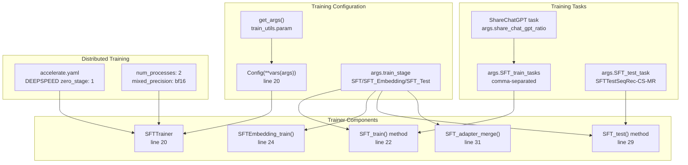
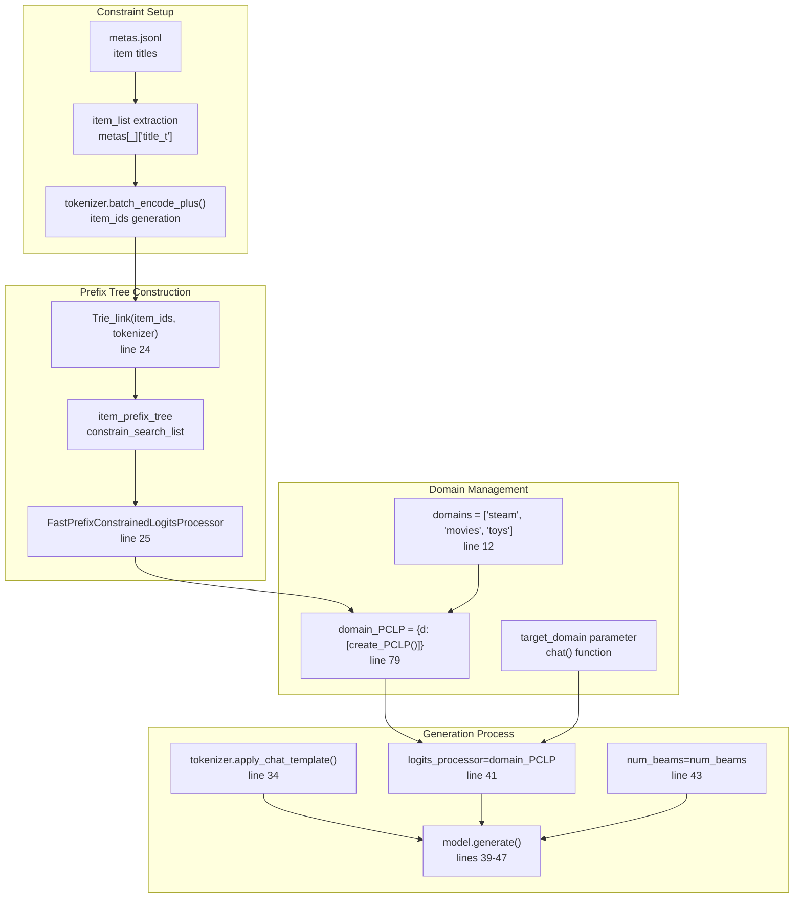
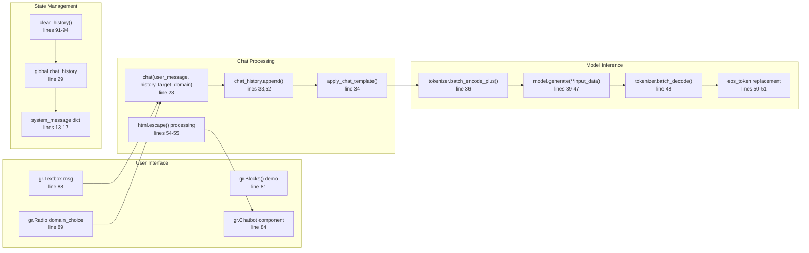

<!-- source: DeepWiki mcp.deepwiki.com · repo microsoft/RecAI · page 5.1 Architecture and Data Processing · fetched 2026-10-26 -->

# Architecture and Data Processing

Relevant source files

The following files were used as context for generating this wiki page:

- [RecLM-cgen/.gitignore](RecLM-cgen/.gitignore)
- [RecLM-cgen/accelerate.yaml](RecLM-cgen/accelerate.yaml)
- [RecLM-cgen/cli_serve.py](RecLM-cgen/cli_serve.py)
- [RecLM-cgen/main.py](RecLM-cgen/main.py)
- [RecLM-cgen/preprocess/data_preprocess_amazon.py](RecLM-cgen/preprocess/data_preprocess_amazon.py)
- [RecLM-cgen/preprocess/transform2unirec.py](RecLM-cgen/preprocess/transform2unirec.py)
- [RecLM-cgen/requirements.txt](RecLM-cgen/requirements.txt)
- [RecLM-cgen/scripts/data_preprocess_amazon.sh](RecLM-cgen/scripts/data_preprocess_amazon.sh)
- [RecLM-cgen/scripts/run_SFT_merge.sh](RecLM-cgen/scripts/run_SFT_merge.sh)

This document covers the architecture and data processing pipeline for RecLM-gen and RecLM-cgen systems, which implement generative and constrained generative language models fine-tuned for recommendation tasks. The focus is on Supervised Fine-Tuning (SFT) pipelines, Amazon dataset preprocessing, and constrained generation mechanisms using prefix trees.

For information about model serving utilities and asynchronous inference, see [Utilities and Serving](#5.2).

## System Architecture Overview

The RecLM-gen/cgen system implements a complete pipeline from raw Amazon data to deployed recommendation models with constrained generation capabilities.

Sources: [RecLM-cgen/preprocess/data_preprocess_amazon.py:1-399](), [RecLM-cgen/main.py:1-34](), [RecLM-cgen/cli_serve.py:1-101]()

## Amazon Data Processing Pipeline

The data preprocessing pipeline transforms raw Amazon review and metadata files into formats suitable for both traditional recommender systems (UniRec) and LLM fine-tuning.

### Data Processing Workflow

Sources: [RecLM-cgen/preprocess/data_preprocess_amazon.py:53-399]()

### Data Filtering and Processing Parameters

| Parameter | Value | Description |
|-----------|-------|-------------|
| `rating_score` | -0.1 | Minimum rating threshold |
| `user_num` | 10000 | Sampled user count |
| `item_len` | 17 | Maximum items per user |
| `seed` | 2022 | Random seed for reproducibility |

The `Amazon()` function [RecLM-cgen/preprocess/data_preprocess_amazon.py:53-91]() filters interactions by rating score and ensures items have both title and category metadata. The `sample_inter()` function [RecLM-cgen/preprocess/data_preprocess_amazon.py:252-263]() creates a subset with exactly 10000 users, each having exactly 17 interactions.

Sources: [RecLM-cgen/preprocess/data_preprocess_amazon.py:307-341]()

## Training Architecture

### SFT Training Pipeline

Sources: [RecLM-cgen/main.py:9-34](), [RecLM-cgen/accelerate.yaml:1-19]()

### Training Stage Execution Flow

The `main.py` orchestrates different training stages:

1. **SFT Stage**: Standard supervised fine-tuning with optional ShareChatGPT integration
2. **SFT_Embedding Stage**: Embedding-specific fine-tuning
3. **SFT_Test Stage**: Model evaluation with special handling for `SFTTestSeqRec-CS-MR` tasks
4. **SFT_Merge Stage**: LoRA adapter merging for deployment

The ShareChatGPT task is conditionally added when `args.share_chat_gpt_ratio > 0.0` [RecLM-cgen/main.py:17-18]().

Sources: [RecLM-cgen/main.py:17-33]()

## Constrained Generation System

### Prefix-Constrained Generation Architecture

Sources: [RecLM-cgen/cli_serve.py:20-79]()

### SOI/EOI Token System

The system uses special tokens to demarcate recommended items:

| Token | Token ID | Purpose |
|-------|----------|---------|
| `<SOI>` | `tokenizer.soi_token_id` | Start of item marker |
| `<EOI>` | `tokenizer.eoi_token_id` | End of item marker |
| `<|eot_id|>` | `tokenizer.eos_token_id` | End of turn marker |

The system message instructs the model: "each item should be enclosed by <SOI> and <EOI>" [RecLM-cgen/cli_serve.py:15]().

Sources: [RecLM-cgen/cli_serve.py:13-16](), [RecLM-cgen/cli_serve.py:69-74]()

## Gradio Serving Interface

### Chat Interface Implementation

Sources: [RecLM-cgen/cli_serve.py:28-99]()

The chat interface maintains conversation state through a global `chat_history` list initialized with a system message defining the recommendation format. The `clear_history()` function resets the conversation by reinitializing `chat_history` with just the system message [RecLM-cgen/cli_serve.py:91-94]().

Sources: [RecLM-cgen/cli_serve.py:17](), [RecLM-cgen/cli_serve.py:91-94]()

---

