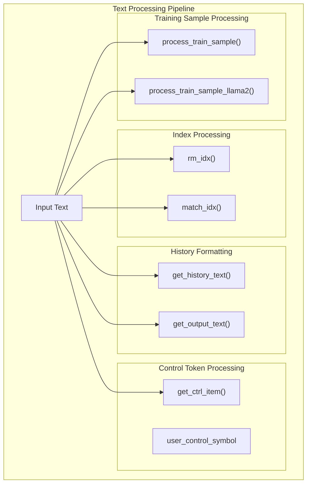
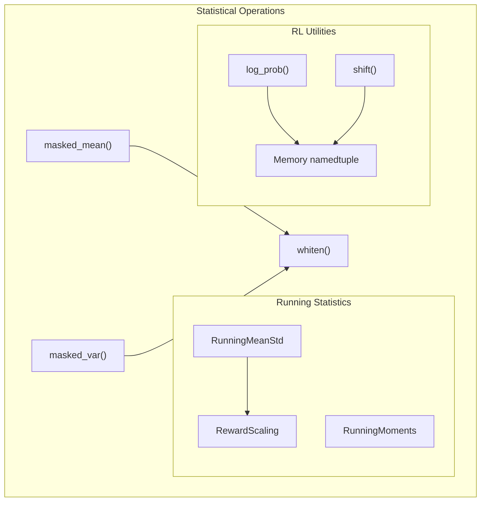
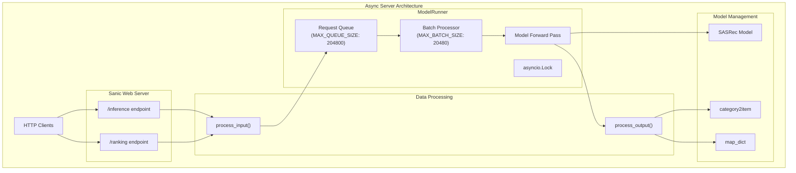
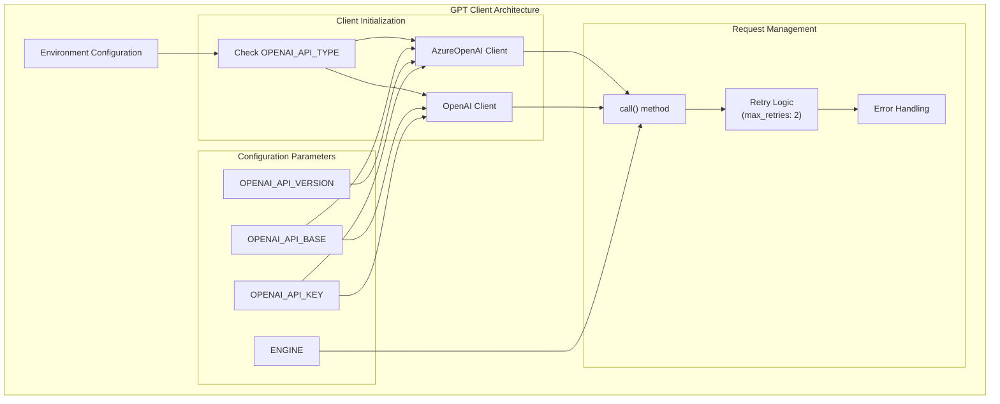
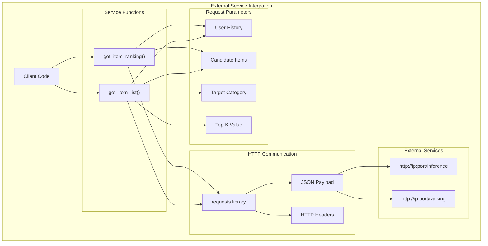
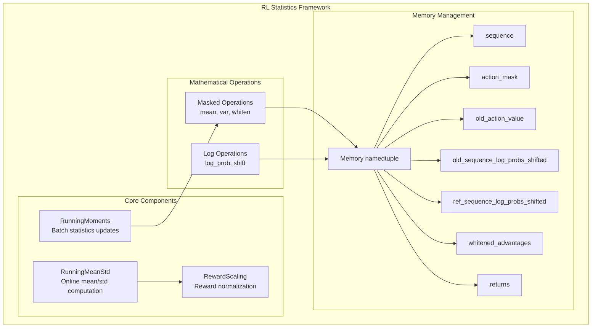
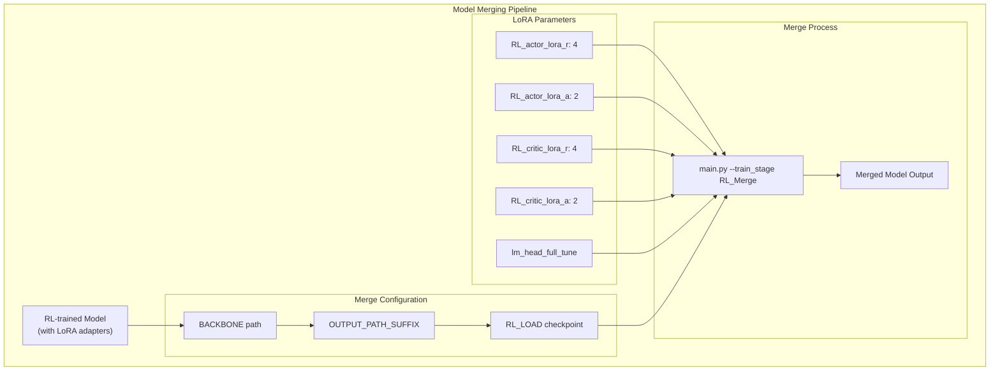

<!-- source: DeepWiki mcp.deepwiki.com · repo microsoft/RecAI · page 5.2 Utilities and Serving · fetched 2026-10-26 -->

# Utilities and Serving

<details>
<summary>Relevant source files</summary>

The following files were used as context for generating this wiki page:

- [RecLM-cgen/train_utils/utils.py](RecLM-cgen/train_utils/utils.py)
- [RecLM-gen/scripts/rl_merge.sh](RecLM-gen/scripts/rl_merge.sh)
- [RecLM-gen/unirec/asyc_server.py](RecLM-gen/unirec/asyc_server.py)
- [RecLM-gen/utils/tools.py](RecLM-gen/utils/tools.py)

</details>


This document covers the utility functions, model serving infrastructure, and deployment tools for the RecLM-gen and RecLM-cgen systems. These components provide essential support for data processing, asynchronous model serving, API integration, and model deployment workflows.

For information about the training pipeline and data preprocessing, see [Architecture and Data Processing](#5.1).

## Core Utility Functions

The RecLM-gen and RecLM-cgen systems provide a comprehensive set of utility functions organized across multiple modules for data processing, text formatting, and model operations.

### Text Processing and Formatting

The systems include utilities for processing recommendation outputs and formatting text for both training and inference:



**Text Processing Functions**
- `rm_idx()` and `match_idx()` handle numbered list processing for recommendation outputs
- `get_history_text()` formats user interaction history as arrow-separated sequences
- `get_output_text()` formats recommendation lists with optional indexing and control symbols
- `get_ctrl_item()` extracts items from control token format (`<SOI>item<EOI>`)

**Training Data Processing**
The `process_train_sample()` and `process_train_sample_llama2()` functions handle conversational training data formatting with system prompts, input/output masking, and proper tokenization for different model architectures.

Sources: [RecLM-cgen/train_utils/utils.py:22-142](), [RecLM-gen/utils/tools.py:16-220]()

### File I/O and Data Persistence

Both systems provide standardized file operations for data persistence:

| Function | Purpose | Format |
|----------|---------|--------|
| `load_pickle()` / `save_pickle()` | Binary data serialization | Pickle protocol |
| `load_json()` / `save_json()` | Configuration and metadata | JSON with UTF-8 encoding |
| `side_tokenizer()` | Tokenization with padding control | HuggingFace tokenizer format |

The file I/O functions include null-safe operations and automatic directory existence checking.

Sources: [RecLM-cgen/train_utils/utils.py:30-68](), [RecLM-gen/utils/tools.py:36-60]()

### Mathematical and Statistical Utilities

The systems include advanced mathematical utilities particularly for reinforcement learning and model training:



**Key Features:**
- **Masked operations**: Handle variable-length sequences with proper masking
- **Running statistics**: Online computation of mean and variance for RL training
- **Reward scaling**: Dynamic reward normalization using running statistics
- **Memory structure**: Named tuple for storing RL episode data

Sources: [RecLM-gen/utils/tools.py:146-350]()

## Model Serving Infrastructure

The RecLM-gen system includes a sophisticated asynchronous serving infrastructure built on the Sanic web framework for high-throughput model inference.

### Server Architecture



**Key Components:**
- **Asynchronous processing**: Uses asyncio for concurrent request handling
- **Request batching**: Automatic batching with configurable size and timeout
- **Queue management**: Thread-safe queuing with overflow protection
- **Model optimization**: Single model instance with batch inference

Sources: [RecLM-gen/unirec/asyc_server.py:1-262]()

### Request Processing Flow

The server implements a sophisticated queuing and batching system for optimal throughput:

```mermaid
graph TB
    subgraph "Request Lifecycle"
        HTTPRequest["HTTP Request"]
        
        subgraph "Input Processing"
            validateInput["Validate Input"]
            createBatchData["Create Batched Data"]
            assignEvent["Assign done_event"]
        end
        
        subgraph "Queue Management" 
            checkQueueSize["Check Queue Size<br/>(< MAX_QUEUE_SIZE)"]
            enqueue["Add to Queue"]
            scheduleProcessing["Schedule Processing"]
        end
        
        subgraph "Batch Processing"
            waitForBatch["Wait for Batch<br/>(size or timeout)"]
            runInference["Run Model Inference"]
            setResults["Set Results & Events"]
        end
        
        subgraph "Output Processing"
            waitForCompletion["Wait for done_event"]
            processResults["Process Results"]
            returnResponse["Return HTTP Response"]
        end
        
        HTTPRequest --> validateInput
        validateInput --> createBatchData
        createBatchData --> assignEvent
        assignEvent --> checkQueueSize
        checkQueueSize --> enqueue
        enqueue --> scheduleProcessing
        scheduleProcessing --> waitForBatch
        waitForBatch --> runInference
        runInference --> setResults
        setResults --> waitForCompletion
        waitForCompletion --> processResults
        processResults --> returnResponse
    end
```



**Processing Parameters:**
- `MAX_QUEUE_SIZE`: 204,800 requests
- `MAX_BATCH_SIZE`: 20,480 requests per batch
- `MAX_WAIT`: 1 second timeout for batching

Sources: [RecLM-gen/unirec/asyc_server.py:146-262]()

### API Endpoints

The server exposes two main endpoints for model inference:

| Endpoint | Method | Purpose | Key Parameters |
|----------|---------|---------|----------------|
| `/inference` | POST | Top-k recommendation | `users`, `item_lists`, `k`, `candidate_item_lists` |
| `/ranking` | POST | Item ranking | `users`, `item_lists`, `candidate_item_lists` |

**Request Format:**
```json
{
  "users": ["user_id"],
  "item_lengths": [sequence_length],
  "item_lists": [["item1", "item2", "..."]],
  "k": 10,
  "candidate_item_lists": [["candidate1", "candidate2", "..."]],
  "target_category": "+category_name",
  "immediately": 1
}
```

The `immediately` flag bypasses batching for single-request processing.

Sources: [RecLM-gen/unirec/asyc_server.py:211-254]()

## API Integration

### OpenAI GPT Integration

The systems include a comprehensive GPT client for external API integration:



**Configuration Environment Variables:**
- `OPENAI_API_TYPE`: "azure" or standard OpenAI
- `OPENAI_API_BASE`: Base URL for API endpoint
- `OPENAI_API_VERSION`: API version for Azure
- `OPENAI_API_KEY`: Authentication key
- `ENGINE`: Model name/deployment name

**Usage Example:**
The `GPT` class provides a simple interface with automatic retry logic and support for both Azure OpenAI and standard OpenAI APIs.

Sources: [RecLM-gen/utils/tools.py:222-270]()

### External Model Communication

The utility functions include HTTP client functionality for communicating with external recommendation services:



These functions enable seamless integration with external recommendation services, supporting both immediate and batched processing modes.

Sources: [RecLM-cgen/train_utils/utils.py:71-105](), [RecLM-gen/utils/tools.py:78-143]()

## RL Training Utilities

The RecLM-gen system includes specialized utilities for reinforcement learning training workflows.

### Running Statistics Management



**Key Features:**
- **Online statistics**: Incremental computation without storing full history
- **Reward scaling**: Dynamic normalization using running statistics
- **Memory structure**: Organized storage for RL episode data
- **Masked operations**: Handle variable-length sequences properly

Sources: [RecLM-gen/utils/tools.py:272-350]()

## Model Deployment and Merging

### LoRA Model Merging

The system includes shell scripts for merging LoRA adapters after RL training:



**Merge Script Configuration:**
- Actor LoRA rank: 4, alpha: 2
- Critic LoRA rank: 4, alpha: 2
- Full tuning enabled for language model head
- FlashAttention 2 optimization enabled

The merge process combines the base model with trained LoRA adapters to create a single deployable model.

Sources: [RecLM-gen/scripts/rl_merge.sh:1-22]()

### Deployment Considerations

The serving infrastructure supports both immediate and batched processing modes, with configurable parameters for production deployment:

- **Memory management**: Automatic GPU memory optimization
- **Concurrency**: Asynchronous processing with configurable worker counts
- **Error handling**: Robust error handling with appropriate HTTP status codes
- **Model optimization**: Single model instance with batch inference for efficiency

Sources: [RecLM-gen/unirec/asyc_server.py:17-29](), [RecLM-gen/unirec/asyc_server.py:257-262]()

---

