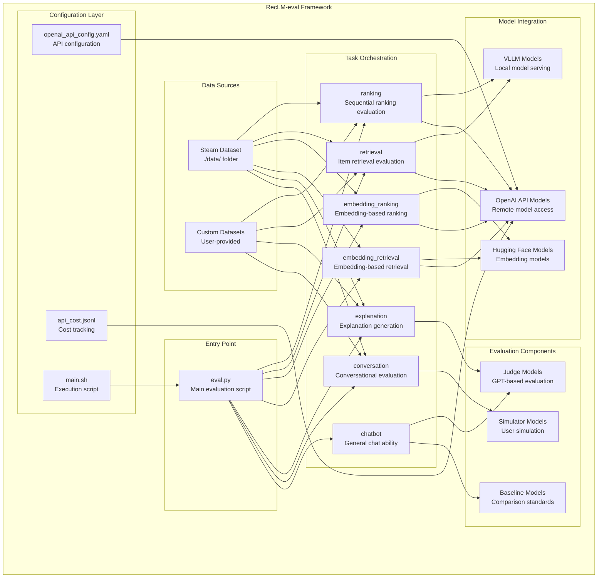
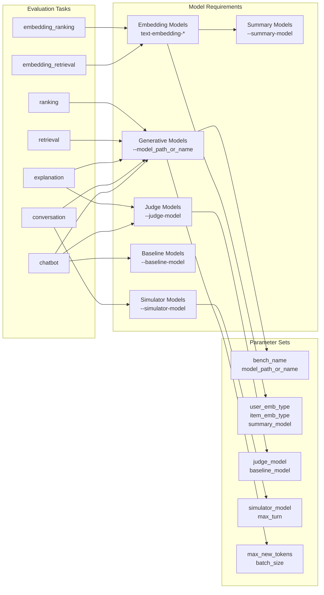
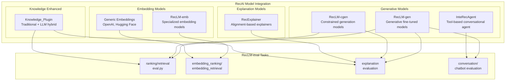

<!-- source: DeepWiki mcp.deepwiki.com · repo microsoft/RecAI · page 6 RecLM-eval · fetched 2026-10-26 -->

# RecLM-eval

<details>
<summary>Relevant source files</summary>

The following files were used as context for generating this wiki page:

- [RecLM-eval/.gitignore](RecLM-eval/.gitignore)
- [RecLM-eval/README.md](RecLM-eval/README.md)
- [RecLM-eval/api_cost.jsonl](RecLM-eval/api_cost.jsonl)

</details>


RecLM-eval is a comprehensive evaluation framework for LLM-based recommendation systems that provides standardized benchmarking across multiple recommendation tasks. It serves as the central evaluation hub for all recommendation models in the RecAI ecosystem, supporting both generative and embedding-based approaches.

For information about specific RecLM-eval evaluation methodologies and task orchestration, see [RecLM-eval Methods](#6.1). For details about model integration and distributed evaluation infrastructure, see [RecLM-eval Model Integration](#6.2).

## Architecture Overview

RecLM-eval implements a modular evaluation architecture that supports seven distinct recommendation evaluation tasks through a unified interface.

### System Architecture



**Sources:** [RecLM-eval/README.md:1-135]()

### Task-Model Integration Map



**Sources:** [RecLM-eval/README.md:51-135]()

## Supported Evaluation Tasks

RecLM-eval supports seven distinct evaluation tasks, each designed to assess different aspects of recommendation system performance.

### Core Recommendation Tasks

| Task | Purpose | Required Parameters | Model Types |
|------|---------|-------------------|-------------|
| `ranking` | Sequential item ranking evaluation | `--bench-name`, `--model_path_or_name` | Generative LLMs |
| `retrieval` | Item retrieval from large catalogs | `--bench-name`, `--model_path_or_name` | Generative LLMs |
| `embedding_ranking` | Ranking using embedding similarity | `--model_path_or_name`, `--user_emb_type`, `--item_emb_type` | Embedding models |
| `embedding_retrieval` | Retrieval using embedding similarity | `--model_path_or_name`, `--user_emb_type`, `--item_emb_type` | Embedding models |

### Interactive Evaluation Tasks

| Task | Purpose | Required Parameters | Model Types |
|------|---------|-------------------|-------------|
| `explanation` | Recommendation explanation quality | `--judge-model`, `--baseline-model` | Generative + Judge |
| `conversation` | Multi-turn conversational ability | `--simulator-model`, `--max_turn` | Generative + Simulator |
| `chatbot` | General conversational capability | `--judge-model`, `--baseline-model` | Generative + Judge + Baseline |

**Sources:** [RecLM-eval/README.md:51-52](), [RecLM-eval/README.md:55-135]()

### Embedding Task Configuration

The embedding-based tasks support flexible configuration for user and item representations:

```bash
# Title-based embeddings
python eval.py --task-names embedding_ranking embedding_retrieval \
    --model_path_or_name text-embedding-3-small \
    --user_emb_type title \
    --item_emb_type title

# Summary-based user embeddings  
python eval.py --task-names embedding_ranking embedding_retrieval \
    --model_path_or_name text-embedding-3-small \
    --user_emb_type summary \
    --summary-model gpt-3.5-turbo \
    --item_emb_type title
```

**Sources:** [RecLM-eval/README.md:78-92]()

## Configuration and Setup

### API Configuration

RecLM-eval uses a YAML-based configuration system for external API access:

```yaml
# openai_api_config.yaml
API_BASE: "if-you-have-different-api-url"
API_KEY: "your-api-key"
```

**Sources:** [RecLM-eval/README.md:21-26]()

### Cost Tracking

The framework tracks API usage costs through a JSONL configuration file that maps model names to input/output token costs:

| Model | Input Cost ($/1M tokens) | Output Cost ($/1M tokens) |
|-------|-------------------------|---------------------------|
| `gpt-4o` | 5.0 | 15.0 |
| `gpt-4o-mini` | 0.15 | 0.6 |
| `gpt-35-turbo` | 0.5 | 1.5 |
| `text-embedding-3-small` | 0.02 | 0 |
| `text-embedding-3-large` | 0.13 | 0 |

**Sources:** [RecLM-eval/api_cost.jsonl:1-14]()

### Environment Setup

```bash
conda create -n receval python==3.9
conda activate receval
pip install -r requirements.txt
```

**Sources:** [RecLM-eval/README.md:36-40]()

## Data Requirements

### Default Dataset

RecLM-eval provides a Steam dataset as the default evaluation benchmark, combining multiple data sources:

- Steam game metadata from UCSD datasets
- Sequential interaction data from SASRec
- Additional game information from Kaggle

**Sources:** [RecLM-eval/README.md:47-48]()

### Data Structure

The framework expects datasets to be placed in the `./data/` directory and follows a standardized format for cross-task compatibility.

**Sources:** [RecLM-eval/README.md:7-13](), [RecLM-eval/.gitignore:4-5]()

## Integration with RecAI Components

RecLM-eval serves as the central evaluation hub for all RecAI components, providing standardized benchmarking across different recommendation approaches:

### Supported Model Architectures



**Sources:** [RecLM-eval/README.md:1-3]()

### Execution Workflow

The main execution script `main.sh` orchestrates the complete evaluation pipeline, while `eval.py` provides the primary interface for task-specific evaluation.

**Sources:** [RecLM-eval/README.md:28-31](), [RecLM-eval/.gitignore:7-9]()

---

