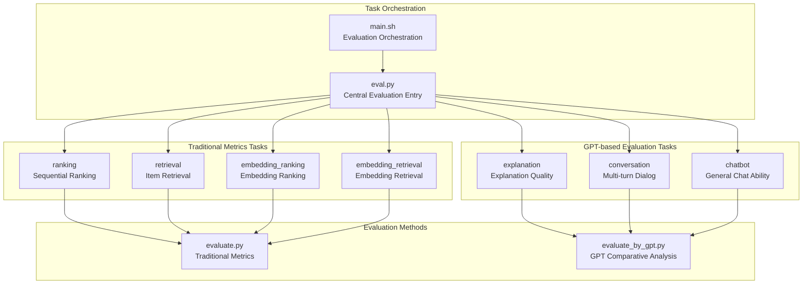
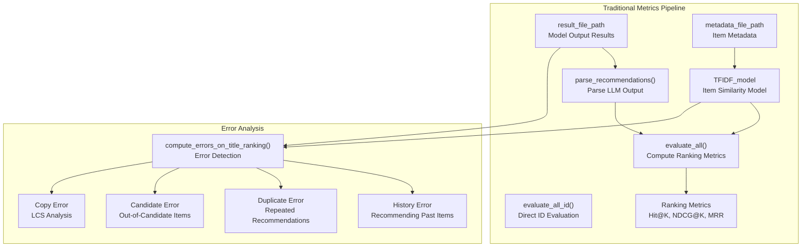
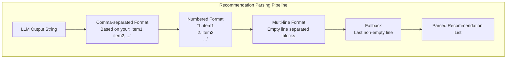
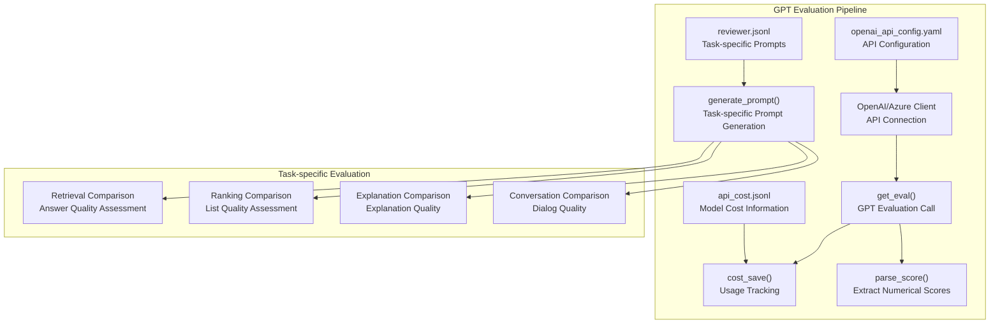
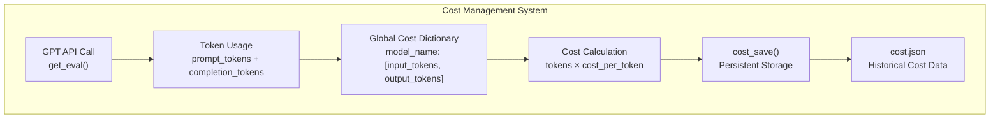
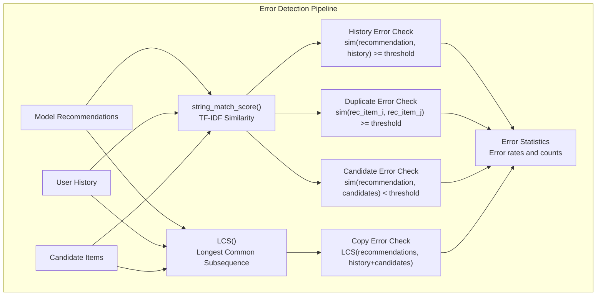
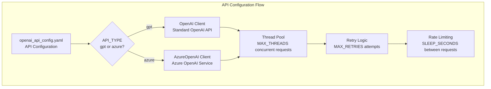

<!-- source: DeepWiki mcp.deepwiki.com · repo microsoft/RecAI · page 6.1 RecLM-eval Methods · fetched 2026-10-26 -->

# RecLM-eval Methods

Relevant source files

The following files were used as context for generating this wiki page:

- [RecLM-eval/.gitignore](RecLM-eval/.gitignore)
- [RecLM-eval/README.md](RecLM-eval/README.md)
- [RecLM-eval/api_cost.jsonl](RecLM-eval/api_cost.jsonl)
- [RecLM-eval/evaluates/evaluate.py](RecLM-eval/evaluates/evaluate.py)
- [RecLM-eval/evaluates/evaluate_by_gpt.py](RecLM-eval/evaluates/evaluate_by_gpt.py)
- [RecLM-eval/main.sh](RecLM-eval/main.sh)
- [RecLM-eval/openai_api_config.yaml](RecLM-eval/openai_api_config.yaml)

This document covers the evaluation methodologies and task orchestration framework within RecLM-eval. It focuses on the core evaluation methods, GPT-based comparative analysis, and metrics computation for LLM-based recommendation systems. For model integration and distributed evaluation infrastructure, see [RecLM-eval Model Integration](#6.2).

## Evaluation Task Orchestration

The RecLM-eval system supports multiple evaluation tasks through a centralized orchestration framework. The main evaluation entry point coordinates different task types and model configurations.

### Task Categories

The evaluation framework supports seven primary task categories:

| Task Type | Purpose | Evaluation Method |
|-----------|---------|------------------|
| `ranking` | Sequential item ranking | Traditional metrics + TF-IDF similarity |
| `retrieval` | Item retrieval from candidates | Ranking metrics with similarity matching |
| `explanation` | Recommendation explanations | GPT-based pairwise comparison |
| `conversation` | Multi-turn conversations | User simulator interaction |
| `embedding_ranking` | Embedding-based ranking | Embedding similarity metrics |
| `embedding_retrieval` | Embedding-based retrieval | Embedding similarity metrics |
| `chatbot` | General chatbot ability | GPT-based pairwise comparison |

Sources: [RecLM-eval/main.sh:12-68](), [RecLM-eval/README.md:52-52]()

## Traditional Metrics Computation

The `evaluate.py` module implements traditional recommendation metrics using TF-IDF similarity matching for title-based evaluation.

### Core Evaluation Functions

The system provides three primary evaluation functions:

- `compute_metrics_on_title_recommend()` - Computes ranking metrics with TF-IDF similarity
- `compute_metrics_on_multi_choices()` - Evaluates multiple choice accuracy  
- `compute_metrics_on_id_recommend()` - Direct ID-based ranking evaluation

Sources: [RecLM-eval/evaluates/evaluate.py:18-57](), [RecLM-eval/evaluates/evaluate.py:119-174]()

### Recommendation Parsing

The `parse_recommendations()` function handles diverse LLM output formats by implementing multiple parsing strategies:

Sources: [RecLM-eval/evaluates/evaluate.py:176-207]()

## GPT-based Comparative Evaluation

The `evaluate_by_gpt.py` module implements pairwise comparison evaluation using GPT models as judges for subjective tasks like explanation quality and conversation ability.

### GPT Evaluation Architecture

Sources: [RecLM-eval/evaluates/evaluate_by_gpt.py:19-43](), [RecLM-eval/evaluates/evaluate_by_gpt.py:159-170]()

### Cost Tracking System

The evaluation framework includes comprehensive cost tracking for API usage:

Sources: [RecLM-eval/evaluates/evaluate_by_gpt.py:49-125](), [RecLM-eval/api_cost.jsonl:1-15]()

## Error Analysis Framework

The evaluation system performs detailed error analysis to identify common failure patterns in LLM-based recommendations.

### Error Types

| Error Type | Description | Detection Method |
|------------|-------------|------------------|
| History Error | Recommending previously interacted items | TF-IDF similarity with user history |
| Duplicate Error | Repeated items in recommendation list | TF-IDF similarity within recommendations |
| Candidate Error | Items not in candidate set | TF-IDF similarity with candidate pool |
| Copy Error | Direct copying from input | Longest Common Subsequence (LCS) analysis |

Sources: [RecLM-eval/evaluates/evaluate.py:119-174](), [RecLM-eval/evaluates/evaluate.py:98-116]()

## API Configuration Management

The system uses a centralized configuration approach for managing different API endpoints and model costs.

### Configuration Structure

The `openai_api_config.yaml` defines API connection parameters:

- `API_BASE` - Custom API endpoint URL
- `API_KEY` - Authentication key
- `API_TYPE` - Provider type (gpt/azure)
- `MAX_THREADS` - Concurrent request limit
- `MAX_RETRIES` - Retry attempt limit

Sources: [RecLM-eval/openai_api_config.yaml:1-21](), [RecLM-eval/evaluates/evaluate_by_gpt.py:21-43]()

---

