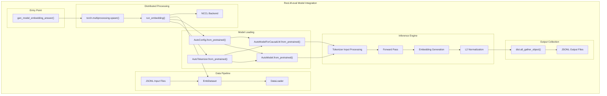
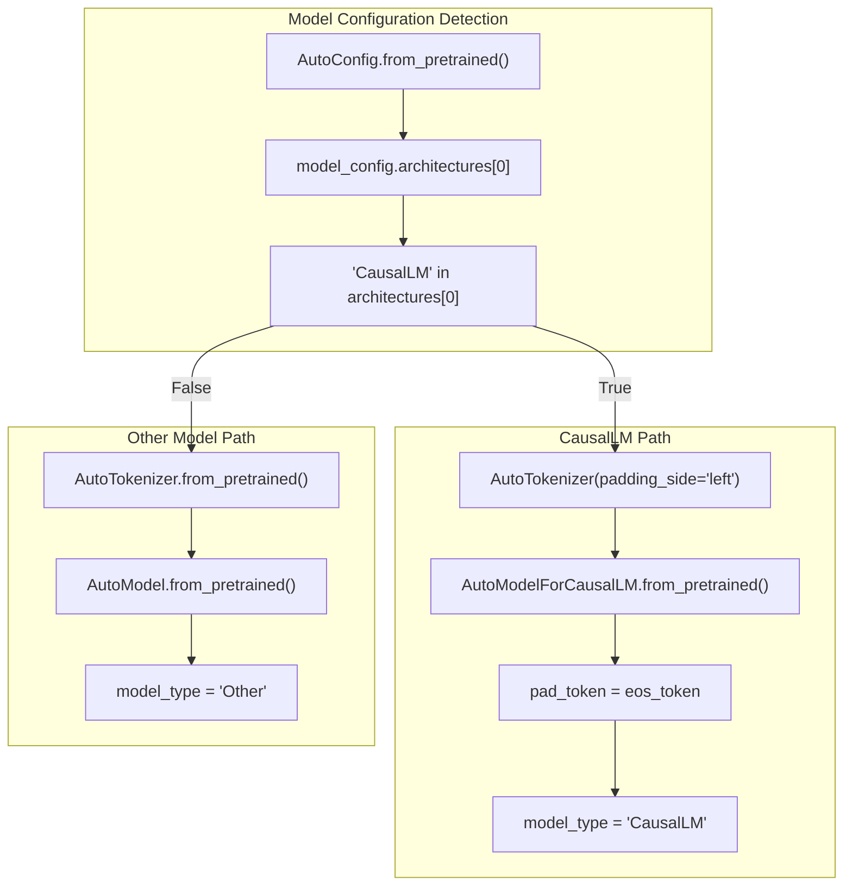
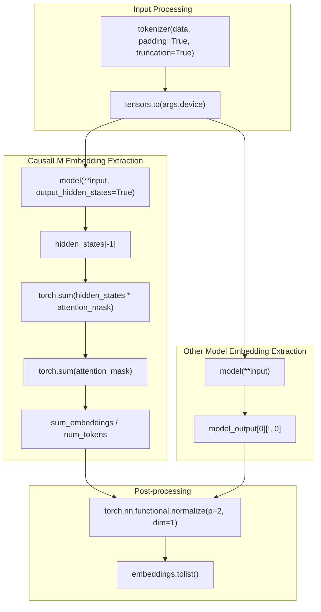

<!-- source: DeepWiki mcp.deepwiki.com · repo microsoft/RecAI · page 6.2 RecLM-eval Model Integration · fetched 2026-10-26 -->

# RecLM-eval Model Integration

<details>
<summary>Relevant source files</summary>

The following files were used as context for generating this wiki page:

- [RecLM-eval/call_models/huggingface_models.py](RecLM-eval/call_models/huggingface_models.py)

</details>


## Purpose and Scope

This document covers the model integration infrastructure within RecLM-eval that enables evaluation of Hugging Face models through distributed inference and embedding generation. This system provides the computational backbone for loading, configuring, and running inference on various language models during evaluation tasks.

For evaluation methodologies and task orchestration, see [RecLM-eval Methods](#6.1). For training and fine-tuning of RecLM models, see [RecLM-gen and RecLM-cgen](#5).

## Architecture Overview

The RecLM-eval model integration system is built around distributed PyTorch inference with Hugging Face Transformers integration. The system supports both causal language models and dedicated embedding models through a unified interface.

### Model Integration Architecture



Sources: [RecLM-eval/call_models/huggingface_models.py:1-125]()

## Distributed Processing Infrastructure

The system implements distributed inference using PyTorch's distributed training framework with NCCL backend for multi-GPU coordination.

### Distributed Processing Flow

```mermaid
graph LR
    subgraph "Process Orchestration"
        ARGS["args.gpus, args.nodes"]
        WS["args.world_size = args.nodes * args.gpus"]
        ENV["MASTER_ADDR, MASTER_PORT"]
    end
    
    subgraph "GPU Process Spawning"
        SPAWN["mp.spawn(run_embedding, nprocs=args.gpus)"]
        LGR["local_gpu_rank per process"]
        RANK["args.rank = args.nr * args.gpus + local_gpu_rank"]
    end
    
    subgraph "Distributed Group Init"
        DEVICE["torch.device('cuda', local_gpu_rank)"]
        IPG["dist.init_process_group(backend='nccl')"]
    end
    
    subgraph "Data Distribution"
        EDS["EmbDataset(world_size, rank)"]
        SHARD["Data sharding by rank"]
    end
    
    ARGS --> WS
    WS --> ENV
    ENV --> SPAWN
    SPAWN --> LGR
    LGR --> RANK
    RANK --> DEVICE
    DEVICE --> IPG
    IPG --> EDS
    EDS --> SHARD
```



Sources: [RecLM-eval/call_models/huggingface_models.py:44-47](), [RecLM-eval/call_models/huggingface_models.py:119-125]()

### EmbDataset Implementation

The `EmbDataset` class handles distributed data loading with automatic sharding across GPU processes:

| Parameter | Description | Code Reference |
|-----------|-------------|----------------|
| `test_dataset` | Input JSONL data loaded as list | [RecLM-eval/call_models/huggingface_models.py:71-73]() |
| `world_size` | Total number of distributed processes | [RecLM-eval/call_models/huggingface_models.py:24]() |
| `rank` | Current process rank for data sharding | [RecLM-eval/call_models/huggingface_models.py:25]() |
| `max_seq_len` | Maximum sequence length for tokenization | [RecLM-eval/call_models/huggingface_models.py:23]() |

The dataset implements distributed indexing through `idx * self.world_size + self.rank` to ensure each process handles a unique subset of data.

Sources: [RecLM-eval/call_models/huggingface_models.py:18-40]()

## Model Loading and Configuration

The system supports two model architectures through automatic detection based on the model configuration:

### Model Type Detection and Loading



Sources: [RecLM-eval/call_models/huggingface_models.py:49-68]()

### Sequence Length Configuration

The system attempts multiple fallback strategies for determining maximum sequence length:

```python
try:
    max_seq_length = model_config.max_position_embeddings
except:
    try:
        max_seq_length = model_config.seq_length  
    except:
        max_seq_length = 4096
```

The actual dataset uses `max_seq_length - 100` to provide buffer space for model processing.

Sources: [RecLM-eval/call_models/huggingface_models.py:74-81]()

## Embedding Generation Pipeline

The inference pipeline handles both causal language models and dedicated embedding models through different embedding extraction strategies.

### Embedding Extraction Strategies



Sources: [RecLM-eval/call_models/huggingface_models.py:88-101]()

### Distributed Output Collection

The system uses `dist.all_gather_object()` to collect embeddings from all processes:

| Step | Operation | Purpose |
|------|-----------|---------|
| 1 | `sentence_embeddings = (args.rank, embeddings)` | Tag embeddings with process rank |
| 2 | `gather_data = [None for _ in range(args.world_size)]` | Initialize collection buffer |
| 3 | `dist.all_gather_object(gather_data, sentence_embeddings)` | Gather from all processes |
| 4 | `gather_data = sorted(gather_data, key=lambda x:x[0])` | Sort by process rank |
| 5 | Reconstruct original order through nested loops | Maintain input data ordering |

Sources: [RecLM-eval/call_models/huggingface_models.py:102-117]()

## Integration with Evaluation Framework

The model integration system serves as the computational backend for the broader RecLM-eval framework. The output format preserves the original input structure while adding computed embeddings:

```json
{
  "prompt": "original input text",
  "answer": [0.1, -0.2, 0.05, ...],  // normalized embedding vector
  // ... other original fields preserved
}
```

The system writes results to JSONL files with one JSON object per line, maintaining compatibility with downstream evaluation pipelines.

### Performance Considerations

| Aspect | Implementation | Location |
|--------|----------------|----------|
| Memory Management | `low_cpu_mem_usage=True` | [RecLM-eval/call_models/huggingface_models.py:59]() |
| Distributed Backend | NCCL for GPU communication | [RecLM-eval/call_models/huggingface_models.py:47]() |
| Batch Processing | Configurable batch size via `args.batch_size` | [RecLM-eval/call_models/huggingface_models.py:82]() |
| Progress Tracking | `tqdm` progress bar on rank 0 | [RecLM-eval/call_models/huggingface_models.py:84-85]() |

Sources: [RecLM-eval/call_models/huggingface_models.py:43-125]()