# Page: Overview

# Overview

<details>
<summary>Relevant source files</summary>

The following files were used as context for generating this wiki page:

- [InteRecAgent/README.md](InteRecAgent/README.md)
- [Knowledge_Plugin/README.md](Knowledge_Plugin/README.md)
- [RAI_FAQ.md](RAI_FAQ.md)
- [README.md](README.md)
- [RecLM-cgen/README.md](RecLM-cgen/README.md)
- [RecLM-gen/README.md](RecLM-gen/README.md)

</details>


This document provides a comprehensive overview of the RecAI repository architecture, which implements various strategies for integrating Large Language Models (LLMs) into recommender systems. RecAI addresses the fundamental challenge that while LLMs excel at natural language interaction, they lack domain-specific recommendation knowledge, and while traditional recommender systems are effective with in-domain data, they lack interactivity and explainability.

The repository contains six main systems that explore different LLM4Rec integration approaches: conversational agents, knowledge injection, specialized LLM training, model explanation, and evaluation frameworks. For specific implementation details of individual systems, see [InteRecAgent](#4), [RecLM-emb](#2), [RecExplainer](#3), [RecLM-gen and RecLM-cgen](#5), [Knowledge_Plugin](#), and [RecLM-eval](#6).

## System Architecture Overview

RecAI implements four distinct approaches to LLM-recommender integration, each addressing different aspects of the recommendation pipeline:

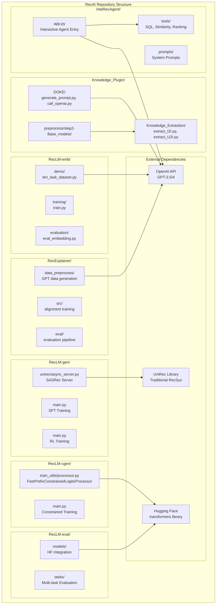

Sources: [README.md:1-234](), [InteRecAgent/README.md:1-196](), [RecLM-gen/README.md:1-310](), [RecLM-cgen/README.md:1-289](), [Knowledge_Plugin/README.md:1-69]()

## LLM Integration Approaches

RecAI implements four distinct strategies for combining LLMs with recommender systems:

| Approach | System | Key Components | Training Required | Benefits |
|----------|--------|----------------|-------------------|----------|
| **Tool-based Orchestration** | InteRecAgent | `app.py`, `tools/`, LLM API | No LLM training | Natural interaction, preserves domain expertise |
| **Knowledge Injection** | Knowledge_Plugin | `generate_prompt.py`, CF extractors | No LLM training | Selective knowledge use, maintains LLM capabilities |
| **LLM Specialization** | RecLM-gen/cgen/emb | `main.py`, SFT/RL training | Extensive training | End-to-end optimization, task-specific adaptation |
| **Model Explanation** | RecExplainer | Alignment training, behavior analysis | Moderate training | Interpretability, trust building |

Sources: [README.md:13-68](), [RAI_FAQ.md:7-19]()

## Core System Components

### Data Processing Pipeline

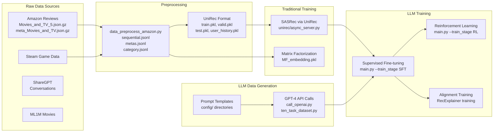

Sources: [RecLM-gen/README.md:60-66](), [RecLM-cgen/README.md:20-35](), [Knowledge_Plugin/README.md:7-17]()

### Technology Stack

The RecAI implementation leverages several key libraries and frameworks:

**Core ML Libraries:**
- `transformers` (Hugging Face) - LLM training and inference [RecLM-gen/README.md:8](), [RecLM-cgen/README.md:18]()
- `UniRec` - Traditional recommender model training [RecLM-gen/README.md:69](), [RecLM-cgen/README.md:78]()
- `vllm` - Fast LLM serving for inference [RecLM-gen/README.md:262]()

**LLM Integration:**
- OpenAI API integration for GPT-3.5/4 [InteRecAgent/README.md:74-88]()
- FastChat for local model serving [InteRecAgent/README.md:112-141]()
- Custom constrained generation via `FastPrefixConstrainedLogitsProcessor` [RecLM-cgen/README.md:251-276]()

**Data Processing:**
- Amazon dataset preprocessing pipelines [RecLM-gen/README.md:61-66](), [RecLM-cgen/README.md:21-34]()
- Collaborative filtering knowledge extraction [Knowledge_Plugin/README.md:19-35]()
- Multi-task dataset generation for LLM training

Sources: [README.md:102-107](), [InteRecAgent/README.md:56-141](), [RecLM-gen/README.md:1-310]()

## Evaluation and Deployment

RecAI provides comprehensive evaluation through `RecLM-eval` and multiple deployment options:

**Evaluation Framework:**
- Multi-task evaluation across retrieval, ranking, explanation capabilities [README.md:64-66]()
- User simulator for conversational evaluation [RAI_FAQ.md:25-27]()
- GPT-4 based comparative analysis

**Deployment Options:**
- Gradio interfaces for interactive demos [InteRecAgent/README.md:91-99]()
- REST API endpoints for model serving [RecLM-gen/README.md:262-276]()
- Docker containerization support for production deployment

The system is designed for both research experimentation and practical deployment, with responsible AI considerations documented in [RAI_FAQ.md:1-59]().

Sources: [README.md:62-68](), [RAI_FAQ.md:21-37](), [RecLM-gen/README.md:258-289]()

---

# Page: RecLM-emb

# RecLM-emb

<details>
<summary>Relevant source files</summary>

The following files were used as context for generating this wiki page:

- [RecLM-emb/.gitignore](RecLM-emb/.gitignore)
- [RecLM-emb/README.md](RecLM-emb/README.md)
- [RecLM-emb/demo.py](RecLM-emb/demo.py)
- [RecLM-emb/shell/demo.sh](RecLM-emb/shell/demo.sh)

</details>


## Purpose and Scope

RecLM-emb is a specialized text embedding system designed for versatile text-based item retrieval in recommendation systems. This system refines general-purpose language models to encode diverse query formats—including dialogues, detailed descriptions, formatted instructions, and sparse attributes—for effective embedding-based item matching. The system implements a comprehensive ten-task training framework to handle various retrieval scenarios encountered in real-world recommender systems.

For information about generative recommendation models, see [RecLM-gen and RecLM-cgen](#5). For evaluation frameworks, see [RecLM-eval](#6).

## System Overview

RecLM-emb addresses the limitation of general-purpose text embedding models that often produce overly generic semantic representations for item retrieval tasks. The system specializes language models through a multi-task training approach, enabling them to process user queries in various formats while maintaining consistent item representations.

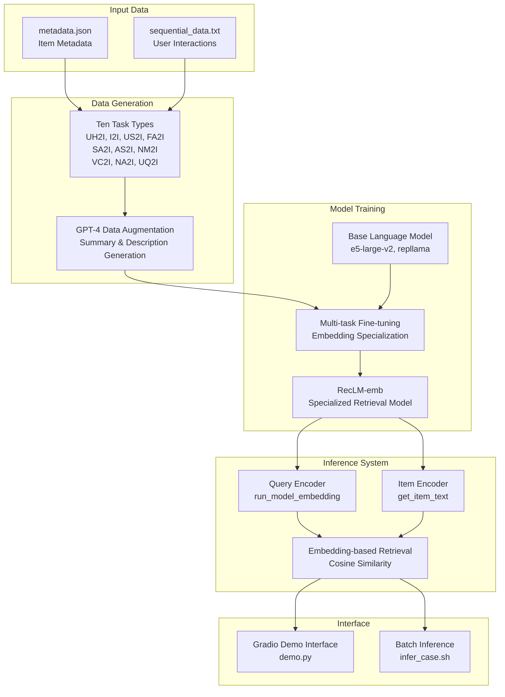

Sources: [RecLM-emb/README.md:19-25](), [RecLM-emb/demo.py:122-131]()

## Ten-Task Training Framework

RecLM-emb implements a comprehensive training framework encompassing ten distinct task types to ensure robust query understanding across various retrieval scenarios:

| Task Code | Task Name | Description | Query Format |
|-----------|-----------|-------------|--------------|
| UH2I | User History | Behavior history of a user | Sequential item interactions |
| I2I | Item-to-Item | Source item searching similar items | Single item representation |
| US2I | User Summary | Summary about user behavior | Natural language user profile |
| FA2I | Full Attributes | Complete item attributes | Concatenated full metadata |
| SA2I | Sparse Attributes | Randomly sampled attributes | Partial metadata fields |
| AS2I | Attributes Summary | Item summary with user tone | Natural language item description |
| NM2I | Name Misspell | Item name with misspellings | Intentionally corrupted titles |
| VC2I | Vague Condition | Non-precise attribute terms | Ambiguous descriptive language |
| NA2I | Negative Attributes | Items lacking certain features | Exclusion-based queries |
| UQ2I | User History and Query | Combined implicit/explicit preferences | History + explicit intent |

Sources: [RecLM-emb/README.md:5-16]()

## Architecture Components

The system architecture integrates multiple components for data processing, model training, and inference:

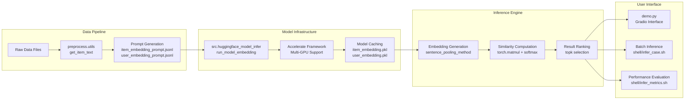

Sources: [RecLM-emb/demo.py:16-17](), [RecLM-emb/demo.py:116-121](), [RecLM-emb/shell/demo.sh:9-20]()

## Data Requirements and Formats

The system requires two primary input files with specific formats:

### metadata.json Structure
Each line contains a JSON object representing item metadata:
```json
{"title": "item title", "tags": ["tag1", "tag2"], "price": 29.99}
```

**Supported Fields:**
- `title` (required): Primary item identifier
- `tags`, `genres`: Item categorization
- `game_details`, `specs`: Technical specifications  
- `publisher`, `developer`: Content creators
- `price`, `release_date`: Commercial metadata
- `description`: Detailed item information

### sequential_data.txt Structure
Space-separated user-item interaction sequences:
```
userid_1 itemid_11 itemid_12 itemid_13
userid_2 itemid_21 itemid_22
```

Sources: [RecLM-emb/README.md:60-80](), [RecLM-emb/README.md:82-89]()

## Model Configuration and Training

The system supports multiple base models and training configurations:

**Supported Base Models:**
- `intfloat/e5-large-v2`: General-purpose embedding model
- `castorini/repllama-v1-7b-lora-passage`: LLaMA-based retrieval model

**Key Configuration Parameters:**
- `query_max_len`: Maximum query sequence length (default: 512)
- `passage_max_len`: Maximum item text length (default: 280)
- `sentence_pooling_method`: Embedding pooling strategy (`cls`, `mean`, `last`)
- `per_device_eval_batch_size`: Inference batch size
- `normlized`: L2 normalization flag
- `has_template`: Template-based text formatting

Sources: [RecLM-emb/demo.py:72-96](), [RecLM-emb/shell/demo.sh:12-20]()

## Inference and Retrieval Process

The retrieval process implements efficient embedding-based similarity computation:

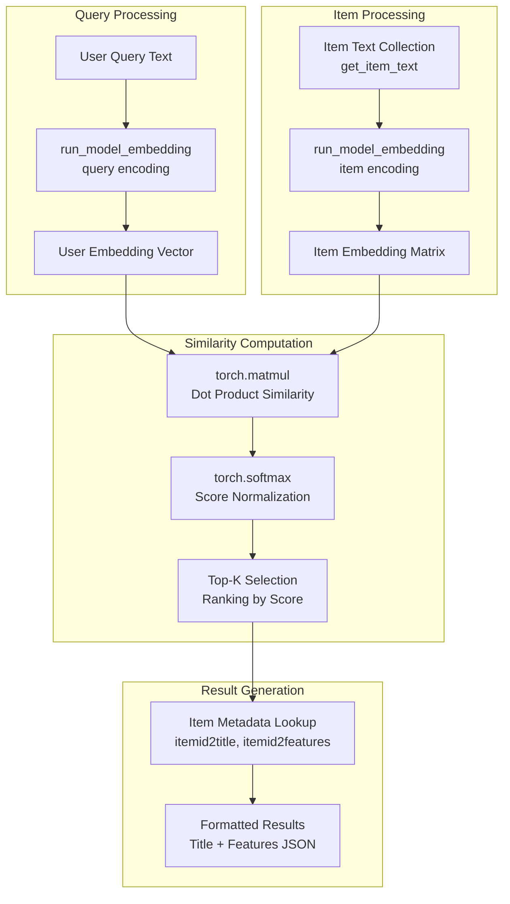

Sources: [RecLM-emb/demo.py:36-53](), [RecLM-emb/demo.py:122-131]()

## Demo Interface Features

The Gradio-based demo interface provides interactive item retrieval capabilities:

**Interface Components:**
- Text area for user query input
- Submit and clear functionality  
- Ranked result display with item titles
- Expandable JSON metadata view
- Pre-configured example queries

**Example Query Types:**
- Natural language requests: "I'd like to find shooting games not made for kids"
- Attribute-based searches: "Sports game with high quality graphics, released after 2021"
- Conversational contexts: Multi-turn dialogue scenarios
- Budget constraints: "Games under $100"

Sources: [RecLM-emb/demo.py:136-164](), [RecLM-emb/demo.py:149-158]()

---

# Page: RecLM-emb Architecture

# RecLM-emb Architecture

<details>
<summary>Relevant source files</summary>

The following files were used as context for generating this wiki page:

- [RecLM-emb/.gitignore](RecLM-emb/.gitignore)
- [RecLM-emb/README.md](RecLM-emb/README.md)
- [RecLM-emb/demo.py](RecLM-emb/demo.py)
- [RecLM-emb/shell/demo.sh](RecLM-emb/shell/demo.sh)

</details>


This document covers the architecture of the RecLM-emb system, which specializes general-purpose text embedding models for versatile text-based item retrieval. This includes the ten-task dataset generation framework and the interactive demo system for real-time item retrieval.

For information about RecLM-emb training pipelines, see [2.2](#2.2). For data processing and GPT integration details, see [2.3](#2.3). For inference and evaluation systems, see [2.4](#2.4).

## System Overview

RecLM-emb transforms general-purpose text embedding models into specialized item retrieval systems by fine-tuning on a comprehensive dataset of ten distinct task types. The system processes two raw input files (`metadata.json` and `sequential_data.txt`) to generate diverse training samples, then fine-tunes embedding models to handle various query formats including dialogues, descriptions, and sparse attributes.

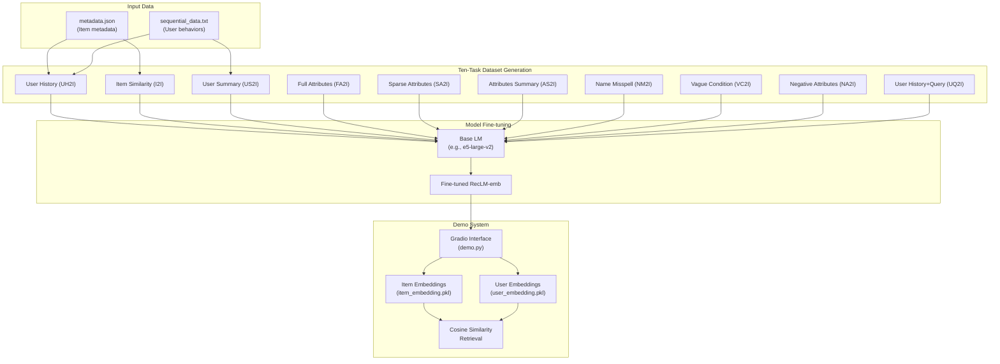

Sources: [RecLM-emb/README.md:1-168]()

## Ten-Task Dataset Architecture

The core innovation of RecLM-emb is its comprehensive ten-task dataset that covers diverse query formats for item retrieval. Each task type represents a different way users might express their preferences or search intents.

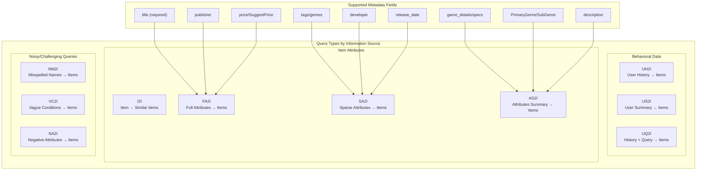

Sources: [RecLM-emb/README.md:6-16](), [RecLM-emb/README.md:69-80]()

## Demo System Architecture

The RecLM-emb demo system provides an interactive web interface built with Gradio for real-time item retrieval. The system pre-computes item embeddings and generates user query embeddings on-demand for efficient retrieval.

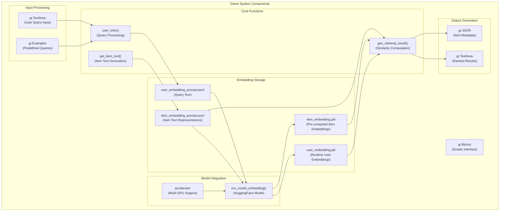

Sources: [RecLM-emb/demo.py:1-165](), [RecLM-emb/shell/demo.sh:1-20]()

## Model Integration Architecture

The system supports various embedding models through a unified interface, with configurable parameters for different deployment scenarios. The architecture separates query and passage encoding to optimize for retrieval performance.

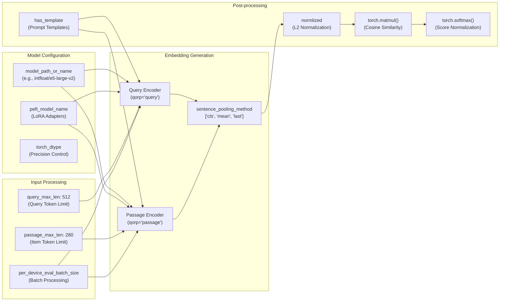

Sources: [RecLM-emb/demo.py:56-98](), [RecLM-emb/demo.py:122-131]()

## Retrieval Pipeline Architecture

The demo system implements an efficient retrieval pipeline that combines pre-computed item embeddings with real-time user query processing to generate ranked recommendations with metadata enrichment.

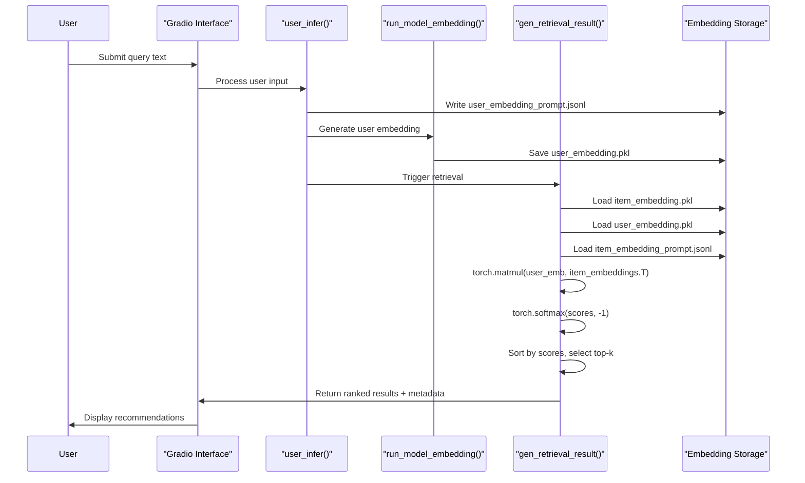

Sources: [RecLM-emb/demo.py:20-54](), [RecLM-emb/demo.py:122-131]()

---

# Page: RecLM-emb Training

# RecLM-emb Training

<details>
<summary>Relevant source files</summary>

The following files were used as context for generating this wiki page:

- [RecLM-emb/shell/run_multi_node.sh](RecLM-emb/shell/run_multi_node.sh)
- [RecLM-emb/shell/run_single_node.sh](RecLM-emb/shell/run_single_node.sh)
- [RecLM-emb/src/arguments.py](RecLM-emb/src/arguments.py)

</details>


This document covers the training orchestration, configuration management, and distributed training infrastructure for RecLM-emb models. The training system supports multiple embedding architectures and provides both single-node and multi-node distributed training capabilities for fine-tuning text embedding models on recommendation tasks.

For information about the RecLM-emb architecture and ten-task dataset, see [RecLM-emb Architecture](#2.1). For data preprocessing and template generation, see [RecLM-emb Data Processing](#2.3).

## Training Orchestration Overview

The RecLM-emb training system uses PyTorch's `torchrun` distributed launcher to coordinate model training across multiple GPUs and nodes. The training process supports both single-node and multi-node configurations with different parameter settings optimized for each deployment scenario.

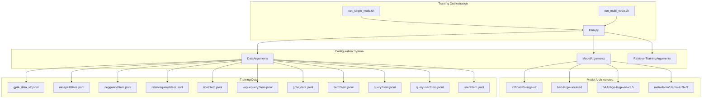

**Sources:** [RecLM-emb/shell/run_single_node.sh:1-87](), [RecLM-emb/shell/run_multi_node.sh:1-91](), [RecLM-emb/src/arguments.py:1-94]()

## Configuration System

The training configuration is managed through three main dataclasses that define model, data, and training-specific parameters. This modular configuration system allows for flexible experimentation across different model architectures and training setups.

### Model Configuration

The `ModelArguments` class handles model selection and architecture-specific settings:

| Parameter | Purpose | Supported Values |
|-----------|---------|------------------|
| `model_name_or_path` | Base model identifier | e5-large-v2, bert-large-uncased, bge-large-en-v1.5, Llama-2-7b-hf |
| `sentence_pooling_method` | Embedding pooling strategy | mean, cls, last |
| `peft_model_name` | PEFT model for efficient training | castorini/repllama-v1-7b-lora-passage |
| `attn_implementation` | Attention mechanism | eager, sdpa, flash_attention_2 |
| `torch_dtype` | Model precision | bfloat16, float16, float32, auto |

### Data Configuration

The `DataArguments` class defines training data parameters:

| Parameter | Purpose | Default |
|-----------|---------|---------|
| `train_group_size` | Positive + negative examples per query | 8 |
| `query_max_len` | Maximum query sequence length | 512 |
| `passage_max_len` | Maximum item description length | 128 |
| `has_template` | Whether data includes prompt templates | True |
| `max_example_num_per_dataset` | Examples per dataset limit | 100000000 |

### Training Configuration

The `RetrieverTrainingArguments` extends Transformers' `TrainingArguments` with retrieval-specific settings:

| Parameter | Purpose | Default |
|-----------|---------|---------|
| `temperature` | Contrastive learning temperature | 0.01 |
| `negatives_cross_device` | Share negatives across GPUs | False |
| `in_batch_negatives` | Use in-batch negatives | True |
| `fix_position_embedding` | Freeze position embeddings | False |

**Sources:** [RecLM-emb/src/arguments.py:12-53](), [RecLM-emb/src/arguments.py:55-87](), [RecLM-emb/src/arguments.py:88-94]()

## Distributed Training Setup

The training system provides two deployment modes with different resource requirements and performance characteristics.

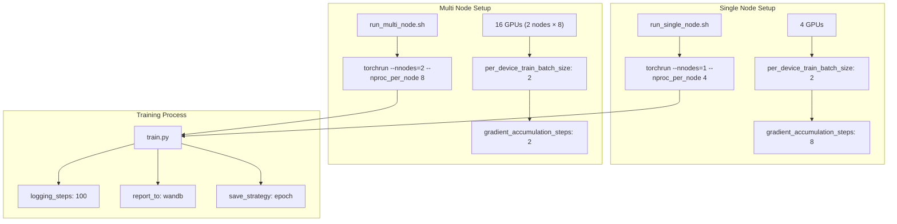

### Single Node Configuration

Single node training uses 4 GPUs with higher gradient accumulation to maintain effective batch size:

- **GPUs**: 4 per node
- **Batch size**: 2 per device 
- **Gradient accumulation**: 8 steps
- **Effective batch size**: 64 examples
- **Port**: 29501

### Multi Node Configuration  

Multi node training distributes across 2 nodes with 8 GPUs each, requiring node coordination parameters:

- **Nodes**: 2 nodes with 8 GPUs each
- **Batch size**: 2 per device
- **Gradient accumulation**: 2 steps  
- **Effective batch size**: 64 examples
- **Coordination**: `node_rank`, `master_addr`, `master_port` required

**Sources:** [RecLM-emb/shell/run_single_node.sh:30-56](), [RecLM-emb/shell/run_single_node.sh:62-84](), [RecLM-emb/shell/run_multi_node.sh:30-56](), [RecLM-emb/shell/run_multi_node.sh:61-83]()

## Model-Specific Training Configurations

Different embedding model architectures require specialized configuration settings for optimal performance. The training scripts automatically detect the model type and apply appropriate settings.

### Standard Embedding Models

For models like `intfloat/e5-large-v2`, `bert-large-uncased`, and `BAAI/bge-large-en-v1.5`:

| Setting | Value | Purpose |
|---------|-------|---------|
| `train_group_size` | 8 | Higher negative sampling |
| `has_template` | True | Use prompt templates |
| Pooling methods | mean (e5, BERT), cls (BGE) | Architecture-specific pooling |

### Large Language Models

For `meta-llama/Llama-2-7b-hf`, additional efficiency optimizations are enabled:

| Setting | Value | Purpose |
|---------|-------|---------|
| `torch_dtype` | bfloat16 | Memory efficiency |
| `bf16` | True | Mixed precision training |
| `attn_implementation` | flash_attention_2 | Optimized attention |
| `train_group_size` | 2 | Reduced due to memory constraints |
| `peft_model_name` | castorini/repllama-v1-7b-lora-passage | LoRA fine-tuning |
| `sentence_pooling_method` | last | LLM-appropriate pooling |

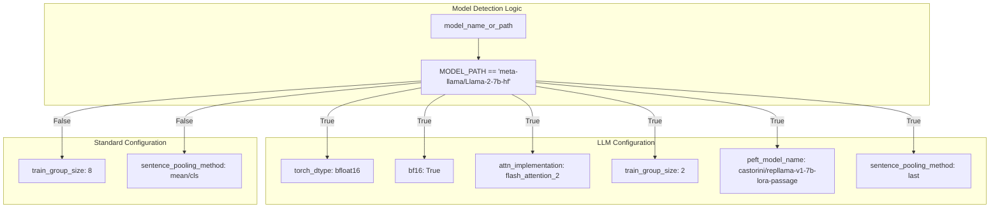

**Sources:** [RecLM-emb/shell/run_single_node.sh:22-36](), [RecLM-emb/shell/run_single_node.sh:58-64](), [RecLM-emb/shell/run_multi_node.sh:22-36](), [RecLM-emb/shell/run_multi_node.sh:58-64]()

## Training Pipeline and Monitoring

The training process integrates with Weights & Biases for experiment tracking and implements epoch-based checkpointing for model persistence.

### Environment Configuration

Essential environment variables for training execution:

| Variable | Purpose | Value |
|----------|---------|-------|
| `WANDB_PROJECT` | Experiment grouping | "RecLM-emb" |
| `WANDB_DIR` | Logging directory | "$HOME/.cache/" |
| `DISABLE_MLFLOW_INTEGRATION` | Disable MLflow | true |

### Training Parameters

Core training hyperparameters used across all model configurations:

| Parameter | Value | Purpose |
|-----------|-------|---------|
| `learning_rate` | 3e-5 | Learning rate |
| `num_train_epochs` | 3 | Training epochs |
| `warmup_ratio` | 0.1 | Learning rate warmup |
| `temperature` | 0.01 | Contrastive loss temperature |
| `normlized` | True | Normalize embeddings |
| `dataloader_num_workers` | 2 | Data loading parallelism |

### Ten-Task Training Data

The training process loads eleven JSONL files representing different recommendation tasks:

1. `gpt4_data_v2.jsonl` - GPT-4 generated queries (enhanced)
2. `misspell2item.jsonl` - Misspelled query handling
3. `negquery2item.jsonl` - Negative query examples
4. `relativequery2item.jsonl` - Relative preference queries
5. `title2item.jsonl` - Title-based item retrieval
6. `vaguequery2item.jsonl` - Ambiguous query handling
7. `gpt4_data.jsonl` - GPT-4 generated queries (original)
8. `item2item.jsonl` - Item similarity tasks
9. `query2item.jsonl` - Query-item matching
10. `queryuser2item.jsonl` - User-contextualized queries
11. `user2item.jsonl` - User preference modeling

**Sources:** [RecLM-emb/shell/run_single_node.sh:6-21](), [RecLM-emb/shell/run_single_node.sh:40-41](), [RecLM-emb/shell/run_single_node.sh:68-84](), [RecLM-emb/shell/run_multi_node.sh:6-21](), [RecLM-emb/shell/run_multi_node.sh:40-41](), [RecLM-emb/shell/run_multi_node.sh:67-83]()

---

# Page: RecLM-emb Data Processing

# RecLM-emb Data Processing

<details>
<summary>Relevant source files</summary>

The following files were used as context for generating this wiki page:

- [RecLM-emb/preprocess/data_process_v2.py](RecLM-emb/preprocess/data_process_v2.py)
- [RecLM-emb/preprocess/genera_query_file.py](RecLM-emb/preprocess/genera_query_file.py)
- [RecLM-emb/preprocess/merge.py](RecLM-emb/preprocess/merge.py)
- [RecLM-emb/preprocess/merge_v2.py](RecLM-emb/preprocess/merge_v2.py)
- [RecLM-emb/preprocess/template.py](RecLM-emb/preprocess/template.py)
- [RecLM-emb/preprocess/test_merge.py](RecLM-emb/preprocess/test_merge.py)
- [RecLM-emb/requirements.txt](RecLM-emb/requirements.txt)
- [RecLM-emb/shell/data_pipeline.sh](RecLM-emb/shell/data_pipeline.sh)
- [RecLM-emb/shell/test_data_pipeline.sh](RecLM-emb/shell/test_data_pipeline.sh)

</details>


## Purpose and Scope

This document details the data preprocessing and generation pipelines used for training and testing RecLM-emb, the embedding-based recommendation system component of RecAI. The RecLM-emb data processing pipeline transforms raw interaction data and item metadata into structured training and evaluation datasets for language model fine-tuning.

For information about the overall RecLM-emb architecture, see [RecLM-emb Architecture](#2.1). For details on the training process itself, see [RecLM-emb Training](#2.2).

## Data Processing Pipeline Overview

The RecLM-emb data processing system transforms raw sequential user-item interaction data and item metadata into diverse training and evaluation datasets designed to optimize embedding-based recommendation tasks.

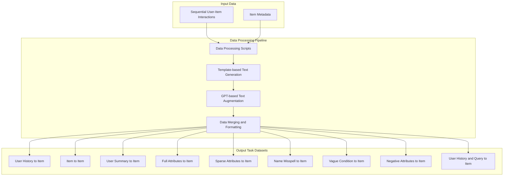

Sources: [RecLM-emb/shell/data_pipeline.sh:1-85](), [RecLM-emb/preprocess/data_process_v2.py:1-257]()

### Pipeline Execution

The data processing pipeline is orchestrated using shell scripts that coordinate the execution of multiple Python scripts:

1. **Initial data processing**: Transforms raw data into structured formats
2. **Template-based generation**: Creates templated text for different recommendation tasks
3. **GPT augmentation**: Uses GPT to enhance data quality and diversity
4. **Data merging**: Combines processed data into final training datasets

The pipeline is run separately for both training and testing data.

Sources: [RecLM-emb/shell/data_pipeline.sh:1-85](), [RecLM-emb/shell/test_data_pipeline.sh:1-66]()

## Input Data Format

The RecLM-emb data processing pipeline starts with two main input data sources:

1. **Sequential Data**: User-item interaction sequences in the format:
   ```
   user_id item_id1 item_id2 item_id3 ...
   ```
   Each line represents one user's chronological item interaction history.

2. **Metadata**: JSON file containing detailed information about each item, including:
   - Title
   - Description
   - Tags/categories
   - Developer/publisher
   - Price
   - Release date
   - Other item-specific attributes

Sources: [RecLM-emb/preprocess/data_process_v2.py:51-71](), [RecLM-emb/preprocess/data_process_v2.py:114-134]()

## Task-Specific Data Generation

RecLM-emb processes data for multiple recommendation tasks, each requiring specific data preparation approaches.

### Conversation Data Generation

Generates simulated conversations between users and recommendation assistants:

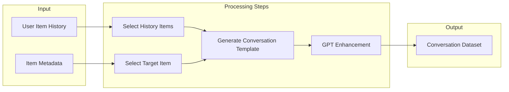

The conversation generation process:
1. Selects a target item from a user's history
2. Uses previous items as context
3. Creates conversation templates with placeholders
4. Configures parameters like difficulty level
5. Processes with GPT to generate natural conversations

Sources: [RecLM-emb/preprocess/data_process_v2.py:51-102](), [RecLM-emb/preprocess/template.py:251-272]()

### User Summary Generation

Creates text summaries of user preferences based on interaction history:

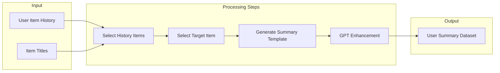

The summary generation process:
1. Extracts user interaction history
2. Formats history items into readable text
3. Configures parameters (word count, clarity, style)
4. Uses GPT to generate natural language summaries

Sources: [RecLM-emb/preprocess/data_process_v2.py:113-162](), [RecLM-emb/preprocess/template.py:274-283]()

### Query Generation

Creates natural language queries describing desired item attributes:

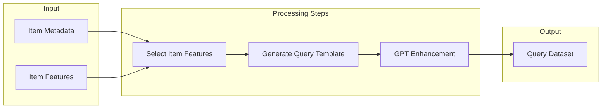

The query generation process:
1. Selects random items from metadata
2. Extracts key attributes (tags, features, price, etc.)
3. Configures parameters (difficulty, clarity, word count)
4. Uses GPT to generate natural language queries

Sources: [RecLM-emb/preprocess/data_process_v2.py:164-203](), [RecLM-emb/preprocess/template.py:285-298]()

### Negative Query Generation

Creates queries that express preferences for excluding certain attributes:

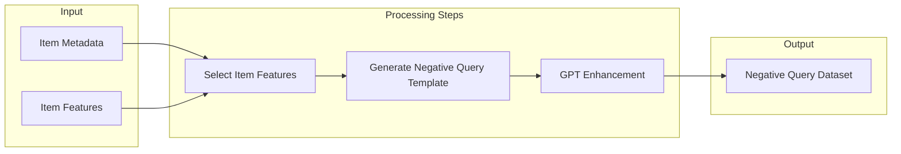

The negative query generation process:
1. Selects random items from metadata
2. Extracts key attributes to be excluded
3. Configures parameters (difficulty, clarity, word count)
4. Uses GPT to generate natural language negative queries

Sources: [RecLM-emb/preprocess/data_process_v2.py:205-247](), [RecLM-emb/preprocess/template.py:300-311]()

## Template-Based Data Generation

RecLM-emb uses extensive template libraries to generate diverse training examples:

| Task Type | Example Templates | Purpose |
|-----------|------------------|---------|
| User-to-Item | "I have played several games before: {}. Can you recommend other games for me?" | Generate user history-based recommendation queries |
| Query-to-Item | "I want to find some games with several features: {}." | Generate attribute-based search queries |
| Title-to-Item | "I'm looking for a game called {}." | Generate title-based search queries |
| Item-to-Item | "Can you recommend me some items similar to {}?" | Generate similar item recommendation queries |
| QueryUser-to-Item | "Based on my gaming history {0}, suggest some games that have these attributes: {1}." | Generate combined history and attribute queries |
| Negative Queries | "I want to find some games excluding several features: {}." | Generate exclusion-based queries |

The system uses these templates to:
1. Generate diverse training examples
2. Create natural language variants of the same query
3. Support different recommendation scenarios

Sources: [RecLM-emb/preprocess/template.py:4-249]()

## Data Merging and Sampling

After generating raw data and GPT responses, the pipeline merges them and performs sampling:

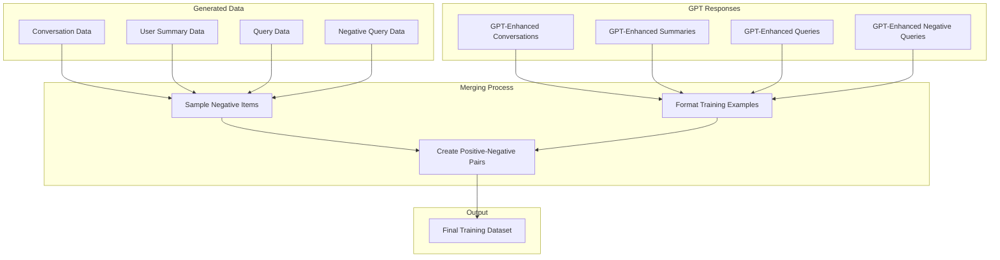

The merging process:
1. Loads GPT-enhanced responses for each data type
2. Samples negative items for contrastive learning
3. Formats data into query-positive-negative triplets
4. Writes the final training dataset to disk

The output format contains:
- `query`: Natural language query
- `pos`: List of positive item examples
- `neg`: List of negative item examples

Sources: [RecLM-emb/preprocess/merge_v2.py:56-241](), [RecLM-emb/preprocess/merge.py:47-161]()

## GPT Integration

RecLM-emb uses GPT to enhance the quality and diversity of training data:

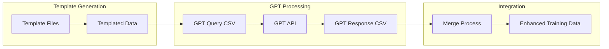

The GPT integration process:
1. Prepares query files from template data
2. Formats queries for GPT API processing
3. Processes responses from GPT
4. Merges responses with original data
5. Creates the final enhanced training data

Sources: [RecLM-emb/shell/data_pipeline.sh:41-85](), [RecLM-emb/preprocess/genera_query_file.py:124-164]()

## Test Data Generation

The test data generation pipeline follows a similar process to training data but with some key differences:

1. Samples a smaller subset of data for evaluation
2. Creates evaluation-specific formats
3. Removes duplicate examples between training and test sets
4. Creates specific evaluation task datasets

The resulting test datasets evaluate the model's performance on various recommendation tasks.

Sources: [RecLM-emb/shell/test_data_pipeline.sh:1-66](), [RecLM-emb/preprocess/test_merge.py:17-131]()

## Dependencies

The RecLM-emb data processing pipeline requires the following key dependencies:

- pandas: For data manipulation
- transformers: For tokenization
- tqdm: For progress tracking
- nltk: For text processing
- numpy: For numerical operations
- wandb: For experiment tracking

Sources: [RecLM-emb/requirements.txt:1-24]()

---

# Page: RecLM-emb Inference and Evaluation

# RecLM-emb Inference and Evaluation

<details>
<summary>Relevant source files</summary>

The following files were used as context for generating this wiki page:

- [RecLM-emb/infer_metrics.py](RecLM-emb/infer_metrics.py)
- [RecLM-emb/shell/infer_metrics.sh](RecLM-emb/shell/infer_metrics.sh)
- [RecLM-emb/src/data.py](RecLM-emb/src/data.py)
- [RecLM-emb/src/huggingface_model_infer.py](RecLM-emb/src/huggingface_model_infer.py)
- [RecLM-emb/src/model.py](RecLM-emb/src/model.py)
- [RecLM-emb/src/trainer.py](RecLM-emb/src/trainer.py)
- [RecLM-emb/train.py](RecLM-emb/train.py)

</details>


This document covers the model inference pipeline and evaluation framework for RecLM-emb, including embedding generation, retrieval evaluation, and multi-task performance measurement. For information about RecLM-emb training procedures, see [RecLM-emb Training](#2.2). For data processing and preparation, see [RecLM-emb Data Processing](#2.3).

## Purpose and Scope

The RecLM-emb inference and evaluation system provides:
- Model inference for both Hugging Face transformers and OpenAI API models
- Text embedding generation with configurable pooling strategies
- Multi-task evaluation across ten recommendation scenarios
- Performance metrics computation including precision, recall, NDCG, and coverage
- Distributed inference capabilities using Accelerate framework

## Inference Pipeline Overview

The inference system supports two primary model types through a unified interface, handling both local Hugging Face models and remote OpenAI API services.

```mermaid
graph TB
    subgraph "Inference Entry Point"
        IM["infer_metrics.py<br/>main()"]
    end
    
    subgraph "Model Type Detection"
        MTD["openai_model_names<br/>['ada_embeddings', 'text-embedding-ada-002', 'text-embedding-3-large']"]
    end
    
    subgraph "HuggingFace Path"
        HF_INFER["huggingface_model_infer.py<br/>run_model_embedding()"]
        HF_MODEL["BiEncoderModel<br/>AutoModel.from_pretrained()"]
        HF_EMB["sentence_embedding()<br/>mean/cls/last pooling"]
    end
    
    subgraph "OpenAI API Path"
        OAI_INFER["openai_model_infer.py<br/>run_api_embedding()"]
        OAI_API["OpenAI Embedding API<br/>text-embedding-*"]
    end
    
    subgraph "Evaluation Framework"
        GEN_RESULT["gen_retrieval_result()<br/>compute similarities"]
        COMPUTE_METRICS["compute_metrics()<br/>precision/recall/ndcg"]
        WRITE_METRICS["write_metrics_to_file()<br/>jsonl output"]
    end
    
    IM --> MTD
    MTD -->|"HuggingFace models"| HF_INFER
    MTD -->|"OpenAI models"| OAI_INFER
    
    HF_INFER --> HF_MODEL
    HF_MODEL --> HF_EMB
    
    HF_EMB --> GEN_RESULT
    OAI_API --> GEN_RESULT
    OAI_INFER --> OAI_API
    
    GEN_RESULT --> COMPUTE_METRICS
    COMPUTE_METRICS --> WRITE_METRICS
```

Sources: [RecLM-emb/infer_metrics.py:411-449](), [RecLM-emb/src/huggingface_model_infer.py:64-104]()

## Model Inference Implementation

The inference system uses the `EmbDataset` class and specialized data collators to handle text processing and tokenization across different model architectures.

### HuggingFace Model Inference

The `run_model_embedding` function orchestrates the complete inference pipeline for transformer models:

```mermaid
graph LR
    subgraph "Data Loading"
        ED["EmbDataset<br/>__init__()"]
        IC["InferCollator<br/>__call__()"]
    end
    
    subgraph "Model Setup"
        AC["AutoConfig.from_pretrained()"]
        AT["AutoTokenizer.from_pretrained()"]
        AM["AutoModel.from_pretrained()"]
        PM["PeftModel.from_pretrained()"]
    end
    
    subgraph "Inference Loop"
        DL["DataLoader<br/>batch processing"]
        MO["model(**data)"]
        SE["sentence_embedding()<br/>pooling + normalization"]
        AG["accelerator.gather_for_metrics()"]
    end
    
    ED --> IC
    AC --> AM
    AT --> IC
    AM --> PM
    PM --> MO
    IC --> DL
    DL --> MO
    MO --> SE
    SE --> AG
```

The `EmbDataset` class handles template formatting and text preprocessing:

| Parameter | Purpose | Implementation |
|-----------|---------|---------------|
| `has_template` | Apply query/passage prefixes | [RecLM-emb/src/huggingface_model_infer.py:28-29]() |
| `qorp` | Query or passage designation | Used in template: `f'{self.qorp}: {data}'` |
| `max_seq_len` | Sequence length limit | Passed to tokenizer truncation |

Sources: [RecLM-emb/src/huggingface_model_infer.py:14-31](), [RecLM-emb/src/huggingface_model_infer.py:64-104]()

### Embedding Generation and Pooling

The `sentence_embedding` function implements multiple pooling strategies for converting token-level representations to sentence-level embeddings:

```mermaid
graph TD
    subgraph "Pooling Methods"
        MEAN["Mean Pooling<br/>torch.sum(hidden * mask) / mask.sum()"]
        CLS["CLS Pooling<br/>hidden_state[:, 0]"]
        LAST["Last Token Pooling<br/>hidden_state[:, -1]"]
    end
    
    subgraph "Post-processing"
        NORM["L2 Normalization<br/>torch.nn.functional.normalize()"]
        OUTPUT["Final Embeddings<br/>pickle.dump()"]
    end
    
    MEAN --> NORM
    CLS --> NORM
    LAST --> NORM
    NORM --> OUTPUT
```

The pooling implementation handles attention masking for variable-length sequences:

```python
# Mean pooling with attention mask weighting
s = torch.sum(hidden_state * mask.unsqueeze(-1).float(), dim=1)
d = mask.sum(axis=1, keepdim=True).float()
sentence_embeddings = s / d
```

Sources: [RecLM-emb/src/huggingface_model_infer.py:48-62]()

## Multi-Task Evaluation Framework

The evaluation system processes ten distinct recommendation tasks through a unified metrics computation pipeline.

### Task Types and Evaluation Methods

The system handles different evaluation methodologies based on task characteristics:

```mermaid
graph TB
    subgraph "ID-based Recommendation Tasks"
        U2I["user2item<br/>Sequential recommendation"]
        T2I["title2item<br/>Content-based retrieval"]
        I2I["item2item<br/>Item similarity"]
        QU2I["queryuser2item<br/>Query + user history"]
        M2I["misspell2item<br/>Robustness testing"]
    end
    
    subgraph "Query-based Constraint Tasks" 
        Q2I["query2item<br/>Feature matching"]
        VQ2I["vaguequery2item<br/>Fuzzy constraints"]
    end
    
    subgraph "Evaluation Functions"
        EVAL_ID["compute_metrics_on_id_recommend()<br/>precision/recall/ndcg/hit"]
        EVAL_QUERY["compute_metrics_on_query()<br/>feature coverage"]
    end
    
    U2I --> EVAL_ID
    T2I --> EVAL_ID
    I2I --> EVAL_ID
    QU2I --> EVAL_ID
    M2I --> EVAL_ID
    
    Q2I --> EVAL_QUERY
    VQ2I --> EVAL_QUERY
```

Sources: [RecLM-emb/infer_metrics.py:306-311](), [RecLM-emb/shell/infer_metrics.sh:25-261]()

### Retrieval and Ranking Process

The `gen_retrieval_result` function computes similarity scores and generates ranked recommendations:

| Step | Operation | Implementation |
|------|-----------|---------------|
| Load embeddings | `pickle.load()` | User and item embeddings from disk |
| Compute similarities | `torch.matmul(user_emb, item_emb.T)` | Cosine similarity matrix |
| Apply constraints | `scores[idx][history] = -2` | Remove seen items |
| Generate rankings | `get_topk_index()` | Top-k retrieval with numpy |

The similarity computation uses softmax normalization and constraint masking:

```python
scores = torch.softmax(torch.matmul(user_embeddings, item_embeddings.T), -1)
scores[idx][data["history"]] = -2  # Mask historical items
topk_index = get_topk_index(scores, max(eval(args.topk)))
```

Sources: [RecLM-emb/infer_metrics.py:321-347]()

## Performance Metrics Implementation

The evaluation framework implements standard information retrieval metrics with specialized handling for recommendation scenarios.

### Core Metrics Computation

```mermaid
graph LR
    subgraph "Input Processing"
        TP["topk_preds<br/>List[item_id]"]
        GT["groundtruth<br/>List[item_id] or item_id"]
        REL["rel = [int(x in gt_set) for x in topk_preds]"]
    end
    
    subgraph "Metric Functions"
        PREC["precision_at_k()<br/>np.mean(rel[:k])"]
        REC["recall_at_k()<br/>np.sum(rel[:k]) / len(gt_set)"]
        NDCG["ndcg_at_k()<br/>dcg / dcg_max"]
        HIT["hit_at_k()<br/>1.0 if np.sum(rel[:k]) > 0 else 0.0"]
        COV["coverage_at_k()<br/>np.sum(rel[:k]) / k"]
    end
    
    TP --> REL
    GT --> REL
    REL --> PREC
    REL --> REC
    REL --> NDCG
    REL --> HIT
    REL --> COV
```

### NDCG Implementation

The Normalized Discounted Cumulative Gain computation uses ideal ranking for normalization:

```python
def ndcg_at_k(r, k, gt_set, method=1):
    gt_rel = [1]*len(gt_set) + [0]*(k-len(gt_set)) if len(gt_set)<k else [1]*k
    dcg_max = dcg_at_k(gt_rel, k, method)
    return dcg_at_k(r, k, method) / dcg_max if dcg_max else 0.0
```

Sources: [RecLM-emb/infer_metrics.py:107-138](), [RecLM-emb/infer_metrics.py:140-189]()

### Feature Coverage Evaluation

For constraint-based tasks, the system evaluates whether recommended items satisfy specified features:

```mermaid
graph TD
    subgraph "Feature Matching"
        FC["cal_feature_coverage()<br/>Exact feature matching"]
        VFC["cal_vague_feature_coverage()<br/>Price/date range matching"]
    end
    
    subgraph "Constraint Types"
        PRICE["Price Constraints<br/>'less than' / 'more than'"]
        DATE["Release Date<br/>'before' / 'after' / 'in'"]
        EXACT["Exact Features<br/>genre, developer, etc."]
    end
    
    FC --> EXACT
    VFC --> PRICE
    VFC --> DATE
```

The feature coverage computation processes item metadata to verify constraint satisfaction:

```python
# Price constraint checking
if ground_truth[1][0]=='less than' and meta['price']>=ground_truth[1][1]:
    flag=0
elif ground_truth[1][0]=='more than' and meta['price']<=ground_truth[1][1]:
    flag=0
```

Sources: [RecLM-emb/infer_metrics.py:208-262](), [RecLM-emb/infer_metrics.py:264-304]()

## Distributed Inference Configuration

The system uses Accelerate for distributed inference across multiple GPUs and nodes. Configuration files specify hardware allocation and parallelization strategies.

### Accelerate Configuration

The inference pipeline supports multiple distributed configurations through YAML files:

| Configuration | File | Use Case |
|---------------|------|----------|
| Standard | `shell/infer.yaml` | HuggingFace models |
| Case-specific | `shell/infer_case.yaml` | OpenAI API models |

The `accelerator.prepare()` call handles model and dataloader distribution:

```python
model, dataloader = accelerator.prepare(model, dataloader)
sentence_embeddings = accelerator.gather_for_metrics(sentence_embeddings)
```

Sources: [RecLM-emb/src/huggingface_model_infer.py:87](), [RecLM-emb/src/huggingface_model_infer.py:99](), [RecLM-emb/shell/infer_metrics.sh:19-23]()

---

# Page: RecLM-emb API Integration

# RecLM-emb API Integration

<details>
<summary>Relevant source files</summary>

The following files were used as context for generating this wiki page:

- [RecLM-emb/preprocess/gpt_api/api.py](RecLM-emb/preprocess/gpt_api/api.py)
- [RecLM-emb/src/openai_model_infer.py](RecLM-emb/src/openai_model_infer.py)

</details>


This document covers the OpenAI API integration components within the RecLM-emb system, focusing on external service interaction, concurrent processing, and authentication mechanisms. The integration enables RecLM-emb to leverage OpenAI's chat completion and embedding models for data preprocessing and inference tasks.

For information about RecLM-emb architecture and core training components, see [RecLM-emb Architecture](#2.1). For data processing pipelines and template systems, see [RecLM-emb Data Processing](#2.3).

## Authentication and Client Configuration

The RecLM-emb system supports multiple authentication methods for OpenAI API access, including direct API keys and Azure credential-based authentication.

```mermaid
flowchart TD
    EnvVars["Environment Variables<br/>OPENAI_API_KEY<br/>OPENAI_API_BASE<br/>OPENAI_API_TYPE<br/>OPENAI_API_VERSION"] --> AuthCheck{"api_key exists?"}
    
    AuthCheck -->|Yes| TypeCheck{"api_type == 'azure'?"}
    TypeCheck -->|Yes| AzureClient["AzureOpenAI<br/>client"]
    TypeCheck -->|No| OpenAIClient["OpenAI<br/>client"]
    
    AuthCheck -->|No| AzureCredentials["AzureCliCredential<br/>credential"]
    AzureCredentials --> TokenProvider["get_bearer_token_provider<br/>token_provider"]
    TokenProvider --> AzureADClient["AzureOpenAI<br/>with AD token"]
    
    AzureClient --> ClientReady["Client Ready"]
    OpenAIClient --> ClientReady
    AzureADClient --> ClientReady
```

**OpenAI Client Initialization**

The system initializes clients based on available authentication credentials:

| Authentication Method | Client Type | Required Environment Variables |
|----------------------|-------------|-------------------------------|
| API Key + Standard OpenAI | `OpenAI` | `OPENAI_API_KEY` |
| API Key + Azure OpenAI | `AzureOpenAI` | `OPENAI_API_KEY`, `OPENAI_API_BASE`, `OPENAI_API_TYPE=azure`, `OPENAI_API_VERSION` |
| Azure AD Authentication | `AzureOpenAI` with token provider | `OPENAI_API_BASE`, `OPENAI_API_VERSION` |

Sources: [RecLM-emb/preprocess/gpt_api/api.py:16-45](), [RecLM-emb/src/openai_model_infer.py:23-52]()

## Chat Completion API Integration

The `api.py` module handles GPT model interactions for generating synthetic training data and responses.

```mermaid
flowchart TD
    InputCSV["Input CSV<br/>with 'question' column"] --> LoadData["load_jsonl_from_disk()<br/>pandas DataFrame"]
    LoadData --> ThreadPool["ThreadPoolExecutor<br/>max_workers=args.num_process"]
    
    ThreadPool --> ProcessRow["process_row()<br/>for each sample"]
    ProcessRow --> CallChatGPT["call_chatgpt()<br/>with retry logic"]
    
    CallChatGPT --> TokenCount["tiktoken.encoding<br/>input/output tokens"]
    CallChatGPT --> APICall["client.chat.completions.create()<br/>model=MODEL"]
    
    APICall --> ResponseHandle{"Response OK?"}
    ResponseHandle -->|Yes| WriteCSV["csv.writer.writerow()<br/>question, response"]
    ResponseHandle -->|No| RetryLogic["Retry up to 5 times<br/>with rate limit handling"]
    
    RetryLogic --> APICall
    WriteCSV --> TokenTracking["Track total tokens<br/>Calculate cost"]
    
    subgraph "Error Handling"
        RetryLogic --> ContentFilter{"content filtering?"}
        RetryLogic --> RateLimit{"rate limit?"}
        RateLimit -->|Yes| Sleep["time.sleep(20)"]
        Sleep --> APICall
        ContentFilter -->|Yes| SkipSample["result = 'NULL'"]
    end
```

**Key Functions and Parameters**

| Function | Purpose | Key Parameters |
|----------|---------|----------------|
| `call_chatgpt()` | Single API call with retry logic | `prompt` (str) |
| `process_row()` | Process single data sample | `writer`, `sample` dict |
| `process_hf_data()` | Batch processing with concurrency | `dataset`, `output_file`, `args` |

The system implements comprehensive error handling for content filtering, rate limits, and network issues, with configurable retry counts and sleep intervals.

Sources: [RecLM-emb/preprocess/gpt_api/api.py:54-129]()

## Embedding API Integration

The `openai_model_infer.py` module handles OpenAI embedding model inference for text representation tasks.

```mermaid
flowchart TD
    InputJSONL["Input JSONL<br/>with 'text' field"] --> ReadPandas["pd.read_json()<br/>lines=True"]
    ReadPandas --> ExtractTexts["Extract text list<br/>prompts['text'].tolist()"]
    
    ExtractTexts --> QueueSetup["Setup Queues<br/>prompts_queue<br/>results (PriorityQueue)"]
    QueueSetup --> ThreadPool["ThreadPoolExecutor<br/>MAX_THREADS workers"]
    
    ThreadPool --> WorkerEmbedding["worker_embedding()<br/>for each thread"]
    ThreadPool --> ProgressMonitor["progress_monitor()<br/>multiprocessing.Process"]
    
    WorkerEmbedding --> DequeuePrompt["prompts_queue.get()<br/>(index, prompt)"]
    DequeuePrompt --> CallEmbedding["call_openai_embedding()<br/>model, text"]
    
    CallEmbedding --> EmbedAPI["client.embeddings.create()<br/>model=model<br/>input=[text]"]
    EmbedAPI --> ExtractEmbedding["response.data[0].embedding"]
    ExtractEmbedding --> EnqueueResult["results.put()<br/>(index, result)"]
    
    EnqueueResult --> UpdateProgress["num_completed.value += 1"]
    
    subgraph "Result Collection"
        CollectResults["Collect from results queue"] --> SortByIndex["Sort by original index"]
        SortByIndex --> HandleNone["Replace 'None' with zero vectors"]
        HandleNone --> SavePickle["pickle.dump()<br/>embeddings list"]
    end
```

**Concurrent Processing Architecture**

| Component | Type | Purpose |
|-----------|------|---------|
| `prompts_queue` | `queue.Queue` | Thread-safe prompt distribution |
| `results` | `queue.PriorityQueue` | Ordered result collection |
| `num_completed` | `multiprocessing.Value` | Shared progress counter |
| `progress_monitor` | `multiprocessing.Process` | Real-time progress display |

The embedding system maintains result ordering through indexed queue operations and implements robust error handling with configurable retry intervals.

Sources: [RecLM-emb/src/openai_model_infer.py:54-127]()

## Data Flow and Processing Pipeline

```mermaid
flowchart LR
    subgraph "Chat Completion Pipeline"
        CSV1["Input CSV<br/>questions"] --> GPTProcess["process_hf_data()<br/>ThreadPoolExecutor"]
        GPTProcess --> CSV2["Output CSV<br/>question, response"]
    end
    
    subgraph "Embedding Pipeline"
        JSONL1["Input JSONL<br/>text records"] --> EmbedProcess["run_api_embedding()<br/>multiprocessing"]
        EmbedProcess --> Pickle["Output Pickle<br/>embedding vectors"]
    end
    
    subgraph "Configuration"
        EnvConfig["Environment Variables<br/>MODEL, API_KEY, etc."] --> GPTProcess
        EnvConfig --> EmbedProcess
        CLIArgs["Command Line Args<br/>num_process, files"] --> GPTProcess
    end
    
    subgraph "Monitoring"
        TokenTracking["Token Usage Tracking<br/>tiktoken encoding"] --> GPTProcess
        ProgressBar["tqdm Progress Bar<br/>real-time updates"] --> EmbedProcess
        CostEstimation["Cost Calculation<br/>$10/1M input + $30/1M output"] --> GPTProcess
    end
```

**Input/Output Formats**

| Module | Input Format | Output Format | Key Fields |
|--------|-------------|---------------|------------|
| `api.py` | CSV with headers | CSV with headers | `question` → `question, response` |
| `openai_model_infer.py` | JSONL | Pickle binary | `text` → embedding vectors |

**Performance Characteristics**

- **Concurrency**: Configurable thread pools (default 1 thread for embeddings, configurable for chat)
- **Rate Limiting**: Automatic 20-second delays on rate limit errors
- **Retry Logic**: Up to 5 retries with exponential backoff
- **Progress Tracking**: Real-time progress bars with `tqdm` integration
- **Memory Efficiency**: Streaming processing for large datasets

Sources: [RecLM-emb/preprocess/gpt_api/api.py:94-129](), [RecLM-emb/src/openai_model_infer.py:85-127]()

---

# Page: RecExplainer

# RecExplainer

<details>
<summary>Relevant source files</summary>

The following files were used as context for generating this wiki page:

- [RecExplainer/README.md](RecExplainer/README.md)
- [RecExplainer/shell/eval_explan.sh](RecExplainer/shell/eval_explan.sh)
- [RecExplainer/shell/infer_alignment.sh](RecExplainer/shell/infer_alignment.sh)

</details>


RecExplainer is a framework for aligning Large Language Models (LLMs) to understand and explain the behavior of black-box recommendation models. The system trains LLMs as surrogate models that can mimic target recommender models and generate natural language explanations for their predictions.

For information about other LLM-based recommendation approaches, see [RecLM-gen and RecLM-cgen](#5) for generative models and [InteRecAgent](#4) for conversational recommendation agents.

## System Overview

RecExplainer consists of two main components: a target recommender model (such as SASRec or Matrix Factorization) that generates recommendations, and an LLM that learns to mimic and explain the target model's behavior through specialized training tasks.

```mermaid
graph TB
    subgraph "RecExplainer Framework"
        subgraph "Target Models"
            SASRec["SASRec<br/>Sequential Recommender"]
            MF["MF<br/>Matrix Factorization"]
        end
        
        subgraph "LLM Surrogate Models"
            RecExpB["RecExplainer-B<br/>Behavior Alignment<br/>Language Space"]
            RecExpI["RecExplainer-I<br/>Intention Alignment<br/>Latent Space"]  
            RecExpH["RecExplainer-H<br/>Hybrid Alignment<br/>Both Spaces"]
        end
        
        subgraph "Training Tasks"
            Task1["uid2next<br/>Next Item Retrieval"]
            Task2["uidiid2rank<br/>Item Ranking"]
            Task3["uidiid2binary<br/>Interest Classification"]
            Task4["Item Discrimination"]
            Task6["uid2hist<br/>History Reconstruction"]
            TaskRec["iid2title<br/>Item Recovery"]
        end
        
        subgraph "Data Sources"
            Amazon["Amazon Video Games<br/>Reviews & Metadata"]
            ShareGPT["ShareGPT<br/>Conversation Data"]
        end
        
        subgraph "Evaluation"
            Alignment["Alignment Effect<br/>Task Performance"]
            Explanation["Explanation Quality<br/>GPT-4 & Human Rating"]
            Distinction["Distinction & Coherence<br/>Classifier & Score Predictor"]
        end
    end
    
    %% Data flow
    Amazon --> SASRec
    Amazon --> MF
    ShareGPT --> RecExpB
    ShareGPT --> RecExpI
    ShareGPT --> RecExpH
    
    %% Target model to LLM alignment
    SASRec --> RecExpB
    SASRec --> RecExpI
    SASRec --> RecExpH
    MF --> RecExpB
    MF --> RecExpI
    MF --> RecExpH
    
    %% Training tasks
    RecExpB --> Task1
    RecExpB --> Task2
    RecExpB --> Task3
    RecExpB --> Task4
    RecExpB --> Task6
    RecExpB --> TaskRec
    
    RecExpI --> Task1
    RecExpI --> Task2
    RecExpI --> Task3
    RecExpI --> Task4
    RecExpI --> Task6
    RecExpI --> TaskRec
    
    RecExpH --> Task1
    RecExpH --> Task2
    RecExpH --> Task3
    RecExpH --> Task4
    RecExpH --> Task6
    RecExpH --> TaskRec
    
    %% Evaluation
    RecExpB --> Alignment
    RecExpI --> Alignment
    RecExpH --> Alignment
    
    RecExpB --> Explanation
    RecExpI --> Explanation
    RecExpH --> Explanation
    
    RecExpB --> Distinction
    RecExpI --> Distinction
    RecExpH --> Distinction
```

Sources: [RecExplainer/README.md:1-20]()

## Alignment Approaches

RecExplainer implements three distinct alignment strategies to train LLMs as surrogate models for recommendation systems:

### Behavior Alignment (RecExplainer-B)
Operates entirely in the language space by representing user preferences and item information as text. The LLM learns to mimic the target model's behavior using textual representations of users and items.

### Intention Alignment (RecExplainer-I) 
Works in the latent space of the recommendation model, using user and item embeddings to understand the model's internal decision-making process.

### Hybrid Alignment (RecExplainer-H)
Combines both language and latent spaces to leverage the benefits of textual understanding and embedding-based reasoning.

```mermaid
graph TB
    subgraph "Alignment Approaches"
        subgraph "Behavior Alignment"
            B_Input["Text Representations<br/>User History + Item Descriptions"]
            B_LLM["LLM<br/>Language Space Processing"]
            B_Output["Text-based Predictions<br/>Mimicking Target Model"]
        end
        
        subgraph "Intention Alignment"
            I_Input["Embedding Vectors<br/>User & Item Representations"]
            I_LLM["LLM<br/>Latent Space Processing"]
            I_Output["Embedding-based Predictions<br/>Understanding Internal Logic"]
        end
        
        subgraph "Hybrid Alignment"
            H_Input_Text["Text Representations"]
            H_Input_Embed["Embedding Vectors"]
            H_LLM["LLM<br/>Combined Processing"]
            H_Output["Hybrid Predictions<br/>Best of Both Worlds"]
        end
        
        subgraph "Target Model Knowledge"
            TargetPreds["Target Model Predictions"]
            TargetEmbeds["Target Model Embeddings"]
        end
    end
    
    %% Behavior alignment flow
    B_Input --> B_LLM
    B_LLM --> B_Output
    TargetPreds --> B_Output
    
    %% Intention alignment flow
    I_Input --> I_LLM
    I_LLM --> I_Output
    TargetEmbeds --> I_Output
    
    %% Hybrid alignment flow
    H_Input_Text --> H_LLM
    H_Input_Embed --> H_LLM
    H_LLM --> H_Output
    TargetPreds --> H_Output
    TargetEmbeds --> H_Output
```

Sources: [RecExplainer/README.md:10-13]()

## Training Tasks and Data Pipeline

The system uses five core training tasks to align the LLM with the target recommender model's behavior patterns:

| Task | Task Type | Description | Inference Mode |
|------|-----------|-------------|----------------|
| Next Item Retrieval | `uid2next` | Predict next item in user sequence | `uid2next` |
| Item Ranking | `uidiid2rank` | Rank candidate items for user | `uidiid2rank` |
| Interest Classification | `uidiid2binary` | Binary classification of user interest | `uidiid2binary` |
| Item Discrimination | - | Distinguish between similar items | - |
| History Reconstruction | `uid2hist` | Reconstruct user interaction history | `uid2hist` |
| Item Recovery | `iid2title` | Recover item information from ID | `iid2title` |

```mermaid
graph LR
    subgraph "Data Preprocessing Pipeline"
        RawData["Raw Amazon Data<br/>meta_Video_Games.json<br/>Video_Games_5.json"]
        ShareGPT["ShareGPT Data<br/>ShareGPT_V3_unfiltered_cleaned_split.json"]
        
        Preprocess["preprocess_recmodel.sh<br/>Data Cleaning & Formatting"]
        UniRecPrep["unirec_prepare_data.sh<br/>UniRec Format Conversion"]
        
        TargetTrain["Target Model Training<br/>unirec_sasrec_train.sh<br/>unirec_mf_train.sh"]
        TargetInfer["Target Model Inference<br/>unirec_sasrec_infer.sh<br/>unirec_mf_infer.sh"]
        
        DataPipeline["recexplainer_data_pipeline.sh<br/>Generate Training Data"]
        
        TrainingFiles["Training Files<br/>behaviour_train.json<br/>intention_train.json<br/>both_train.json"]
        ValidationFiles["Validation Files<br/>behaviour_valid.json<br/>intention_valid.json<br/>both_valid.json"]
        ExplanationFiles["Explanation Files<br/>explan_behaviour_valid.json<br/>explan_intention_valid.json<br/>explan_both_valid.json"]
    end
    
    RawData --> Preprocess
    ShareGPT --> Preprocess
    Preprocess --> UniRecPrep
    UniRecPrep --> TargetTrain
    TargetTrain --> TargetInfer
    TargetInfer --> DataPipeline
    DataPipeline --> TrainingFiles
    DataPipeline --> ValidationFiles
    DataPipeline --> ExplanationFiles
```

Sources: [RecExplainer/README.md:51-117](), [RecExplainer/shell/infer_alignment.sh:1-142]()

## Training and Inference Configuration

The system supports multiple LLM templates and can be configured for different target recommendation models:

### Supported Models and Templates
- **Target Models**: SASRec, Matrix Factorization (MF)
- **LLM Templates**: mistral, vicuna, llama-2, llama-3, phi3
- **Task Types**: behaviour, intention, both, none

### Key Training Parameters

| Parameter | Description | Example Values |
|-----------|-------------|----------------|
| `rec_model_type` | Target recommender model type | `SASRec`, `MF` |
| `task_type` | Alignment method | `behaviour`, `intention`, `both` |
| `template_name` | LLM chat template | `llama-3`, `mistral` |
| `max_hist_len` | Maximum history length | `9` |
| `model_max_length` | Maximum sequence length | `1024` |

```mermaid
graph TB
    subgraph "Training Configuration Flow"
        BaseModel["Base LLM<br/>Llama-3, Mistral, etc."]
        LoRAConfig["LoRA Configuration<br/>Low-rank Adaptation"]
        
        TaskData["Task-specific Data<br/>behaviour_train.json<br/>intention_train.json<br/>both_train.json"]
        
        TrainScript["train.sh<br/>Supervised Fine-tuning"]
        MergeScript["merge.sh<br/>LoRA Adapter Merging"]
        
        AlignedModel["Aligned RecExplainer Model<br/>Merged Final Model"]
        
        InferenceScripts["Inference Scripts<br/>infer_alignment.sh<br/>infer_explan.sh"]
        
        Results["Model Outputs<br/>Alignment Performance<br/>Generated Explanations"]
    end
    
    BaseModel --> LoRAConfig
    TaskData --> TrainScript
    LoRAConfig --> TrainScript
    TrainScript --> MergeScript
    MergeScript --> AlignedModel
    AlignedModel --> InferenceScripts
    InferenceScripts --> Results
```

Sources: [RecExplainer/README.md:119-133](), [RecExplainer/shell/infer_alignment.sh:13-21]()

## Evaluation Framework

RecExplainer employs a comprehensive two-fold evaluation approach to assess both alignment effectiveness and explanation quality:

### Alignment Effect Evaluation
Measures how well the LLM understands the target model's predictive patterns through task-specific performance metrics across the six training tasks.

### Explanation Generation Evaluation

#### Overall Ratings
Uses GPT-4 and human experts to evaluate explanation quality through comparative analysis.

#### Distinction and Coherence
Employs trained classifiers and score predictors to verify that explanations are distinct from other LLMs and coherent with the model's own predictions.

```mermaid
graph TB
    subgraph "Evaluation Pipeline"
        subgraph "Alignment Evaluation"
            AlignInfer["infer_alignment.sh<br/>Task Performance Testing"]
            Tasks["Alignment Tasks<br/>iid2title, uid2hist<br/>uid2next, uidiid2rank<br/>uidiid2binary"]
            AlignResults["Alignment Scores<br/>Task Accuracy Metrics"]
        end
        
        subgraph "Explanation Evaluation"
            ExplanInfer["infer_explan.sh<br/>Generate Explanations"]
            ExplanData["Explanation Outputs<br/>recexplainer-B_response.csv<br/>recexplainer-I_response.csv<br/>recexplainer-H_response.csv"]
            
            GPTEval["eval_explan.sh<br/>GPT-4 Quality Assessment"]
            JudgeData["judge_query.csv<br/>judge_response.csv"]
            
            Discriminator["Discriminator Training<br/>data_gen.sh<br/>run_cls.sh, run_reg.sh"]
            ClassifierReg["Classifier & Regressor<br/>Distinction & Coherence"]
        end
        
        FinalScores["Final Evaluation Scores<br/>Alignment + Explanation Quality"]
    end
    
    %% Alignment evaluation flow
    AlignInfer --> Tasks
    Tasks --> AlignResults
    
    %% Explanation evaluation flow
    ExplanInfer --> ExplanData
    ExplanData --> GPTEval
    GPTEval --> JudgeData
    
    ExplanData --> Discriminator
    Discriminator --> ClassifierReg
    
    %% Final results
    AlignResults --> FinalScores
    JudgeData --> FinalScores
    ClassifierReg --> FinalScores
```

Sources: [RecExplainer/README.md:134-194](), [RecExplainer/shell/eval_explan.sh:1-18]()

## Implementation Architecture

The RecExplainer codebase follows a modular structure with distinct components for data processing, model training, and evaluation:

```mermaid
graph TB
    subgraph "RecExplainer Code Structure"
        subgraph "Shell Scripts"
            ShellPreprocess["shell/preprocess_recmodel.sh<br/>shell/unirec_prepare_data.sh"]
            ShellTrain["shell/unirec_sasrec_train.sh<br/>shell/unirec_mf_train.sh"]
            ShellPipeline["shell/recexplainer_data_pipeline.sh"]
            ShellTraining["shell/train.sh<br/>shell/merge.sh"]
            ShellInference["shell/infer_alignment.sh<br/>shell/infer_explan.sh"]
            ShellEval["shell/eval_explan.sh"]
        end
        
        subgraph "Source Code"
            SrcInference["src/inference.py<br/>Model Inference Engine"]
            SrcTraining["src/ (Training Components)"]
        end
        
        subgraph "Preprocessing"
            PrepUtils["preprocess/unirec_utils/<br/>Data Processing Utilities"]
            PrepEval["preprocess/eval_explan.py<br/>preprocess/gpt_api.py"]
        end
        
        subgraph "Discriminator"
            DiscGen["discriminator/data_gen.sh"]
            DiscTrain["discriminator/run_cls.sh<br/>discriminator/run_reg.sh"]
        end
        
        subgraph "Configuration"
            ConfigInfer["shell/config/infer_single_node.yaml<br/>Accelerate Configuration"]
        end
        
        subgraph "Data Directory Structure"
            DataAmazon["data/amazon_video_games_v3/<br/>datamaps.json, metadata.json<br/>SASRec.pth, sequential_data.txt"]
            DataMF["data/mf_amazon_video_games_v3/<br/>MF.pth, sim_item.txt"]
            DataOutput["output/amazon_video_games_v3/<br/>Inference Results"]
        end
    end
    
    %% Flow connections
    ShellPreprocess --> PrepUtils
    ShellTrain --> DataAmazon
    ShellTrain --> DataMF
    ShellPipeline --> DataAmazon
    ShellTraining --> SrcTraining
    ShellInference --> SrcInference
    ShellInference --> ConfigInfer
    ShellEval --> PrepEval
    
    SrcInference --> DataOutput
    DiscGen --> DiscTrain
```

Sources: [RecExplainer/README.md:76-98](), [RecExplainer/shell/infer_alignment.sh:23-46]()

---

# Page: RecExplainer Architecture

# RecExplainer Architecture

<details>
<summary>Relevant source files</summary>

The following files were used as context for generating this wiki page:

- [RecExplainer/README.md](RecExplainer/README.md)
- [RecExplainer/shell/eval_explan.sh](RecExplainer/shell/eval_explan.sh)
- [RecExplainer/shell/infer_alignment.sh](RecExplainer/shell/infer_alignment.sh)

</details>


## Purpose and Scope

This document provides an architectural overview of RecExplainer, a framework designed to align Large Language Models (LLMs) for understanding and explaining black-box recommender models. RecExplainer serves as a surrogate model that mimics target recommendation model behavior and generates natural language explanations for recommendation decisions.

For information about data pipeline and preprocessing components, see [RecExplainer Data Pipeline](#3.2). For training configuration and model merging details, see [RecExplainer Training](#3.3).

## System Architecture Overview

RecExplainer operates as a two-component framework where an LLM learns to mimic and explain a target recommender model through various alignment strategies. The system supports multiple target recommendation models and provides comprehensive evaluation capabilities.

### Core Components Architecture

```mermaid
graph TB
    subgraph "Target Recommendation Models"
        SASRec["SASRec Model<br/>Sequential Recommender"]
        MF["MF Model<br/>Matrix Factorization"]
        UniRec["UniRec Framework<br/>Training Infrastructure"]
    end
    
    subgraph "RecExplainer LLM System"
        BaseModel["Base LLM Models<br/>Llama-3, Mistral, Vicuna, Phi3"]
        LoRAAdapters["LoRA Adapters<br/>Task-specific Fine-tuning"]
        MergedModel["Merged RecExplainer Model<br/>Aligned LLM"]
    end
    
    subgraph "Alignment Framework"
        BehaviorAlign["RecExplainer-B<br/>Behavior Alignment<br/>Language Space Operations"]
        IntentionAlign["RecExplainer-I<br/>Intention Alignment<br/>Latent Space Operations"] 
        HybridAlign["RecExplainer-H<br/>Hybrid Alignment<br/>Combined Approach"]
    end
    
    subgraph "Task Execution Engine"
        TaskEngine["Multi-task Framework"]
        Task1["next item retrieval<br/>(uid2next)"]
        Task2["item ranking<br/>(uidiid2rank)"]
        Task3["interest classification<br/>(uidiid2binary)"]
        Task4["item discrimination<br/>(iid2title)"]
        Task6["history reconstruction<br/>(uid2hist)"]
    end
    
    subgraph "Evaluation Components"
        AlignmentEval["Alignment Effect Evaluation<br/>Task Performance Metrics"]
        ExplanationEval["Explanation Generation Evaluation<br/>GPT-4 Scoring & Human Annotation"]
        Discriminator["Discriminator Components<br/>Classifier & Score Predictor"]
    end
    
    subgraph "Data Processing Pipeline"
        AmazonData["Amazon Video Games Dataset<br/>Reviews & Metadata"]
        ShareGPTData["ShareGPT Conversations<br/>Training Data"]
        DataPreprocess["Data Preprocessing<br/>Sequential Data Generation"]
    end
    
    %% Target model connections
    UniRec --> SASRec
    UniRec --> MF
    SASRec --> TaskEngine
    MF --> TaskEngine
    
    %% LLM system connections
    BaseModel --> LoRAAdapters
    LoRAAdapters --> MergedModel
    
    %% Alignment connections
    MergedModel --> BehaviorAlign
    MergedModel --> IntentionAlign
    MergedModel --> HybridAlign
    
    %% Task connections
    BehaviorAlign --> TaskEngine
    IntentionAlign --> TaskEngine
    HybridAlign --> TaskEngine
    TaskEngine --> Task1
    TaskEngine --> Task2
    TaskEngine --> Task3
    TaskEngine --> Task4
    TaskEngine --> Task6
    
    %% Evaluation connections
    TaskEngine --> AlignmentEval
    BehaviorAlign --> ExplanationEval
    IntentionAlign --> ExplanationEval
    HybridAlign --> ExplanationEval
    ExplanationEval --> Discriminator
    
    %% Data connections
    AmazonData --> DataPreprocess
    ShareGPTData --> DataPreprocess
    DataPreprocess --> TaskEngine
```

Sources: [RecExplainer/README.md:5-20](), [RecExplainer/shell/infer_alignment.sh:20-46]()

## Alignment Approaches Architecture

RecExplainer implements three distinct alignment strategies to train LLMs to understand and explain recommendation model behavior. Each approach operates in different representational spaces and targets different aspects of model understanding.

### Alignment Strategy Framework

```mermaid
graph TB
    subgraph "Input Processing"
        UserSeq["User Sequential Data<br/>sequential_data.txt"]
        ItemMeta["Item Metadata<br/>metadata.json"]
        RecModelPred["Target Model Predictions<br/>test_top.txt, train_top.txt"]
    end
    
    subgraph "Behavior Alignment (RecExplainer-B)"
        BehaviorData["behaviour_train.json<br/>behaviour_valid.json"]
        LanguageSpace["Language Space Operations<br/>Text-based User & Item Representations"]
        BehaviorTasks["Task Templates<br/>Template-based Prompt Generation"]
    end
    
    subgraph "Intention Alignment (RecExplainer-I)"
        IntentionData["intention_train.json<br/>intention_valid.json"]
        LatentSpace["Latent Space Operations<br/>Model Embedding Representations"]
        IntentionTasks["Embedding-based Tasks<br/>Feature-level Understanding"]
    end
    
    subgraph "Hybrid Alignment (RecExplainer-H)"
        HybridData["both_train.json<br/>both_valid.json"] 
        CombinedSpace["Combined Approach<br/>Language + Latent Spaces"]
        HybridTasks["Multi-modal Task Design<br/>Comprehensive Alignment"]
    end
    
    subgraph "Training Configuration"
        TaskType["task_type Parameter<br/>behaviour/intention/both"]
        TemplateName["template_name Parameter<br/>mistral/vicuna/llama-2/llama-3/phi3"]
        ModelType["rec_model_type Parameter<br/>SASRec/MF"]
    end
    
    subgraph "Inference Modes"
        InferenceEngine["inference_mode Parameter"]
        ItemRecovery["iid2title<br/>Item Recovery Task"]
        HistoryRecon["uid2hist<br/>History Reconstruction"]
        NextItemRetrieval["uid2next<br/>Next Item Retrieval"]
        ItemRanking["uidiid2rank<br/>Item Ranking"]
        InterestClass["uidiid2binary<br/>Interest Classification"]
        CaseStudy["case study<br/>Explanation Generation"]
    end
    
    %% Input processing connections
    UserSeq --> BehaviorData
    UserSeq --> IntentionData
    UserSeq --> HybridData
    ItemMeta --> LanguageSpace
    ItemMeta --> LatentSpace
    RecModelPred --> BehaviorTasks
    RecModelPred --> IntentionTasks
    
    %% Alignment approach connections
    BehaviorData --> LanguageSpace
    LanguageSpace --> BehaviorTasks
    
    IntentionData --> LatentSpace
    LatentSpace --> IntentionTasks
    
    HybridData --> CombinedSpace
    CombinedSpace --> HybridTasks
    
    %% Configuration connections
    TaskType --> BehaviorTasks
    TaskType --> IntentionTasks
    TaskType --> HybridTasks
    TemplateName --> BehaviorTasks
    TemplateName --> IntentionTasks
    TemplateName --> HybridTasks
    ModelType --> BehaviorTasks
    ModelType --> IntentionTasks
    ModelType --> HybridTasks
    
    %% Inference connections
    BehaviorTasks --> InferenceEngine
    IntentionTasks --> InferenceEngine
    HybridTasks --> InferenceEngine
    InferenceEngine --> ItemRecovery
    InferenceEngine --> HistoryRecon
    InferenceEngine --> NextItemRetrieval
    InferenceEngine --> ItemRanking
    InferenceEngine --> InterestClass
    InferenceEngine --> CaseStudy
```

Sources: [RecExplainer/README.md:10-13](), [RecExplainer/shell/infer_alignment.sh:13-14](), [RecExplainer/README.md:125-128]()

## Task Framework and Execution Pipeline

The RecExplainer system implements a comprehensive multi-task framework designed to align LLMs with target recommendation models across different dimensions of understanding. Each task targets specific aspects of recommendation model behavior and contributes to overall model alignment.

### Multi-Task Execution Architecture

| Task ID | Task Name | Inference Mode | Purpose | Output Type |
|---------|-----------|----------------|---------|-------------|
| Task 1 | Next Item Retrieval | `uid2next` | Predict next items for user sequences | Item titles/IDs |
| Task 2 | Item Ranking | `uidiid2rank` | Rank items by user preference | Ranking scores |
| Task 3 | Interest Classification | `uidiid2binary` | Binary interest prediction | Yes/No classification |
| Task 4 | Item Discrimination | `iid2title` | Recover item information from embeddings | Item metadata |
| Task 6 | History Reconstruction | `uid2hist` | Reconstruct user interaction history | Historical item sequences |
| Explanation | Case Study Generation | `case study` | Generate natural language explanations | Explanation text |

### Task Processing Pipeline

```mermaid
graph TB
    subgraph "Data Input Layer"
        ValidationFile["validation_file<br/>JSON task data"]
        SequentialFile["sequential_file<br/>User sequence data"]
        MetadataFile["metadata_file<br/>Item information"]
        TestTopFile["test_top_file<br/>Model predictions"]
    end
    
    subgraph "Task Configuration"
        MaxHistLen["max_hist_len: 9<br/>History window size"]
        ModelMaxLength["model_max_length: 1024<br/>Context window"]
        TaskType["task_type<br/>Alignment approach"]
        TemplateName["template_name<br/>Chat template format"]
        InferenceMode["inference_mode<br/>Task specification"]
    end
    
    subgraph "Task Execution Engine"
        PreprocessingWorkers["preprocessing_num_workers: 4<br/>Parallel data processing"]
        BatchProcessor["per_device_eval_batch_size<br/>Batch processing"]
        AccelerateFramework["accelerate launch<br/>Distributed execution"]
    end
    
    subgraph "Generation Parameters"
        MaxNewTokens["max_new_tokens<br/>50-500 tokens"]
        NumBeams["num_beams<br/>1-5 beam search"]
        NumReturnSeqs["num_return_sequences<br/>1-5 outputs"]
        TorchDtype["torch_dtype: bfloat16<br/>Memory optimization"]
        AttnImpl["attn_implementation<br/>flash_attention_2"]
    end
    
    subgraph "Task-Specific Processing"
        ItemRecovery["Item Recovery<br/>max_new_tokens: 200<br/>beam_search: 1"]
        ItemRanking["Item Ranking<br/>max_new_tokens: 500<br/>beam_search: 1"]
        InterestClassification["Interest Classification<br/>max_new_tokens: 100<br/>beam_search: 1"]
        NextItemRetrieval["Next Item Retrieval<br/>max_new_tokens: 150<br/>beam_search: 5"]
        HistoryReconstruction["History Reconstruction<br/>max_new_tokens: 500<br/>beam_search: 1"]
    end
    
    subgraph "Output Processing"
        ResponseFiles["Task response files<br/>Model predictions"]
        EvaluationMetrics["Performance metrics<br/>Task-specific scores"]
        ExplanationOutput["Explanation texts<br/>Natural language output"]
    end
    
    %% Data flow connections
    ValidationFile --> PreprocessingWorkers
    SequentialFile --> PreprocessingWorkers
    MetadataFile --> PreprocessingWorkers
    TestTopFile --> PreprocessingWorkers
    
    %% Configuration connections
    MaxHistLen --> BatchProcessor
    ModelMaxLength --> BatchProcessor
    TaskType --> BatchProcessor
    TemplateName --> BatchProcessor
    InferenceMode --> BatchProcessor
    
    %% Processing connections
    PreprocessingWorkers --> BatchProcessor
    BatchProcessor --> AccelerateFramework
    AccelerateFramework --> ItemRecovery
    AccelerateFramework --> ItemRanking
    AccelerateFramework --> InterestClassification
    AccelerateFramework --> NextItemRetrieval
    AccelerateFramework --> HistoryReconstruction
    
    %% Parameter connections
    MaxNewTokens --> ItemRecovery
    MaxNewTokens --> ItemRanking
    MaxNewTokens --> InterestClassification
    MaxNewTokens --> NextItemRetrieval
    MaxNewTokens --> HistoryReconstruction
    
    %% Output connections
    ItemRecovery --> ResponseFiles
    ItemRanking --> ResponseFiles
    InterestClassification --> ResponseFiles
    NextItemRetrieval --> ResponseFiles
    HistoryReconstruction --> ResponseFiles
    ResponseFiles --> EvaluationMetrics
    ResponseFiles --> ExplanationOutput
```

Sources: [RecExplainer/shell/infer_alignment.sh:25-142](), [RecExplainer/README.md:141-143]()

## Evaluation Architecture

RecExplainer employs a comprehensive two-fold evaluation framework that assesses both alignment effectiveness and explanation generation quality. The evaluation system integrates automated metrics, GPT-4 scoring, and discriminator components for thorough model assessment.

### Evaluation Framework Components

```mermaid
graph TB
    subgraph "Alignment Effect Evaluation"
        AlignmentTasks["Task Performance Assessment"]
        ItemRecoveryEval["Item Recovery Accuracy<br/>iid2title evaluation"]
        RankingEval["Ranking Performance<br/>uidiid2rank metrics"]
        ClassificationEval["Binary Classification<br/>uidiid2binary accuracy"]
        RetrievalEval["Next Item Retrieval<br/>uid2next hit rates"]
        HistoryEval["History Reconstruction<br/>uid2hist similarity"]
    end
    
    subgraph "Explanation Generation Evaluation"
        OverallRatings["Overall Quality Ratings"]
        GPT4Judge["GPT-4 Scoring System<br/>judge_query.csv input<br/>judge_response.csv output"]
        HumanAnnotation["Human Expert Evaluation<br/>Quality annotations"]
        
        DistinctionCoherence["Distinction & Coherence"]
        ClassifierTraining["Explanation Classifier<br/>Distinctiveness verification"]
        ScorePredictor["Score Predictor<br/>Coherence assessment"]
    end
    
    subgraph "Model Comparison Framework"
        ModelNames["Model comparison set<br/>recexplainer-B,recexplainer-I,recexplainer-H,llama3,chatgpt"]
        ResponseFiles["Model response files<br/>CSV format outputs"]
        ComparativeAnalysis["Cross-model comparison<br/>Relative performance"]
    end
    
    subgraph "Evaluation Scripts and Tools"
        EvalExplanScript["eval_explan.py<br/>Main evaluation script"]
        GPTAPIScript["gpt_api.py<br/>OpenAI API integration"]
        DiscriminatorScripts["discriminator/run_cls.sh<br/>discriminator/run_reg.sh"]
    end
    
    subgraph "Data Generation for Evaluation"
        DataGenScript["discriminator/data_gen.sh<br/>Evaluation data preparation"]
        TrainingData["Training data generation<br/>For discriminator models"]
        TestingData["Testing data preparation<br/>For evaluation tasks"]
    end
    
    %% Alignment evaluation connections
    AlignmentTasks --> ItemRecoveryEval
    AlignmentTasks --> RankingEval
    AlignmentTasks --> ClassificationEval
    AlignmentTasks --> RetrievalEval
    AlignmentTasks --> HistoryEval
    
    %% Explanation evaluation connections
    OverallRatings --> GPT4Judge
    OverallRatings --> HumanAnnotation
    DistinctionCoherence --> ClassifierTraining
    DistinctionCoherence --> ScorePredictor
    
    %% Model comparison connections
    ModelNames --> ResponseFiles
    ResponseFiles --> ComparativeAnalysis
    ComparativeAnalysis --> GPT4Judge
    
    %% Script connections
    EvalExplanScript --> ModelNames
    EvalExplanScript --> ResponseFiles
    EvalExplanScript --> GPT4Judge
    GPTAPIScript --> GPT4Judge
    DiscriminatorScripts --> ClassifierTraining
    DiscriminatorScripts --> ScorePredictor
    
    %% Data generation connections
    DataGenScript --> TrainingData
    DataGenScript --> TestingData
    TrainingData --> ClassifierTraining
    TrainingData --> ScorePredictor
    TestingData --> ComparativeAnalysis
```

### Evaluation Parameter Configuration

| Component | Parameters | Values | Purpose |
|-----------|------------|--------|---------|
| Model Comparison | `model_names` | `recexplainer-B,recexplainer-I,recexplainer-H,llama3,chatgpt` | Multi-model evaluation |
| Response Processing | `model_response_files` | CSV file paths | Input for comparative analysis |
| GPT-4 Judging | `judge_query_file` | `judge_query.csv` | Evaluation prompts |
| GPT-4 Judging | `judge_response_file` | `judge_response.csv` | GPT-4 evaluation scores |
| API Integration | `input_columns` | `model,label,history,target item,question` | Data structure for evaluation |

Sources: [RecExplainer/shell/eval_explan.sh:8-18](), [RecExplainer/README.md:158-193]()

## Data Flow and Processing Pipeline

The RecExplainer system implements a comprehensive data processing pipeline that transforms raw recommendation datasets into training and evaluation data for LLM alignment. The pipeline supports multiple data sources and generates task-specific datasets for different alignment approaches.

### End-to-End Data Processing Architecture

```mermaid
graph TB
    subgraph "Raw Data Sources"
        AmazonReviews["Amazon Video Games 5-core<br/>Video_Games_5.json.gz"]
        AmazonMeta["Amazon Video Games metadata<br/>meta_Video_Games.json.gz"]  
        ShareGPT["ShareGPT Conversations<br/>ShareGPT_V3_unfiltered_cleaned_split.json"]
    end
    
    subgraph "Data Preprocessing Stage"
        PreprocessScript["shell/preprocess_recmodel.sh<br/>Initial data preparation"]
        UniRecPrep["shell/unirec_prepare_data.sh<br/>UniRec format conversion"]
        DataMaps["datamaps.json<br/>ID mapping storage"]
        SequentialData["sequential_data.txt<br/>User sequence data"]
    end
    
    subgraph "Target Model Training"
        SASRecTrain["shell/unirec_sasrec_train.sh<br/>SASRec model training"]
        MFTrain["shell/unirec_mf_train.sh<br/>MF model training"]
        SASRecInfer["shell/unirec_sasrec_infer.sh<br/>SASRec inference"]
        MFInfer["shell/unirec_mf_infer.sh<br/>MF inference"]
    end
    
    subgraph "Model Outputs"
        SASRecOutput["SASRec.pth<br/>Trained SASRec model"]
        MFOutput["MF.pth<br/>Trained MF model"]
        TestTop["test_top.txt<br/>Test predictions"]
        TrainTop["train_top.txt<br/>Training predictions"]
        SimItem["sim_item.txt<br/>Item similarities"]
        MetadataJSON["metadata.json<br/>Item metadata"]
    end
    
    subgraph "RecExplainer Data Generation"
        DataPipeline["shell/recexplainer_data_pipeline.sh<br/>Main data pipeline"]
        
        AlignmentDataGen["Alignment Task Data Generation"]
        BehaviorTrain["behaviour_train.json<br/>behaviour_valid.json"]
        IntentionTrain["intention_train.json<br/>intention_valid.json"]
        BothTrain["both_train.json<br/>both_valid.json"]
        
        ExplanationDataGen["Explanation Task Data Generation"]
        ExplanBehavior["explan_behaviour_valid.json<br/>Behavior explanation prompts"]
        ExplanIntention["explan_intention_valid.json<br/>Intention explanation prompts"]
        ExplanBoth["explan_both_valid.json<br/>Hybrid explanation prompts"]
        ExplanChatGPT["explan_chatgpt_valid.csv<br/>ChatGPT comparison data"]
    end
    
    subgraph "File Organization Structure"
        AmazonDir["data/amazon_video_games_v3/<br/>Main dataset directory"]
        MFDir["data/mf_amazon_video_games_v3/<br/>MF model directory"]
        RawDataDir["data/amazon_video_games_v3/raw_data/<br/>Raw file storage"]
        UniRecDir["data/unirec_raw_data/<br/>UniRec format data"]
    end
    
    %% Raw data processing
    AmazonReviews --> RawDataDir
    AmazonMeta --> RawDataDir
    ShareGPT --> RawDataDir
    RawDataDir --> PreprocessScript
    
    %% Data preprocessing flow
    PreprocessScript --> DataMaps
    PreprocessScript --> SequentialData
    PreprocessScript --> UniRecPrep
    UniRecPrep --> UniRecDir
    
    %% Model training flow
    UniRecDir --> SASRecTrain
    UniRecDir --> MFTrain
    SASRecTrain --> SASRecInfer
    MFTrain --> MFInfer
    
    %% Model output generation
    SASRecInfer --> SASRecOutput
    SASRecInfer --> TestTop
    SASRecInfer --> TrainTop
    SASRecInfer --> SimItem
    MFInfer --> MFOutput
    
    %% RecExplainer data generation
    SASRecOutput --> DataPipeline
    MFOutput --> DataPipeline
    TestTop --> DataPipeline
    TrainTop --> DataPipeline
    SimItem --> DataPipeline
    MetadataJSON --> DataPipeline
    SequentialData --> DataPipeline
    
    %% Alignment data generation
    DataPipeline --> AlignmentDataGen
    AlignmentDataGen --> BehaviorTrain
    AlignmentDataGen --> IntentionTrain
    AlignmentDataGen --> BothTrain
    
    %% Explanation data generation
    DataPipeline --> ExplanationDataGen
    ExplanationDataGen --> ExplanBehavior
    ExplanationDataGen --> ExplanIntention
    ExplanationDataGen --> ExplanBoth
    ExplanationDataGen --> ExplanChatGPT
    
    %% File organization
    DataMaps --> AmazonDir
    SequentialData --> AmazonDir
    SASRecOutput --> AmazonDir
    TestTop --> AmazonDir
    TrainTop --> AmazonDir
    MFOutput --> MFDir
```

Sources: [RecExplainer/README.md:51-117](), [RecExplainer/README.md:88-98]()

---

# Page: RecExplainer Data Pipeline

# RecExplainer Data Pipeline

<details>
<summary>Relevant source files</summary>

The following files were used as context for generating this wiki page:

- [RecExplainer/preprocess/amazon_generate_v3.py](RecExplainer/preprocess/amazon_generate_v3.py)
- [RecExplainer/preprocess/data_preprocess_amazon.py](RecExplainer/preprocess/data_preprocess_amazon.py)
- [RecExplainer/preprocess/eval_explan.py](RecExplainer/preprocess/eval_explan.py)
- [RecExplainer/preprocess/gpt_api.py](RecExplainer/preprocess/gpt_api.py)
- [RecExplainer/preprocess/mf_amazon_video_games_generate.py](RecExplainer/preprocess/mf_amazon_video_games_generate.py)
- [RecExplainer/preprocess/unirec_utils/unirec_split.py](RecExplainer/preprocess/unirec_utils/unirec_split.py)
- [RecExplainer/preprocess/utils.py](RecExplainer/preprocess/utils.py)
- [RecExplainer/requirements.txt](RecExplainer/requirements.txt)
- [RecExplainer/shell/infer_explan.sh](RecExplainer/shell/infer_explan.sh)
- [RecExplainer/shell/merge.sh](RecExplainer/shell/merge.sh)
- [RecExplainer/shell/preprocess_recmodel.sh](RecExplainer/shell/preprocess_recmodel.sh)
- [RecExplainer/shell/recexplainer_data_pipeline.sh](RecExplainer/shell/recexplainer_data_pipeline.sh)
- [RecExplainer/shell/unirec_prepare_data.sh](RecExplainer/shell/unirec_prepare_data.sh)

</details>


## Purpose and Scope

This document covers the RecExplainer data preprocessing pipeline, which transforms raw Amazon product data and user interaction sequences into training datasets for LLM alignment tasks. The pipeline generates synthetic training data using GPT-4 API calls and creates model-specific datasets for both SASRec and Matrix Factorization recommendation models.

For information about the RecExplainer training process, see [RecExplainer Training](#3.3). For the overall RecExplainer architecture, see [RecExplainer Architecture](#3.1).

## Pipeline Overview

The RecExplainer data pipeline orchestrates multiple preprocessing stages to create training data that aligns LLMs with recommendation model behavior. The main pipeline script coordinates data transformation from raw Amazon datasets through GPT-4 augmentation to final training datasets.

### End-to-End Data Flow

```mermaid
graph TD
    RawData["Raw Amazon Data<br/>• Video_Games_5.json.gz<br/>• meta_Video_Games.json.gz"] --> PreProcess["data_preprocess_amazon.py<br/>K-core filtering & ID mapping"]
    PreProcess --> SeqData["sequential_data.txt<br/>metadata.json"]
    SeqData --> QueryGen["amazon_generate_v3.py<br/>Generate GPT queries"]
    QueryGen --> GPTQuery["test_query.csv<br/>User history summaries"]
    GPTQuery --> GPTAPI["gpt_api.py<br/>OpenAI API calls"]
    GPTAPI --> GPTResponse["test_response.csv<br/>User summaries from GPT-4"]
    
    SeqData --> AlignGen["amazon_generate_v3.py<br/>Alignment data generation"]
    GPTResponse --> AlignGen
    AlignGen --> AlignData["Training Datasets<br/>• intention_train.json<br/>• behaviour_train.json<br/>• both_train.json"]
    
    SeqData --> ExplanGen["explan_data_gen.py<br/>Explanation data generation"]
    ExplanGen --> ExplanData["Explanation Datasets<br/>• explan_both_train.json<br/>• explan_both_valid.json"]
    
    SeqData --> MFGen["mf_amazon_video_games_generate.py<br/>MF-specific processing"]
    GPTResponse --> MFGen
    MFGen --> MFData["MF Training Datasets<br/>Model-specific alignment data"]
```

Sources: [RecExplainer/shell/recexplainer_data_pipeline.sh:1-71]()

## Data Sources and Raw Data Processing

The pipeline begins with raw Amazon product review data and metadata, applying K-core filtering to ensure data quality and generating sequential interaction datasets.

### Raw Data Structure

| Data Source | Format | Content |
|-------------|--------|---------|
| `Video_Games_5.json.gz` | Gzipped JSON | User reviews with ratings, timestamps, text |
| `meta_Video_Games.json.gz` | Gzipped JSON | Product metadata with titles, descriptions, features |
| `ShareGPT_V3_unfiltered_cleaned_split.json` | JSON | Conversational data for training augmentation |

### Data Preprocessing Pipeline

```mermaid
graph LR
    Amazon["Amazon(rating_score, args)<br/>Load interactions"] --> GetInteraction["get_interaction(datas)<br/>Build user sequences"]
    GetInteraction --> FilterKcore["filter_Kcore(user_items, 5, 5)<br/>K-core filtering"]
    FilterKcore --> IDMap["id_map(user_items)<br/>User/item ID mapping"]
    IDMap --> Meta["Amazon_meta(datamaps, args)<br/>Process metadata"]
    Meta --> Output["Output Files<br/>• sequential_data.txt<br/>• metadata.json<br/>• datamaps.json"]
```

The preprocessing applies 5-core filtering to ensure both users and items have at least 5 interactions, removing low-activity entities that would create sparse training data.

Sources: [RecExplainer/preprocess/data_preprocess_amazon.py:59-97](), [RecExplainer/preprocess/data_preprocess_amazon.py:203-257](), [RecExplainer/preprocess/data_preprocess_amazon.py:259-291]()

## GPT-4 Integration for User Summaries

The pipeline generates user behavior summaries using GPT-4 API calls to create rich textual representations of user preferences for alignment training.

### GPT API Processing Architecture

```mermaid
graph TD
    QueryGen["gen_uid2summary()<br/>Generate user summary queries"] --> QueryFile["test_query.csv<br/>User history prompts"]
    QueryFile --> GPTClient["OpenAI/AzureOpenAI client<br/>API authentication"]
    GPTClient --> CallChatGPT["call_chatgpt(prompt)<br/>GPT-4 API calls"]
    CallChatGPT --> ThreadPool["ThreadPoolExecutor<br/>Concurrent processing"]
    ThreadPool --> ResponseFile["test_response.csv<br/>Generated summaries"]
    
    Retry["Retry Logic<br/>max_retry_cnt=5"] --> CallChatGPT
    RateLimit["Rate Limiting<br/>20s sleep on error"] --> CallChatGPT
    TokenCount["tiktoken encoding<br/>Token usage tracking"] --> CallChatGPT
```

The system supports both OpenAI and Azure OpenAI endpoints with automatic retry logic and rate limiting to handle API constraints.

Sources: [RecExplainer/preprocess/gpt_api.py:54-82](), [RecExplainer/preprocess/gpt_api.py:99-137](), [RecExplainer/preprocess/utils.py:103-118]()

### User Summary Template

The pipeline uses a standardized template for generating user summaries:

```
"Based on a user's purchase history, create a concise user summary under 100 words, 
highlighting patterns and traits from past items so that it is helpful to identify 
preferences and predict future item choices."
```

Sources: [RecExplainer/preprocess/utils.py:105]()

## Training Data Generation

The pipeline generates multiple types of training data for different alignment tasks, creating structured datasets that teach LLMs to understand recommendation behavior.

### Data Generation Components

| Component | Purpose | Output Format |
|-----------|---------|---------------|
| `gen_iid2text()` | Item-to-text mappings | Title, features, descriptions |
| `gen_uid2text()` | User-to-text mappings | History, summaries |
| `gen_uid2next_rank()` | Ranking predictions | Top-k item rankings |
| `gen_sharegpt()` | Conversational data | Multi-turn dialogues |

### Task Type Classification

The pipeline generates three alignment approaches:

```mermaid
graph TD
    TaskTypes["Training Task Types"]
    TaskTypes --> Intention["Intention Alignment<br/>• User ID → Behavior<br/>• Item ID → Properties"]
    TaskTypes --> Behavior["Behavior Alignment<br/>• History → Predictions<br/>• Text → Item matches"]
    TaskTypes --> Both["Both Alignment<br/>• Combined signals<br/>• Multi-modal inputs"]
    
    Intention --> IntentionTasks["Task Examples<br/>• uid2hist<br/>• uid2summary<br/>• iid2title"]
    Behavior --> BehaviorTasks["Task Examples<br/>• history → next_item<br/>• features → item<br/>• ranking tasks"]
    Both --> BothTasks["Task Examples<br/>• user+history → prediction<br/>• item+title → description"]
```

Sources: [RecExplainer/preprocess/amazon_generate_v3.py:71-113](), [RecExplainer/preprocess/amazon_generate_v3.py:114-184]()

### Template-Based Data Generation

The system uses extensive prompt templates for different task types stored in `prompt_templates` dictionary:

- **iid2title**: Item ID to title mapping (14 variations)  
- **uid2next**: User history to next item prediction (13 variations)
- **uidiid2rank**: User and items to preference ranking (13 variations)
- **uidiid2binary**: User and item to yes/no preference (13 variations)

Sources: [RecExplainer/preprocess/utils.py:165-326]()

## Model-Specific Data Processing

The pipeline supports both SASRec and Matrix Factorization models with specialized data generation approaches tailored to each model's characteristics.

### SASRec vs MF Data Processing

```mermaid
graph LR
    ModelSwitch{"Model Type"} 
    ModelSwitch -->|SASRec| SASRecFlow["amazon_generate_v3.py<br/>Sequential processing"]
    ModelSwitch -->|MF| MFFlow["mf_amazon_video_games_generate.py<br/>Matrix factorization processing"]
    
    SASRecFlow --> SASRecTasks["SASRec Tasks<br/>• Sequential patterns<br/>• Full training data<br/>• Time-aware splits"]
    MFFlow --> MFTasks["MF Tasks<br/>• User-item ratings<br/>• 90/10 train/valid split<br/>• Simplified sequences"]
    
    SASRecTasks --> SASRecOutput["SASRec Datasets<br/>• Full sequence history<br/>• Time-ordered splits"]
    MFTasks --> MFOutput["MF Datasets<br/>• Rating-based splits<br/>• Reduced complexity"]
```

### Key Differences in Processing

| Aspect | SASRec Processing | MF Processing |
|--------|------------------|---------------|
| **History Length** | Full sequence up to `max_seq_len` | Last `max_seq_len-1` items |
| **Data Splits** | Time-based train/valid/test | User-based 90/10 split |
| **Task Complexity** | Full ranking and binary tasks | Simplified ranking tasks |
| **ShareGPT Data** | 10,000 train + 1,000 valid | 9,000 train + 900 valid |

Sources: [RecExplainer/preprocess/amazon_generate_v3.py:151-183](), [RecExplainer/preprocess/mf_amazon_video_games_generate.py:160-186]()

## Explanation Data Generation

The pipeline creates specialized datasets for training models to generate explanations for recommendation decisions using the `explan_data_gen.py` script.

### Explanation Task Structure

```mermaid
graph TD
    ExplanInput["Input Data<br/>• User history<br/>• Target item<br/>• Rec model predictions"] --> ExplanGen["explan_data_gen.py<br/>Generate explanation tasks"]
    ExplanGen --> TrainData["Training Data<br/>explan_both_train.json<br/>2000 samples"]
    ExplanGen --> ValidData["Validation Data<br/>explan_both_valid.json<br/>500 samples"]
    
    ExplanGen --> ClassifierData["Classifier Training<br/>Binary classification data"]
    ExplanGen --> ScoreData["Score Predictor<br/>Preference score data"]
```

The explanation data generation supports both SASRec and MF models through the `--rec_model_type` parameter, creating model-specific explanation training datasets.

Sources: [RecExplainer/shell/recexplainer_data_pipeline.sh:43-50](), [RecExplainer/shell/recexplainer_data_pipeline.sh:64-70]()

## Pipeline Configuration and Execution

The main pipeline script coordinates all processing stages with configurable parameters for different datasets and models.

### Pipeline Parameters

| Parameter | Default Value | Purpose |
|-----------|---------------|---------|
| `max_seq_len` | 9 | Maximum sequence length for user history |
| `model_max_length` | 1024 | Maximum token length for LLM inputs |
| `model_name` | `meta-llama/Meta-Llama-3-8B-Instruct` | Base LLM for tokenization |

### Execution Flow Control

```mermaid
graph TD
    Pipeline["recexplainer_data_pipeline.sh<br/>Main orchestration script"]
    Pipeline --> CheckGPT{"GPT response<br/>exists?"}
    CheckGPT -->|No| GenerateGPT["gpt_api.py<br/>Generate summaries"]
    CheckGPT -->|Yes| SkipGPT["Skip GPT generation"]
    GenerateGPT --> SASRecGen["SASRec Data Generation<br/>amazon_generate_v3.py"]
    SkipGPT --> SASRecGen
    SASRecGen --> MFGen["MF Data Generation<br/>mf_amazon_video_games_generate.py"]
    MFGen --> ExplanGen["Explanation Data<br/>explan_data_gen.py"]
```

The pipeline includes conditional execution logic to skip expensive GPT-4 API calls if response files already exist.

Sources: [RecExplainer/shell/recexplainer_data_pipeline.sh:24-31](), [RecExplainer/shell/recexplainer_data_pipeline.sh:33-71]()

---

# Page: RecExplainer Training

# RecExplainer Training

<details>
<summary>Relevant source files</summary>

The following files were used as context for generating this wiki page:

- [RecExplainer/discriminator/run_cls.sh](RecExplainer/discriminator/run_cls.sh)
- [RecExplainer/shell/train.sh](RecExplainer/shell/train.sh)
- [RecExplainer/src/merge.py](RecExplainer/src/merge.py)

</details>


## Purpose and Scope

This document describes the technical process of training RecExplainer models, which are Large Language Models (LLMs) aligned with recommendation systems to generate natural language explanations. It covers the training workflow, configuration parameters, supported models, and the model merging process. For information about the data preparation pipeline, see [RecExplainer Data Pipeline](#4.2). For details about the architecture, see [RecExplainer Architecture](#4.1).

## Training Workflow

The RecExplainer training process involves fine-tuning an LLM using one of three alignment approaches. The process starts with a pre-trained target recommender model and ends with a fine-tuned LLM capable of explaining recommendations.

```mermaid
flowchart TD
    subgraph "Prerequisites"
        TargetRec["Target Recommender Model\n(SASRec.pth/MF.pth)"]
        TrainData["Training Data Files\n(behaviour_train.json, intention_train.json, both_train.json)"]
    end
    
    subgraph "Training Process"
        SFTTraining["SFT Training\n(sft_training.py)"]
        LoRAAdapters["LoRA-adapted Model"]
        Merge["Model Merging\n(merge.py)"]
        FinalModel["Final RecExplainer Model"]
    end
    
    TargetRec --> SFTTraining
    TrainData --> SFTTraining
    SFTTraining --> LoRAAdapters
    LoRAAdapters --> Merge
    Merge --> FinalModel
```

Sources: [RecExplainer/README.md:7-13](), [RecExplainer/shell/train.sh:5-63]()

## Alignment Approaches

RecExplainer supports three alignment approaches, each focusing on different aspects of the recommendation model:

```mermaid
flowchart TD
    subgraph "Alignment Methods"
        Behavior["Behavior Alignment\n(RecExplainer-B)"]
        Intention["Intention Alignment\n(RecExplainer-I)"]
        Hybrid["Hybrid Alignment\n(RecExplainer-H)"]
    end
    
    Behavior -->|"Language Space\nText representations"| AlignedLLM["Aligned LLM"]
    Intention -->|"Latent Space\nRepresentations from rec model"| AlignedLLM
    Hybrid -->|"Combined approach\nBoth spaces"| AlignedLLM
    
    RecModel["Target Recommender Model"] --> Behavior
    RecModel --> Intention
    RecModel --> Hybrid
```

Sources: [RecExplainer/README.md:10-13](), [RecExplainer/shell/train.sh:24-25]()

## Training Configuration

### Core Training Parameters

The `sft_training.py` script accepts the following key parameters as defined in the training shell script:

| Parameter | Value | Description |
|-----------|-------|-------------|
| `rec_model_type` | SASRec, MF | Target recommender model architecture |
| `task_type` | both | Alignment approach (behaviour+intention hybrid) |
| `template_name` | llama-3 | Chat template for LLM formatting |
| `model_name_or_path` | meta-llama/Meta-Llama-3-8B-Instruct | Base LLM checkpoint |
| `model_max_length` | 1024 | Maximum sequence length |
| `torch_dtype` | bfloat16 | Model precision for training |
| `attn_implementation` | flash_attention_2 | Attention mechanism optimization |

### Training Hyperparameters

| Parameter | Value | Description |
|-----------|-------|-------------|
| `learning_rate` | 1e-4 | AdamW learning rate |
| `num_train_epochs` | 20 | Total training epochs |
| `per_device_train_batch_size` | 4 | Batch size per GPU device |
| `gradient_accumulation_steps` | 4 | Steps before weight update |
| `warmup_ratio` | 0.1 | Learning rate warmup proportion |
| `weight_decay` | 0.0 | L2 regularization weight |

Sources: [RecExplainer/shell/train.sh:13-58]()

### Model Architecture Integration

The `sft_training.py` script integrates target recommender models with LLMs through specialized wrapper classes:

```mermaid
flowchart TD
    subgraph "Model Loading Process"
        base_model["model_name_or_path"] --> config_load["AutoConfig.from_pretrained()"]
        rec_checkpoint["rec_model_name_or_path"] --> rec_state["torch.load()"]
        config_load --> model_class_select["Model Class Selection"]
        rec_state --> rec_config["config.rec_config"]
        
        model_class_select --> mistral_exp["MistralForExp"]
        model_class_select --> llama_exp["LlamaForExp"] 
        model_class_select --> phi3_exp["Phi3ForExp"]
        
        rec_config --> mistral_exp
        rec_config --> llama_exp
        rec_config --> phi3_exp
    end
    
    subgraph "Training Integration"
        training_data["train_file/validation_file"] --> task_processing["task_type processing"]
        task_processing --> model_forward["ForExp.forward()"]
        rec_model_component["model.rec_model"] --> model_forward
        model_forward --> loss_computation["training_loss"]
    end
```

Sources: [RecExplainer/src/merge.py:119-141]()

## Training Execution

### Distributed Training Setup

RecExplainer uses `torchrun` for multi-GPU distributed training:

```bash
torchrun --nnodes=1 --nproc_per_node 4 --master_port=29501 ./src/sft_training.py
```

### Training Process Flow

```mermaid
flowchart TD
    subgraph "Training Initialization"
        torchrun_cmd["torchrun command"] --> sft_training["./src/sft_training.py"]
        environment_vars["WANDB_PROJECT='RecExplainer'"] --> sft_training
        data_dir["DATA_DIR path"] --> file_paths["train_file/validation_file/sequential_file"]
    end
    
    subgraph "Model Loading"
        sft_training --> model_loading["Model & Tokenizer Loading"]
        rec_model_path["rec_model_name_or_path"] --> rec_checkpoint["Load .pth checkpoint"]
        rec_checkpoint --> state_dict_load["model.rec_model.load_state_dict()"]
    end
    
    subgraph "Training Loop"
        file_paths --> data_processing["Data Processing"]
        data_processing --> batch_training["Per-device Batch Training"]
        batch_training --> gradient_accum["gradient_accumulation_steps=4"]
        gradient_accum --> weight_update["Weight Update"]
        weight_update --> evaluation["Evaluation (per epoch)"]
    end
    
    subgraph "Logging and Output"
        evaluation --> wandb_logging["wandb logging"]
        weight_update --> checkpoint_save["save_strategy=epoch"]
        checkpoint_save --> output_dir["output_dir"]
    end
```

Sources: [RecExplainer/shell/train.sh:31-63]()

## Alignment Tasks

The LLM is trained on multiple tasks that help it align with the target recommender model:

| Task ID | Task Name | Description | Inference Mode |
|---------|-----------|-------------|----------------|
| Task 1 | Next Item Retrieval | Predict the next item based on user history | uid2next |
| Task 2 | Item Ranking | Rank items based on user preferences | uidiid2rank |
| Task 3 | Interest Classification | Classify user interest in items | uidiid2binary |
| Task 4 | Item Discrimination | Distinguish between similar items | - |
| Task 6 | History Reconstruction | Reconstruct user history from user ID | uid2hist |

Additional evaluation includes item recovery (iid2title) which tests if the model can accurately identify items.

Sources: [RecExplainer/README.md:8](), [RecExplainer/shell/infer_alignment.sh:26-142]()

## Post-Training: Model Merging

### LoRA Adapter Merging Process

The `merge.py` script combines LoRA adapters with the base model to create the final RecExplainer model:

```mermaid
flowchart TD
    subgraph "Input Components"
        peft_model_name["--peft_model_name"] --> tokenizer_load["AutoTokenizer.from_pretrained()"]
        model_name_or_path["--model_name_or_path"] --> config_load["AutoConfig.from_pretrained()"]
        rec_model_path["--rec_model_name_or_path"] --> rec_cpt["torch.load()"]
    end
    
    subgraph "Model Architecture Selection"
        config_load --> arch_check["config.architectures[0]"]
        arch_check --> mistral_check["MistralForCausalLM"]
        arch_check --> llama_check["LlamaForCausalLM"]  
        arch_check --> phi3_check["Phi3ForCausalLM"]
        
        mistral_check --> mistral_for_exp["MistralForExp"]
        llama_check --> llama_for_exp["LlamaForExp"]
        phi3_check --> phi3_for_exp["Phi3ForExp"]
    end
    
    subgraph "Integration and Merging"
        rec_cpt --> rec_config_setup["config.rec_config = rec_cpt['config']"]
        rec_config_setup --> model_instantiation["classForExp.from_pretrained()"]
        model_instantiation --> rec_state_load["model.rec_model.load_state_dict()"]
        
        rec_state_load --> peft_loading["PeftModel.from_pretrained()"]
        peft_loading --> merge_unload["peft_model.merge_and_unload()"]
        merge_unload --> save_model["peft_model.save_pretrained()"]
    end
    
    subgraph "Output"
        save_model --> output_dir["--output_dir"]
        tokenizer_load --> tokenizer_save["tokenizer.save_pretrained()"]
        tokenizer_save --> output_dir
    end
```

### Configuration Processing

The merge process handles recommender model configuration by removing deployment-specific keys:

```python
del_keys = ['device', 'item_emb_path', 'text_emb_path']
```

Sources: [RecExplainer/src/merge.py:90-151]()

## Evaluation

After training and merging, the RecExplainer model is evaluated in two ways:

### Alignment Effect Evaluation

Tests how well the model understands the recommender system using the following tasks:
- Item recovery (`iid2title`)
- Item ranking (`uidiid2rank`)
- Interest classification (`uidiid2binary`)
- Next item retrieval (`uid2next`)
- History reconstruction (`uid2hist`)

Each task evaluates different aspects of the model's understanding of the recommendation system.

Sources: [RecExplainer/shell/infer_alignment.sh:26-142](), [RecExplainer/README.md:135-143]()

### Explanation Quality Evaluation

Evaluates the quality of generated explanations through multiple approaches including discriminator training:

```mermaid
flowchart TD
    subgraph "Explanation Generation"
        trained_model["Trained RecExplainer Model"] --> explanation_gen["infer_explan.sh"]
        explanation_gen --> generated_explanations["Generated Explanations"]
    end
    
    subgraph "Discriminator Training"
        discriminator_data["discriminator/classification_train.csv"] --> bert_training["run_cls.py"]
        bert_base["bert-base-uncased"] --> bert_training
        bert_training --> discriminator_model["Trained Discriminator"]
        
        bert_training_params["--num_labels 3\n--max_seq_length 512\n--learning_rate 3e-5"]
        bert_training_params --> bert_training
    end
    
    subgraph "Evaluation Methods"
        generated_explanations --> gpt4_eval["GPT-4 Evaluation"]
        generated_explanations --> distinction_test["Distinction Testing"]
        discriminator_model --> distinction_test
        
        gpt4_eval --> quality_scores["Quality Scores"]
        distinction_test --> classifier_results["3-class Classification Results"]
    end
    
    subgraph "Final Assessment"
        quality_scores --> final_eval["Final Evaluation Metrics"]
        classifier_results --> final_eval
    end
```

### Discriminator Training Configuration

The discriminator uses BERT for 3-class classification with the following parameters:

| Parameter | Value | Description |
|-----------|-------|-------------|
| `num_labels` | 3 | Number of classification labels |
| `max_seq_length` | 512 | Maximum input sequence length |
| `learning_rate` | 3e-5 | BERT fine-tuning learning rate |
| `num_train_epochs` | 3 | Training epochs for discriminator |
| `per_device_train_batch_size` | 8 | Batch size for discriminator training |

Sources: [RecExplainer/discriminator/run_cls.sh:8-32]()

## Supported Target Recommender Models

RecExplainer currently supports two types of recommender models:

1. **SASRec (Self-Attentive Sequential Recommendation)**: A sequential recommender model that uses self-attention mechanisms to capture user sequential behavior patterns.

2. **MF (Matrix Factorization)**: A classic collaborative filtering approach that decomposes the user-item interaction matrix into latent factors.

The choice of recommender model affects the training process and the types of explanations that can be generated.

Sources: [RecExplainer/shell/train.sh:5-63](), [RecExplainer/shell/train.sh:66-124]()

---

# Page: InteRecAgent

# InteRecAgent

<details>
<summary>Relevant source files</summary>

The following files were used as context for generating this wiki page:

- [InteRecAgent/llm4crs/agent_plan_first_openai.py](InteRecAgent/llm4crs/agent_plan_first_openai.py)
- [InteRecAgent/llm4crs/prompt/tool.py](InteRecAgent/llm4crs/prompt/tool.py)
- [InteRecAgent/llm4crs/utils/open_ai.py](InteRecAgent/llm4crs/utils/open_ai.py)
- [InteRecAgent/requirements.txt](InteRecAgent/requirements.txt)

</details>


## Purpose and Scope

InteRecAgent is a conversational recommendation agent that uses tool-based LLM orchestration to provide interactive item recommendations. The system employs a plan-first execution framework where an LLM acts as the brain to understand user intent, plan tool usage, and orchestrate recommendation tools to generate contextual responses. This document covers the agent architecture, tool system, memory management, and integration patterns.

For information about other LLM-enhanced recommendation approaches, see [RecLM-emb](#2), [RecExplainer](#3), and [RecLM-gen and RecLM-cgen](#5).

## Architecture Overview

InteRecAgent implements a plan-first agent architecture where the LLM generates execution plans that are then executed by specialized recommendation tools.

### Core Components Architecture

```mermaid
graph TB
    subgraph "InteRecAgent System"
        subgraph "Agent Layer"
            Agent["CRSAgentPlanFirstOpenAI<br/>Main Agent Controller"]
            Memory["DialogueMemory<br/>Conversation History"]
            Profile["UserProfileMemory<br/>User Preferences"]
        end
        
        subgraph "Planning & Execution"
            Planner["LLM Planner<br/>Plan Generation"]
            ToolBox["ToolBox<br/>Tool Orchestrator"]
            Critic["Critic<br/>Response Validation"]
        end
        
        subgraph "Tool Ecosystem"
            Buffer["BufferStoreTool<br/>Candidate Storage"]
            Lookup["LookUpTool<br/>SQL Information Retrieval"]
            HardFilter["HardFilterTool<br/>Property-based Filtering"]
            SoftFilter["SoftFilterTool<br/>Similarity-based Filtering"]
            Ranking["RankingTool<br/>Preference-based Ranking"]
            Mapping["MapTool<br/>ID to Title Conversion"]
        end
        
        subgraph "External Services"
            OpenAI["OpenAICall<br/>LLM API Integration"]
            ItemDB["item_corups<br/>Item Database"]
            CandBuffer["candidate_buffer<br/>Working Memory"]
        end
    end
    
    Agent --> Memory
    Agent --> Profile
    Agent --> Planner
    Agent --> ToolBox
    Agent --> Critic
    
    Planner --> OpenAI
    ToolBox --> Buffer
    ToolBox --> Lookup
    ToolBox --> HardFilter
    ToolBox --> SoftFilter
    ToolBox --> Ranking
    ToolBox --> Mapping
    
    Buffer --> CandBuffer
    Lookup --> ItemDB
    HardFilter --> ItemDB
    SoftFilter --> ItemDB
    Ranking --> CandBuffer
    Mapping --> CandBuffer
    
    Critic --> Agent
```

**Sources:** [InteRecAgent/llm4crs/agent_plan_first_openai.py:245-585]()

### Execution Flow

```mermaid
sequenceDiagram
    participant User
    participant Agent as "CRSAgentPlanFirstOpenAI"
    participant Memory as "DialogueMemory"
    participant Planner as "LLM Planner"
    participant ToolBox as "ToolBox"
    participant Tools as "Recommendation Tools"
    
    User->>Agent: User Input
    Agent->>Memory: Store User Message
    Agent->>Planner: Generate Plan
    Planner->>Agent: Tool Execution Plan
    Agent->>ToolBox: Execute Plan
    ToolBox->>Tools: Run Individual Tools
    Tools->>ToolBox: Tool Results
    ToolBox->>Agent: Aggregated Results
    Agent->>Agent: Summarize Response
    Agent->>Memory: Store Agent Response
    Agent->>User: Final Response
```

**Sources:** [InteRecAgent/llm4crs/agent_plan_first_openai.py:417-490]()

## Tool System

InteRecAgent employs six specialized tools for different recommendation tasks, each with specific input formats and behaviors.

### Tool Definitions and Capabilities

| Tool Name | Code Class | Purpose | Input Format |
|-----------|------------|---------|--------------|
| `BufferStoreTool` | Item Candidates Storing Tool | Store candidate items for processing | String of item names split by ";;" |
| `LookUpTool` | Item Information Look Up Tool | Query item database with SQL | SQL SELECT command |
| `HardFilterTool` | Item Properties Filtering Tool | Filter items by hard constraints | SQL SELECT with WHERE conditions |
| `SoftFilterTool` | Item Similarity Filtering Tool | Find similar items using embeddings | Python list of seed item titles |
| `RankingTool` | Item Candidates Ranking Tool | Rank items by preference/similarity | JSON with "schema", "prefer", "unwanted" |
| `MapTool` | Mapping Tool | Convert item IDs to titles | Integer (number of items needed) |

**Sources:** [InteRecAgent/llm4crs/prompt/tool.py:7-14](), [InteRecAgent/llm4crs/prompt/tool.py:82-101]()

### Tool Description System

The system uses dynamic tool descriptions that are formatted based on the domain:

```mermaid
graph LR
    subgraph "Tool Description Generation"
        Domain["Domain Mapping<br/>{item, Item, ITEM}"]
        Templates["Tool Description Templates<br/>CANDIDATE_STORE_TOOL_DESC<br/>LOOK_UP_TOOL_DESC<br/>HARD_FILTER_TOOL_DESC<br/>etc."]
        Formatted["OVERALL_TOOL_DESC<br/>Formatted Tool Descriptions"]
    end
    
    Domain --> Templates
    Templates --> Formatted
    Formatted --> SystemPrompt["SYSTEM_PROMPT_PLAN_FIRST"]
```

**Sources:** [InteRecAgent/llm4crs/prompt/tool.py:17-101](), [InteRecAgent/llm4crs/agent_plan_first_openai.py:267-274]()

### Tool Execution Framework

The `ToolBox` class orchestrates tool execution with validation and error handling:

```mermaid
graph TB
    subgraph "ToolBox Execution Pipeline"
        Input["JSON Plan Input<br/>[{tool_name, input}, ...]"]
        Parser["JSON Parser<br/>json.loads()"]
        Validator["Tool Validation<br/>_check_plan_legacy()"]
        AutoFix["Auto-correction<br/>Add missing MapTool"]
        Executor["Tool Execution Loop"]
        Aggregator["Result Aggregation"]
        Output["Final Output"]
    end
    
    Input --> Parser
    Parser --> Validator
    Validator --> AutoFix
    AutoFix --> Executor
    Executor --> Aggregator
    Aggregator --> Output
    
    Validator -.-> |"Map tool missing"| AutoFix
    Parser -.-> |"Parse error"| Output
    Executor -.-> |"Tool error"| Output
```

**Sources:** [InteRecAgent/llm4crs/agent_plan_first_openai.py:23-153]()

## Memory Management

InteRecAgent implements sophisticated memory management for maintaining conversation context and user profiles.

### DialogueMemory Implementation

The `DialogueMemory` class handles conversation history with automatic shortening capabilities:

| Feature | Implementation | Configuration |
|---------|---------------|---------------|
| Memory Storage | List of role-content dictionaries | `self.memory = []` |
| Token Limiting | Configurable max tokens per dialogue | `max_dialogue_tokens = 512` |
| Shortening Strategy | "cut" (truncate) or "pure" (LLM summarize) | `shortening_strategy` |
| Auto-shortening | Triggered on token limit exceeded | `enable_shorten = True` |

```mermaid
graph TB
    subgraph "Memory Management Flow"
        NewMessage["New Message"]
        Append["append(role, message)"]
        TokenCheck["Check Token Count<br/>num_tokens_from_string()"]
        Decision{"Exceeds Limit?"}
        Strategy{"Shortening Strategy"}
        Cut["Cut Strategy<br/>Remove earliest messages"]
        Pure["Pure Strategy<br/>LLM Summarization"]
        Update["Update Memory State"]
    end
    
    NewMessage --> Append
    Append --> TokenCheck
    TokenCheck --> Decision
    Decision -->|Yes| Strategy
    Decision -->|No| Update
    Strategy -->|cut| Cut
    Strategy -->|pure| Pure
    Cut --> Update
    Pure --> Update
```

**Sources:** [InteRecAgent/llm4crs/agent_plan_first_openai.py:155-243]()

### User Profile Integration

The system optionally maintains user profiles through `UserProfileMemory`:

- **Profile Updates**: Triggered every N turns based on `user_profile_update` parameter
- **Profile Integration**: Automatically injected into ranking tools
- **Profile Structure**: Contains "prefer", "unwanted", and historical interaction data

**Sources:** [InteRecAgent/llm4crs/agent_plan_first_openai.py:361-363](), [InteRecAgent/llm4crs/agent_plan_first_openai.py:481-484]()

## LLM Integration and API Management

### OpenAI API Integration

The `OpenAICall` class provides robust API integration with multiple provider support:

```mermaid
graph TB
    subgraph "OpenAI Integration Architecture"
        Config["API Configuration<br/>model, api_key, api_type<br/>api_base, temperature"]
        Client["Client Initialization<br/>OpenAI() or AzureOpenAI()"]
        Methods["API Methods<br/>_chat_completion()<br/>_completion()"]
        ErrorHandling["Error Handling<br/>Retry Logic<br/>Token Usage Tracking"]
        Response["Response Processing<br/>Content Extraction<br/>Usage Statistics"]
    end
    
    Config --> Client
    Client --> Methods
    Methods --> ErrorHandling
    ErrorHandling --> Response
    
    subgraph "Supported APIs"
        OpenAIAPI["OpenAI API<br/>api_type='open_ai'"]
        AzureAPI["Azure OpenAI<br/>api_type='azure'"]
        LocalAPI["Local APIs<br/>FastChat compatible"]
    end
    
    Client --> OpenAIAPI
    Client --> AzureAPI
    Client --> LocalAPI
```

**Sources:** [InteRecAgent/llm4crs/utils/open_ai.py:32-145]()

### Token Usage Tracking

The system implements context-aware token usage tracking:

- **Context Variables**: Uses `ContextVar` for thread-safe token counting
- **Automatic Aggregation**: Accumulates tokens across multiple API calls
- **Usage Categories**: Tracks completion, prompt, and total tokens separately

**Sources:** [InteRecAgent/llm4crs/utils/open_ai.py:14-29](), [InteRecAgent/llm4crs/utils/open_ai.py:132-139]()

## Plan Generation and Execution

### System Prompt Structure

The agent uses `SYSTEM_PROMPT_PLAN_FIRST` which includes:

- Tool descriptions formatted for the specific domain
- Tool execution format specifications
- Action/Action Input parsing patterns
- Final Answer generation instructions

### Plan Parsing and Validation

```mermaid
graph TB
    subgraph "Plan Processing Pipeline"
        LLMOutput["LLM Output<br/>Raw text response"]
        RegexMatch["Regex Pattern Matching<br/>Action: ... Action Input: ..."]
        FinalCheck["Final Answer Check<br/>'Final Answer:' pattern"]
        ActionParsing["Action Input Extraction"]
        ToolExecution["Tool Execution via ToolBox"]
        ResponseGeneration["Response Summarization"]
    end
    
    LLMOutput --> RegexMatch
    RegexMatch --> |Match found| ActionParsing
    RegexMatch --> |No match| FinalCheck
    FinalCheck --> |Final Answer| ResponseGeneration
    FinalCheck --> |Neither| ResponseGeneration
    ActionParsing --> ToolExecution
    ToolExecution --> ResponseGeneration
```

**Sources:** [InteRecAgent/llm4crs/agent_plan_first_openai.py:523-537]()

## Dependencies and Requirements

The system requires the following key dependencies:

| Category | Dependencies | Purpose |
|----------|-------------|---------|
| LLM Integration | `openai>=1.5.0`, `langchain==0.0.312` | API communication and agent framework |
| Data Processing | `pandasql==0.7.3`, `sqlparse==0.4.2` | SQL query processing for tool operations |
| Vector Operations | `faiss-cpu==1.7.4`, `sentence_transformers==2.2.2` | Similarity-based filtering |
| Web Interface | `gradio==3.40.1` | Interactive demo interface |
| Utilities | `loguru==0.7.0`, `tiktoken==0.4.0` | Logging and token counting |

**Sources:** [InteRecAgent/requirements.txt:1-17]()

---

# Page: InteRecAgent Architecture

# InteRecAgent Architecture

<details>
<summary>Relevant source files</summary>

The following files were used as context for generating this wiki page:

- [InteRecAgent/llm4crs/agent_plan_first_openai.py](InteRecAgent/llm4crs/agent_plan_first_openai.py)
- [InteRecAgent/llm4crs/prompt/system.py](InteRecAgent/llm4crs/prompt/system.py)
- [InteRecAgent/llm4crs/prompt/tool.py](InteRecAgent/llm4crs/prompt/tool.py)
- [InteRecAgent/llm4crs/utils/open_ai.py](InteRecAgent/llm4crs/utils/open_ai.py)
- [InteRecAgent/requirements.txt](InteRecAgent/requirements.txt)

</details>


## Purpose and Scope

This document covers the architecture of InteRecAgent, a conversational recommendation agent that uses tool-based LLM orchestration for interactive item recommendations. InteRecAgent implements a plan-first execution framework where the LLM creates a structured plan using available tools, then executes that plan to provide personalized recommendations. For usage instructions and deployment setup, see [InteRecAgent Usage](#4.2).

## Core Architecture Overview

InteRecAgent follows a tool-orchestrated architecture where a large language model acts as the central planner and coordinator, utilizing specialized tools to handle different aspects of the recommendation process.

```mermaid
graph TB
    subgraph "InteRecAgent System"
        subgraph "Core Agent"
            CRSAgent["CRSAgentPlanFirstOpenAI<br/>Main orchestrator class"]
            Memory["DialogueMemory<br/>Conversation history management"]
            Profile["UserProfileMemory<br/>User preference tracking"]
        end
        
        subgraph "Planning & Execution"
            Planner["LLM Planner<br/>via OpenAICall"]
            ToolBox["ToolBox<br/>Tool execution container"]
            Parser["_parse_llm_output()<br/>Plan parser"]
        end
        
        subgraph "Tool System"
            BufferStore["BufferStoreTool<br/>Candidate storage"]
            LookUp["LookUpTool<br/>SQL-based info lookup"]
            HardFilter["HardFilterTool<br/>Property-based filtering"]
            SoftFilter["SoftFilterTool<br/>Similarity filtering"]
            Ranking["RankingTool<br/>Preference-based ranking"]
            Mapping["MapTool<br/>ID to title conversion"]
        end
        
        subgraph "Data Layer"
            CandidateBuffer["candidate_buffer<br/>Shared item buffer"]
            ItemCorpus["item_corups<br/>Item metadata"]
        end
        
        subgraph "External Services"
            OpenAI["OpenAI API<br/>via OpenAICall class"]
        end
    end
    
    %% Flow connections
    CRSAgent --> Memory
    CRSAgent --> Profile
    CRSAgent --> Planner
    CRSAgent --> ToolBox
    Planner --> OpenAI
    Planner --> Parser
    Parser --> ToolBox
    
    ToolBox --> BufferStore
    ToolBox --> LookUp
    ToolBox --> HardFilter
    ToolBox --> SoftFilter
    ToolBox --> Ranking
    ToolBox --> Mapping
    
    BufferStore --> CandidateBuffer
    LookUp --> ItemCorpus
    HardFilter --> CandidateBuffer
    SoftFilter --> CandidateBuffer
    Ranking --> CandidateBuffer
    Mapping --> CandidateBuffer
```

**Sources:** [InteRecAgent/llm4crs/agent_plan_first_openai.py:245-362](), [InteRecAgent/llm4crs/prompt/tool.py:7-14]()

## Plan-First Execution Framework

The agent implements a plan-first approach using the `SYSTEM_PROMPT_PLAN_FIRST` template, where the LLM first creates a structured plan, then executes it through the `ToolBox`.

```mermaid
graph TD
    UserInput["User Input<br/>{'input': query}"]
    
    subgraph "Planning Phase"
        PromptFormat["format_prompt()<br/>Template population"]
        LLMPlanning["agent.call()<br/>OpenAI LLM planning"]
        PlanParsing["_parse_llm_output()<br/>Extract action plan"]
    end
    
    subgraph "Execution Phase"
        ToolExecution["toolbox.run()<br/>Execute tool sequence"]
        ToolValidation["_check_plan_legacy()<br/>Validate tool usage"]
        ProfileIntegration["UserProfileMemory<br/>Inject user preferences"]
    end
    
    subgraph "Response Phase"
        Summarization["_summarize_recommendation()<br/>Generate final response"]
        MemoryUpdate["memory.append()<br/>Store conversation"]
        ProfileUpdate["user_profile.update()<br/>Update user model"]
    end
    
    %% Flow
    UserInput --> PromptFormat
    PromptFormat --> LLMPlanning
    LLMPlanning --> PlanParsing
    PlanParsing --> ToolValidation
    ToolValidation --> ProfileIntegration
    ProfileIntegration --> ToolExecution
    ToolExecution --> Summarization
    Summarization --> MemoryUpdate
    MemoryUpdate --> ProfileUpdate
    
    %% Decision points
    PlanParsing --> DirectAnswer["Final Answer<br/>No tools needed"]
    ToolExecution --> ErrorHandling["Error Response<br/>Tool execution failure"]
```

**Sources:** [InteRecAgent/llm4crs/agent_plan_first_openai.py:492-521](), [InteRecAgent/llm4crs/prompt/system.py:104-179]()

## Tool System Architecture

InteRecAgent uses six specialized tools that operate on a shared `candidate_buffer` to provide different aspects of recommendation functionality.

| Tool | Purpose | Input Format | Buffer Interaction |
|------|---------|--------------|-------------------|
| `BufferStoreTool` | Store user-specified candidates | `"item1;; item2;; item3"` | Initializes buffer |
| `LookUpTool` | Query item metadata | SQL command string | Read-only |
| `HardFilterTool` | Property-based filtering | SQL SELECT command | Filters buffer |
| `SoftFilterTool` | Similarity-based filtering | Python list of seed items | Filters buffer |
| `RankingTool` | Preference-based ranking | JSON with schema/prefer/unwanted | Reorders buffer |
| `MapTool` | Convert IDs to titles | Integer (number of items) | Retrieves from buffer |

```mermaid
graph LR
    subgraph "Tool Execution Pipeline"
        Buffer1["candidate_buffer<br/>(All items)"]
        
        subgraph "Optional Tools"
            BufferStore["BufferStoreTool<br/>Custom candidate set"]
            LookUp["LookUpTool<br/>Information retrieval"]
            HardFilter["HardFilterTool<br/>Property filtering"]
            SoftFilter["SoftFilterTool<br/>Similarity filtering"]
        end
        
        subgraph "Required Tools"
            Ranking["RankingTool<br/>Preference ranking"]
            Mapping["MapTool<br/>ID-to-title mapping"]
        end
        
        Buffer2["candidate_buffer<br/>(Filtered)"]
        Buffer3["candidate_buffer<br/>(Ranked)"]
        FinalOutput["Final Recommendations<br/>(Title strings)"]
    end
    
    %% Flow
    Buffer1 --> BufferStore
    BufferStore --> Buffer1
    Buffer1 --> HardFilter
    HardFilter --> Buffer2
    Buffer2 --> SoftFilter
    SoftFilter --> Buffer2
    Buffer2 --> Ranking
    Ranking --> Buffer3
    Buffer3 --> Mapping
    Mapping --> FinalOutput
    
    %% Side operations
    LookUp --> ItemMetadata["Item Information<br/>Direct to user"]
```

**Sources:** [InteRecAgent/llm4crs/prompt/tool.py:17-89](), [InteRecAgent/llm4crs/agent_plan_first_openai.py:23-152]()

## Memory and Profile Management

### DialogueMemory System

The `DialogueMemory` class manages conversation history with automatic shortening capabilities to stay within token limits.

```mermaid
graph TB
    subgraph "DialogueMemory Components"
        Memory["memory: List[dict]<br/>Full conversation history"]
        ShortMem["_shortened_dialogue_history: str<br/>Compressed early dialogue"]
        Turn["_shortened_dialogue_turn: int<br/>Compression boundary"]
        
        subgraph "Shortening Strategies"
            Cut["cut strategy<br/>Remove earliest turns"]
            Pure["pure strategy<br/>LLM summarization"]
        end
    end
    
    subgraph "Operations"
        Append["append(role, message)<br/>Add new dialogue turn"]
        Get["get() -> str<br/>Retrieve formatted history"]
        Shorten["shorten()<br/>Compress if over token limit"]
    end
    
    Memory --> Append
    Append --> Shorten
    Shorten --> Cut
    Shorten --> Pure
    Pure --> ShortMem
    Cut --> Turn
    ShortMem --> Get
    Turn --> Get
    Memory --> Get
```

**Sources:** [InteRecAgent/llm4crs/agent_plan_first_openai.py:155-243]()

### UserProfileMemory Integration

The agent optionally maintains user profiles that are integrated into the ranking tool execution:

```mermaid
graph LR
    subgraph "Profile Integration Flow"
        UserInput["User Request"]
        Profile["UserProfileMemory.get()<br/>Extract user preferences"]
        
        subgraph "Profile Structure"
            History["history: List<br/>Interaction history"]
            Like["like: List<br/>Liked items"]
            Unwanted["unwanted: Set<br/>Disliked items"]
        end
        
        Merge["Profile merging<br/>in toolbox.run()"]
        RankTool["RankingTool execution<br/>with user context"]
    end
    
    UserInput --> Profile
    Profile --> History
    Profile --> Like
    Profile --> Unwanted
    History --> Merge
    Like --> Merge
    Unwanted --> Merge
    Merge --> RankTool
```

**Sources:** [InteRecAgent/llm4crs/agent_plan_first_openai.py:63-127](), [InteRecAgent/llm4crs/agent_plan_first_openai.py:482-484]()

## LLM Integration and API Management

### OpenAICall Architecture

The system uses the `OpenAICall` class for LLM interactions, supporting both OpenAI and Azure OpenAI endpoints with comprehensive error handling.

```mermaid
graph TB
    subgraph "OpenAICall Components"
        Client["openai_client<br/>OpenAI | AzureOpenAI"]
        Config["Configuration<br/>model, temperature, timeout"]
        Retry["Retry Logic<br/>retry_limits, exponential backoff"]
        
        subgraph "API Types"
            ChatComp["_chat_completion()<br/>Chat-based models"]
            Comp["_completion()<br/>Completion models"]
        end
        
        subgraph "Token Tracking"
            Context["TOKEN_USAGE_VAR<br/>Context variable"]
            Usage["Usage tracking<br/>prompt/completion tokens"]
        end
    end
    
    subgraph "Error Handling"
        Errors["Timeout, APIError<br/>ConnectionError, RateLimit"]
        Backoff["Exponential backoff<br/>sleep_time *= 1.5"]
    end
    
    Client --> ChatComp
    Client --> Comp
    Config --> Client
    Retry --> Errors
    Errors --> Backoff
    ChatComp --> Usage
    Comp --> Usage
    Usage --> Context
```

**Sources:** [InteRecAgent/llm4crs/utils/open_ai.py:32-195]()

### System Prompt Structure

The agent uses the `SYSTEM_PROMPT_PLAN_FIRST` template which structures the LLM's reasoning process:

| Prompt Section | Purpose | Template Variables |
|---------------|---------|-------------------|
| Role Definition | Establish conversational recommender identity | `{item}`, `{Item}`, `{ITEM}` |
| Tool Descriptions | Define available tools and usage | `{tools_desc}`, `{tool_names}` |
| Planning Format | Specify plan structure and execution | `{tool_exe_name}` |
| Context Integration | Include conversation history and examples | `{history}`, `{examples}`, `{table_info}` |

**Sources:** [InteRecAgent/llm4crs/prompt/system.py:104-179](), [InteRecAgent/llm4crs/agent_plan_first_openai.py:364-374]()

## Configuration and Initialization

The `CRSAgentPlanFirstOpenAI` class supports extensive configuration for different deployment scenarios:

| Parameter | Purpose | Default | Options |
|-----------|---------|---------|---------|
| `domain` | Item type (games, movies, etc.) | Required | String |
| `engine` | LLM model identifier | `"text-davinci-003"` | Any OpenAI model |
| `bot_type` | API interaction type | `"completion"` | `"chat"`, `"completion"` |
| `demo_mode` | Few-shot learning mode | `"zero"` | `"zero"`, others |
| `reply_style` | Response verbosity | `"detailed"` | `"concise"`, `"detailed"` |
| `user_profile_update` | Profile update frequency | `-1` | Integer (turns) |
| `reflection_limits` | Max self-correction attempts | `3` | Integer |

**Sources:** [InteRecAgent/llm4crs/agent_plan_first_openai.py:245-332]()

---

# Page: InteRecAgent Usage

# InteRecAgent Usage

<details>
<summary>Relevant source files</summary>

The following files were used as context for generating this wiki page:

- [InteRecAgent/app.py](InteRecAgent/app.py)
- [InteRecAgent/demonstration/seed_demos.jsonl](InteRecAgent/demonstration/seed_demos.jsonl)
- [InteRecAgent/demonstration/seed_demos_placeholder.jsonl](InteRecAgent/demonstration/seed_demos_placeholder.jsonl)
- [InteRecAgent/run.sh](InteRecAgent/run.sh)

</details>


This document covers the deployment, configuration, and user interface aspects of InteRecAgent, the conversational recommendation agent. It focuses on running the Gradio web application, configuring agent parameters, and understanding the demonstration system. For information about the underlying architecture and tool-based framework, see [InteRecAgent Architecture](#4.1).

## Purpose and Scope

This page documents how to deploy and use InteRecAgent through its Gradio web interface, including:
- Configuration parameters and deployment scripts
- Gradio interface components and user interactions
- Demonstration system and example usage patterns
- Environment setup and API integration

## Application Deployment

### Deployment Script Configuration

The primary deployment mechanism uses the `run.sh` script which sets environment variables and launches the Gradio application.

```mermaid
graph TB
    subgraph "Deployment Flow"
        RunScript["run.sh<br/>Environment Setup"]
        OAIFile["oai.sh<br/>API Credentials"]
        AppPy["app.py<br/>Gradio Application"]
        
        RunScript --> OAIFile
        RunScript --> AppPy
        
        subgraph "Environment Variables"
            DOMAIN["DOMAIN=game"]
            OPENAI_API_KEY["OPENAI_API_KEY"]
            OPENAI_API_BASE["OPENAI_API_BASE"]
            OPENAI_API_VERSION["OPENAI_API_VERSION"]
            OPENAI_API_TYPE["OPENAI_API_TYPE"]
        end
        
        RunScript --> DOMAIN
        RunScript --> OPENAI_API_KEY
        RunScript --> OPENAI_API_BASE
        RunScript --> OPENAI_API_VERSION
        RunScript --> OPENAI_API_TYPE
        
        subgraph "Configuration Parameters"
            engine["engine=gpt-4"]
            bot_type["bot_type=chat"]
            demo_mode["demo_mode=dynamic"]
            plan_first["plan_first=1"]
            enable_reflection["enable_reflection=0"]
        end
        
        RunScript --> engine
        RunScript --> bot_type
        RunScript --> demo_mode
        RunScript --> plan_first
        RunScript --> enable_reflection
    end
```

**Sources:** [InteRecAgent/run.sh:1-68]()

### Key Configuration Options

The deployment script supports several critical configuration parameters:

| Parameter | Default | Description |
|-----------|---------|-------------|
| `engine` | `gpt-4` | OpenAI model name or Azure deployment name |
| `bot_type` | `chat` | Model type: `chat` or `completion` |
| `domain` | `game` | Item domain for recommendations |
| `demo_mode` | `dynamic` | Demonstration mode: `zero`, `fixed`, or `dynamic` |
| `num_demos` | `5` | Number of demonstrations for in-context learning |
| `plan_first` | `1` | Enable plan-first agent architecture |
| `enable_reflection` | `0` | Enable reflection mechanism |
| `langchain` | `0` | Use LangChain in plan-first agent |

**Sources:** [InteRecAgent/run.sh:26-48]()

## Gradio Interface Architecture

### Application Initialization

The `app.py` file creates a comprehensive Gradio interface with multiple agent types and configuration options.

```mermaid
graph TB
    subgraph "Application Startup"
        ArgParser["argparse.ArgumentParser<br/>Command Line Arguments"]
        DomainSetup["domain = os.environ.get('DOMAIN', 'game')<br/>Domain Configuration"]
        ToolsInit["tools = {...}<br/>Tool Initialization"]
        AgentSelect["Agent Type Selection"]
        GradioLaunch["demo.launch()"]
        
        ArgParser --> DomainSetup
        DomainSetup --> ToolsInit
        ToolsInit --> AgentSelect
        AgentSelect --> GradioLaunch
        
        subgraph "Agent Types"
            CRSAgent["CRSAgent<br/>Basic Agent"]
            CRSAgentPlanFirst["CRSAgentPlanFirst<br/>LangChain-based"]
            CRSAgentPlanFirstOpenAI["CRSAgentPlanFirstOpenAI<br/>OpenAI-based"]
        end
        
        AgentSelect --> CRSAgent
        AgentSelect --> CRSAgentPlanFirst
        AgentSelect --> CRSAgentPlanFirstOpenAI
        
        subgraph "Tool Components"
            BufferStoreTool["BufferStoreTool<br/>candidate_buffer.init_candidates"]
            LookUpTool["LookUpTool<br/>QueryTool"]
            HardFilterTool["HardFilterTool<br/>SQLSearchTool"]
            SoftFilterTool["SoftFilterTool<br/>SimilarItemTool"]
            RankingTool["RankingTool<br/>RecModelTool"]
            MapTool["MapTool<br/>MapTool"]
        end
        
        ToolsInit --> BufferStoreTool
        ToolsInit --> LookUpTool
        ToolsInit --> HardFilterTool
        ToolsInit --> SoftFilterTool
        ToolsInit --> RankingTool
        ToolsInit --> MapTool
    end
```

**Sources:** [InteRecAgent/app.py:24-234]()

### Interface Components

The Gradio interface consists of several interactive components that control agent behavior and user interaction.

```mermaid
graph TB
    subgraph "Gradio Interface Components"
        GrBlocks["gr.Blocks<br/>Main Container"]
        
        subgraph "Control Panel"
            ModeRadio["mode = gr.Radio<br/>['diversity', 'accuracy']"]
            StyleRadio["style = gr.Radio<br/>['concise', 'detailed']"]
        end
        
        subgraph "Chat Interface"
            Chatbot["chatbot = gr.Chatbot<br/>Message Display"]
            State["state = gr.State<br/>Conversation History"]
            TextInput["txt = gr.Textbox<br/>User Input"]
            SendButton["send = gr.Button<br/>Send Message"]
            ClearButton["clear = gr.ClearButton<br/>Reset Chat"]
        end
        
        subgraph "Event Handlers"
            UserFunc["user()<br/>Message Processing"]
            BotRunGr["bot.run_gr()<br/>Agent Response"]
            BufferClear["candidate_buffer.clear()<br/>Reset Buffer"]
            BotSetMode["bot.set_mode()<br/>Mode Change"]
            BotSetStyle["bot.set_style()<br/>Style Change"]
        end
        
        GrBlocks --> ModeRadio
        GrBlocks --> StyleRadio
        GrBlocks --> Chatbot
        GrBlocks --> State
        GrBlocks --> TextInput
        GrBlocks --> SendButton
        GrBlocks --> ClearButton
        
        TextInput --> UserFunc
        UserFunc --> BotRunGr
        BotRunGr --> BufferClear
        
        ModeRadio --> BotSetMode
        StyleRadio --> BotSetStyle
        
        ClearButton --> Chatbot
        ClearButton --> State
    end
```

**Sources:** [InteRecAgent/app.py:256-301]()

### Agent Selection Logic

The application dynamically selects the appropriate agent type based on configuration parameters.

```mermaid
graph TD
    PlanFirst{"plan_first == 1"}
    LangChain{"langchain == 1"}
    
    PlanFirst -->|Yes| LangChain
    PlanFirst -->|No| CRSAgent
    
    LangChain -->|Yes| CRSAgentPlanFirst
    LangChain -->|No| CRSAgentPlanFirstOpenAI
    
    subgraph "Agent Configuration"
        AgentParams["AgentType(<br/>domain,<br/>tools,<br/>candidate_buffer,<br/>item_corups,<br/>engine,<br/>bot_type,<br/>max_tokens,<br/>enable_shorten,<br/>demo_mode,<br/>demo_dir_or_file,<br/>num_demos,<br/>critic,<br/>reflection_limits,<br/>verbose,<br/>reply_style<br/>)"]
    end
    
    CRSAgent --> AgentParams
    CRSAgentPlanFirst --> AgentParams
    CRSAgentPlanFirstOpenAI --> AgentParams
```

**Sources:** [InteRecAgent/app.py:211-234]()

## Configuration Parameters

### Command Line Arguments

The application accepts numerous command-line arguments for fine-tuning behavior:

| Argument | Type | Default | Description |
|----------|------|---------|-------------|
| `--port` | int | 7891 | Gradio server port |
| `--max_candidate_num` | int | 1000 | Maximum candidates in buffer |
| `--similar_ratio` | float | 0.05 | Ratio for similar item retrieval |
| `--rank_num` | int | 100 | Number of items from ranking tool |
| `--max_output_tokens` | int | 1024 | Maximum LLM output tokens |
| `--engine` | str | text-davinci-003 | OpenAI API engine |
| `--bot_type` | str | chat | Model type (chat/completion) |
| `--enable_shorten` | int | 0 | Enable chat history shortening |
| `--demo_mode` | str | dynamic | Demonstration mode |
| `--num_demos` | int | 5 | Number of demonstrations |
| `--enable_reflection` | int | 0 | Enable reflection mechanism |
| `--plan_first` | int | 1 | Use plan-first agent |
| `--langchain` | int | 0 | Use LangChain integration |
| `--reply_style` | str | detailed | Response detail level |

**Sources:** [InteRecAgent/app.py:24-128]()

### Tool Configuration

Tools are initialized with domain-specific parameters and descriptions:

```mermaid
graph LR
    subgraph "Tool Initialization Flow"
        DomainMap["domain_map = {'item': domain, 'Item': domain.capitalize(), 'ITEM': domain.upper()}"]
        ToolNames["tool_names = {k: v.format(**domain_map) for k, v in TOOL_NAMES.items()}"]
        ItemCorups["item_corups = BaseGallery(GAME_INFO_FILE, TABLE_COL_DESC_FILE, f'{domain}_information', ...)"]
        CandidateBuffer["candidate_buffer = CandidateBuffer(item_corups, num_limit=args.max_candidate_num)"]
        
        DomainMap --> ToolNames
        ToolNames --> ItemCorups
        ItemCorups --> CandidateBuffer
        
        subgraph "Individual Tools"
            BufferStore["BufferStoreTool: FuncToolWrapper(candidate_buffer.init_candidates)"]
            LookUp["LookUpTool: QueryTool(item_corups, buffer)"]
            HardFilter["HardFilterTool: SQLSearchTool(item_corups, buffer)"]
            SoftFilter["SoftFilterTool: SimilarItemTool(item_sim_path, buffer)"]
            Ranking["RankingTool: RecModelTool(model_fpath, buffer)"]
            Map["MapTool: MapTool(item_corups, buffer)"]
        end
        
        CandidateBuffer --> BufferStore
        CandidateBuffer --> LookUp
        CandidateBuffer --> HardFilter
        CandidateBuffer --> SoftFilter
        CandidateBuffer --> Ranking
        CandidateBuffer --> Map
    end
```

**Sources:** [InteRecAgent/app.py:130-197]()

## Demonstration System

### Demonstration Modes

The system supports three demonstration modes for in-context learning:

1. **Zero-shot** (`zero`): No demonstrations provided
2. **Fixed** (`fixed`): Uses first N demonstrations from file
3. **Dynamic** (`dynamic`): Retrieves most relevant demonstrations

### Example Demonstrations

The demonstration files contain request-plan pairs that teach the agent how to decompose user requests into tool sequences:

| Request Type | Example Plan |
|--------------|--------------|
| Category Filter | `"I want some TAG games."` → `"1. hard condition filter tool (for TAG games); 2. ranking tool (by popularity); 3. map tool"` |
| Similarity Search | `"Games similar to GAME"` → `"1. soft condition filter tool (similar to GAME); 2. ranking tool (by similarity); 3. map tool"` |
| History-based | `"I have played GAME1 and GAME2"` → `"1. ranking tool (user history GAME1 and GAME2, by preference); 2. map tool"` |
| Complex Query | Multi-constraint requests with filtering, similarity, and ranking steps |

**Sources:** [InteRecAgent/demonstration/seed_demos_placeholder.jsonl:1-14](), [InteRecAgent/demonstration/seed_demos.jsonl:1-14]()

## Interface Features

### Interactive Controls

The Gradio interface provides several user controls:

- **Recommendation Mode**: Toggle between "diversity" and "accuracy" modes
- **Reply Style**: Choose between "concise" and "detailed" responses  
- **Chat History**: Persistent conversation state with clear functionality
- **Real-time Response**: Streaming responses from the agent

### Event Handling

The interface implements several event handlers for user interaction:

```mermaid
graph TB
    subgraph "Event Flow"
        UserInput["User Input<br/>txt.submit() / send.click()"]
        UserFunc["user(user_message, history)<br/>Returns: '', history + [[user_message, None]], history + [[user_message, None]]"]
        BotResponse["bot.run_gr([state])<br/>Returns: [chatbot, state]"]
        BufferClear["candidate_buffer.clear()"]
        
        UserInput --> UserFunc
        UserFunc --> BotResponse
        BotResponse --> BufferClear
        
        subgraph "Control Events"
            ModeChange["mode.change(bot.set_mode, [mode], None)"]
            StyleChange["style.change(bot.set_style, [style], None)"]
            ClearEvent["clear.click(bot.clear)"]
        end
        
        ModeChange --> BotResponse
        StyleChange --> BotResponse
        ClearEvent --> UserInput
    end
```

**Sources:** [InteRecAgent/app.py:283-300]()

### Default Behavior

The application initializes with default settings:
- Default chat message welcomes users to the recommendation system
- Mode defaults to "accuracy"
- Style defaults to the agent's configured `reply_style`
- State and chatbot are initialized with the welcome message

**Sources:** [InteRecAgent/app.py:133-138](), [InteRecAgent/app.py:280-281]()

---

# Page: RecLM-gen and RecLM-cgen

# RecLM-gen and RecLM-cgen

<details>
<summary>Relevant source files</summary>

The following files were used as context for generating this wiki page:

- [RecLM-cgen/.gitignore](RecLM-cgen/.gitignore)
- [RecLM-cgen/accelerate.yaml](RecLM-cgen/accelerate.yaml)
- [RecLM-cgen/cli_serve.py](RecLM-cgen/cli_serve.py)
- [RecLM-cgen/main.py](RecLM-cgen/main.py)
- [RecLM-cgen/preprocess/data_preprocess_amazon.py](RecLM-cgen/preprocess/data_preprocess_amazon.py)
- [RecLM-cgen/preprocess/transform2unirec.py](RecLM-cgen/preprocess/transform2unirec.py)
- [RecLM-cgen/requirements.txt](RecLM-cgen/requirements.txt)
- [RecLM-cgen/scripts/data_preprocess_amazon.sh](RecLM-cgen/scripts/data_preprocess_amazon.sh)
- [RecLM-cgen/scripts/run_SFT_merge.sh](RecLM-cgen/scripts/run_SFT_merge.sh)

</details>


This document covers the RecLM-gen and RecLM-cgen systems, which are generative and constrained generative language models fine-tuned for recommendation tasks. RecLM-gen provides end-to-end generation capabilities for recommendation scenarios, while RecLM-cgen adds prefix-constrained output to ensure generated items match a predefined vocabulary.

For embedding-based recommendation models, see [RecLM-emb](#2). For evaluation frameworks, see [RecLM-eval](#6). For conversational recommendation agents, see [InteRecAgent](#4).

## System Overview

RecLM-gen and RecLM-cgen transform pre-trained language models into recommendation engines through supervised fine-tuning (SFT) and optional reinforcement learning. The key differentiator is that RecLM-cgen employs constrained generation using prefix trees to ensure all generated item titles match exactly with items in the training catalog.

Both systems support multiple domains including movies, toys, and Steam games, and can be trained using teacher knowledge from traditional recommender models like SASRec.

**Core Components:**
- **Data Processing Pipeline**: Amazon dataset preprocessing and UniRec format transformation
- **SFT Training**: Supervised fine-tuning with LoRA adapters
- **Constrained Generation**: Prefix-constrained decoding using trie-based search
- **Serving Interface**: Gradio-based chat interface with domain selection

Sources: [RecLM-cgen/main.py:1-34](), [RecLM-cgen/cli_serve.py:12-17]()

## Architecture and Training Pipeline

```mermaid
graph TB
    subgraph "Data Sources"
        Amazon["Amazon Reviews & Metadata<br/>json.gz files"]
        UniRec["UniRec Format<br/>train.pkl, valid.pkl, test.pkl"]
    end
    
    subgraph "Data Processing"
        DataPreprocess["data_preprocess_amazon.py<br/>Amazon()"]
        Transform["transform2unirec.py<br/>main_process()"]
        MetaExtract["Amazon_meta()<br/>reformat_titles()"]
    end
    
    subgraph "Training Infrastructure"
        MainPy["main.py<br/>SFTTrainer"]
        AccelerateConfig["accelerate.yaml<br/>DeepSpeed ZeRO-1"]
        LoRAConfig["SFT_actor_lora_r=16<br/>SFT_actor_lora_a=8"]
    end
    
    subgraph "Model Components"
        Backbone["meta-llama/Meta-Llama-3-8B-Instruct<br/>AutoModelForCausalLM"]
        Tokenizer["AutoTokenizer<br/>SOI/EOI tokens"]
        LoRAAdapter["LoRA Adapter<br/>peft integration"]
    end
    
    subgraph "Training Stages"
        SFT["SFT Training<br/>trainer.SFT_train()"]
        Embedding["SFT_Embedding<br/>trainer.SFTEmbedding_train()"]
        Test["SFT_Test<br/>trainer.SFT_test()"]
        Merge["SFT_Merge<br/>trainer.SFT_adapter_merge()"]
    end
    
    Amazon --> DataPreprocess
    DataPreprocess --> Transform
    DataPreprocess --> MetaExtract
    Transform --> UniRec
    
    MainPy --> SFT
    MainPy --> Embedding  
    MainPy --> Test
    MainPy --> Merge
    
    AccelerateConfig --> SFT
    LoRAConfig --> SFT
    Backbone --> SFT
    Tokenizer --> SFT
    LoRAAdapter --> SFT
    
    UniRec --> SFT
```

**Training Configuration Table:**

| Parameter | Value | Purpose |
|-----------|-------|---------|
| `SFT_actor_lora_r` | 16 | LoRA rank for adaptation |
| `SFT_actor_lora_a` | 8 | LoRA alpha parameter |
| `zero_stage` | 1 | DeepSpeed ZeRO optimization stage |
| `mixed_precision` | bf16 | Mixed precision training |
| `num_processes` | 2 | Multi-GPU training processes |

Sources: [RecLM-cgen/main.py:9-34](), [RecLM-cgen/accelerate.yaml:1-19](), [RecLM-cgen/scripts/run_SFT_merge.sh:1-16]()

## Data Processing Pipeline

The data processing pipeline transforms raw Amazon datasets into formats suitable for both traditional recommender training (UniRec) and language model fine-tuning.

```mermaid
graph LR
    subgraph "Raw Amazon Data"
        MetaFile["meta_Movies_and_TV.json.gz<br/>asin, title, category"]
        ReviewFile["Movies_and_TV_5.json.gz<br/>reviewerID, asin, overall"]
    end
    
    subgraph "Processing Functions"
        AmazonFunc["Amazon(rating_score=-1.0)<br/>Filter interactions"]
        AmazonMeta["Amazon_meta(datamaps)<br/>Extract metadata"]
        GetInteraction["get_interaction(datas)<br/>Sequential ordering"]
        FilterKcore["filter_Kcore()<br/>K-core filtering"]
        SampleInter["sample_inter(user_num=10000)<br/>User sampling"]
        IdMap["id_map(user_items)<br/>ID mapping"]
    end
    
    subgraph "Output Formats"
        Sequential["sequential.jsonl<br/>{user: [items]}"]
        Metas["metas.jsonl<br/>{asin: metadata}"]
        Category["category.jsonl<br/>Category hierarchies"]
        UniRecFiles["train.pkl, valid.pkl, test.pkl<br/>user_history.pkl, map.pkl"]
    end
    
    MetaFile --> AmazonMeta
    ReviewFile --> AmazonFunc
    AmazonFunc --> GetInteraction
    GetInteraction --> FilterKcore
    FilterKcore --> SampleInter
    SampleInter --> IdMap
    
    AmazonMeta --> Metas
    IdMap --> Sequential
    AmazonMeta --> Category
    IdMap --> UniRecFiles
```

**Data Statistics after Processing:**

| Metric | Value |
|--------|-------|
| Users | 10,000 |
| Items | Variable per domain |
| Max sequence length | 17 |
| Rating threshold | > -1.0 |
| K-core filtering | User 1-core, Item 1-core |

Sources: [RecLM-cgen/preprocess/data_preprocess_amazon.py:53-394](), [RecLM-cgen/preprocess/transform2unirec.py:96-139]()

## Constrained Generation System

RecLM-cgen implements constrained generation to ensure all generated item titles exactly match items in the training catalog. This prevents hallucination of non-existent items.

```mermaid
graph TB
    subgraph "Constraint Setup"
        MetasLoad["load_json('metas.jsonl')<br/>Item metadata"]
        ItemList["item_list = [metas[_]['title_t']]<br/>Processed titles"]
        ItemIds["tokenizer.batch_encode_plus()<br/>Token IDs"]
        TrieLink["Trie_link(item_ids, tokenizer)<br/>Prefix tree construction"]
    end
    
    subgraph "Generation Process"
        PCLP["FastPrefixConstrainedLogitsProcessor<br/>Logits constraint"]
        ModelGenerate["model.generate()<br/>logits_processor=PCLP"]
        BeamSearch["num_beams=1<br/>Beam search decoding"]
    end
    
    subgraph "Chat Interface"
        SystemMessage["system_message<br/>SOI/EOI instructions"]
        UserInput["user_message<br/>Recommendation request"]
        ChatHistory["chat_history<br/>Conversation context"]
        PromptTemplate["tokenizer.apply_chat_template()<br/>Formatted prompt"]
    end
    
    MetasLoad --> ItemList
    ItemList --> ItemIds
    ItemIds --> TrieLink
    TrieLink --> PCLP
    
    SystemMessage --> ChatHistory
    UserInput --> ChatHistory
    ChatHistory --> PromptTemplate
    PromptTemplate --> ModelGenerate
    PCLP --> ModelGenerate
    BeamSearch --> ModelGenerate
```

**Special Tokens:**

| Token | Purpose | Token ID |
|-------|---------|-----------|
| `<SOI>` | Start of item marker | `tokenizer.soi_token_id` |
| `<EOI>` | End of item marker | `tokenizer.eoi_token_id` |
| `<|eot_id|>` | End of turn token | `tokenizer.eos_token_id` |
| `<|reserved_special_token_250|>` | Padding token | 128255 |

Sources: [RecLM-cgen/cli_serve.py:20-26](), [RecLM-cgen/train_utils/processor.py:9]()

## Serving Interface

The system provides a Gradio-based chat interface for interactive recommendation generation with domain-specific constraints.

**Interface Components:**

| Component | Function | Implementation |
|-----------|----------|----------------|
| `chatbot` | Chat history display | `gr.Chatbot(height=500, show_copy_button=True)` |
| `msg` | User input textbox | `gr.Textbox(placeholder="Input instruction...")` |
| `domain_choice` | Domain selector | `gr.Radio(choices=domains + ["None"])` |
| `clear_btn` | Reset conversation | `clear_history()` function |

**Supported Domains:**
- `steam`: Steam game recommendations
- `movies`: Movie recommendations  
- `toys`: Toy product recommendations
- `None`: Unconstrained generation

The serving system loads domain-specific prefix constraint processors and maintains conversation state through the `chat_history` global variable.

Sources: [RecLM-cgen/cli_serve.py:60-100]()

## Training Stages and Model Integration

The system supports multiple training stages orchestrated through the `main.py` entry point:

**Training Stage Flow:**

```mermaid
graph LR
    SFTStage["SFT<br/>trainer.SFT_train()"]
    EmbeddingStage["SFT_Embedding<br/>trainer.SFTEmbedding_train()"]
    TestStage["SFT_Test<br/>trainer.SFT_test()"]
    MergeStage["SFT_Merge<br/>trainer.SFT_adapter_merge()"]
    
    SFTStage --> TestStage
    SFTStage --> MergeStage
    EmbeddingStage --> TestStage
```

**Key Training Parameters:**

- `share_chat_gpt_ratio`: Enables ShareChatGPT task integration
- `SFT_train_tasks`: Comma-separated list of training tasks
- `SFT_test_task`: Specific test task (e.g., "SFTTestSeqRec-CS-MR")
- `train_stage`: Controls execution flow

The system integrates with the `transformers` ecosystem using `peft` for LoRA adaptation and `accelerate` for distributed training coordination.

Sources: [RecLM-cgen/main.py:9-34](), [RecLM-cgen/requirements.txt:1-18]()

---

# Page: Architecture and Data Processing

# Architecture and Data Processing

<details>
<summary>Relevant source files</summary>

The following files were used as context for generating this wiki page:

- [RecLM-cgen/.gitignore](RecLM-cgen/.gitignore)
- [RecLM-cgen/accelerate.yaml](RecLM-cgen/accelerate.yaml)
- [RecLM-cgen/cli_serve.py](RecLM-cgen/cli_serve.py)
- [RecLM-cgen/main.py](RecLM-cgen/main.py)
- [RecLM-cgen/preprocess/data_preprocess_amazon.py](RecLM-cgen/preprocess/data_preprocess_amazon.py)
- [RecLM-cgen/preprocess/transform2unirec.py](RecLM-cgen/preprocess/transform2unirec.py)
- [RecLM-cgen/requirements.txt](RecLM-cgen/requirements.txt)
- [RecLM-cgen/scripts/data_preprocess_amazon.sh](RecLM-cgen/scripts/data_preprocess_amazon.sh)
- [RecLM-cgen/scripts/run_SFT_merge.sh](RecLM-cgen/scripts/run_SFT_merge.sh)

</details>


This document covers the architecture and data processing pipeline for RecLM-gen and RecLM-cgen systems, which implement generative and constrained generative language models fine-tuned for recommendation tasks. The focus is on Supervised Fine-Tuning (SFT) pipelines, Amazon dataset preprocessing, and constrained generation mechanisms using prefix trees.

For information about model serving utilities and asynchronous inference, see [Utilities and Serving](#5.2).

## System Architecture Overview

The RecLM-gen/cgen system implements a complete pipeline from raw Amazon data to deployed recommendation models with constrained generation capabilities.

```mermaid
graph TB
    subgraph "Raw Data Sources"
        Amazon["Amazon Review Data<br/>meta_*.json.gz<br/>*_5.json.gz"]
    end
    
    subgraph "Data Processing Pipeline"
        DataPreprocessor["data_preprocess_amazon.py<br/>Amazon() function"]
        MetaExtractor["Amazon_meta() function"]
        TitleReformatter["reformat_titles() function"]
        UniRecConverter["transform2unirec.py<br/>main_process() function"]
    end
    
    subgraph "Training Infrastructure"
        MainTrainer["main.py<br/>SFTTrainer class"]
        ConfigManager["train_utils.param<br/>Config class"]
        AccelerateConfig["accelerate.yaml<br/>DeepSpeed ZeRO-1"]
    end
    
    subgraph "Model Components"
        BaseModel["AutoModelForCausalLM<br/>meta-llama/Meta-Llama-3-8B-Instruct"]
        ConstraintProcessor["FastPrefixConstrainedLogitsProcessor<br/>Trie_link class"]
        TokenizerExtended["AutoTokenizer<br/>SOI/EOI tokens"]
    end
    
    subgraph "Serving Layer"
        GradioInterface["cli_serve.py<br/>chat() function"]
        DomainPCLP["domain_PCLP dict<br/>create_PCLP() function"]
    end
    
    Amazon --> DataPreprocessor
    DataPreprocessor --> MetaExtractor
    MetaExtractor --> TitleReformatter  
    TitleReformatter --> UniRecConverter
    UniRecConverter --> MainTrainer
    ConfigManager --> MainTrainer
    AccelerateConfig --> MainTrainer
    MainTrainer --> BaseModel
    BaseModel --> ConstraintProcessor
    TokenizerExtended --> ConstraintProcessor
    ConstraintProcessor --> GradioInterface
    DomainPCLP --> GradioInterface
```

Sources: [RecLM-cgen/preprocess/data_preprocess_amazon.py:1-399](), [RecLM-cgen/main.py:1-34](), [RecLM-cgen/cli_serve.py:1-101]()

## Amazon Data Processing Pipeline

The data preprocessing pipeline transforms raw Amazon review and metadata files into formats suitable for both traditional recommender systems (UniRec) and LLM fine-tuning.

### Data Processing Workflow

```mermaid
graph LR
    subgraph "Input Processing"
        ReviewData["review_file<br/>Amazon() function<br/>lines 77-91"]
        MetaData["meta_file<br/>Amazon_meta() function<br/>lines 108-136"]
    end
    
    subgraph "Interaction Extraction"
        InteractionBuilder["get_interaction()<br/>lines 192-209"]
        TimeSorter["item_time.sort()<br/>line 204"]
        UserSequences["user_seq dict<br/>user: [items]"]
    end
    
    subgraph "Data Filtering"
        Sampling["sample_inter()<br/>lines 252-263<br/>10000 users, 17 items"]
        IDMapping["id_map() function<br/>lines 266-293"]
        DataMaps["user2id, item2id<br/>id2user, id2item"]
    end
    
    subgraph "Metadata Enhancement" 
        TitleProcessing["reformat_titles()<br/>lines 139-149"]
        RepeatHandling["reformat_repeat_title()<br/>lines 152-165"]
        CategoryExtraction["Amazon_category()<br/>lines 168-179"]
    end
    
    subgraph "Output Generation"
        SequentialData["sequential.jsonl"]
        MetasData["metas.jsonl"] 
        CategoryData["category.jsonl"]
        UniRecData["train.pkl, valid.pkl<br/>test.pkl, user_history.pkl"]
    end
    
    ReviewData --> InteractionBuilder
    MetaData --> TitleProcessing
    InteractionBuilder --> TimeSorter
    TimeSorter --> UserSequences
    UserSequences --> Sampling
    Sampling --> IDMapping
    IDMapping --> DataMaps
    TitleProcessing --> RepeatHandling
    RepeatHandling --> CategoryExtraction
    DataMaps --> SequentialData
    CategoryExtraction --> MetasData
    CategoryExtraction --> CategoryData
    DataMaps --> UniRecData
```

Sources: [RecLM-cgen/preprocess/data_preprocess_amazon.py:53-399]()

### Data Filtering and Processing Parameters

| Parameter | Value | Description |
|-----------|-------|-------------|
| `rating_score` | -0.1 | Minimum rating threshold |
| `user_num` | 10000 | Sampled user count |
| `item_len` | 17 | Maximum items per user |
| `seed` | 2022 | Random seed for reproducibility |

The `Amazon()` function [RecLM-cgen/preprocess/data_preprocess_amazon.py:53-91]() filters interactions by rating score and ensures items have both title and category metadata. The `sample_inter()` function [RecLM-cgen/preprocess/data_preprocess_amazon.py:252-263]() creates a subset with exactly 10000 users, each having exactly 17 interactions.

Sources: [RecLM-cgen/preprocess/data_preprocess_amazon.py:307-341]()

## Training Architecture

### SFT Training Pipeline

```mermaid
graph TB
    subgraph "Training Configuration"
        ArgsParser["get_args()<br/>train_utils.param"]
        ConfigClass["Config(**vars(args))<br/>line 20"]
        TrainStage["args.train_stage<br/>SFT/SFT_Embedding/SFT_Test"]
    end
    
    subgraph "Trainer Components"  
        SFTTrainerClass["SFTTrainer<br/>line 20"]
        SFTTrain["SFT_train() method<br/>line 22"]
        SFTEmbedding["SFTEmbedding_train()<br/>line 24"] 
        SFTTest["SFT_test() method<br/>line 29"]
        AdapterMerge["SFT_adapter_merge()<br/>line 31"]
    end
    
    subgraph "Training Tasks"
        ShareChatGPT["ShareChatGPT task<br/>args.share_chat_gpt_ratio"]
        SFTTasks["args.SFT_train_tasks<br/>comma-separated"]
        TestTasks["args.SFT_test_task<br/>SFTTestSeqRec-CS-MR"]
    end
    
    subgraph "Distributed Training"
        DeepSpeed["accelerate.yaml<br/>DEEPSPEED zero_stage: 1"]
        MultiGPU["num_processes: 2<br/>mixed_precision: bf16"]
    end
    
    ArgsParser --> ConfigClass
    ConfigClass --> SFTTrainerClass
    TrainStage --> SFTTrain
    TrainStage --> SFTEmbedding
    TrainStage --> SFTTest
    TrainStage --> AdapterMerge
    ShareChatGPT --> SFTTasks
    SFTTasks --> SFTTrain
    TestTasks --> SFTTest
    DeepSpeed --> SFTTrainerClass
    MultiGPU --> SFTTrainerClass
```

Sources: [RecLM-cgen/main.py:9-34](), [RecLM-cgen/accelerate.yaml:1-19]()

### Training Stage Execution Flow

The `main.py` orchestrates different training stages:

1. **SFT Stage**: Standard supervised fine-tuning with optional ShareChatGPT integration
2. **SFT_Embedding Stage**: Embedding-specific fine-tuning
3. **SFT_Test Stage**: Model evaluation with special handling for `SFTTestSeqRec-CS-MR` tasks
4. **SFT_Merge Stage**: LoRA adapter merging for deployment

The ShareChatGPT task is conditionally added when `args.share_chat_gpt_ratio > 0.0` [RecLM-cgen/main.py:17-18]().

Sources: [RecLM-cgen/main.py:17-33]()

## Constrained Generation System

### Prefix-Constrained Generation Architecture

```mermaid
graph TB
    subgraph "Constraint Setup"
        ItemMetadata["metas.jsonl<br/>item titles"]
        ItemList["item_list extraction<br/>metas[_]['title_t']"]
        TokenizeBatch["tokenizer.batch_encode_plus()<br/>item_ids generation"]
    end
    
    subgraph "Prefix Tree Construction"  
        TrieLink["Trie_link(item_ids, tokenizer)<br/>line 24"]
        PrefixTree["item_prefix_tree<br/>constrain_search_list"]
        PCLP["FastPrefixConstrainedLogitsProcessor<br/>line 25"]
    end
    
    subgraph "Generation Process"
        ChatTemplate["tokenizer.apply_chat_template()<br/>line 34"]
        ModelGenerate["model.generate()<br/>lines 39-47"]
        LogitsProcessor["logits_processor=domain_PCLP<br/>line 41"]
        BeamSearch["num_beams=num_beams<br/>line 43"]
    end
    
    subgraph "Domain Management"
        DomainPCLPDict["domain_PCLP = {d: [create_PCLP()]}<br/>line 79"]
        DomainChoices["domains = ['steam', 'movies', 'toys']<br/>line 12"]
        TargetDomain["target_domain parameter<br/>chat() function"]
    end
    
    ItemMetadata --> ItemList
    ItemList --> TokenizeBatch
    TokenizeBatch --> TrieLink
    TrieLink --> PrefixTree
    PrefixTree --> PCLP
    PCLP --> DomainPCLPDict
    DomainChoices --> DomainPCLPDict
    DomainPCLPDict --> LogitsProcessor
    ChatTemplate --> ModelGenerate
    LogitsProcessor --> ModelGenerate
    BeamSearch --> ModelGenerate
    TargetDomain --> LogitsProcessor
```

Sources: [RecLM-cgen/cli_serve.py:20-79]()

### SOI/EOI Token System

The system uses special tokens to demarcate recommended items:

| Token | Token ID | Purpose |
|-------|----------|---------|
| `<SOI>` | `tokenizer.soi_token_id` | Start of item marker |
| `<EOI>` | `tokenizer.eoi_token_id` | End of item marker |
| `<|eot_id|>` | `tokenizer.eos_token_id` | End of turn marker |

The system message instructs the model: "each item should be enclosed by <SOI> and <EOI>" [RecLM-cgen/cli_serve.py:15]().

Sources: [RecLM-cgen/cli_serve.py:13-16](), [RecLM-cgen/cli_serve.py:69-74]()

## Gradio Serving Interface

### Chat Interface Implementation

```mermaid
graph LR
    subgraph "User Interface"
        GradioBlocks["gr.Blocks() demo<br/>line 81"]
        ChatbotUI["gr.Chatbot component<br/>line 84"]
        MessageInput["gr.Textbox msg<br/>line 88"]
        DomainRadio["gr.Radio domain_choice<br/>line 89"]
    end
    
    subgraph "Chat Processing"
        ChatFunction["chat(user_message, history, target_domain)<br/>line 28"]
        HistoryManagement["chat_history.append()<br/>lines 33,52"]
        PromptTemplate["apply_chat_template()<br/>line 34"]
        HTMLEscape["html.escape() processing<br/>lines 54-55"]
    end
    
    subgraph "Model Inference"
        InputEncoding["tokenizer.batch_encode_plus()<br/>line 36"]
        GenerationCall["model.generate(**input_data)<br/>lines 39-47"]
        OutputDecoding["tokenizer.batch_decode()<br/>line 48"]
        EOSCleaning["eos_token replacement<br/>lines 50-51"]
    end
    
    subgraph "State Management"
        GlobalHistory["global chat_history<br/>line 29"]
        SystemMessage["system_message dict<br/>lines 13-17"]
        ClearFunction["clear_history()<br/>lines 91-94"]
    end
    
    MessageInput --> ChatFunction
    DomainRadio --> ChatFunction
    ChatFunction --> HistoryManagement
    HistoryManagement --> PromptTemplate
    PromptTemplate --> InputEncoding
    InputEncoding --> GenerationCall
    GenerationCall --> OutputDecoding
    OutputDecoding --> EOSCleaning
    HTMLEscape --> ChatbotUI
    GlobalHistory --> SystemMessage
    ClearFunction --> GlobalHistory
```

Sources: [RecLM-cgen/cli_serve.py:28-99]()

The chat interface maintains conversation state through a global `chat_history` list initialized with a system message defining the recommendation format. The `clear_history()` function resets the conversation by reinitializing `chat_history` with just the system message [RecLM-cgen/cli_serve.py:91-94]().

Sources: [RecLM-cgen/cli_serve.py:17](), [RecLM-cgen/cli_serve.py:91-94]()

---

# Page: Utilities and Serving

# Utilities and Serving

<details>
<summary>Relevant source files</summary>

The following files were used as context for generating this wiki page:

- [RecLM-cgen/train_utils/utils.py](RecLM-cgen/train_utils/utils.py)
- [RecLM-gen/scripts/rl_merge.sh](RecLM-gen/scripts/rl_merge.sh)
- [RecLM-gen/unirec/asyc_server.py](RecLM-gen/unirec/asyc_server.py)
- [RecLM-gen/utils/tools.py](RecLM-gen/utils/tools.py)

</details>


This document covers the utility functions, model serving infrastructure, and deployment tools for the RecLM-gen and RecLM-cgen systems. These components provide essential support for data processing, asynchronous model serving, API integration, and model deployment workflows.

For information about the training pipeline and data preprocessing, see [Architecture and Data Processing](#5.1).

## Core Utility Functions

The RecLM-gen and RecLM-cgen systems provide a comprehensive set of utility functions organized across multiple modules for data processing, text formatting, and model operations.

### Text Processing and Formatting

The systems include utilities for processing recommendation outputs and formatting text for both training and inference:

```mermaid
graph TB
    subgraph "Text Processing Pipeline"
        InputText["Input Text"]
        
        subgraph "Index Processing"
            rmIdx["rm_idx()"]
            matchIdx["match_idx()"]
        end
        
        subgraph "History Formatting"
            getHistoryText["get_history_text()"]
            getOutputText["get_output_text()"]
        end
        
        subgraph "Control Token Processing"
            getCtrlItem["get_ctrl_item()"]
            userControlSymbol["user_control_symbol"]
        end
        
        subgraph "Training Sample Processing"
            processTrainSample["process_train_sample()"]
            processTrainSampleLlama2["process_train_sample_llama2()"]
        end
        
        InputText --> rmIdx
        InputText --> matchIdx
        InputText --> getHistoryText
        InputText --> getOutputText
        InputText --> getCtrlItem
        InputText --> processTrainSample
        InputText --> processTrainSampleLlama2
    end
```

**Text Processing Functions**
- `rm_idx()` and `match_idx()` handle numbered list processing for recommendation outputs
- `get_history_text()` formats user interaction history as arrow-separated sequences
- `get_output_text()` formats recommendation lists with optional indexing and control symbols
- `get_ctrl_item()` extracts items from control token format (`<SOI>item<EOI>`)

**Training Data Processing**
The `process_train_sample()` and `process_train_sample_llama2()` functions handle conversational training data formatting with system prompts, input/output masking, and proper tokenization for different model architectures.

Sources: [RecLM-cgen/train_utils/utils.py:22-142](), [RecLM-gen/utils/tools.py:16-220]()

### File I/O and Data Persistence

Both systems provide standardized file operations for data persistence:

| Function | Purpose | Format |
|----------|---------|--------|
| `load_pickle()` / `save_pickle()` | Binary data serialization | Pickle protocol |
| `load_json()` / `save_json()` | Configuration and metadata | JSON with UTF-8 encoding |
| `side_tokenizer()` | Tokenization with padding control | HuggingFace tokenizer format |

The file I/O functions include null-safe operations and automatic directory existence checking.

Sources: [RecLM-cgen/train_utils/utils.py:30-68](), [RecLM-gen/utils/tools.py:36-60]()

### Mathematical and Statistical Utilities

The systems include advanced mathematical utilities particularly for reinforcement learning and model training:

```mermaid
graph TB
    subgraph "Statistical Operations"
        maskedMean["masked_mean()"]
        maskedVar["masked_var()"]
        whiten["whiten()"]
        
        subgraph "Running Statistics"
            RunningMeanStd["RunningMeanStd"]
            RunningMoments["RunningMoments"]
            RewardScaling["RewardScaling"]
        end
        
        subgraph "RL Utilities"
            Memory["Memory namedtuple"]
            logProb["log_prob()"]
            shift["shift()"]
        end
    end
    
    maskedMean --> whiten
    maskedVar --> whiten
    RunningMeanStd --> RewardScaling
    logProb --> Memory
    shift --> Memory
```

**Key Features:**
- **Masked operations**: Handle variable-length sequences with proper masking
- **Running statistics**: Online computation of mean and variance for RL training
- **Reward scaling**: Dynamic reward normalization using running statistics
- **Memory structure**: Named tuple for storing RL episode data

Sources: [RecLM-gen/utils/tools.py:146-350]()

## Model Serving Infrastructure

The RecLM-gen system includes a sophisticated asynchronous serving infrastructure built on the Sanic web framework for high-throughput model inference.

### Server Architecture

```mermaid
graph TB
    subgraph "Async Server Architecture"
        Client["HTTP Clients"]
        
        subgraph "Sanic Web Server"
            inferenceRoute["/inference endpoint"]
            rankingRoute["/ranking endpoint"]
        end
        
        subgraph "ModelRunner"
            Queue["Request Queue<br/>(MAX_QUEUE_SIZE: 204800)"]
            QueueLock["asyncio.Lock"]
            BatchProcessor["Batch Processor<br/>(MAX_BATCH_SIZE: 20480)"]
            ModelInference["Model Forward Pass"]
        end
        
        subgraph "Data Processing"
            processInput["process_input()"]
            processOutput["process_output()"]
        end
        
        subgraph "Model Management"
            SASRecModel["SASRec Model"]
            CategoryMapping["category2item"]
            ItemMapping["map_dict"]
        end
        
        Client --> inferenceRoute
        Client --> rankingRoute
        inferenceRoute --> processInput
        rankingRoute --> processInput
        processInput --> Queue
        Queue --> BatchProcessor
        BatchProcessor --> ModelInference
        ModelInference --> processOutput
        ModelInference --> SASRecModel
        processOutput --> CategoryMapping
        processOutput --> ItemMapping
    end
```

**Key Components:**
- **Asynchronous processing**: Uses asyncio for concurrent request handling
- **Request batching**: Automatic batching with configurable size and timeout
- **Queue management**: Thread-safe queuing with overflow protection
- **Model optimization**: Single model instance with batch inference

Sources: [RecLM-gen/unirec/asyc_server.py:1-262]()

### Request Processing Flow

The server implements a sophisticated queuing and batching system for optimal throughput:

```mermaid
graph TB
    subgraph "Request Lifecycle"
        HTTPRequest["HTTP Request"]
        
        subgraph "Input Processing"
            validateInput["Validate Input"]
            createBatchData["Create Batched Data"]
            assignEvent["Assign done_event"]
        end
        
        subgraph "Queue Management" 
            checkQueueSize["Check Queue Size<br/>(< MAX_QUEUE_SIZE)"]
            enqueue["Add to Queue"]
            scheduleProcessing["Schedule Processing"]
        end
        
        subgraph "Batch Processing"
            waitForBatch["Wait for Batch<br/>(size or timeout)"]
            runInference["Run Model Inference"]
            setResults["Set Results & Events"]
        end
        
        subgraph "Output Processing"
            waitForCompletion["Wait for done_event"]
            processResults["Process Results"]
            returnResponse["Return HTTP Response"]
        end
        
        HTTPRequest --> validateInput
        validateInput --> createBatchData
        createBatchData --> assignEvent
        assignEvent --> checkQueueSize
        checkQueueSize --> enqueue
        enqueue --> scheduleProcessing
        scheduleProcessing --> waitForBatch
        waitForBatch --> runInference
        runInference --> setResults
        setResults --> waitForCompletion
        waitForCompletion --> processResults
        processResults --> returnResponse
    end
```

**Processing Parameters:**
- `MAX_QUEUE_SIZE`: 204,800 requests
- `MAX_BATCH_SIZE`: 20,480 requests per batch
- `MAX_WAIT`: 1 second timeout for batching

Sources: [RecLM-gen/unirec/asyc_server.py:146-262]()

### API Endpoints

The server exposes two main endpoints for model inference:

| Endpoint | Method | Purpose | Key Parameters |
|----------|---------|---------|----------------|
| `/inference` | POST | Top-k recommendation | `users`, `item_lists`, `k`, `candidate_item_lists` |
| `/ranking` | POST | Item ranking | `users`, `item_lists`, `candidate_item_lists` |

**Request Format:**
```json
{
  "users": ["user_id"],
  "item_lengths": [sequence_length],
  "item_lists": [["item1", "item2", "..."]],
  "k": 10,
  "candidate_item_lists": [["candidate1", "candidate2", "..."]],
  "target_category": "+category_name",
  "immediately": 1
}
```

The `immediately` flag bypasses batching for single-request processing.

Sources: [RecLM-gen/unirec/asyc_server.py:211-254]()

## API Integration

### OpenAI GPT Integration

The systems include a comprehensive GPT client for external API integration:

```mermaid
graph TB
    subgraph "GPT Client Architecture"
        EnvConfig["Environment Configuration"]
        
        subgraph "Client Initialization"
            checkApiType["Check OPENAI_API_TYPE"]
            azureClient["AzureOpenAI Client"]
            openaiClient["OpenAI Client"]
        end
        
        subgraph "Request Management"
            callMethod["call() method"]
            retryLogic["Retry Logic<br/>(max_retries: 2)"]
            errorHandling["Error Handling"]
        end
        
        subgraph "Configuration Parameters"
            apiBase["OPENAI_API_BASE"]
            apiVersion["OPENAI_API_VERSION"]
            apiKey["OPENAI_API_KEY"]
            engine["ENGINE"]
        end
        
        EnvConfig --> checkApiType
        checkApiType --> azureClient
        checkApiType --> openaiClient
        azureClient --> callMethod
        openaiClient --> callMethod
        callMethod --> retryLogic
        retryLogic --> errorHandling
        
        apiBase --> azureClient
        apiBase --> openaiClient
        apiVersion --> azureClient
        apiKey --> azureClient
        apiKey --> openaiClient
        engine --> callMethod
    end
```

**Configuration Environment Variables:**
- `OPENAI_API_TYPE`: "azure" or standard OpenAI
- `OPENAI_API_BASE`: Base URL for API endpoint
- `OPENAI_API_VERSION`: API version for Azure
- `OPENAI_API_KEY`: Authentication key
- `ENGINE`: Model name/deployment name

**Usage Example:**
The `GPT` class provides a simple interface with automatic retry logic and support for both Azure OpenAI and standard OpenAI APIs.

Sources: [RecLM-gen/utils/tools.py:222-270]()

### External Model Communication

The utility functions include HTTP client functionality for communicating with external recommendation services:

```mermaid
graph TB
    subgraph "External Service Integration"
        ClientCode["Client Code"]
        
        subgraph "Service Functions"
            getItemList["get_item_list()"]
            getItemRanking["get_item_ranking()"]
        end
        
        subgraph "Request Parameters"
            userHistory["User History"]
            candidateItems["Candidate Items"]
            targetCategory["Target Category"]
            topK["Top-K Value"]
        end
        
        subgraph "HTTP Communication"
            requestsLib["requests library"]
            jsonPayload["JSON Payload"]
            httpHeaders["HTTP Headers"]
        end
        
        subgraph "External Services"
            inferenceEndpoint["http://ip:port/inference"]
            rankingEndpoint["http://ip:port/ranking"]
        end
        
        ClientCode --> getItemList
        ClientCode --> getItemRanking
        getItemList --> userHistory
        getItemList --> candidateItems
        getItemList --> targetCategory
        getItemList --> topK
        getItemRanking --> userHistory
        getItemRanking --> candidateItems
        
        getItemList --> requestsLib
        getItemRanking --> requestsLib
        requestsLib --> jsonPayload
        requestsLib --> httpHeaders
        jsonPayload --> inferenceEndpoint
        jsonPayload --> rankingEndpoint
    end
```

These functions enable seamless integration with external recommendation services, supporting both immediate and batched processing modes.

Sources: [RecLM-cgen/train_utils/utils.py:71-105](), [RecLM-gen/utils/tools.py:78-143]()

## RL Training Utilities

The RecLM-gen system includes specialized utilities for reinforcement learning training workflows.

### Running Statistics Management

```mermaid
graph TB
    subgraph "RL Statistics Framework"
        subgraph "Core Components"
            RunningMeanStd["RunningMeanStd<br/>Online mean/std computation"]
            RunningMoments["RunningMoments<br/>Batch statistics updates"]
            RewardScaling["RewardScaling<br/>Reward normalization"]
        end
        
        subgraph "Memory Management"
            Memory["Memory namedtuple"]
            sequenceField["sequence"]
            actionMaskField["action_mask"]
            valueField["old_action_value"]
            logProbsField["old_sequence_log_probs_shifted"]
            refLogProbsField["ref_sequence_log_probs_shifted"]
            advantagesField["whitened_advantages"]
            returnsField["returns"]
        end
        
        subgraph "Mathematical Operations"
            maskedOperations["Masked Operations<br/>mean, var, whiten"]
            logOperations["Log Operations<br/>log_prob, shift"]
        end
        
        RunningMeanStd --> RewardScaling
        RunningMoments --> maskedOperations
        maskedOperations --> Memory
        logOperations --> Memory
        
        Memory --> sequenceField
        Memory --> actionMaskField
        Memory --> valueField
        Memory --> logProbsField
        Memory --> refLogProbsField
        Memory --> advantagesField
        Memory --> returnsField
    end
```

**Key Features:**
- **Online statistics**: Incremental computation without storing full history
- **Reward scaling**: Dynamic normalization using running statistics
- **Memory structure**: Organized storage for RL episode data
- **Masked operations**: Handle variable-length sequences properly

Sources: [RecLM-gen/utils/tools.py:272-350]()

## Model Deployment and Merging

### LoRA Model Merging

The system includes shell scripts for merging LoRA adapters after RL training:

```mermaid
graph TB
    subgraph "Model Merging Pipeline"
        TrainedModel["RL-trained Model<br/>(with LoRA adapters)"]
        
        subgraph "Merge Configuration"
            backbonePath["BACKBONE path"]
            outputPath["OUTPUT_PATH_SUFFIX"]
            rlLoad["RL_LOAD checkpoint"]
        end
        
        subgraph "LoRA Parameters"
            actorLoraR["RL_actor_lora_r: 4"]
            actorLoraA["RL_actor_lora_a: 2"]  
            criticLoraR["RL_critic_lora_r: 4"]
            criticLoraA["RL_critic_lora_a: 2"]
            lmHeadTune["lm_head_full_tune"]
        end
        
        subgraph "Merge Process"
            mainScript["main.py --train_stage RL_Merge"]
            mergedModel["Merged Model Output"]
        end
        
        TrainedModel --> backbonePath
        backbonePath --> outputPath
        outputPath --> rlLoad
        
        actorLoraR --> mainScript
        actorLoraA --> mainScript
        criticLoraR --> mainScript
        criticLoraA --> mainScript
        lmHeadTune --> mainScript
        rlLoad --> mainScript
        
        mainScript --> mergedModel
    end
```

**Merge Script Configuration:**
- Actor LoRA rank: 4, alpha: 2
- Critic LoRA rank: 4, alpha: 2
- Full tuning enabled for language model head
- FlashAttention 2 optimization enabled

The merge process combines the base model with trained LoRA adapters to create a single deployable model.

Sources: [RecLM-gen/scripts/rl_merge.sh:1-22]()

### Deployment Considerations

The serving infrastructure supports both immediate and batched processing modes, with configurable parameters for production deployment:

- **Memory management**: Automatic GPU memory optimization
- **Concurrency**: Asynchronous processing with configurable worker counts
- **Error handling**: Robust error handling with appropriate HTTP status codes
- **Model optimization**: Single model instance with batch inference for efficiency

Sources: [RecLM-gen/unirec/asyc_server.py:17-29](), [RecLM-gen/unirec/asyc_server.py:257-262]()

---

# Page: RecLM-eval

# RecLM-eval

<details>
<summary>Relevant source files</summary>

The following files were used as context for generating this wiki page:

- [RecLM-eval/.gitignore](RecLM-eval/.gitignore)
- [RecLM-eval/README.md](RecLM-eval/README.md)
- [RecLM-eval/api_cost.jsonl](RecLM-eval/api_cost.jsonl)

</details>


RecLM-eval is a comprehensive evaluation framework for LLM-based recommendation systems that provides standardized benchmarking across multiple recommendation tasks. It serves as the central evaluation hub for all recommendation models in the RecAI ecosystem, supporting both generative and embedding-based approaches.

For information about specific RecLM-eval evaluation methodologies and task orchestration, see [RecLM-eval Methods](#6.1). For details about model integration and distributed evaluation infrastructure, see [RecLM-eval Model Integration](#6.2).

## Architecture Overview

RecLM-eval implements a modular evaluation architecture that supports seven distinct recommendation evaluation tasks through a unified interface.

### System Architecture

```mermaid
graph TB
    subgraph "RecLM-eval Framework"
        subgraph "Entry Point"
            eval_py["eval.py<br/>Main evaluation script"]
        end
        
        subgraph "Configuration Layer"
            config_yaml["openai_api_config.yaml<br/>API configuration"]
            cost_jsonl["api_cost.jsonl<br/>Cost tracking"]
            main_sh["main.sh<br/>Execution script"]
        end
        
        subgraph "Task Orchestration"
            ranking_task["ranking<br/>Sequential ranking evaluation"]
            retrieval_task["retrieval<br/>Item retrieval evaluation"]
            emb_ranking["embedding_ranking<br/>Embedding-based ranking"]
            emb_retrieval["embedding_retrieval<br/>Embedding-based retrieval"]
            explanation_task["explanation<br/>Explanation generation"]
            conversation_task["conversation<br/>Conversational evaluation"]
            chatbot_task["chatbot<br/>General chat ability"]
        end
        
        subgraph "Model Integration"
            vllm_models["VLLM Models<br/>Local model serving"]
            openai_models["OpenAI API Models<br/>Remote model access"]
            hf_models["Hugging Face Models<br/>Embedding models"]
        end
        
        subgraph "Data Sources"
            steam_data["Steam Dataset<br/>./data/ folder"]
            custom_data["Custom Datasets<br/>User-provided"]
        end
        
        subgraph "Evaluation Components"
            judge_models["Judge Models<br/>GPT-based evaluation"]
            simulator_models["Simulator Models<br/>User simulation"]
            baseline_models["Baseline Models<br/>Comparison standards"]
        end
    end
    
    %% Entry point connections
    eval_py --> ranking_task
    eval_py --> retrieval_task
    eval_py --> emb_ranking
    eval_py --> emb_retrieval
    eval_py --> explanation_task
    eval_py --> conversation_task
    eval_py --> chatbot_task
    
    %% Configuration connections
    config_yaml --> openai_models
    cost_jsonl --> openai_models
    main_sh --> eval_py
    
    %% Task to model connections
    ranking_task --> vllm_models
    ranking_task --> openai_models
    retrieval_task --> vllm_models
    retrieval_task --> openai_models
    emb_ranking --> hf_models
    emb_ranking --> openai_models
    emb_retrieval --> hf_models
    emb_retrieval --> openai_models
    explanation_task --> judge_models
    conversation_task --> simulator_models
    chatbot_task --> judge_models
    chatbot_task --> baseline_models
    
    %% Data connections
    steam_data --> ranking_task
    steam_data --> retrieval_task
    steam_data --> emb_ranking
    steam_data --> emb_retrieval
    steam_data --> explanation_task
    steam_data --> conversation_task
    custom_data --> ranking_task
    custom_data --> retrieval_task
    custom_data --> explanation_task
    custom_data --> conversation_task
```

**Sources:** [RecLM-eval/README.md:1-135]()

### Task-Model Integration Map

```mermaid
graph LR
    subgraph "Evaluation Tasks"
        ranking["ranking"]
        retrieval["retrieval"] 
        emb_ranking["embedding_ranking"]
        emb_retrieval["embedding_retrieval"]
        explanation["explanation"]
        conversation["conversation"]
        chatbot["chatbot"]
    end
    
    subgraph "Model Requirements"
        generative["Generative Models<br/>--model_path_or_name"]
        embedding["Embedding Models<br/>text-embedding-*"]
        judge["Judge Models<br/>--judge-model"]
        baseline["Baseline Models<br/>--baseline-model"]
        simulator["Simulator Models<br/>--simulator-model"]
        summary["Summary Models<br/>--summary-model"]
    end
    
    subgraph "Parameter Sets"
        basic_params["bench_name<br/>model_path_or_name"]
        emb_params["user_emb_type<br/>item_emb_type<br/>summary_model"]
        judge_params["judge_model<br/>baseline_model"]
        conv_params["simulator_model<br/>max_turn"]
        vllm_params["max_new_tokens<br/>batch_size"]
    end
    
    %% Task to model type connections
    ranking --> generative
    retrieval --> generative
    emb_ranking --> embedding
    emb_retrieval --> embedding
    explanation --> generative
    explanation --> judge
    conversation --> generative
    conversation --> simulator
    chatbot --> generative
    chatbot --> judge
    chatbot --> baseline
    
    %% Model to parameter connections
    generative --> basic_params
    generative --> vllm_params
    embedding --> emb_params
    embedding --> summary
    judge --> judge_params
    simulator --> conv_params
```

**Sources:** [RecLM-eval/README.md:51-135]()

## Supported Evaluation Tasks

RecLM-eval supports seven distinct evaluation tasks, each designed to assess different aspects of recommendation system performance.

### Core Recommendation Tasks

| Task | Purpose | Required Parameters | Model Types |
|------|---------|-------------------|-------------|
| `ranking` | Sequential item ranking evaluation | `--bench-name`, `--model_path_or_name` | Generative LLMs |
| `retrieval` | Item retrieval from large catalogs | `--bench-name`, `--model_path_or_name` | Generative LLMs |
| `embedding_ranking` | Ranking using embedding similarity | `--model_path_or_name`, `--user_emb_type`, `--item_emb_type` | Embedding models |
| `embedding_retrieval` | Retrieval using embedding similarity | `--model_path_or_name`, `--user_emb_type`, `--item_emb_type` | Embedding models |

### Interactive Evaluation Tasks

| Task | Purpose | Required Parameters | Model Types |
|------|---------|-------------------|-------------|
| `explanation` | Recommendation explanation quality | `--judge-model`, `--baseline-model` | Generative + Judge |
| `conversation` | Multi-turn conversational ability | `--simulator-model`, `--max_turn` | Generative + Simulator |
| `chatbot` | General conversational capability | `--judge-model`, `--baseline-model` | Generative + Judge + Baseline |

**Sources:** [RecLM-eval/README.md:51-52](), [RecLM-eval/README.md:55-135]()

### Embedding Task Configuration

The embedding-based tasks support flexible configuration for user and item representations:

```bash
# Title-based embeddings
python eval.py --task-names embedding_ranking embedding_retrieval \
    --model_path_or_name text-embedding-3-small \
    --user_emb_type title \
    --item_emb_type title

# Summary-based user embeddings  
python eval.py --task-names embedding_ranking embedding_retrieval \
    --model_path_or_name text-embedding-3-small \
    --user_emb_type summary \
    --summary-model gpt-3.5-turbo \
    --item_emb_type title
```

**Sources:** [RecLM-eval/README.md:78-92]()

## Configuration and Setup

### API Configuration

RecLM-eval uses a YAML-based configuration system for external API access:

```yaml
# openai_api_config.yaml
API_BASE: "if-you-have-different-api-url"
API_KEY: "your-api-key"
```

**Sources:** [RecLM-eval/README.md:21-26]()

### Cost Tracking

The framework tracks API usage costs through a JSONL configuration file that maps model names to input/output token costs:

| Model | Input Cost ($/1M tokens) | Output Cost ($/1M tokens) |
|-------|-------------------------|---------------------------|
| `gpt-4o` | 5.0 | 15.0 |
| `gpt-4o-mini` | 0.15 | 0.6 |
| `gpt-35-turbo` | 0.5 | 1.5 |
| `text-embedding-3-small` | 0.02 | 0 |
| `text-embedding-3-large` | 0.13 | 0 |

**Sources:** [RecLM-eval/api_cost.jsonl:1-14]()

### Environment Setup

```bash
conda create -n receval python==3.9
conda activate receval
pip install -r requirements.txt
```

**Sources:** [RecLM-eval/README.md:36-40]()

## Data Requirements

### Default Dataset

RecLM-eval provides a Steam dataset as the default evaluation benchmark, combining multiple data sources:

- Steam game metadata from UCSD datasets
- Sequential interaction data from SASRec
- Additional game information from Kaggle

**Sources:** [RecLM-eval/README.md:47-48]()

### Data Structure

The framework expects datasets to be placed in the `./data/` directory and follows a standardized format for cross-task compatibility.

**Sources:** [RecLM-eval/README.md:7-13](), [RecLM-eval/.gitignore:4-5]()

## Integration with RecAI Components

RecLM-eval serves as the central evaluation hub for all RecAI components, providing standardized benchmarking across different recommendation approaches:

### Supported Model Architectures

```mermaid
graph TB
    subgraph "RecAI Model Integration"
        subgraph "Generative Models"
            reclm_gen["RecLM-gen<br/>Generative fine-tuned models"]
            reclm_cgen["RecLM-cgen<br/>Constrained generation models"]
            interec["InteRecAgent<br/>Tool-based conversational agent"]
        end
        
        subgraph "Embedding Models" 
            reclm_emb["RecLM-emb<br/>Specialized embedding models"]
            generic_emb["Generic Embeddings<br/>OpenAI, Hugging Face"]
        end
        
        subgraph "Explanation Models"
            recexplainer["RecExplainer<br/>Alignment-based explainers"]
        end
        
        subgraph "Knowledge Enhanced"
            knowledge_plugin["Knowledge_Plugin<br/>Traditional + LLM hybrid"]
        end
    end
    
    subgraph "RecLM-eval Tasks"
        eval_ranking["ranking/retrieval<br/>eval.py"]
        eval_embedding["embedding_ranking/<br/>embedding_retrieval"]
        eval_explanation["explanation<br/>evaluation"]
        eval_conversation["conversation/<br/>chatbot evaluation"]
    end
    
    %% Model to task connections
    reclm_gen --> eval_ranking
    reclm_gen --> eval_explanation
    reclm_gen --> eval_conversation
    
    reclm_cgen --> eval_ranking
    reclm_cgen --> eval_explanation
    
    interec --> eval_conversation
    
    reclm_emb --> eval_embedding
    generic_emb --> eval_embedding
    
    recexplainer --> eval_explanation
    
    knowledge_plugin --> eval_ranking
    knowledge_plugin --> eval_explanation
```

**Sources:** [RecLM-eval/README.md:1-3]()

### Execution Workflow

The main execution script `main.sh` orchestrates the complete evaluation pipeline, while `eval.py` provides the primary interface for task-specific evaluation.

**Sources:** [RecLM-eval/README.md:28-31](), [RecLM-eval/.gitignore:7-9]()

---

# Page: RecLM-eval Methods

# RecLM-eval Methods

<details>
<summary>Relevant source files</summary>

The following files were used as context for generating this wiki page:

- [RecLM-eval/.gitignore](RecLM-eval/.gitignore)
- [RecLM-eval/README.md](RecLM-eval/README.md)
- [RecLM-eval/api_cost.jsonl](RecLM-eval/api_cost.jsonl)
- [RecLM-eval/evaluates/evaluate.py](RecLM-eval/evaluates/evaluate.py)
- [RecLM-eval/evaluates/evaluate_by_gpt.py](RecLM-eval/evaluates/evaluate_by_gpt.py)
- [RecLM-eval/main.sh](RecLM-eval/main.sh)
- [RecLM-eval/openai_api_config.yaml](RecLM-eval/openai_api_config.yaml)

</details>


This document covers the evaluation methodologies and task orchestration framework within RecLM-eval. It focuses on the core evaluation methods, GPT-based comparative analysis, and metrics computation for LLM-based recommendation systems. For model integration and distributed evaluation infrastructure, see [RecLM-eval Model Integration](#6.2).

## Evaluation Task Orchestration

The RecLM-eval system supports multiple evaluation tasks through a centralized orchestration framework. The main evaluation entry point coordinates different task types and model configurations.

### Task Categories

The evaluation framework supports seven primary task categories:

| Task Type | Purpose | Evaluation Method |
|-----------|---------|------------------|
| `ranking` | Sequential item ranking | Traditional metrics + TF-IDF similarity |
| `retrieval` | Item retrieval from candidates | Ranking metrics with similarity matching |
| `explanation` | Recommendation explanations | GPT-based pairwise comparison |
| `conversation` | Multi-turn conversations | User simulator interaction |
| `embedding_ranking` | Embedding-based ranking | Embedding similarity metrics |
| `embedding_retrieval` | Embedding-based retrieval | Embedding similarity metrics |
| `chatbot` | General chatbot ability | GPT-based pairwise comparison |

```mermaid
graph TB
    subgraph "Task Orchestration"
        MainScript["main.sh<br/>Evaluation Orchestration"]
        EvalScript["eval.py<br/>Central Evaluation Entry"]
    end
    
    subgraph "Traditional Metrics Tasks"
        RankTask["ranking<br/>Sequential Ranking"]
        RetrTask["retrieval<br/>Item Retrieval"]  
        EmbRankTask["embedding_ranking<br/>Embedding Ranking"]
        EmbRetrTask["embedding_retrieval<br/>Embedding Retrieval"]
    end
    
    subgraph "GPT-based Evaluation Tasks"
        ExplTask["explanation<br/>Explanation Quality"]
        ConvTask["conversation<br/>Multi-turn Dialog"]
        ChatTask["chatbot<br/>General Chat Ability"]
    end
    
    subgraph "Evaluation Methods"
        TradMetrics["evaluate.py<br/>Traditional Metrics"]
        GPTEval["evaluate_by_gpt.py<br/>GPT Comparative Analysis"]
    end
    
    MainScript --> EvalScript
    EvalScript --> RankTask
    EvalScript --> RetrTask
    EvalScript --> EmbRankTask
    EvalScript --> EmbRetrTask
    EvalScript --> ExplTask
    EvalScript --> ConvTask
    EvalScript --> ChatTask
    
    RankTask --> TradMetrics
    RetrTask --> TradMetrics
    EmbRankTask --> TradMetrics
    EmbRetrTask --> TradMetrics
    
    ExplTask --> GPTEval
    ConvTask --> GPTEval
    ChatTask --> GPTEval
```

Sources: [RecLM-eval/main.sh:12-68](), [RecLM-eval/README.md:52-52]()

## Traditional Metrics Computation

The `evaluate.py` module implements traditional recommendation metrics using TF-IDF similarity matching for title-based evaluation.

### Core Evaluation Functions

The system provides three primary evaluation functions:

- `compute_metrics_on_title_recommend()` - Computes ranking metrics with TF-IDF similarity
- `compute_metrics_on_multi_choices()` - Evaluates multiple choice accuracy  
- `compute_metrics_on_id_recommend()` - Direct ID-based ranking evaluation

```mermaid
graph TB
    subgraph "Traditional Metrics Pipeline"
        ResultFile["result_file_path<br/>Model Output Results"]
        MetadataFile["metadata_file_path<br/>Item Metadata"]
        
        ParseRec["parse_recommendations()<br/>Parse LLM Output"]
        TFIDFModel["TFIDF_model<br/>Item Similarity Model"]
        
        EvalAll["evaluate_all()<br/>Compute Ranking Metrics"]
        EvalAllID["evaluate_all_id()<br/>Direct ID Evaluation"]
        
        Metrics["Ranking Metrics<br/>Hit@K, NDCG@K, MRR"]
    end
    
    subgraph "Error Analysis"
        ErrorAnalysis["compute_errors_on_title_ranking()<br/>Error Detection"]
        HistoryError["History Error<br/>Recommending Past Items"]
        DuplicateError["Duplicate Error<br/>Repeated Recommendations"]  
        CandidateError["Candidate Error<br/>Out-of-Candidate Items"]
        CopyError["Copy Error<br/>LCS Analysis"]
    end
    
    ResultFile --> ParseRec
    MetadataFile --> TFIDFModel
    ParseRec --> EvalAll
    TFIDFModel --> EvalAll
    EvalAll --> Metrics
    
    ResultFile --> ErrorAnalysis
    TFIDFModel --> ErrorAnalysis
    ErrorAnalysis --> HistoryError
    ErrorAnalysis --> DuplicateError
    ErrorAnalysis --> CandidateError
    ErrorAnalysis --> CopyError
```

Sources: [RecLM-eval/evaluates/evaluate.py:18-57](), [RecLM-eval/evaluates/evaluate.py:119-174]()

### Recommendation Parsing

The `parse_recommendations()` function handles diverse LLM output formats by implementing multiple parsing strategies:

```mermaid
graph TB
    subgraph "Recommendation Parsing Pipeline"
        LLMOutput["LLM Output String"]
        
        Strategy1["Comma-separated Format<br/>'Based on your: item1, item2, ...'"]
        Strategy2["Numbered Format<br/>'1. item1<br/>2. item2<br/>...'"]  
        Strategy3["Multi-line Format<br/>Empty line separated blocks"]
        Strategy4["Fallback<br/>Last non-empty line"]
        
        ParsedList["Parsed Recommendation List"]
    end
    
    LLMOutput --> Strategy1
    Strategy1 --> Strategy2
    Strategy2 --> Strategy3
    Strategy3 --> Strategy4
    Strategy4 --> ParsedList
```

Sources: [RecLM-eval/evaluates/evaluate.py:176-207]()

## GPT-based Comparative Evaluation

The `evaluate_by_gpt.py` module implements pairwise comparison evaluation using GPT models as judges for subjective tasks like explanation quality and conversation ability.

### GPT Evaluation Architecture

```mermaid
graph TB
    subgraph "GPT Evaluation Pipeline"
        ConfigFile["openai_api_config.yaml<br/>API Configuration"]
        CostFile["api_cost.jsonl<br/>Model Cost Information"]
        ReviewerFile["reviewer.jsonl<br/>Task-specific Prompts"]
        
        APIClient["OpenAI/Azure Client<br/>API Connection"]
        CostTracker["cost_save()<br/>Usage Tracking"]
        
        PromptGen["generate_prompt()<br/>Task-specific Prompt Generation"]
        GPTEval["get_eval()<br/>GPT Evaluation Call"]
        ScoreParser["parse_score()<br/>Extract Numerical Scores"]
    end
    
    subgraph "Task-specific Evaluation"
        RetrievalEval["Retrieval Comparison<br/>Answer Quality Assessment"]
        RankingEval["Ranking Comparison<br/>List Quality Assessment"] 
        ExplanationEval["Explanation Comparison<br/>Explanation Quality"]
        ConversationEval["Conversation Comparison<br/>Dialog Quality"]
    end
    
    ConfigFile --> APIClient
    CostFile --> CostTracker
    ReviewerFile --> PromptGen
    APIClient --> GPTEval
    GPTEval --> CostTracker
    GPTEval --> ScoreParser
    
    PromptGen --> RetrievalEval
    PromptGen --> RankingEval
    PromptGen --> ExplanationEval
    PromptGen --> ConversationEval
```

Sources: [RecLM-eval/evaluates/evaluate_by_gpt.py:19-43](), [RecLM-eval/evaluates/evaluate_by_gpt.py:159-170]()

### Cost Tracking System

The evaluation framework includes comprehensive cost tracking for API usage:

```mermaid
graph TB
    subgraph "Cost Management System"
        APICall["GPT API Call<br/>get_eval()"]
        TokenCount["Token Usage<br/>prompt_tokens + completion_tokens"]
        GlobalCost["Global Cost Dictionary<br/>model_name: [input_tokens, output_tokens]"]
        
        CostCalc["Cost Calculation<br/>tokens × cost_per_token"]
        CostSave["cost_save()<br/>Persistent Storage"]
        CostJSON["cost.json<br/>Historical Cost Data"]
    end
    
    APICall --> TokenCount
    TokenCount --> GlobalCost
    GlobalCost --> CostCalc
    CostCalc --> CostSave
    CostSave --> CostJSON
```

Sources: [RecLM-eval/evaluates/evaluate_by_gpt.py:49-125](), [RecLM-eval/api_cost.jsonl:1-15]()

## Error Analysis Framework

The evaluation system performs detailed error analysis to identify common failure patterns in LLM-based recommendations.

### Error Types

| Error Type | Description | Detection Method |
|------------|-------------|------------------|
| History Error | Recommending previously interacted items | TF-IDF similarity with user history |
| Duplicate Error | Repeated items in recommendation list | TF-IDF similarity within recommendations |
| Candidate Error | Items not in candidate set | TF-IDF similarity with candidate pool |
| Copy Error | Direct copying from input | Longest Common Subsequence (LCS) analysis |

```mermaid
graph TB
    subgraph "Error Detection Pipeline"
        ResultData["Model Recommendations"]
        HistoryData["User History"]
        CandidateData["Candidate Items"]
        
        TFIDFSim["string_match_score()<br/>TF-IDF Similarity"]
        LCSAnalysis["LCS()<br/>Longest Common Subsequence"]
        
        HistCheck["History Error Check<br/>sim(recommendation, history) >= threshold"]
        DupCheck["Duplicate Error Check<br/>sim(rec_item_i, rec_item_j) >= threshold"]
        CandCheck["Candidate Error Check<br/>sim(recommendation, candidates) < threshold"]
        CopyCheck["Copy Error Check<br/>LCS(recommendations, history+candidates)"]
        
        ErrorStats["Error Statistics<br/>Error rates and counts"]
    end
    
    ResultData --> TFIDFSim
    HistoryData --> TFIDFSim
    CandidateData --> TFIDFSim
    
    TFIDFSim --> HistCheck
    TFIDFSim --> DupCheck  
    TFIDFSim --> CandCheck
    
    ResultData --> LCSAnalysis
    HistoryData --> LCSAnalysis
    CandidateData --> LCSAnalysis
    LCSAnalysis --> CopyCheck
    
    HistCheck --> ErrorStats
    DupCheck --> ErrorStats
    CandCheck --> ErrorStats
    CopyCheck --> ErrorStats
```

Sources: [RecLM-eval/evaluates/evaluate.py:119-174](), [RecLM-eval/evaluates/evaluate.py:98-116]()

## API Configuration Management

The system uses a centralized configuration approach for managing different API endpoints and model costs.

### Configuration Structure

The `openai_api_config.yaml` defines API connection parameters:

- `API_BASE` - Custom API endpoint URL
- `API_KEY` - Authentication key
- `API_TYPE` - Provider type (gpt/azure)
- `MAX_THREADS` - Concurrent request limit
- `MAX_RETRIES` - Retry attempt limit

```mermaid
graph TB
    subgraph "API Configuration Flow"
        ConfigYAML["openai_api_config.yaml<br/>API Configuration"]
        
        APIType{"API_TYPE<br/>gpt or azure?"}
        
        OpenAIClient["OpenAI Client<br/>Standard OpenAI API"]
        AzureClient["AzureOpenAI Client<br/>Azure OpenAI Service"]
        
        ThreadPool["Thread Pool<br/>MAX_THREADS concurrent requests"]
        RetryLogic["Retry Logic<br/>MAX_RETRIES attempts"]
        
        RateLimit["Rate Limiting<br/>SLEEP_SECONDS between requests"]
    end
    
    ConfigYAML --> APIType
    APIType -->|"gpt"| OpenAIClient
    APIType -->|"azure"| AzureClient
    
    OpenAIClient --> ThreadPool
    AzureClient --> ThreadPool
    ThreadPool --> RetryLogic
    RetryLogic --> RateLimit
```

Sources: [RecLM-eval/openai_api_config.yaml:1-21](), [RecLM-eval/evaluates/evaluate_by_gpt.py:21-43]()

---

# Page: RecLM-eval Model Integration

# RecLM-eval Model Integration

<details>
<summary>Relevant source files</summary>

The following files were used as context for generating this wiki page:

- [RecLM-eval/call_models/huggingface_models.py](RecLM-eval/call_models/huggingface_models.py)

</details>


## Purpose and Scope

This document covers the model integration infrastructure within RecLM-eval that enables evaluation of Hugging Face models through distributed inference and embedding generation. This system provides the computational backbone for loading, configuring, and running inference on various language models during evaluation tasks.

For evaluation methodologies and task orchestration, see [RecLM-eval Methods](#6.1). For training and fine-tuning of RecLM models, see [RecLM-gen and RecLM-cgen](#5).

## Architecture Overview

The RecLM-eval model integration system is built around distributed PyTorch inference with Hugging Face Transformers integration. The system supports both causal language models and dedicated embedding models through a unified interface.

### Model Integration Architecture

```mermaid
graph TB
    subgraph "RecLM-eval Model Integration"
        subgraph "Entry Point"
            GMEA["gen_model_embedding_answer()"]
        end
        
        subgraph "Distributed Processing"
            MP["torch.multiprocessing.spawn()"]
            RE["run_embedding()"]
            NCCL["NCCL Backend"]
        end
        
        subgraph "Data Pipeline"
            ED["EmbDataset"]
            DL["DataLoader"]
            JSON["JSONL Input Files"]
        end
        
        subgraph "Model Loading"
            AC["AutoConfig.from_pretrained()"]
            AT["AutoTokenizer.from_pretrained()"]
            ACLM["AutoModelForCausalLM.from_pretrained()"]
            AM["AutoModel.from_pretrained()"]
        end
        
        subgraph "Inference Engine"
            TI["Tokenizer Input Processing"]
            FP["Forward Pass"]
            EMB["Embedding Generation"]
            NORM["L2 Normalization"]
        end
        
        subgraph "Output Collection"
            AG["dist.all_gather_object()"]
            OUT["JSONL Output Files"]
        end
    end
    
    GMEA --> MP
    MP --> RE
    RE --> NCCL
    RE --> ED
    ED --> DL
    JSON --> ED
    RE --> AC
    RE --> AT
    AC --> ACLM
    AC --> AM
    AT --> ACLM
    AT --> AM
    ACLM --> TI
    AM --> TI
    TI --> FP
    FP --> EMB
    EMB --> NORM
    NORM --> AG
    AG --> OUT
```

Sources: [RecLM-eval/call_models/huggingface_models.py:1-125]()

## Distributed Processing Infrastructure

The system implements distributed inference using PyTorch's distributed training framework with NCCL backend for multi-GPU coordination.

### Distributed Processing Flow

```mermaid
graph LR
    subgraph "Process Orchestration"
        ARGS["args.gpus, args.nodes"]
        WS["args.world_size = args.nodes * args.gpus"]
        ENV["MASTER_ADDR, MASTER_PORT"]
    end
    
    subgraph "GPU Process Spawning"
        SPAWN["mp.spawn(run_embedding, nprocs=args.gpus)"]
        LGR["local_gpu_rank per process"]
        RANK["args.rank = args.nr * args.gpus + local_gpu_rank"]
    end
    
    subgraph "Distributed Group Init"
        DEVICE["torch.device('cuda', local_gpu_rank)"]
        IPG["dist.init_process_group(backend='nccl')"]
    end
    
    subgraph "Data Distribution"
        EDS["EmbDataset(world_size, rank)"]
        SHARD["Data sharding by rank"]
    end
    
    ARGS --> WS
    WS --> ENV
    ENV --> SPAWN
    SPAWN --> LGR
    LGR --> RANK
    RANK --> DEVICE
    DEVICE --> IPG
    IPG --> EDS
    EDS --> SHARD
```

Sources: [RecLM-eval/call_models/huggingface_models.py:44-47](), [RecLM-eval/call_models/huggingface_models.py:119-125]()

### EmbDataset Implementation

The `EmbDataset` class handles distributed data loading with automatic sharding across GPU processes:

| Parameter | Description | Code Reference |
|-----------|-------------|----------------|
| `test_dataset` | Input JSONL data loaded as list | [RecLM-eval/call_models/huggingface_models.py:71-73]() |
| `world_size` | Total number of distributed processes | [RecLM-eval/call_models/huggingface_models.py:24]() |
| `rank` | Current process rank for data sharding | [RecLM-eval/call_models/huggingface_models.py:25]() |
| `max_seq_len` | Maximum sequence length for tokenization | [RecLM-eval/call_models/huggingface_models.py:23]() |

The dataset implements distributed indexing through `idx * self.world_size + self.rank` to ensure each process handles a unique subset of data.

Sources: [RecLM-eval/call_models/huggingface_models.py:18-40]()

## Model Loading and Configuration

The system supports two model architectures through automatic detection based on the model configuration:

### Model Type Detection and Loading

```mermaid
graph TB
    subgraph "Model Configuration Detection"
        CONFIG["AutoConfig.from_pretrained()"]
        ARCH["model_config.architectures[0]"]
        CHECK["'CausalLM' in architectures[0]"]
    end
    
    subgraph "CausalLM Path"
        CLMTOK["AutoTokenizer(padding_side='left')"]
        CLMMODEL["AutoModelForCausalLM.from_pretrained()"]
        CLMCONFIG["pad_token = eos_token"]
        CLMTYPE["model_type = 'CausalLM'"]
    end
    
    subgraph "Other Model Path"
        OTHERTOK["AutoTokenizer.from_pretrained()"]
        OTHERMODEL["AutoModel.from_pretrained()"]
        OTHERTYPE["model_type = 'Other'"]
    end
    
    CONFIG --> ARCH
    ARCH --> CHECK
    CHECK -->|True| CLMTOK
    CHECK -->|False| OTHERTOK
    CLMTOK --> CLMMODEL
    CLMMODEL --> CLMCONFIG
    CLMCONFIG --> CLMTYPE
    OTHERTOK --> OTHERMODEL
    OTHERMODEL --> OTHERTYPE
```

Sources: [RecLM-eval/call_models/huggingface_models.py:49-68]()

### Sequence Length Configuration

The system attempts multiple fallback strategies for determining maximum sequence length:

```python
try:
    max_seq_length = model_config.max_position_embeddings
except:
    try:
        max_seq_length = model_config.seq_length  
    except:
        max_seq_length = 4096
```

The actual dataset uses `max_seq_length - 100` to provide buffer space for model processing.

Sources: [RecLM-eval/call_models/huggingface_models.py:74-81]()

## Embedding Generation Pipeline

The inference pipeline handles both causal language models and dedicated embedding models through different embedding extraction strategies.

### Embedding Extraction Strategies

```mermaid
graph TB
    subgraph "Input Processing"
        TOKENS["tokenizer(data, padding=True, truncation=True)"]
        DEVICE_MOVE["tensors.to(args.device)"]
    end
    
    subgraph "CausalLM Embedding Extraction"
        FORWARD_CLM["model(**input, output_hidden_states=True)"]
        HIDDEN["hidden_states[-1]"]
        SUM_EMB["torch.sum(hidden_states * attention_mask)"]
        COUNT_TOKENS["torch.sum(attention_mask)"]
        MEAN_POOL["sum_embeddings / num_tokens"]
    end
    
    subgraph "Other Model Embedding Extraction"
        FORWARD_OTHER["model(**input)"]
        CLS_POOL["model_output[0][:, 0]"]
    end
    
    subgraph "Post-processing"
        NORMALIZE["torch.nn.functional.normalize(p=2, dim=1)"]
        TOLIST["embeddings.tolist()"]
    end
    
    TOKENS --> DEVICE_MOVE
    DEVICE_MOVE --> FORWARD_CLM
    DEVICE_MOVE --> FORWARD_OTHER
    FORWARD_CLM --> HIDDEN
    HIDDEN --> SUM_EMB
    SUM_EMB --> COUNT_TOKENS
    COUNT_TOKENS --> MEAN_POOL
    FORWARD_OTHER --> CLS_POOL
    MEAN_POOL --> NORMALIZE
    CLS_POOL --> NORMALIZE
    NORMALIZE --> TOLIST
```

Sources: [RecLM-eval/call_models/huggingface_models.py:88-101]()

### Distributed Output Collection

The system uses `dist.all_gather_object()` to collect embeddings from all processes:

| Step | Operation | Purpose |
|------|-----------|---------|
| 1 | `sentence_embeddings = (args.rank, embeddings)` | Tag embeddings with process rank |
| 2 | `gather_data = [None for _ in range(args.world_size)]` | Initialize collection buffer |
| 3 | `dist.all_gather_object(gather_data, sentence_embeddings)` | Gather from all processes |
| 4 | `gather_data = sorted(gather_data, key=lambda x:x[0])` | Sort by process rank |
| 5 | Reconstruct original order through nested loops | Maintain input data ordering |

Sources: [RecLM-eval/call_models/huggingface_models.py:102-117]()

## Integration with Evaluation Framework

The model integration system serves as the computational backend for the broader RecLM-eval framework. The output format preserves the original input structure while adding computed embeddings:

```json
{
  "prompt": "original input text",
  "answer": [0.1, -0.2, 0.05, ...],  // normalized embedding vector
  // ... other original fields preserved
}
```

The system writes results to JSONL files with one JSON object per line, maintaining compatibility with downstream evaluation pipelines.

### Performance Considerations

| Aspect | Implementation | Location |
|--------|----------------|----------|
| Memory Management | `low_cpu_mem_usage=True` | [RecLM-eval/call_models/huggingface_models.py:59]() |
| Distributed Backend | NCCL for GPU communication | [RecLM-eval/call_models/huggingface_models.py:47]() |
| Batch Processing | Configurable batch size via `args.batch_size` | [RecLM-eval/call_models/huggingface_models.py:82]() |
| Progress Tracking | `tqdm` progress bar on rank 0 | [RecLM-eval/call_models/huggingface_models.py:84-85]() |

Sources: [RecLM-eval/call_models/huggingface_models.py:43-125]()