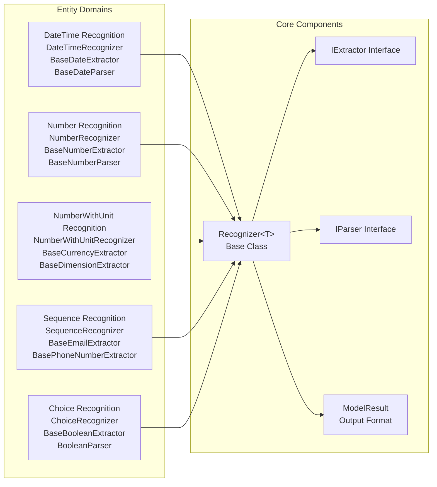
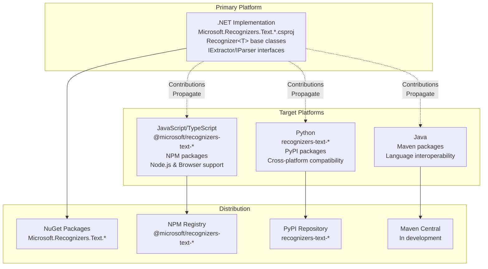
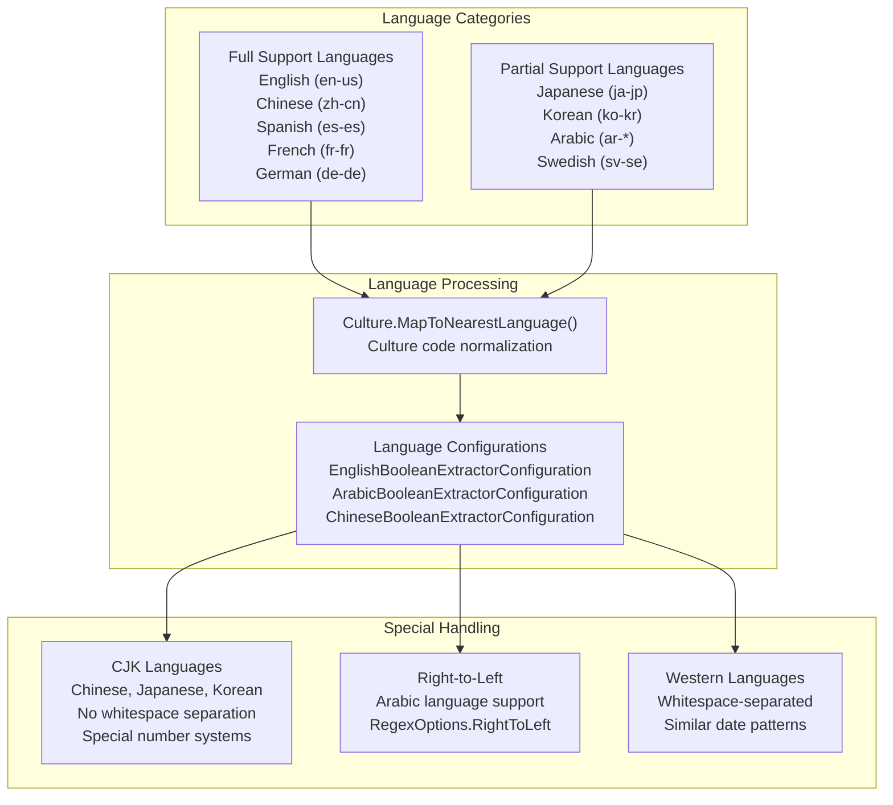
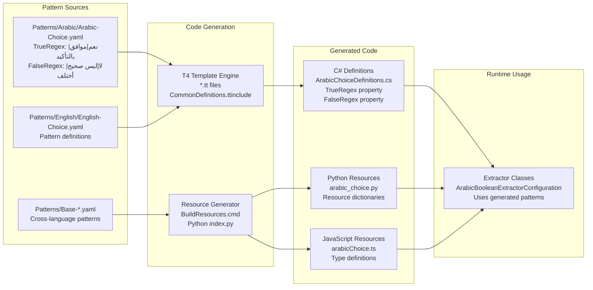
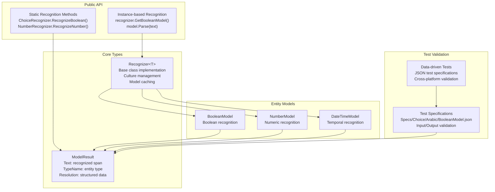

<!-- source: DeepWiki mcp.deepwiki.com · repo microsoft/Recognizers-Text · page 1 Overview · fetched 2026-10-26 -->

# Overview

<details>
<summary>Relevant source files</summary>

The following files were used as context for generating this wiki page:

- [.NET/Microsoft.Recognizers.Definitions.Common/Arabic/ChoiceDefinitions.cs](.NET/Microsoft.Recognizers.Definitions.Common/Arabic/ChoiceDefinitions.cs)
- [.NET/Microsoft.Recognizers.Definitions.Common/Arabic/ChoiceDefinitions.tt](.NET/Microsoft.Recognizers.Definitions.Common/Arabic/ChoiceDefinitions.tt)
- [.NET/Microsoft.Recognizers.Definitions.Common/Microsoft.Recognizers.Definitions.Common.csproj](.NET/Microsoft.Recognizers.Definitions.Common/Microsoft.Recognizers.Definitions.Common.csproj)
- [.NET/Microsoft.Recognizers.Definitions/Microsoft.Recognizers.Definitions.csproj](.NET/Microsoft.Recognizers.Definitions/Microsoft.Recognizers.Definitions.csproj)
- [.NET/Microsoft.Recognizers.Text.Choice/Arabic/Extractors/ArabicBooleanExtractorConfiguration.cs](.NET/Microsoft.Recognizers.Text.Choice/Arabic/Extractors/ArabicBooleanExtractorConfiguration.cs)
- [.NET/Microsoft.Recognizers.Text.Choice/ChoiceRecognizer.cs](.NET/Microsoft.Recognizers.Text.Choice/ChoiceRecognizer.cs)
- [.NET/Microsoft.Recognizers.Text.Choice/Microsoft.Recognizers.Text.Choice.csproj](.NET/Microsoft.Recognizers.Text.Choice/Microsoft.Recognizers.Text.Choice.csproj)
- [.NET/Microsoft.Recognizers.Text.DataDrivenTests/Choice/TestChoice_Arabic.cs](.NET/Microsoft.Recognizers.Text.DataDrivenTests/Choice/TestChoice_Arabic.cs)
- [.NET/Microsoft.Recognizers.Text.DataDrivenTests/Microsoft.Recognizers.Text.DataDrivenTests.csproj](.NET/Microsoft.Recognizers.Text.DataDrivenTests/Microsoft.Recognizers.Text.DataDrivenTests.csproj)
- [.NET/Microsoft.Recognizers.Text.DataTypes.DataDrivenTests/Microsoft.Recognizers.Text.DataTypes.DataDrivenTests.csproj](.NET/Microsoft.Recognizers.Text.DataTypes.DataDrivenTests/Microsoft.Recognizers.Text.DataTypes.DataDrivenTests.csproj)
- [.NET/Microsoft.Recognizers.Text.DataTypes.TimexExpression/Microsoft.Recognizers.Text.DataTypes.TimexExpression.csproj](.NET/Microsoft.Recognizers.Text.DataTypes.TimexExpression/Microsoft.Recognizers.Text.DataTypes.TimexExpression.csproj)
- [.NET/Microsoft.Recognizers.Text.DateTime/Microsoft.Recognizers.Text.DateTime.csproj](.NET/Microsoft.Recognizers.Text.DateTime/Microsoft.Recognizers.Text.DateTime.csproj)
- [.NET/Microsoft.Recognizers.Text.Number/Microsoft.Recognizers.Text.Number.csproj](.NET/Microsoft.Recognizers.Text.Number/Microsoft.Recognizers.Text.Number.csproj)
- [.NET/Microsoft.Recognizers.Text.NumberWithUnit/Microsoft.Recognizers.Text.NumberWithUnit.csproj](.NET/Microsoft.Recognizers.Text.NumberWithUnit/Microsoft.Recognizers.Text.NumberWithUnit.csproj)
- [.NET/Microsoft.Recognizers.Text.Sequence/Microsoft.Recognizers.Text.Sequence.csproj](.NET/Microsoft.Recognizers.Text.Sequence/Microsoft.Recognizers.Text.Sequence.csproj)
- [.NET/Microsoft.Recognizers.Text.sln](.NET/Microsoft.Recognizers.Text.sln)
- [.NET/Microsoft.Recognizers.Text/Culture.cs](.NET/Microsoft.Recognizers.Text/Culture.cs)
- [.NET/Microsoft.Recognizers.Text/Microsoft.Recognizers.Text.csproj](.NET/Microsoft.Recognizers.Text/Microsoft.Recognizers.Text.csproj)
- [.NET/Samples/SimpleConsole/SimpleConsole.csproj](.NET/Samples/SimpleConsole/SimpleConsole.csproj)
- [Patterns/Arabic/Arabic-Choice.yaml](Patterns/Arabic/Arabic-Choice.yaml)
- [Python/.pre-commit-config.yaml](Python/.pre-commit-config.yaml)
- [Python/build.ci.cmd](Python/build.ci.cmd)
- [Python/build.sh](Python/build.sh)
- [Python/libraries/recognizers-choice/recognizers_choice/choice/english/__init__.py](Python/libraries/recognizers-choice/recognizers_choice/choice/english/__init__.py)
- [Python/libraries/recognizers-choice/recognizers_choice/resources/__init__.py](Python/libraries/recognizers-choice/recognizers_choice/resources/__init__.py)
- [Python/libraries/recognizers-choice/resource-definitions.json](Python/libraries/recognizers-choice/resource-definitions.json)
- [Python/libraries/recognizers-choice/setup.py](Python/libraries/recognizers-choice/setup.py)
- [Python/libraries/recognizers-text/recognizers_text/parser.py](Python/libraries/recognizers-text/recognizers_text/parser.py)
- [Python/requirements.txt](Python/requirements.txt)
- [Python/setup.py](Python/setup.py)
- [Python/tests/requirements.txt](Python/tests/requirements.txt)
- [README.md](README.md)
- [Script/Utils/countNotSupportedCases.py](Script/Utils/countNotSupportedCases.py)
- [Script/Utils/deleteNotSupportedPlatform.py](Script/Utils/deleteNotSupportedPlatform.py)
- [Script/Utils/getNotSupportedInput.py](Script/Utils/getNotSupportedInput.py)
- [Specs/Choice/Arabic/BooleanModel.json](Specs/Choice/Arabic/BooleanModel.json)

</details>


Microsoft Recognizers Text is a comprehensive, multi-platform natural language processing library that provides robust recognition and resolution of structured entities from unstructured text. The system extracts and normalizes common data types including numbers, dates, times, units, currencies, sequences (URLs, emails, phone numbers), and boolean choices across multiple languages and cultural contexts.

This document covers the core architecture, entity recognition domains, and cross-platform design. For detailed implementation guides for specific languages, see pages [3.1](#3.1) through [3.6](#3.6). For platform-specific documentation, see pages [4.1](#4.1) through [4.4](#4.4).

## System Architecture

The Microsoft Recognizers Text system follows a pattern-driven, extractor-parser pipeline architecture that transforms natural language text into structured data through a multi-stage process.

```mermaid
graph TB
    subgraph "Input Layer"
        NL["Natural Language Text<br/>\"I'll pay $25.50 tomorrow at 3pm\""]
    end
    
    subgraph "Pattern Layer"
        YAML["YAML Pattern Files<br/>English-Numbers.yaml<br/>English-DateTime.yaml<br/>English-NumbersWithUnit.yaml"]
        CodeGen["Code Generation<br/>T4 Templates<br/>Resource Generators"]
        Definitions["Generated Definitions<br/>NumbersDefinitions.cs<br/>DateTimeDefinitions.cs"]
    end
    
    subgraph "Recognition Pipeline"
        Extractors["IExtractor Implementations<br/>CurrencyExtractor<br/>DateExtractor<br/>TimeExtractor"]
        Parsers["IParser Implementations<br/>CurrencyParser<br/>BaseDateParser<br/>BaseTimeParser"]
    end
    
    subgraph "Model Layer"
        Models["Recognition Models<br/>CurrencyModel<br/>DateTimeModel<br/>NumberModel"]
        Recognizers["Recognizer Classes<br/>NumberWithUnitRecognizer<br/>DateTimeRecognizer"]
    end
    
    subgraph "Output Layer"
        Results["ModelResult[]<br/>Text: \"$25.50\"<br/>TypeName: \"currency\"<br/>Resolution: {\"value\": 25.50, \"unit\": \"Dollar\"}"]
    end
    
    NL --> Extractors
    YAML --> CodeGen
    CodeGen --> Definitions
    Definitions --> Extractors
    Extractors --> Parsers
    Parsers --> Models
    Models --> Recognizers
    Recognizers --> Results
```

**Sources:** [README.md:1-109](), [.NET/Microsoft.Recognizers.Text.sln:15-135](), [.NET/Microsoft.Recognizers.Definitions.Common/Microsoft.Recognizers.Definitions.Common.csproj:1-571]()

The architecture consists of four primary layers:

### Pattern Definition Layer
YAML files in the `Patterns/` directory define language-specific recognition patterns. These are processed by T4 templates during build time to generate strongly-typed C# definition classes.

### Extraction Layer  
`IExtractor` implementations use regex patterns and linguistic rules to identify potential entities in text. Each extractor focuses on a specific entity type and language combination.

### Parsing Layer
`IParser` implementations take extracted text spans and resolve them into structured data with normalized values, handling cultural variations and ambiguity resolution.

### Model Layer
Recognition models combine extractors and parsers to provide the public API through `Recognizer` classes that return `ModelResult` objects containing resolved entity information.

## Entity Recognition Domains

The system recognizes five primary categories of entities, each implemented as separate packages with language-specific configurations.



**Sources:** [.NET/Microsoft.Recognizers.Text.Choice/ChoiceRecognizer.cs:1-131](), [.NET/Microsoft.Recognizers.Text.DataDrivenTests/Microsoft.Recognizers.Text.DataDrivenTests.csproj:54-61]()

| Entity Domain | Primary Classes | Supported Entity Types |
|---------------|----------------|------------------------|
| **DateTime** | `DateTimeRecognizer`, `BaseDateExtractor` | Dates, times, durations, date ranges, recurring patterns |
| **Number** | `NumberRecognizer`, `BaseNumberExtractor` | Cardinals, ordinals, fractions, percentages, number ranges |
| **NumberWithUnit** | `NumberWithUnitRecognizer`, `BaseCurrencyExtractor` | Currency, dimensions, temperature, age |
| **Sequence** | `SequenceRecognizer`, `BaseEmailExtractor` | URLs, emails, phone numbers, IP addresses, GUIDs |
| **Choice** | `ChoiceRecognizer`, `BaseBooleanExtractor` | Boolean values, yes/no responses |

## Multi-Platform Support

The system maintains consistent APIs across four target platforms, with .NET serving as the primary platform where new features are developed before propagation to other platforms.



**Sources:** [README.md:12-21](), [.NET/Microsoft.Recognizers.Text/Microsoft.Recognizers.Text.csproj:1-52](), [Python/build.ci.cmd:1-73]()

The .NET implementation provides the reference architecture with base classes like `Recognizer<T>` and interfaces like `IExtractor` and `IParser` that define the contract for all platforms. Language-specific configurations such as `ArabicBooleanExtractorConfiguration` demonstrate the pattern used across all supported languages.

## Language Support Architecture

The system supports multiple languages through a culture-based configuration system that handles both full and partial implementations across different entity domains.



**Sources:** [.NET/Microsoft.Recognizers.Text/Culture.cs:1-102](), [.NET/Microsoft.Recognizers.Text.Choice/Arabic/Extractors/ArabicBooleanExtractorConfiguration.cs:1-24](), [README.md:65-108]()

The `Culture` class provides language code normalization through `MapToNearestLanguage()`, mapping variants like "en-029" to "en-*" for broader compatibility. Language-specific configurations like `ArabicBooleanExtractorConfiguration` demonstrate special handling requirements, such as `RegexOptions.RightToLeft` for Arabic text processing.

## Pattern-Driven Recognition System

Recognition logic is defined declaratively in YAML files that are compiled into executable code during the build process, enabling consistent pattern maintenance across platforms.



**Sources:** [Patterns/Arabic/Arabic-Choice.yaml:1-12](), [.NET/Microsoft.Recognizers.Definitions.Common/Arabic/ChoiceDefinitions.cs:1-30](), [.NET/Microsoft.Recognizers.Definitions.Common/Arabic/ChoiceDefinitions.tt:1-7](), [Python/build.ci.cmd:20-26]()

YAML pattern files like `Arabic-Choice.yaml` define language-specific recognition patterns using a structured format. These are processed by T4 templates (*.tt files) in .NET to generate strongly-typed definition classes like `ArabicChoiceDefinitions.cs`. For other platforms, resource generators create equivalent pattern files in the target language format.

## Core API and Integration

The system provides a consistent recognition API across all entity domains and platforms, centered around the `Recognizer` pattern and `ModelResult` output format.



**Sources:** [.NET/Microsoft.Recognizers.Text.Choice/ChoiceRecognizer.cs:51-61](), [Specs/Choice/Arabic/BooleanModel.json:1-241](), [.NET/Microsoft.Recognizers.Text.DataDrivenTests/Choice/TestChoice_Arabic.cs:1-21]()

The API design emphasizes simplicity with static methods like `ChoiceRecognizer.RecognizeBoolean()` for common scenarios and instance-based methods for advanced configuration. All recognition results follow the `ModelResult` format with standardized `Text`, `TypeName`, and `Resolution` properties. The system includes comprehensive test coverage through JSON specification files that validate recognition accuracy across languages and platforms.

---

