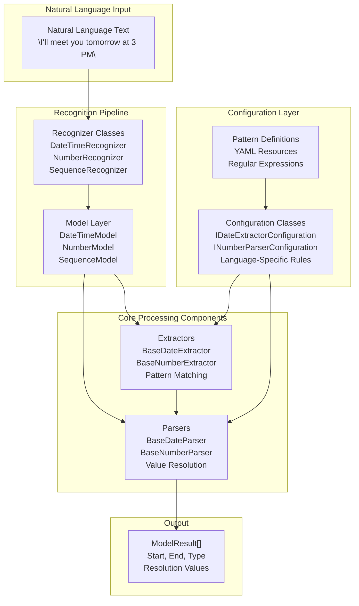
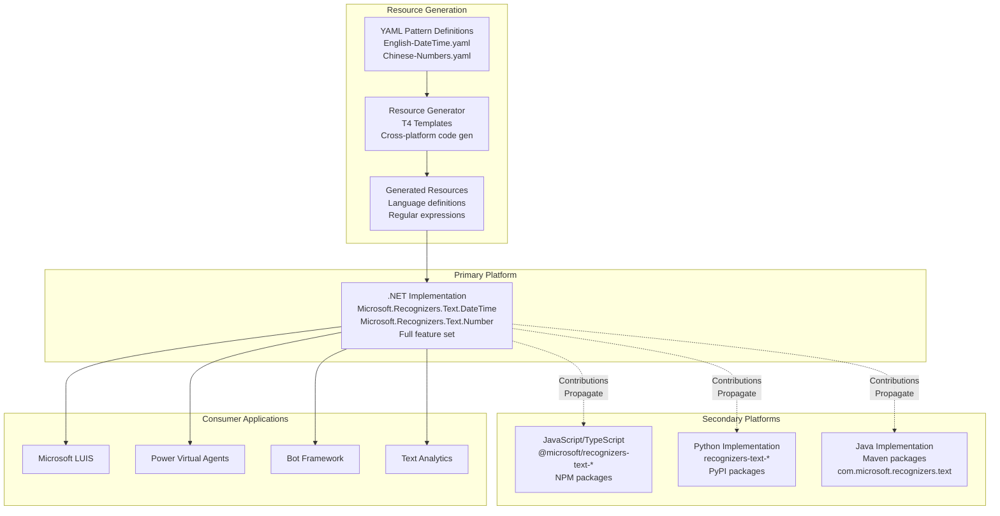
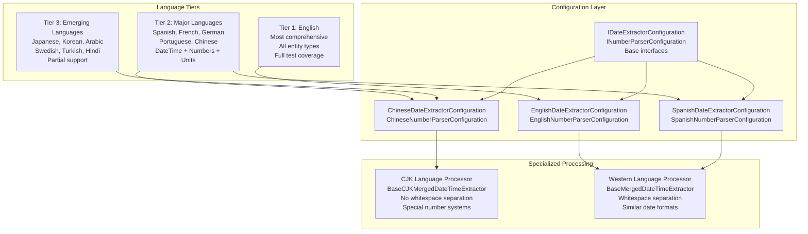
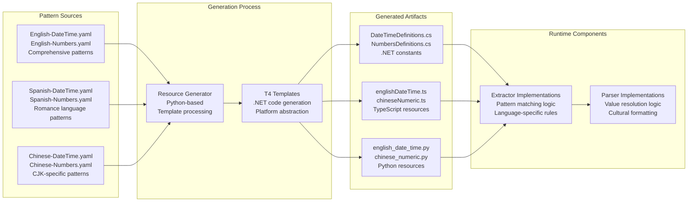
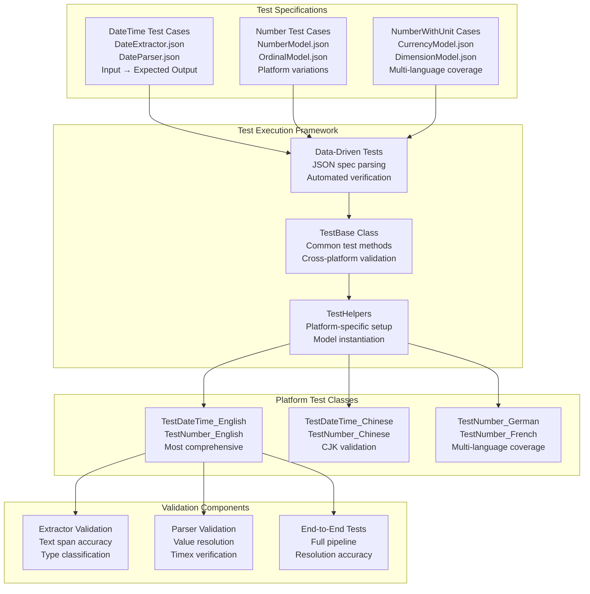

<!-- source: DeepWiki mcp.deepwiki.com · repo microsoft/Recognizers-Text · page 1.1 Architecture Overview · fetched 2026-10-26 -->

# Architecture Overview

<details>
<summary>Relevant source files</summary>

The following files were used as context for generating this wiki page:

- [.NET/Microsoft.Recognizers.Text.DataDrivenTests/DateTime/TestDateTime_English.cs](.NET/Microsoft.Recognizers.Text.DataDrivenTests/DateTime/TestDateTime_English.cs)
- [.NET/Microsoft.Recognizers.Text.DataDrivenTests/Number/TestNumber_Chinese.cs](.NET/Microsoft.Recognizers.Text.DataDrivenTests/Number/TestNumber_Chinese.cs)
- [.NET/Microsoft.Recognizers.Text.DataDrivenTests/Number/TestNumber_Dutch.cs](.NET/Microsoft.Recognizers.Text.DataDrivenTests/Number/TestNumber_Dutch.cs)
- [.NET/Microsoft.Recognizers.Text.DataDrivenTests/Number/TestNumber_French.cs](.NET/Microsoft.Recognizers.Text.DataDrivenTests/Number/TestNumber_French.cs)
- [.NET/Microsoft.Recognizers.Text.DataDrivenTests/Number/TestNumber_German.cs](.NET/Microsoft.Recognizers.Text.DataDrivenTests/Number/TestNumber_German.cs)
- [.NET/Microsoft.Recognizers.Text.DataDrivenTests/Number/TestNumber_Italian.cs](.NET/Microsoft.Recognizers.Text.DataDrivenTests/Number/TestNumber_Italian.cs)
- [.NET/Microsoft.Recognizers.Text.DataDrivenTests/Number/TestNumber_Japanese.cs](.NET/Microsoft.Recognizers.Text.DataDrivenTests/Number/TestNumber_Japanese.cs)
- [.NET/Microsoft.Recognizers.Text.DataDrivenTests/Number/TestNumber_Korean.cs](.NET/Microsoft.Recognizers.Text.DataDrivenTests/Number/TestNumber_Korean.cs)
- [.NET/Microsoft.Recognizers.Text.DataDrivenTests/Number/TestNumber_Spanish.cs](.NET/Microsoft.Recognizers.Text.DataDrivenTests/Number/TestNumber_Spanish.cs)
- [.NET/Microsoft.Recognizers.Text.DataDrivenTests/TestBase.cs](.NET/Microsoft.Recognizers.Text.DataDrivenTests/TestBase.cs)
- [.NET/Microsoft.Recognizers.Text.DataDrivenTests/TestHelpers.cs](.NET/Microsoft.Recognizers.Text.DataDrivenTests/TestHelpers.cs)
- [.NET/Microsoft.Recognizers.Text.DateTime/DateTimeOptions.cs](.NET/Microsoft.Recognizers.Text.DateTime/DateTimeOptions.cs)
- [.NET/Microsoft.Recognizers.Text.DateTime/DateTimeRecognizer.cs](.NET/Microsoft.Recognizers.Text.DateTime/DateTimeRecognizer.cs)
- [.NET/Microsoft.Recognizers.Text.DateTime/Extractors/BaseDateExtractor.cs](.NET/Microsoft.Recognizers.Text.DateTime/Extractors/BaseDateExtractor.cs)
- [.NET/Microsoft.Recognizers.Text.DateTime/Microsoft.Recognizers.Text.DateTime.xml](.NET/Microsoft.Recognizers.Text.DateTime/Microsoft.Recognizers.Text.DateTime.xml)
- [.NET/Microsoft.Recognizers.Text.DateTime/Parsers/BaseDateParser.cs](.NET/Microsoft.Recognizers.Text.DateTime/Parsers/BaseDateParser.cs)
- [.NET/Microsoft.Recognizers.Text.DateTime/Parsers/BaseDateTimeParser.cs](.NET/Microsoft.Recognizers.Text.DateTime/Parsers/BaseDateTimeParser.cs)
- [.NET/Microsoft.Recognizers.Text.Number/Italian/Extractors/NumberRangeExtractor.cs](.NET/Microsoft.Recognizers.Text.Number/Italian/Extractors/NumberRangeExtractor.cs)
- [.NET/Microsoft.Recognizers.Text.Number/Italian/Parsers/ItalianNumberRangeParserConfiguration.cs](.NET/Microsoft.Recognizers.Text.Number/Italian/Parsers/ItalianNumberRangeParserConfiguration.cs)
- [.NET/Microsoft.Recognizers.Text.Number/NumberRecognizer.cs](.NET/Microsoft.Recognizers.Text.Number/NumberRecognizer.cs)
- [.NET/Microsoft.Recognizers.Text.NumberWithUnit/NumberWithUnitRecognizer.cs](.NET/Microsoft.Recognizers.Text.NumberWithUnit/NumberWithUnitRecognizer.cs)
- [.NET/Microsoft.Recognizers.Text.Sequence/SequenceRecognizer.cs](.NET/Microsoft.Recognizers.Text.Sequence/SequenceRecognizer.cs)
- [.NET/Microsoft.Recognizers.Text/Constants.cs](.NET/Microsoft.Recognizers.Text/Constants.cs)
- [.NET/Microsoft.Recognizers.Text/Models/ExtendedModelResult.cs](.NET/Microsoft.Recognizers.Text/Models/ExtendedModelResult.cs)
- [.NET/Microsoft.Recognizers.Text/Models/ModelResult.cs](.NET/Microsoft.Recognizers.Text/Models/ModelResult.cs)
- [.NET/Microsoft.Recognizers.Text/Recognizer.cs](.NET/Microsoft.Recognizers.Text/Recognizer.cs)
- [Java/tests/src/test/java/com/microsoft/recognizers/text/tests/numberwithunit/NumberWithUnitRecognizerInitializationTest.java](Java/tests/src/test/java/com/microsoft/recognizers/text/tests/numberwithunit/NumberWithUnitRecognizerInitializationTest.java)
- [Python/.pre-commit-config.yaml](Python/.pre-commit-config.yaml)
- [Python/build.ci.cmd](Python/build.ci.cmd)
- [Python/build.sh](Python/build.sh)
- [Python/libraries/recognizers-choice/recognizers_choice/choice/english/__init__.py](Python/libraries/recognizers-choice/recognizers_choice/choice/english/__init__.py)
- [Python/libraries/recognizers-choice/recognizers_choice/resources/__init__.py](Python/libraries/recognizers-choice/recognizers_choice/resources/__init__.py)
- [Python/libraries/recognizers-choice/resource-definitions.json](Python/libraries/recognizers-choice/resource-definitions.json)
- [Python/libraries/recognizers-choice/setup.py](Python/libraries/recognizers-choice/setup.py)
- [Python/libraries/recognizers-text/recognizers_text/parser.py](Python/libraries/recognizers-text/recognizers_text/parser.py)
- [Python/requirements.txt](Python/requirements.txt)
- [Python/setup.py](Python/setup.py)
- [Python/tests/requirements.txt](Python/tests/requirements.txt)
- [README.md](README.md)
- [Script/Utils/countNotSupportedCases.py](Script/Utils/countNotSupportedCases.py)
- [Script/Utils/deleteNotSupportedPlatform.py](Script/Utils/deleteNotSupportedPlatform.py)
- [Script/Utils/getNotSupportedInput.py](Script/Utils/getNotSupportedInput.py)
- [Specs/DateTime/English/DateExtractor.json](Specs/DateTime/English/DateExtractor.json)
- [Specs/DateTime/English/DateParser.json](Specs/DateTime/English/DateParser.json)
- [Specs/Number/German/OrdinalModel.json](Specs/Number/German/OrdinalModel.json)
- [Specs/Number/German/OrdinalModelEnablePreview.json](Specs/Number/German/OrdinalModelEnablePreview.json)
- [Specs/Number/Italian/NumberRangeModel.json](Specs/Number/Italian/NumberRangeModel.json)

</details>


This document provides a comprehensive overview of the Microsoft Recognizers Text architecture, covering the core recognition pipeline, multi-platform design, language support framework, and pattern-driven code generation system. For detailed information about specific entity recognition domains, see [Entity Recognition Domains](#2). For platform-specific implementation details, see [Platform Implementations](#4).

## System Purpose and Core Design

Microsoft Recognizers Text is a multi-platform text recognition system designed to extract and resolve structured entities from natural language text. The system recognizes five primary entity types: DateTime, Numbers, NumberWithUnit, Sequences, and Choices across multiple languages and platforms.

The architecture follows a consistent **extractor-parser pipeline** pattern where extractors identify potential entity text spans and parsers resolve them into structured values. This two-stage approach enables flexible language-specific customization while maintaining consistent output formats across platforms.

**Sources:** [README.md:1-109]()

## High-Level System Architecture



**Sources:** [.NET/Microsoft.Recognizers.Text.Number/NumberRecognizer.cs:21-534](), [.NET/Microsoft.Recognizers.Text.DateTime/DateTimeRecognizer.cs:21-183](), [.NET/Microsoft.Recognizers.Text/Recognizer.cs:10-89]()

## Extractor-Parser Pipeline Architecture

The core recognition process follows a two-stage pipeline that separates text identification from value resolution:

```mermaid
graph LR
    subgraph "Stage 1: Extraction"
        Input["Input Text<br/>\"next Friday\""]
        ExtractorConfig["IDateExtractorConfiguration<br/>Language-specific patterns<br/>Regular expressions"]
        Extractor["BaseDateExtractor<br/>Pattern matching<br/>Token identification"]
        ExtractResult["ExtractResult<br/>Text: \"next Friday\"<br/>Start: 0, Length: 11<br/>Type: \"date\""]
    end
    
    subgraph "Stage 2: Parsing"
        ParserConfig["IDateParserConfiguration<br/>Calendar logic<br/>Reference time handling"]
        Parser["BaseDateParser<br/>Value resolution<br/>Timex generation"]
        ParseResult["DateTimeParseResult<br/>FutureValue: 2024-01-19<br/>PastValue: 2024-01-12<br/>Timex: \"XXXX-WXX-5\""]
    end
    
    subgraph "Stage 3: Model Output"
        ModelResult["ModelResult<br/>Text, Start, End<br/>TypeName, Resolution"]
    end
    
    Input --> ExtractorConfig
    ExtractorConfig --> Extractor
    Extractor --> ExtractResult
    ExtractResult --> ParserConfig
    ParserConfig --> Parser
    Parser --> ParseResult
    ParseResult --> ModelResult
```

**Sources:** [.NET/Microsoft.Recognizers.Text.DateTime/Extractors/BaseDateExtractor.cs:16-631](), [.NET/Microsoft.Recognizers.Text.DateTime/Parsers/BaseDateParser.cs:15-629](), [.NET/Microsoft.Recognizers.Text/Models/ModelResult.cs:8-21]()

## Multi-Platform Design and Contribution Flow

The system implements a hub-and-spoke architecture with .NET as the primary platform and automatic propagation to other platforms:



**Sources:** [README.md:12-22](), [.NET/Microsoft.Recognizers.Text.NumberWithUnit/NumberWithUnitRecognizer.cs:9-702](), [Python/build.ci.cmd:1-73]()

## Language Support and Configuration Architecture

The system supports multiple languages through a configuration-driven approach with language-specific implementations:



**Sources:** [.NET/Microsoft.Recognizers.Text.DataDrivenTests/TestHelpers.cs:147-298](), [README.md:63-108](), [.NET/Microsoft.Recognizers.Text.DateTime/DateTimeRecognizer.cs:60-183]()

## Pattern Definition and Code Generation Pipeline

The system uses a pattern-driven approach where YAML definitions generate platform-specific code:



**Sources:** [Python/build.ci.cmd:19-26](), [Python/build.sh:6-11]()

## Testing and Validation Framework

The system employs a comprehensive data-driven testing approach with JSON specification files:



**Sources:** [.NET/Microsoft.Recognizers.Text.DataDrivenTests/TestBase.cs:18-464](), [.NET/Microsoft.Recognizers.Text.DataDrivenTests/TestHelpers.cs:102-229](), [.NET/Microsoft.Recognizers.Text.DataDrivenTests/DateTime/TestDateTime_English.cs:10-226](), [Specs/DateTime/English/DateParser.json:1-100](), [Specs/DateTime/English/DateExtractor.json:1-100]()

## Core Interfaces and Abstractions

The architecture defines clear interfaces that enable language-specific customization while maintaining consistent behavior:

| Interface | Purpose | Key Implementations |
|-----------|---------|-------------------|
| `IDateTimeExtractor` | Text span identification | `BaseDateExtractor`, `BaseTimeExtractor` |
| `IDateTimeParser` | Value resolution | `BaseDateParser`, `BaseTimeParser` |
| `IModel` | Public API abstraction | `DateTimeModel`, `NumberModel` |
| `IExtractorConfiguration` | Language-specific patterns | `EnglishDateExtractorConfiguration` |
| `IParserConfiguration` | Resolution logic | `EnglishDateParserConfiguration` |

The `Recognizer<TRecognizerOptions>` base class provides the primary entry point for all recognition operations, with specialized implementations for each entity domain like `DateTimeRecognizer`, `NumberRecognizer`, and `SequenceRecognizer`.

**Sources:** [.NET/Microsoft.Recognizers.Text/Recognizer.cs:10-89](), [.NET/Microsoft.Recognizers.Text.DateTime/DateTimeRecognizer.cs:21-183](), [.NET/Microsoft.Recognizers.Text.Number/NumberRecognizer.cs:23-535]()

---

