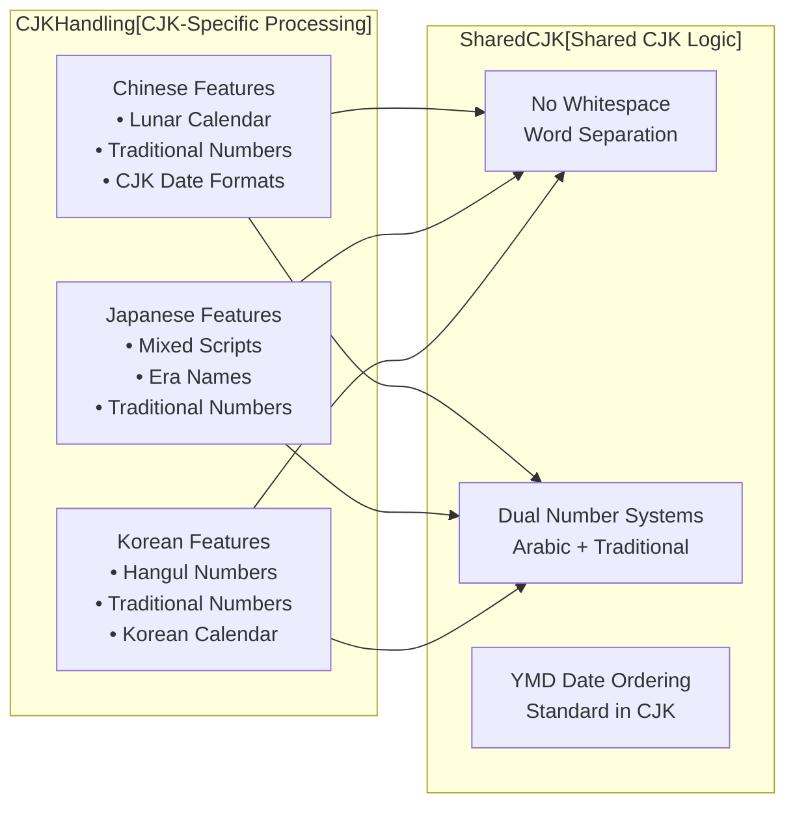
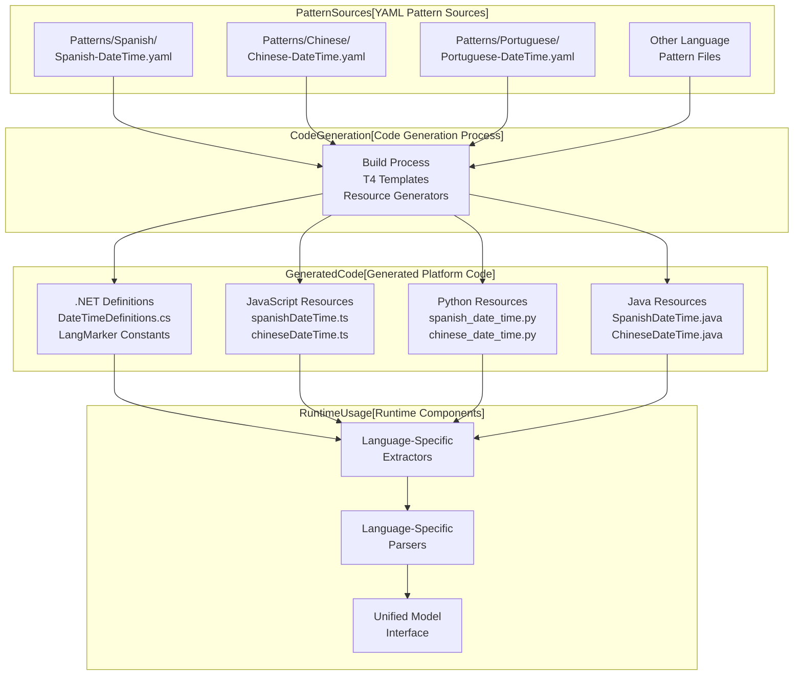
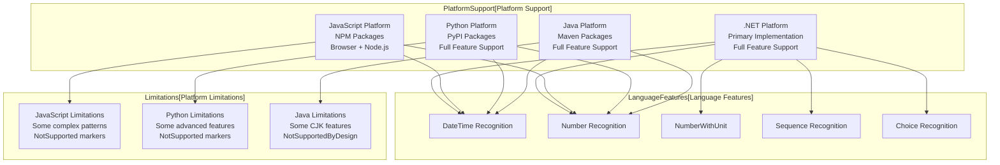
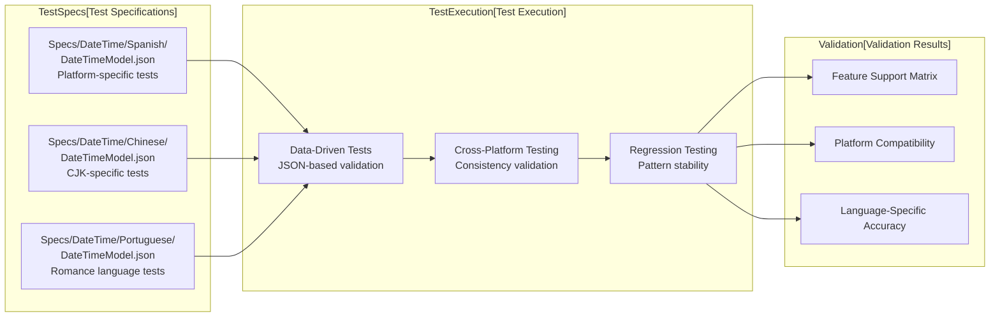

<!-- source: DeepWiki mcp.deepwiki.com · repo microsoft/Recognizers-Text · page 1.2 Supported Languages · fetched 2026-10-26 -->

# Supported Languages

<details>
<summary>Relevant source files</summary>

The following files were used as context for generating this wiki page:

- [.NET/Microsoft.Recognizers.Definitions.Common/Arabic/ChoiceDefinitions.cs](.NET/Microsoft.Recognizers.Definitions.Common/Arabic/ChoiceDefinitions.cs)
- [.NET/Microsoft.Recognizers.Definitions.Common/Arabic/ChoiceDefinitions.tt](.NET/Microsoft.Recognizers.Definitions.Common/Arabic/ChoiceDefinitions.tt)
- [.NET/Microsoft.Recognizers.Definitions.Common/Chinese/DateTimeDefinitions.cs](.NET/Microsoft.Recognizers.Definitions.Common/Chinese/DateTimeDefinitions.cs)
- [.NET/Microsoft.Recognizers.Definitions.Common/Microsoft.Recognizers.Definitions.Common.csproj](.NET/Microsoft.Recognizers.Definitions.Common/Microsoft.Recognizers.Definitions.Common.csproj)
- [.NET/Microsoft.Recognizers.Definitions.Common/Portuguese/DateTimeDefinitions.cs](.NET/Microsoft.Recognizers.Definitions.Common/Portuguese/DateTimeDefinitions.cs)
- [.NET/Microsoft.Recognizers.Definitions.Common/Spanish/DateTimeDefinitions.cs](.NET/Microsoft.Recognizers.Definitions.Common/Spanish/DateTimeDefinitions.cs)
- [.NET/Microsoft.Recognizers.Definitions/Microsoft.Recognizers.Definitions.csproj](.NET/Microsoft.Recognizers.Definitions/Microsoft.Recognizers.Definitions.csproj)
- [.NET/Microsoft.Recognizers.Text.Choice/Arabic/Extractors/ArabicBooleanExtractorConfiguration.cs](.NET/Microsoft.Recognizers.Text.Choice/Arabic/Extractors/ArabicBooleanExtractorConfiguration.cs)
- [.NET/Microsoft.Recognizers.Text.Choice/ChoiceRecognizer.cs](.NET/Microsoft.Recognizers.Text.Choice/ChoiceRecognizer.cs)
- [.NET/Microsoft.Recognizers.Text.Choice/Microsoft.Recognizers.Text.Choice.csproj](.NET/Microsoft.Recognizers.Text.Choice/Microsoft.Recognizers.Text.Choice.csproj)
- [.NET/Microsoft.Recognizers.Text.DataDrivenTests/Choice/TestChoice_Arabic.cs](.NET/Microsoft.Recognizers.Text.DataDrivenTests/Choice/TestChoice_Arabic.cs)
- [.NET/Microsoft.Recognizers.Text.DataDrivenTests/Microsoft.Recognizers.Text.DataDrivenTests.csproj](.NET/Microsoft.Recognizers.Text.DataDrivenTests/Microsoft.Recognizers.Text.DataDrivenTests.csproj)
- [.NET/Microsoft.Recognizers.Text.DataTypes.DataDrivenTests/Microsoft.Recognizers.Text.DataTypes.DataDrivenTests.csproj](.NET/Microsoft.Recognizers.Text.DataTypes.DataDrivenTests/Microsoft.Recognizers.Text.DataTypes.DataDrivenTests.csproj)
- [.NET/Microsoft.Recognizers.Text.DataTypes.TimexExpression/Microsoft.Recognizers.Text.DataTypes.TimexExpression.csproj](.NET/Microsoft.Recognizers.Text.DataTypes.TimexExpression/Microsoft.Recognizers.Text.DataTypes.TimexExpression.csproj)
- [.NET/Microsoft.Recognizers.Text.DateTime/Chinese/Extractors/ChineseDateExtractorConfiguration.cs](.NET/Microsoft.Recognizers.Text.DateTime/Chinese/Extractors/ChineseDateExtractorConfiguration.cs)
- [.NET/Microsoft.Recognizers.Text.DateTime/Chinese/Extractors/ChineseDatePeriodExtractorConfiguration.cs](.NET/Microsoft.Recognizers.Text.DateTime/Chinese/Extractors/ChineseDatePeriodExtractorConfiguration.cs)
- [.NET/Microsoft.Recognizers.Text.DateTime/Chinese/Extractors/ChineseMergedExtractorConfiguration.cs](.NET/Microsoft.Recognizers.Text.DateTime/Chinese/Extractors/ChineseMergedExtractorConfiguration.cs)
- [.NET/Microsoft.Recognizers.Text.DateTime/Chinese/Parsers/ChineseDateParserConfiguration.cs](.NET/Microsoft.Recognizers.Text.DateTime/Chinese/Parsers/ChineseDateParserConfiguration.cs)
- [.NET/Microsoft.Recognizers.Text.DateTime/Chinese/Parsers/ChineseDatePeriodParserConfiguration.cs](.NET/Microsoft.Recognizers.Text.DateTime/Chinese/Parsers/ChineseDatePeriodParserConfiguration.cs)
- [.NET/Microsoft.Recognizers.Text.DateTime/Microsoft.Recognizers.Text.DateTime.csproj](.NET/Microsoft.Recognizers.Text.DateTime/Microsoft.Recognizers.Text.DateTime.csproj)
- [.NET/Microsoft.Recognizers.Text.DateTime/Parsers/CJK/BaseCJKDatePeriodParser.cs](.NET/Microsoft.Recognizers.Text.DateTime/Parsers/CJK/BaseCJKDatePeriodParser.cs)
- [.NET/Microsoft.Recognizers.Text.Number/Microsoft.Recognizers.Text.Number.csproj](.NET/Microsoft.Recognizers.Text.Number/Microsoft.Recognizers.Text.Number.csproj)
- [.NET/Microsoft.Recognizers.Text.NumberWithUnit/Microsoft.Recognizers.Text.NumberWithUnit.csproj](.NET/Microsoft.Recognizers.Text.NumberWithUnit/Microsoft.Recognizers.Text.NumberWithUnit.csproj)
- [.NET/Microsoft.Recognizers.Text.Sequence/Microsoft.Recognizers.Text.Sequence.csproj](.NET/Microsoft.Recognizers.Text.Sequence/Microsoft.Recognizers.Text.Sequence.csproj)
- [.NET/Microsoft.Recognizers.Text.sln](.NET/Microsoft.Recognizers.Text.sln)
- [.NET/Microsoft.Recognizers.Text/Culture.cs](.NET/Microsoft.Recognizers.Text/Culture.cs)
- [.NET/Microsoft.Recognizers.Text/Microsoft.Recognizers.Text.csproj](.NET/Microsoft.Recognizers.Text/Microsoft.Recognizers.Text.csproj)
- [.NET/Samples/SimpleConsole/SimpleConsole.csproj](.NET/Samples/SimpleConsole/SimpleConsole.csproj)
- [Java/libraries/recognizers-text-date-time/src/main/java/com/microsoft/recognizers/text/datetime/resources/ChineseDateTime.java](Java/libraries/recognizers-text-date-time/src/main/java/com/microsoft/recognizers/text/datetime/resources/ChineseDateTime.java)
- [Java/libraries/recognizers-text-date-time/src/main/java/com/microsoft/recognizers/text/datetime/spanish/extractors/SpanishDatePeriodExtractorConfiguration.java](Java/libraries/recognizers-text-date-time/src/main/java/com/microsoft/recognizers/text/datetime/spanish/extractors/SpanishDatePeriodExtractorConfiguration.java)
- [Java/libraries/recognizers-text-number/src/main/java/com/microsoft/recognizers/text/number/spanish/extractors/OrdinalExtractor.java](Java/libraries/recognizers-text-number/src/main/java/com/microsoft/recognizers/text/number/spanish/extractors/OrdinalExtractor.java)
- [JavaScript/packages/recognizers-date-time/src/resources/chineseDateTime.ts](JavaScript/packages/recognizers-date-time/src/resources/chineseDateTime.ts)
- [Patterns/Arabic/Arabic-Choice.yaml](Patterns/Arabic/Arabic-Choice.yaml)
- [Patterns/Chinese/Chinese-DateTime.yaml](Patterns/Chinese/Chinese-DateTime.yaml)
- [Patterns/Portuguese/Portuguese-DateTime.yaml](Patterns/Portuguese/Portuguese-DateTime.yaml)
- [Patterns/Spanish/Spanish-DateTime.yaml](Patterns/Spanish/Spanish-DateTime.yaml)
- [Python/libraries/recognizers-date-time/recognizers_date_time/date_time/chinese/duration_extractor_config.py](Python/libraries/recognizers-date-time/recognizers_date_time/date_time/chinese/duration_extractor_config.py)
- [Python/libraries/recognizers-date-time/recognizers_date_time/resources/chinese_date_time.py](Python/libraries/recognizers-date-time/recognizers_date_time/resources/chinese_date_time.py)
- [Specs/Choice/Arabic/BooleanModel.json](Specs/Choice/Arabic/BooleanModel.json)
- [Specs/DateTime/Chinese/DateExtractor.json](Specs/DateTime/Chinese/DateExtractor.json)
- [Specs/DateTime/Chinese/DateParser.json](Specs/DateTime/Chinese/DateParser.json)
- [Specs/DateTime/Chinese/DatePeriodExtractor.json](Specs/DateTime/Chinese/DatePeriodExtractor.json)
- [Specs/DateTime/Chinese/DatePeriodParser.json](Specs/DateTime/Chinese/DatePeriodParser.json)
- [Specs/DateTime/Chinese/DateTimeExtractor.json](Specs/DateTime/Chinese/DateTimeExtractor.json)
- [Specs/DateTime/Chinese/DateTimeModel.json](Specs/DateTime/Chinese/DateTimeModel.json)
- [Specs/DateTime/Chinese/DateTimePeriodParser.json](Specs/DateTime/Chinese/DateTimePeriodParser.json)
- [Specs/DateTime/Chinese/TimeParser.json](Specs/DateTime/Chinese/TimeParser.json)
- [Specs/DateTime/Portuguese/DateTimeModel.json](Specs/DateTime/Portuguese/DateTimeModel.json)
- [Specs/DateTime/Spanish/DateExtractor.json](Specs/DateTime/Spanish/DateExtractor.json)
- [Specs/DateTime/Spanish/DatePeriodExtractor.json](Specs/DateTime/Spanish/DatePeriodExtractor.json)
- [Specs/DateTime/Spanish/DatePeriodParser.json](Specs/DateTime/Spanish/DatePeriodParser.json)
- [Specs/DateTime/Spanish/DateTimeModel.json](Specs/DateTime/Spanish/DateTimeModel.json)
- [Specs/DateTime/Spanish/DateTimePeriodExtractor.json](Specs/DateTime/Spanish/DateTimePeriodExtractor.json)
- [Specs/DateTime/Spanish/DateTimePeriodParser.json](Specs/DateTime/Spanish/DateTimePeriodParser.json)
- [Specs/DateTime/Spanish/DurationExtractor.json](Specs/DateTime/Spanish/DurationExtractor.json)
- [Specs/DateTime/Spanish/TimePeriodExtractor.json](Specs/DateTime/Spanish/TimePeriodExtractor.json)
- [Specs/DateTime/Spanish/TimePeriodParser.json](Specs/DateTime/Spanish/TimePeriodParser.json)

</details>


This document provides a comprehensive overview of the languages supported by Microsoft Recognizers Text, including their capabilities, implementation details, and platform-specific availability. This covers the pattern definition system, code generation pipeline, and language-specific recognition features across different entity domains.

For information about the overall architecture and entity recognition domains, see [Architecture Overview](#1.1) and [Entity Recognition Domains](#2).

## Language Support Overview

Microsoft Recognizers Text supports **15+ languages** with varying levels of completeness across different entity recognition domains. The system uses a pattern-driven approach where language-specific YAML files define recognition patterns that are then generated into platform-specific code.

### Language Support Matrix

| Language | Code | DateTime | Numbers | NumberWithUnit | Sequences | Choice | Primary Platform Support |
|----------|------|----------|---------|----------------|-----------|---------|--------------------------|
| English | `eng` | ✅ Complete | ✅ Complete | ✅ Complete | ✅ Complete | ✅ Complete | .NET, JS, Python, Java |
| Spanish | `spa` | ✅ Complete | ✅ Complete | ✅ Complete | ❌ Limited | ✅ Complete | .NET, JS, Python, Java |
| Chinese | `chi` | ✅ Complete | ✅ Complete | ✅ Complete | ✅ Complete | ✅ Complete | .NET, JS, Python, Java |
| French | `fra` | ✅ Complete | ✅ Complete | ✅ Complete | ❌ Limited | ✅ Complete | .NET, JS, Python, Java |
| Portuguese | `por` | ✅ Complete | ✅ Complete | ✅ Complete | ❌ Limited | ✅ Complete | .NET, JS, Python, Java |
| German | `ger` | ✅ Complete | ✅ Complete | ✅ Complete | ❌ Limited | ✅ Complete | .NET, JS, Python, Java |
| Italian | `ita` | ✅ Complete | ✅ Complete | ✅ Complete | ❌ Limited | ✅ Complete | .NET, JS, Python, Java |
| Japanese | `jpn` | ✅ Complete | ✅ Complete | ✅ Complete | ✅ Complete | ✅ Complete | .NET, JS, Python, Java |
| Korean | `kor` | ✅ Complete | ✅ Complete | ✅ Complete | ❌ Limited | ❌ Limited | .NET, JS, Python, Java |
| Dutch | `dut` | ✅ Complete | ✅ Complete | ✅ Complete | ❌ Limited | ✅ Complete | .NET, JS, Python, Java |
| Arabic | `ara` | ✅ Limited | ✅ Complete | ❌ Limited | ❌ Limited | ✅ Complete | .NET, JS, Python, Java |
| Hindi | `hin` | ✅ Limited | ✅ Complete | ✅ Complete | ❌ Limited | ✅ Complete | .NET, JS, Python, Java |
| Bulgarian | `bul` | ❌ None | ✅ Complete | ❌ Limited | ❌ Limited | ✅ Complete | .NET, JS, Python, Java |
| Turkish | `tur` | ❌ None | ✅ Complete | ❌ Limited | ❌ Limited | ✅ Complete | .NET, JS, Python, Java |
| Swedish | `swe` | ❌ None | ✅ Complete | ❌ Limited | ❌ Limited | ✅ Complete | .NET, JS, Python, Java |

Sources: [Patterns/Spanish/Spanish-DateTime.yaml:1-5](), [Patterns/Chinese/Chinese-DateTime.yaml:1-5](), [Patterns/Portuguese/Portuguese-DateTime.yaml:1-5](), [.NET/Microsoft.Recognizers.Definitions/Microsoft.Recognizers.Definitions.csproj:44-135]()

## Language Categories

### Tier 1: Comprehensive Support
**English, Spanish, Chinese, French, Portuguese, German, Italian, Japanese, Dutch**

These languages have complete implementations across most entity recognition domains, including complex DateTime expressions, comprehensive number systems, and NumberWithUnit recognition.

```mermaid
graph TD
    subgraph "Tier1[Tier 1 - Comprehensive Support]"
        English["English (eng)<br/>Primary Reference"]
        Spanish["Spanish (spa)<br/>Romance Language"]
        Chinese["Chinese (chi)<br/>CJK + Lunar Calendar"]
        French["French (fra)<br/>Romance Language"]
        Portuguese["Portuguese (por)<br/>Romance Language"]
        German["German (ger)<br/>Germanic Language"]
        Italian["Italian (ita)<br/>Romance Language"]
        Japanese["Japanese (jpn)<br/>CJK Language"]
        Dutch["Dutch (dut)<br/>Germanic Language"]
    end
    
    subgraph "Domains[Supported Domains]"
        DateTime["DateTime Recognition<br/>Complete Coverage"]
        Numbers["Number Recognition<br/>Complete Coverage"]
        Units["NumberWithUnit<br/>Complete Coverage"]
        Sequences["Sequence Recognition<br/>Varies by Language"]
        Choice["Choice Recognition<br/>Complete Coverage"]
    end
    
    English --> DateTime
    Spanish --> DateTime
    Chinese --> DateTime
    French --> DateTime
    Portuguese --> DateTime
    German --> DateTime
    Italian --> DateTime
    Japanese --> DateTime
    Dutch --> DateTime
    
    English --> Numbers
    Spanish --> Numbers
    Chinese --> Numbers
    
    English --> Units
    Spanish --> Units
    Chinese --> Units
```



**English Implementation Details:**
- Serves as the primary reference implementation
- Most comprehensive pattern coverage
- All entity types fully supported
- Extensive test coverage across all platforms

**Spanish Implementation Details:**
- Romance language patterns with gender agreement
- Complex verb conjugations in temporal expressions
- Regional variations handled through flexible patterns

Sources: [Patterns/Spanish/Spanish-DateTime.yaml:1-600](), [.NET/Microsoft.Recognizers.Definitions.Common/Spanish/DateTimeDefinitions.cs:24-600]()

### Tier 2: CJK Language Support
**Chinese, Japanese, Korean**

These languages require special handling due to unique characteristics:
- No whitespace separation between words
- Complex number systems (Arabic + Traditional)
- Different calendar systems (Lunar calendar support in Chinese)
- Unique temporal expressions and cultural concepts



**Chinese Implementation Details:**
- `LangMarker: Chi` in pattern definitions
- Lunar calendar support with `LunarRegex` patterns
- Traditional Chinese number recognition alongside Arabic numerals
- Special handling for dynasties and traditional time periods

Sources: [Patterns/Chinese/Chinese-DateTime.yaml:1-50](), [.NET/Microsoft.Recognizers.Definitions.Common/Chinese/DateTimeDefinitions.cs:23-50]()

### Tier 3: Limited Support
**Korean, Arabic, Hindi, Bulgarian, Turkish, Swedish**

These languages have selective domain coverage, typically strong in Numbers and Choice recognition but limited DateTime or Sequence support.

Sources: [.NET/Microsoft.Recognizers.Definitions/Microsoft.Recognizers.Definitions.csproj:44-135]()

## Pattern Definition to Code Generation Pipeline

The language support system uses a multi-stage pipeline that transforms YAML pattern definitions into platform-specific code:



**YAML Pattern Structure:**
Each language defines patterns using a standardized YAML structure with language-specific markers:

```yaml
# Example from Spanish-DateTime.yaml
LangMarker: Spa
CheckBothBeforeAfter: !bool false
TillRegex: !nestedRegex
  def: (?<till>\b(hasta|hacia|al?)\b(\s+(el|la(s)?)\b)?|{BaseDateTime.RangeConnectorSymbolRegex})
  references: [ BaseDateTime.RangeConnectorSymbolRegex ]
```

**Generated Code Example:**
The YAML patterns are transformed into strongly-typed constants in each platform:

```csharp
// .NET Generated Code
public static class DateTimeDefinitions
{
    public const string LangMarker = @"Spa";
    public const bool CheckBothBeforeAfter = false;
    public static readonly string TillRegex = $@"(?<till>\b(hasta|hacia|al?)\b(\s+(el|la(s)?)\b)?|{BaseDateTime.RangeConnectorSymbolRegex})";
}
```

Sources: [Patterns/Spanish/Spanish-DateTime.yaml:1-10](), [.NET/Microsoft.Recognizers.Definitions.Common/Spanish/DateTimeDefinitions.cs:24-27](), [JavaScript/packages/recognizers-date-time/src/resources/chineseDateTime.ts:13-19]()

## Platform Availability and Cross-Platform Consistency

### Platform Support Matrix

All Tier 1 languages are supported across all platforms, but some features may have platform-specific limitations:



**Platform-Specific Limitations:**
Test specifications include markers indicating platform support:
- `"NotSupported": "javascript, python"` - Feature not available on specified platforms
- `"NotSupportedByDesign": "java"` - Intentionally not implemented on platform

Sources: [Specs/DateTime/Spanish/DateTimeModel.json:482-507](), [Specs/DateTime/Chinese/DateTimeModel.json:7-36]()

## Language-Specific Implementation Details

### Romance Languages (Spanish, Portuguese, French, Italian)
- Shared grammatical patterns for gender agreement
- Similar temporal expression structures
- Common verb conjugation patterns in date/time contexts
- Extensive month and day name variations

### Germanic Languages (German, Dutch, English)
- Compound word handling (especially German)
- Special time expressions like "halb" (half) and "viertel" (quarter) in German
- Modal verb constructions for future/past temporal references

### CJK Languages Special Handling
- **Chinese**: Lunar calendar integration, traditional vs simplified characters
- **Japanese**: Mixed script handling (Hiragana, Katakana, Kanji)
- **Korean**: Hangul number system integration

### Right-to-Left (RTL) Language Support
- **Arabic**: Special RTL text processing, Arabic-Indic numerals, Islamic calendar considerations

Sources: [Patterns/Spanish/Spanish-DateTime.yaml:14-100](), [Patterns/Chinese/Chinese-DateTime.yaml:40-50](), [Patterns/Portuguese/Portuguese-DateTime.yaml:13-30]()

## Testing and Validation Framework

The language support system includes comprehensive testing across all supported languages:



Sources: [Specs/DateTime/Spanish/DateTimeModel.json:1-50](), [Specs/DateTime/Chinese/DateTimeModel.json:1-50](), [.NET/Microsoft.Recognizers.Text.DataDrivenTests/Microsoft.Recognizers.Text.DataDrivenTests.csproj:1-60]()

---

