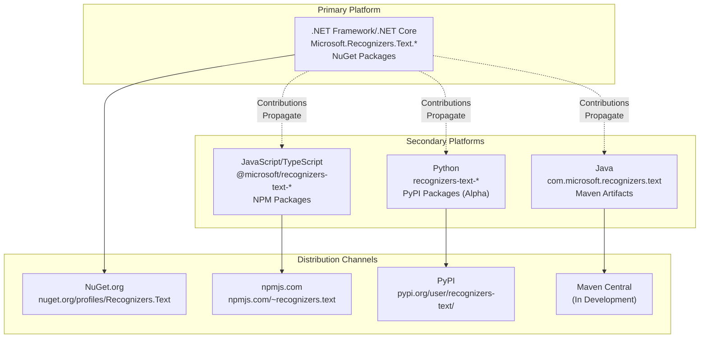
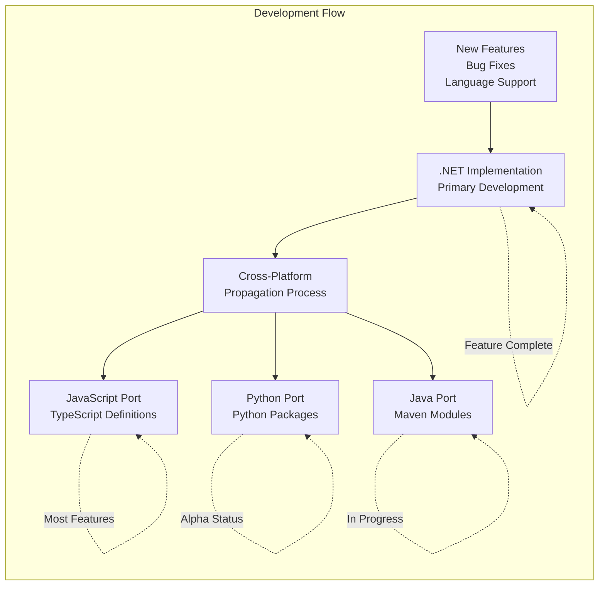
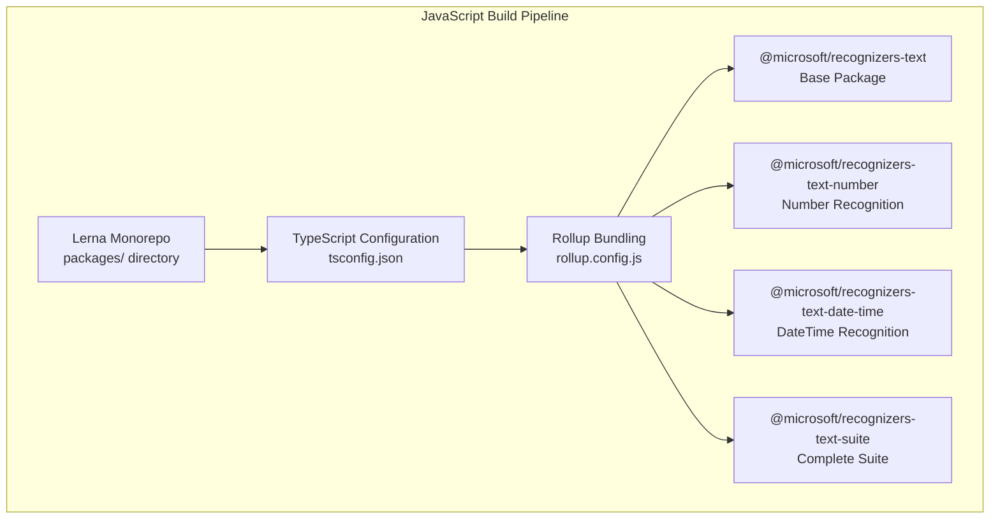
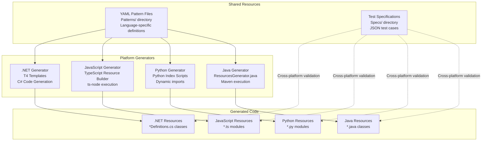

<!-- source: DeepWiki mcp.deepwiki.com · repo microsoft/Recognizers-Text · page 1.3 Platform Support · fetched 2026-10-26 -->

# Platform Support

<details>
<summary>Relevant source files</summary>

The following files were used as context for generating this wiki page:

- [.NET/Microsoft.Recognizers.Definitions.Common/Swedish/QuotedTextDefinitions.cs](.NET/Microsoft.Recognizers.Definitions.Common/Swedish/QuotedTextDefinitions.cs)
- [.NET/Microsoft.Recognizers.Definitions.Common/packages.config](.NET/Microsoft.Recognizers.Definitions.Common/packages.config)
- [.NET/Microsoft.Recognizers.Text.NumberWithUnit/Japanese/Extractors/TemperatureExtractorConfiguration.cs](.NET/Microsoft.Recognizers.Text.NumberWithUnit/Japanese/Extractors/TemperatureExtractorConfiguration.cs)
- [.NET/Microsoft.Recognizers.Text.NumberWithUnit/Japanese/Parsers/TemperatureParserConfiguration.cs](.NET/Microsoft.Recognizers.Text.NumberWithUnit/Japanese/Parsers/TemperatureParserConfiguration.cs)
- [Java/README.md](Java/README.md)
- [Java/libraries/recognizers-text-date-time/pom.xml](Java/libraries/recognizers-text-date-time/pom.xml)
- [Java/libraries/recognizers-text/src/main/java/com/microsoft/recognizers/text/utilities/StringUtility.java](Java/libraries/recognizers-text/src/main/java/com/microsoft/recognizers/text/utilities/StringUtility.java)
- [Java/libraries/resource-generator/pom.xml](Java/libraries/resource-generator/pom.xml)
- [Java/linting-excluded-files.xml](Java/linting-excluded-files.xml)
- [Java/linting-rules.xml](Java/linting-rules.xml)
- [Java/pom.xml](Java/pom.xml)
- [Java/samples/simple-console/pom.xml](Java/samples/simple-console/pom.xml)
- [Java/samples/simple-console/src/main/java/com/microsoft/recognizers/text/samples/simpleconsole/Sample.java](Java/samples/simple-console/src/main/java/com/microsoft/recognizers/text/samples/simpleconsole/Sample.java)
- [Java/tests/pom.xml](Java/tests/pom.xml)
- [JavaScript/lerna.json](JavaScript/lerna.json)
- [JavaScript/package-lock.json](JavaScript/package-lock.json)
- [JavaScript/package.json](JavaScript/package.json)
- [JavaScript/packages/datatypes-date-time/package-lock.json](JavaScript/packages/datatypes-date-time/package-lock.json)
- [JavaScript/packages/datatypes-date-time/package.json](JavaScript/packages/datatypes-date-time/package.json)
- [JavaScript/packages/recognizers-choice/package-lock.json](JavaScript/packages/recognizers-choice/package-lock.json)
- [JavaScript/packages/recognizers-choice/package.json](JavaScript/packages/recognizers-choice/package.json)
- [JavaScript/packages/recognizers-date-time/package-lock.json](JavaScript/packages/recognizers-date-time/package-lock.json)
- [JavaScript/packages/recognizers-date-time/package.json](JavaScript/packages/recognizers-date-time/package.json)
- [JavaScript/packages/recognizers-number-with-unit/package-lock.json](JavaScript/packages/recognizers-number-with-unit/package-lock.json)
- [JavaScript/packages/recognizers-number-with-unit/package.json](JavaScript/packages/recognizers-number-with-unit/package.json)
- [JavaScript/packages/recognizers-number/package-lock.json](JavaScript/packages/recognizers-number/package-lock.json)
- [JavaScript/packages/recognizers-number/package.json](JavaScript/packages/recognizers-number/package.json)
- [JavaScript/packages/recognizers-sequence/package.json](JavaScript/packages/recognizers-sequence/package.json)
- [JavaScript/packages/recognizers-text-suite/package.json](JavaScript/packages/recognizers-text-suite/package.json)
- [JavaScript/packages/recognizers-text/package.json](JavaScript/packages/recognizers-text/package.json)
- [Python/.pre-commit-config.yaml](Python/.pre-commit-config.yaml)
- [Python/build.ci.cmd](Python/build.ci.cmd)
- [Python/build.sh](Python/build.sh)
- [Python/libraries/recognizers-choice/recognizers_choice/choice/english/__init__.py](Python/libraries/recognizers-choice/recognizers_choice/choice/english/__init__.py)
- [Python/libraries/recognizers-choice/recognizers_choice/resources/__init__.py](Python/libraries/recognizers-choice/recognizers_choice/resources/__init__.py)
- [Python/libraries/recognizers-choice/resource-definitions.json](Python/libraries/recognizers-choice/resource-definitions.json)
- [Python/libraries/recognizers-choice/setup.py](Python/libraries/recognizers-choice/setup.py)
- [Python/libraries/recognizers-text/recognizers_text/parser.py](Python/libraries/recognizers-text/recognizers_text/parser.py)
- [Python/requirements.txt](Python/requirements.txt)
- [Python/setup.py](Python/setup.py)
- [Python/tests/requirements.txt](Python/tests/requirements.txt)
- [README.md](README.md)
- [Script/Utils/countNotSupportedCases.py](Script/Utils/countNotSupportedCases.py)
- [Script/Utils/deleteNotSupportedPlatform.py](Script/Utils/deleteNotSupportedPlatform.py)
- [Script/Utils/getNotSupportedInput.py](Script/Utils/getNotSupportedInput.py)

</details>


This document covers the multi-platform architecture of Microsoft Recognizers Text, explaining how the recognition system is implemented across .NET, JavaScript, Python, and Java platforms. For information about the internal architecture and processing pipeline, see [Architecture Overview](#1.1). For details about specific platform implementations, see [Platform Implementations](#4).

## Supported Platforms

Microsoft Recognizers Text provides recognition capabilities across four major platforms, each with platform-specific packaging and distribution mechanisms:



**Platform Status Overview**

| Platform | Status | Package Manager | Namespace/Package Prefix |
|----------|--------|-----------------|--------------------------|
| .NET | Primary | NuGet | `Microsoft.Recognizers.Text` |
| JavaScript/TypeScript | Stable | NPM | `@microsoft/recognizers-text` |
| Python | Alpha | PyPI | `recognizers-text` |
| Java | In Progress | Maven | `com.microsoft.recognizers.text` |

Sources: [README.md:12-21](), [JavaScript/package.json:1-104](), [Python/setup.py:1-5](), [Java/pom.xml:1-60]()

## Primary Platform Model

The project follows a ".NET-first" development model where .NET serves as the primary platform with the most comprehensive feature set. Contributions and improvements are initially implemented in .NET, then propagated to other platforms over time.



This model ensures consistency across platforms while allowing the .NET implementation to serve as the authoritative reference for new features and language support.

Sources: [README.md:21]()

## Platform-Specific Build Systems

Each platform implements its own build system and dependency management while sharing common pattern definitions and test specifications:

### .NET Build System
- **Project Structure**: Solution-based with multiple assemblies per recognizer type
- **Build Tool**: MSBuild with Visual Studio solution files
- **Package Generation**: NuGet packages with semantic versioning
- **Resource Generation**: T4 templates and YAML-to-C# code generation

### JavaScript Build System


### Python Build System
- **Build Tool**: setuptools with `setup.py` files per package
- **Package Structure**: Separate pip-installable packages for each recognizer
- **Resource Generation**: Python scripts converting YAML to Python modules
- **Testing**: pytest with coverage reporting

### Java Build System
- **Build Tool**: Maven with multi-module project structure
- **Artifact Naming**: `com.microsoft.recognizers.text.*` group ID pattern
- **Resource Generation**: Java-based resource generator using YAML parsing
- **Code Style**: CheckStyle integration with custom linting rules

Sources: [JavaScript/lerna.json:1-8](), [JavaScript/package.json:12-19](), [Python/build.sh:1-43](), [Java/pom.xml:16-27](), [Python/libraries/recognizers-choice/setup.py:1-37](), [Java/linting-rules.xml:1-202]()

## Resource Generation and Sharing

All platforms share common pattern definitions stored in YAML files, with platform-specific resource generators converting these into native code:



**Resource Generation Commands by Platform:**

| Platform | Generator Location | Execution Command |
|----------|-------------------|------------------|
| .NET | Built into project | MSBuild automatic |
| JavaScript | `packages/resource-generator/` | `ts-node resource-generator/` |
| Python | `libraries/resource-generator/` | `python index.py` |
| Java | `libraries/resource-generator/` | `mvn exec:exec` |

Sources: [JavaScript/packages/recognizers-number/package.json:29](), [Python/build.ci.cmd:18-25](), [Java/libraries/resource-generator/pom.xml:58-66](), [Python/libraries/recognizers-choice/resource-definitions.json:1-16]()

## Package Distribution

Each platform follows platform-specific conventions for package distribution and dependency management:

### .NET Distribution
- **Repository**: NuGet.org under `Recognizers.Text` profile
- **Package Pattern**: `Microsoft.Recognizers.Text.*`
- **Target Frameworks**: .NET Framework 4.5.2+, .NET Standard 2.0+
- **Assembly Structure**: Separate assemblies per recognizer domain

### JavaScript Distribution  
- **Repository**: npmjs.com under `@microsoft` scope
- **Package Pattern**: `@microsoft/recognizers-text-*`
- **Module Formats**: UMD, ES5, and browser-compatible builds
- **Dependencies**: Managed through package.json with semver ranges

### Python Distribution
- **Repository**: PyPI under `recognizers-text` user
- **Package Pattern**: `recognizers-text-*` 
- **Status**: Alpha releases with active development
- **Dependencies**: Standard pip requirements with version pinning

### Java Distribution
- **Repository**: Maven Central (planned)
- **Group ID**: `com.microsoft.recognizers.text`
- **Artifact Pattern**: Domain-specific artifacts (number, datetime, etc.)
- **Dependencies**: Maven dependency management with version ranges

Sources: [README.md:13-16](), [JavaScript/packages/recognizers-text/package.json:1-31](), [Python/libraries/recognizers-choice/setup.py:13-29](), [Java/samples/simple-console/pom.xml:44-74]()

## Cross-Platform API Consistency

Despite platform differences, all implementations maintain consistent API patterns for recognizer usage:

### Common Recognition Pattern
```
// .NET
NumberRecognizer.RecognizeNumber("twenty five", Culture.English)

// JavaScript  
recognizeNumber("twenty five", Culture.English)

// Python
recognize_number("twenty five", Culture.ENGLISH)

// Java
NumberRecognizer.recognizeNumber("twenty five", Culture.English)
```

### Model-Based Usage Pattern
All platforms support both direct recognition methods and model-based approaches for better performance when processing multiple inputs with the same configuration.

Sources: [Java/samples/simple-console/src/main/java/com/microsoft/recognizers/text/samples/simpleconsole/Sample.java:66-132](), [Java/README.md:88-102]()

---

