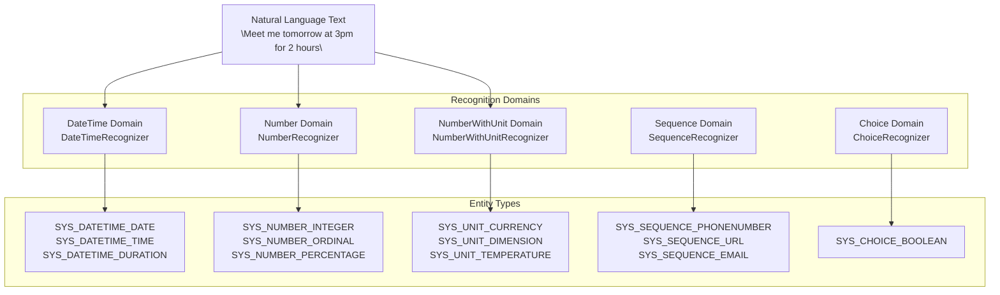
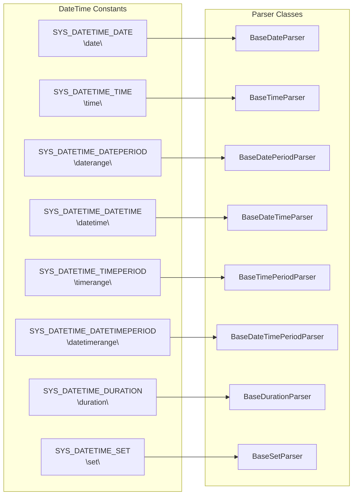
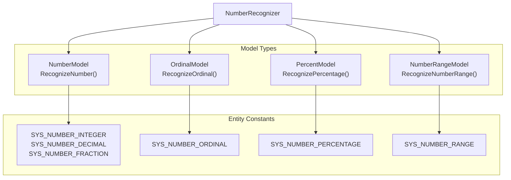

<!-- source: DeepWiki mcp.deepwiki.com · repo microsoft/Recognizers-Text · page 2 Entity Recognition Domains · fetched 2026-10-26 -->

# Entity Recognition Domains

<details>
<summary>Relevant source files</summary>

The following files were used as context for generating this wiki page:

- [.NET/Microsoft.Recognizers.Definitions.Common/English/DateTimeDefinitions.cs](.NET/Microsoft.Recognizers.Definitions.Common/English/DateTimeDefinitions.cs)
- [.NET/Microsoft.Recognizers.Text.DataDrivenTests/Number/TestNumber_Chinese.cs](.NET/Microsoft.Recognizers.Text.DataDrivenTests/Number/TestNumber_Chinese.cs)
- [.NET/Microsoft.Recognizers.Text.DataDrivenTests/Number/TestNumber_Dutch.cs](.NET/Microsoft.Recognizers.Text.DataDrivenTests/Number/TestNumber_Dutch.cs)
- [.NET/Microsoft.Recognizers.Text.DataDrivenTests/Number/TestNumber_French.cs](.NET/Microsoft.Recognizers.Text.DataDrivenTests/Number/TestNumber_French.cs)
- [.NET/Microsoft.Recognizers.Text.DataDrivenTests/Number/TestNumber_German.cs](.NET/Microsoft.Recognizers.Text.DataDrivenTests/Number/TestNumber_German.cs)
- [.NET/Microsoft.Recognizers.Text.DataDrivenTests/Number/TestNumber_Italian.cs](.NET/Microsoft.Recognizers.Text.DataDrivenTests/Number/TestNumber_Italian.cs)
- [.NET/Microsoft.Recognizers.Text.DataDrivenTests/Number/TestNumber_Japanese.cs](.NET/Microsoft.Recognizers.Text.DataDrivenTests/Number/TestNumber_Japanese.cs)
- [.NET/Microsoft.Recognizers.Text.DataDrivenTests/Number/TestNumber_Korean.cs](.NET/Microsoft.Recognizers.Text.DataDrivenTests/Number/TestNumber_Korean.cs)
- [.NET/Microsoft.Recognizers.Text.DataDrivenTests/Number/TestNumber_Spanish.cs](.NET/Microsoft.Recognizers.Text.DataDrivenTests/Number/TestNumber_Spanish.cs)
- [.NET/Microsoft.Recognizers.Text.DateTime/Constants.cs](.NET/Microsoft.Recognizers.Text.DateTime/Constants.cs)
- [.NET/Microsoft.Recognizers.Text.DateTime/DateTimeRecognizer.cs](.NET/Microsoft.Recognizers.Text.DateTime/DateTimeRecognizer.cs)
- [.NET/Microsoft.Recognizers.Text.DateTime/English/Extractors/EnglishDatePeriodExtractorConfiguration.cs](.NET/Microsoft.Recognizers.Text.DateTime/English/Extractors/EnglishDatePeriodExtractorConfiguration.cs)
- [.NET/Microsoft.Recognizers.Text.DateTime/English/Parsers/EnglishDatePeriodParserConfiguration.cs](.NET/Microsoft.Recognizers.Text.DateTime/English/Parsers/EnglishDatePeriodParserConfiguration.cs)
- [.NET/Microsoft.Recognizers.Text.DateTime/Extractors/BaseDatePeriodExtractor.cs](.NET/Microsoft.Recognizers.Text.DateTime/Extractors/BaseDatePeriodExtractor.cs)
- [.NET/Microsoft.Recognizers.Text.DateTime/Parsers/BaseDatePeriodParser.cs](.NET/Microsoft.Recognizers.Text.DateTime/Parsers/BaseDatePeriodParser.cs)
- [.NET/Microsoft.Recognizers.Text.DateTime/Parsers/BaseMergedDateTimeParser.cs](.NET/Microsoft.Recognizers.Text.DateTime/Parsers/BaseMergedDateTimeParser.cs)
- [.NET/Microsoft.Recognizers.Text.DateTime/Utilities/TimexUtility.cs](.NET/Microsoft.Recognizers.Text.DateTime/Utilities/TimexUtility.cs)
- [.NET/Microsoft.Recognizers.Text.Number/Italian/Extractors/NumberRangeExtractor.cs](.NET/Microsoft.Recognizers.Text.Number/Italian/Extractors/NumberRangeExtractor.cs)
- [.NET/Microsoft.Recognizers.Text.Number/Italian/Parsers/ItalianNumberRangeParserConfiguration.cs](.NET/Microsoft.Recognizers.Text.Number/Italian/Parsers/ItalianNumberRangeParserConfiguration.cs)
- [.NET/Microsoft.Recognizers.Text.Number/NumberRecognizer.cs](.NET/Microsoft.Recognizers.Text.Number/NumberRecognizer.cs)
- [.NET/Microsoft.Recognizers.Text.NumberWithUnit/NumberWithUnitRecognizer.cs](.NET/Microsoft.Recognizers.Text.NumberWithUnit/NumberWithUnitRecognizer.cs)
- [.NET/Microsoft.Recognizers.Text.Sequence/SequenceRecognizer.cs](.NET/Microsoft.Recognizers.Text.Sequence/SequenceRecognizer.cs)
- [.NET/Microsoft.Recognizers.Text/Recognizer.cs](.NET/Microsoft.Recognizers.Text/Recognizer.cs)
- [Java/libraries/recognizers-text-date-time/src/main/java/com/microsoft/recognizers/text/datetime/resources/EnglishDateTime.java](Java/libraries/recognizers-text-date-time/src/main/java/com/microsoft/recognizers/text/datetime/resources/EnglishDateTime.java)
- [JavaScript/packages/recognizers-date-time/src/resources/englishDateTime.ts](JavaScript/packages/recognizers-date-time/src/resources/englishDateTime.ts)
- [Patterns/English/English-DateTime.yaml](Patterns/English/English-DateTime.yaml)
- [Python/libraries/recognizers-date-time/recognizers_date_time/resources/english_date_time.py](Python/libraries/recognizers-date-time/recognizers_date_time/resources/english_date_time.py)
- [Specs/DateTime/English/DatePeriodExtractor.json](Specs/DateTime/English/DatePeriodExtractor.json)
- [Specs/DateTime/English/DatePeriodParser.json](Specs/DateTime/English/DatePeriodParser.json)
- [Specs/DateTime/English/DateTimeModel.json](Specs/DateTime/English/DateTimeModel.json)
- [Specs/DateTime/English/DateTimeModelComplexCalendar.json](Specs/DateTime/English/DateTimeModelComplexCalendar.json)
- [Specs/DateTime/English/DateTimeModelExperimentalMode.json](Specs/DateTime/English/DateTimeModelExperimentalMode.json)
- [Specs/DateTime/English/MergedExtractor.json](Specs/DateTime/English/MergedExtractor.json)
- [Specs/DateTime/English/MergedParser.json](Specs/DateTime/English/MergedParser.json)
- [Specs/Number/German/OrdinalModel.json](Specs/Number/German/OrdinalModel.json)
- [Specs/Number/German/OrdinalModelEnablePreview.json](Specs/Number/German/OrdinalModelEnablePreview.json)
- [Specs/Number/Italian/NumberRangeModel.json](Specs/Number/Italian/NumberRangeModel.json)

</details>


This document provides a comprehensive overview of the five main entity recognition domains supported by Microsoft Recognizers Text. Each domain specializes in extracting specific types of structured information from natural language text across multiple languages and platforms.

For information about language-specific implementations, see [Language-Specific Implementations](#3). For platform-specific details, see [Platform Implementations](#4).

## Overview of Recognition Domains

Microsoft Recognizers Text organizes entity recognition into five primary domains, each with specialized extractors, parsers, and models:



Sources: [.NET/Microsoft.Recognizers.Text.DateTime/Constants.cs:14-23](), [.NET/Microsoft.Recognizers.Text.DateTime/DateTimeRecognizer.cs:1-50](), [.NET/Microsoft.Recognizers.Text.Number/NumberRecognizer.cs:23-48](), [.NET/Microsoft.Recognizers.Text.NumberWithUnit/NumberWithUnitRecognizer.cs:9-28](), [.NET/Microsoft.Recognizers.Text.Sequence/SequenceRecognizer.cs:1-20]()

## DateTime Recognition Domain

The DateTime domain is the most comprehensive, handling temporal expressions across multiple sub-types and complexity levels.

### DateTime Entity Types



Sources: [.NET/Microsoft.Recognizers.Text.DateTime/Constants.cs:14-22](), [.NET/Microsoft.Recognizers.Text.DateTime/Parsers/BaseDatePeriodParser.cs:16-18]()

### DateTime Pattern-to-Code Flow

The DateTime domain uses an extensive YAML-to-code generation pipeline:

```mermaid
graph TD
    YAML["English-DateTime.yaml<br/>TillRegex, RelativeRegex<br/>MonthRegex, WeekDayRegex"]
    
    Generator["T4 Template Generator"]
    
    subgraph "Generated Definitions"
        NETDefs["DateTimeDefinitions.cs<br/>TillRegex = \"(?<till>\\b(to|...\"<br/>RelativeRegex = \"\\b(?<order>...\""]
        JSDefs["englishDateTime.ts<br/>export const TillRegex<br/>export const RelativeRegex"]
        PythonDefs["english_date_time.py<br/>TillRegex = f'(?<till>...'<br/>RelativeRegex = f'\\b(?<order>...'"]
        JavaDefs["EnglishDateTime.java<br/>public static final String TillRegex<br/>public static final String RelativeRegex"]
    end
    
    subgraph "Runtime Components"
        Extractors["BaseDatePeriodExtractor<br/>EnglishDatePeriodExtractorConfiguration"]
        Parsers["BaseDatePeriodParser<br/>EnglishDatePeriodParserConfiguration"]
    end
    
    YAML --> Generator
    Generator --> NETDefs
    Generator --> JSDefs
    Generator --> PythonDefs
    Generator --> JavaDefs
    
    NETDefs --> Extractors
    NETDefs --> Parsers
```

Sources: [Patterns/English/English-DateTime.yaml:5-10](), [.NET/Microsoft.Recognizers.Definitions.Common/English/DateTimeDefinitions.cs:24-29](), [JavaScript/packages/recognizers-date-time/src/resources/englishDateTime.ts:16-19](), [Python/libraries/recognizers-date-time/recognizers_date_time/resources/english_date_time.py:19-22](), [Java/libraries/recognizers-text-date-time/src/main/java/com/microsoft/recognizers/text/datetime/resources/EnglishDateTime.java:26-34]()

### DateTime Processing Pipeline

```mermaid
graph LR
    Input["\"tomorrow at 3pm\""]
    
    subgraph "Extraction Phase"
        MergedExtractor["BaseMergedDateTimeExtractor"]
        DateTimeExtractor["BaseDateTimeExtractor"]
        DateExtractor["BaseDateExtractor"]
        TimeExtractor["BaseTimeExtractor"]
    end
    
    subgraph "Parsing Phase"
        MergedParser["BaseMergedDateTimeParser"]
        DateTimeParser["BaseDateTimeParser"]
    end
    
    subgraph "Resolution"
        TimexUtility["TimexUtility"]
        Resolution["DateTimeResolution<br/>values: [<br/>  timex: \"2016-11-08T15\"<br/>  type: \"datetime\"<br/>  value: \"2016-11-08 15:00:00\"<br/>]"]
    end
    
    Input --> MergedExtractor
    MergedExtractor --> DateTimeExtractor
    DateTimeExtractor --> DateExtractor
    DateTimeExtractor --> TimeExtractor
    
    DateTimeExtractor --> MergedParser
    MergedParser --> DateTimeParser
    DateTimeParser --> TimexUtility
    TimexUtility --> Resolution
```

Sources: [.NET/Microsoft.Recognizers.Text.DateTime/Extractors/BaseDatePeriodExtractor.cs:15-28](), [.NET/Microsoft.Recognizers.Text.DateTime/Parsers/BaseDatePeriodParser.cs:107-125](), [.NET/Microsoft.Recognizers.Text.DateTime/Parsers/BaseMergedDateTimeParser.cs:13-50](), [.NET/Microsoft.Recognizers.Text.DateTime/Utilities/TimexUtility.cs:14-35]()

## Number Recognition Domain

The Number domain handles various numeric expressions and mathematical concepts.

### Number Entity Types and Models



Sources: [.NET/Microsoft.Recognizers.Text.Number/NumberRecognizer.cs:50-68](), [.NET/Microsoft.Recognizers.Text.Number/NumberRecognizer.cs:70-83](), [.NET/Microsoft.Recognizers.Text.DateTime/Constants.cs:29]()

## NumberWithUnit Recognition Domain

The NumberWithUnit domain recognizes numbers combined with measurement units across various categories.

### NumberWithUnit Categories

```mermaid
graph TD
    NumberWithUnitRecognizer["NumberWithUnitRecognizer"]
    
    subgraph "Recognition Methods"
        RecognizeCurrency["RecognizeCurrency()<br/>\"$50\", \"20 dollars\""]
        RecognizeDimension["RecognizeDimension()<br/>\"5 feet\", \"10 kilometers\""]
        RecognizeTemperature["RecognizeTemperature()<br/>\"20°C\", \"68 fahrenheit\""]
        RecognizeAge["RecognizeAge()<br/>\"5 years old\", \"30-year-old\""]
    end
    
    subgraph "Model Classes"
        CurrencyModel["CurrencyModel"]
        DimensionModel["DimensionModel"]
        TemperatureModel["TemperatureModel"]
        AgeModel["AgeModel"]
    end
    
    NumberWithUnitRecognizer --> RecognizeCurrency
    NumberWithUnitRecognizer --> RecognizeDimension
    NumberWithUnitRecognizer --> RecognizeTemperature
    NumberWithUnitRecognizer --> RecognizeAge
    
    RecognizeCurrency --> CurrencyModel
    RecognizeDimension --> DimensionModel
    RecognizeTemperature --> TemperatureModel
    RecognizeAge --> AgeModel
```

Sources: [.NET/Microsoft.Recognizers.Text.NumberWithUnit/NumberWithUnitRecognizer.cs:50-85]()

## Sequence Recognition Domain

The Sequence domain handles structured patterns like contact information and identifiers.

### Sequence Entity Types

```mermaid
graph LR
    SequenceRecognizer["SequenceRecognizer"]
    
    subgraph "Recognition Methods"
        RecognizePhoneNumber["RecognizePhoneNumber()"]
        RecognizeURL["RecognizeURL()"]
        RecognizeEmail["RecognizeEmail()"]
        RecognizeIP["RecognizeIP()"]
        RecognizeGUID["RecognizeGUID()"]
        RecognizeSocialSecurity["RecognizeSocialSecurity()"]
    end
    
    subgraph "Pattern Examples"
        PhonePattern["\"(555) 123-4567\"<br/>\"+1-555-123-4567\""]
        URLPattern["\"https://example.com\"<br/>\"www.microsoft.com\""]
        EmailPattern["\"user@domain.com\""]
        IPPattern["\"192.168.1.1\"<br/>\"2001:db8::1\""]
        GUIDPattern["\"123e4567-e89b-12d3-a456-426614174000\""]
    end
    
    SequenceRecognizer --> RecognizePhoneNumber
    SequenceRecognizer --> RecognizeURL
    SequenceRecognizer --> RecognizeEmail
    SequenceRecognizer --> RecognizeIP
    SequenceRecognizer --> RecognizeGUID
    SequenceRecognizer --> RecognizeSocialSecurity
    
    RecognizePhoneNumber --> PhonePattern
    RecognizeURL --> URLPattern
    RecognizeEmail --> EmailPattern
    RecognizeIP --> IPPattern
    RecognizeGUID --> GUIDPattern
```

Sources: [.NET/Microsoft.Recognizers.Text.Sequence/SequenceRecognizer.cs:50-120]()

## Choice Recognition Domain

The Choice domain handles boolean and selection-based responses.

### Choice Recognition Types

```mermaid
graph TD
    Input["\"Yes, I agree\"<br/>\"No thanks\"<br/>\"Maybe tomorrow\""]
    
    ChoiceRecognizer["ChoiceRecognizer"]
    
    subgraph "Recognition Methods"
        RecognizeBoolean["RecognizeBoolean()"]
    end
    
    subgraph "Boolean Values"
        TrueValues["True Values:<br/>\"yes\", \"yeah\", \"yep\"<br/>\"true\", \"correct\", \"right\"<br/>\"ok\", \"okay\""]
        FalseValues["False Values:<br/>\"no\", \"nope\", \"nah\"<br/>\"false\", \"wrong\"<br/>\"cancel\", \"never\""]
    end
    
    Input --> ChoiceRecognizer
    ChoiceRecognizer --> RecognizeBoolean
    RecognizeBoolean --> TrueValues
    RecognizeBoolean --> FalseValues
```

Sources: [.NET/Microsoft.Recognizers.Text.Choice/ChoiceRecognizer.cs:1-50]()

## Cross-Domain Integration

All recognition domains follow a consistent architectural pattern and can be used together through the main entry points:

| Domain | Main Recognizer Class | Primary Entity Types | Key Features |
|--------|----------------------|---------------------|--------------|
| DateTime | `DateTimeRecognizer` | date, time, duration, daterange | Temporal expressions, recurring patterns |
| Number | `NumberRecognizer` | number, ordinal, percentage | Numeric values, mathematical expressions |
| NumberWithUnit | `NumberWithUnitRecognizer` | currency, dimension, temperature, age | Numbers with measurement units |
| Sequence | `SequenceRecognizer` | phonenumber, url, email, ip, guid | Structured identifiers and contact info |
| Choice | `ChoiceRecognizer` | boolean | Yes/no responses, selection choices |

Sources: [.NET/Microsoft.Recognizers.Text.DateTime/DateTimeRecognizer.cs:1-50](), [.NET/Microsoft.Recognizers.Text.Number/NumberRecognizer.cs:23-48](), [.NET/Microsoft.Recognizers.Text.NumberWithUnit/NumberWithUnitRecognizer.cs:9-28](), [.NET/Microsoft.Recognizers.Text.Sequence/SequenceRecognizer.cs:1-20]()

Each domain implements the same three-phase pipeline: extraction (pattern matching), parsing (structure analysis), and resolution (value normalization), ensuring consistent behavior across all entity types and platforms.

---

