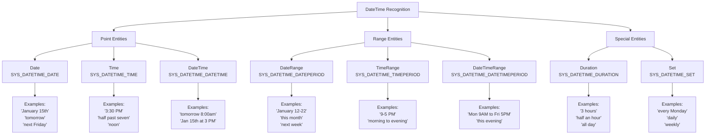
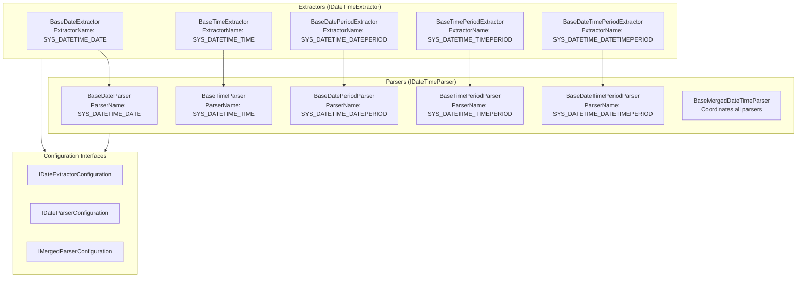
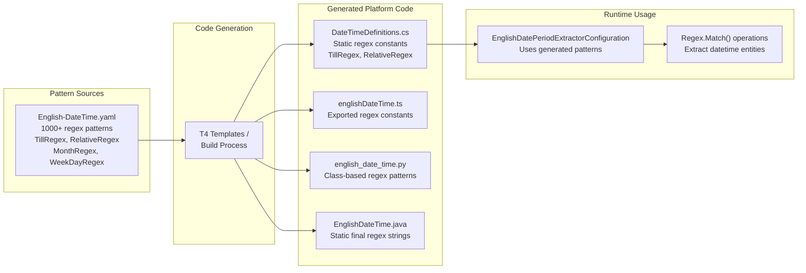
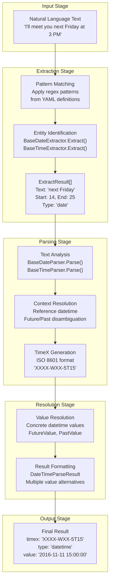
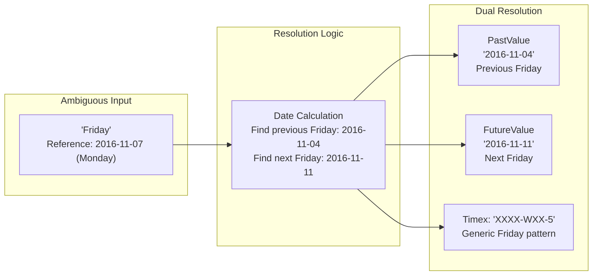
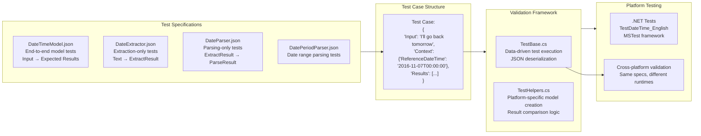

<!-- source: DeepWiki mcp.deepwiki.com · repo microsoft/Recognizers-Text · page 2.1 DateTime Recognition · fetched 2026-10-26 -->

# DateTime Recognition

<details>
<summary>Relevant source files</summary>

The following files were used as context for generating this wiki page:

- [.NET/Microsoft.Recognizers.Definitions.Common/English/DateTimeDefinitions.cs](.NET/Microsoft.Recognizers.Definitions.Common/English/DateTimeDefinitions.cs)
- [.NET/Microsoft.Recognizers.Text.DataDrivenTests/DateTime/TestDateTime_English.cs](.NET/Microsoft.Recognizers.Text.DataDrivenTests/DateTime/TestDateTime_English.cs)
- [.NET/Microsoft.Recognizers.Text.DataDrivenTests/TestBase.cs](.NET/Microsoft.Recognizers.Text.DataDrivenTests/TestBase.cs)
- [.NET/Microsoft.Recognizers.Text.DataDrivenTests/TestHelpers.cs](.NET/Microsoft.Recognizers.Text.DataDrivenTests/TestHelpers.cs)
- [.NET/Microsoft.Recognizers.Text.DateTime/Constants.cs](.NET/Microsoft.Recognizers.Text.DateTime/Constants.cs)
- [.NET/Microsoft.Recognizers.Text.DateTime/DateTimeOptions.cs](.NET/Microsoft.Recognizers.Text.DateTime/DateTimeOptions.cs)
- [.NET/Microsoft.Recognizers.Text.DateTime/English/Extractors/EnglishDatePeriodExtractorConfiguration.cs](.NET/Microsoft.Recognizers.Text.DateTime/English/Extractors/EnglishDatePeriodExtractorConfiguration.cs)
- [.NET/Microsoft.Recognizers.Text.DateTime/English/Extractors/EnglishDateTimePeriodExtractorConfiguration.cs](.NET/Microsoft.Recognizers.Text.DateTime/English/Extractors/EnglishDateTimePeriodExtractorConfiguration.cs)
- [.NET/Microsoft.Recognizers.Text.DateTime/English/Extractors/EnglishTimePeriodExtractorConfiguration.cs](.NET/Microsoft.Recognizers.Text.DateTime/English/Extractors/EnglishTimePeriodExtractorConfiguration.cs)
- [.NET/Microsoft.Recognizers.Text.DateTime/English/Parsers/EnglishDatePeriodParserConfiguration.cs](.NET/Microsoft.Recognizers.Text.DateTime/English/Parsers/EnglishDatePeriodParserConfiguration.cs)
- [.NET/Microsoft.Recognizers.Text.DateTime/English/Parsers/EnglishDateTimePeriodParserConfiguration.cs](.NET/Microsoft.Recognizers.Text.DateTime/English/Parsers/EnglishDateTimePeriodParserConfiguration.cs)
- [.NET/Microsoft.Recognizers.Text.DateTime/English/Parsers/EnglishTimePeriodParserConfiguration.cs](.NET/Microsoft.Recognizers.Text.DateTime/English/Parsers/EnglishTimePeriodParserConfiguration.cs)
- [.NET/Microsoft.Recognizers.Text.DateTime/Extractors/BaseDateExtractor.cs](.NET/Microsoft.Recognizers.Text.DateTime/Extractors/BaseDateExtractor.cs)
- [.NET/Microsoft.Recognizers.Text.DateTime/Extractors/BaseDatePeriodExtractor.cs](.NET/Microsoft.Recognizers.Text.DateTime/Extractors/BaseDatePeriodExtractor.cs)
- [.NET/Microsoft.Recognizers.Text.DateTime/Extractors/BaseDateTimePeriodExtractor.cs](.NET/Microsoft.Recognizers.Text.DateTime/Extractors/BaseDateTimePeriodExtractor.cs)
- [.NET/Microsoft.Recognizers.Text.DateTime/Extractors/BaseTimePeriodExtractor.cs](.NET/Microsoft.Recognizers.Text.DateTime/Extractors/BaseTimePeriodExtractor.cs)
- [.NET/Microsoft.Recognizers.Text.DateTime/Microsoft.Recognizers.Text.DateTime.xml](.NET/Microsoft.Recognizers.Text.DateTime/Microsoft.Recognizers.Text.DateTime.xml)
- [.NET/Microsoft.Recognizers.Text.DateTime/Parsers/BaseDateParser.cs](.NET/Microsoft.Recognizers.Text.DateTime/Parsers/BaseDateParser.cs)
- [.NET/Microsoft.Recognizers.Text.DateTime/Parsers/BaseDatePeriodParser.cs](.NET/Microsoft.Recognizers.Text.DateTime/Parsers/BaseDatePeriodParser.cs)
- [.NET/Microsoft.Recognizers.Text.DateTime/Parsers/BaseDateTimeParser.cs](.NET/Microsoft.Recognizers.Text.DateTime/Parsers/BaseDateTimeParser.cs)
- [.NET/Microsoft.Recognizers.Text.DateTime/Parsers/BaseDateTimePeriodParser.cs](.NET/Microsoft.Recognizers.Text.DateTime/Parsers/BaseDateTimePeriodParser.cs)
- [.NET/Microsoft.Recognizers.Text.DateTime/Parsers/BaseMergedDateTimeParser.cs](.NET/Microsoft.Recognizers.Text.DateTime/Parsers/BaseMergedDateTimeParser.cs)
- [.NET/Microsoft.Recognizers.Text.DateTime/Parsers/BaseTimePeriodParser.cs](.NET/Microsoft.Recognizers.Text.DateTime/Parsers/BaseTimePeriodParser.cs)
- [.NET/Microsoft.Recognizers.Text.DateTime/Utilities/TimexUtility.cs](.NET/Microsoft.Recognizers.Text.DateTime/Utilities/TimexUtility.cs)
- [.NET/Microsoft.Recognizers.Text/Constants.cs](.NET/Microsoft.Recognizers.Text/Constants.cs)
- [.NET/Microsoft.Recognizers.Text/Models/ExtendedModelResult.cs](.NET/Microsoft.Recognizers.Text/Models/ExtendedModelResult.cs)
- [.NET/Microsoft.Recognizers.Text/Models/ModelResult.cs](.NET/Microsoft.Recognizers.Text/Models/ModelResult.cs)
- [Java/libraries/recognizers-text-date-time/src/main/java/com/microsoft/recognizers/text/datetime/resources/EnglishDateTime.java](Java/libraries/recognizers-text-date-time/src/main/java/com/microsoft/recognizers/text/datetime/resources/EnglishDateTime.java)
- [Java/tests/src/test/java/com/microsoft/recognizers/text/tests/numberwithunit/NumberWithUnitRecognizerInitializationTest.java](Java/tests/src/test/java/com/microsoft/recognizers/text/tests/numberwithunit/NumberWithUnitRecognizerInitializationTest.java)
- [JavaScript/packages/recognizers-date-time/src/resources/englishDateTime.ts](JavaScript/packages/recognizers-date-time/src/resources/englishDateTime.ts)
- [Patterns/English/English-DateTime.yaml](Patterns/English/English-DateTime.yaml)
- [Python/libraries/recognizers-date-time/recognizers_date_time/resources/english_date_time.py](Python/libraries/recognizers-date-time/recognizers_date_time/resources/english_date_time.py)
- [Specs/DateTime/English/DateExtractor.json](Specs/DateTime/English/DateExtractor.json)
- [Specs/DateTime/English/DateParser.json](Specs/DateTime/English/DateParser.json)
- [Specs/DateTime/English/DatePeriodExtractor.json](Specs/DateTime/English/DatePeriodExtractor.json)
- [Specs/DateTime/English/DatePeriodParser.json](Specs/DateTime/English/DatePeriodParser.json)
- [Specs/DateTime/English/DateTimeModel.json](Specs/DateTime/English/DateTimeModel.json)
- [Specs/DateTime/English/DateTimeModelComplexCalendar.json](Specs/DateTime/English/DateTimeModelComplexCalendar.json)
- [Specs/DateTime/English/DateTimeModelExperimentalMode.json](Specs/DateTime/English/DateTimeModelExperimentalMode.json)
- [Specs/DateTime/English/DateTimePeriodExtractor.json](Specs/DateTime/English/DateTimePeriodExtractor.json)
- [Specs/DateTime/English/DateTimePeriodParser.json](Specs/DateTime/English/DateTimePeriodParser.json)
- [Specs/DateTime/English/MergedExtractor.json](Specs/DateTime/English/MergedExtractor.json)
- [Specs/DateTime/English/MergedParser.json](Specs/DateTime/English/MergedParser.json)
- [Specs/DateTime/English/TimePeriodExtractor.json](Specs/DateTime/English/TimePeriodExtractor.json)
- [Specs/DateTime/English/TimePeriodParser.json](Specs/DateTime/English/TimePeriodParser.json)

</details>


This document covers the DateTime Recognition system within Microsoft Recognizers Text, which identifies and parses temporal expressions in natural language text across multiple languages and platforms. For information about other entity types, see [Number Recognition](#2.2), [NumberWithUnit Recognition](#2.3), [Sequence Recognition](#2.4), and [Choice Recognition](#2.5).

## DateTime Entity Types

The DateTime Recognition system identifies eight distinct types of temporal entities, each with specific recognition patterns and resolution formats.

### Core Entity Types

| Entity Type | Constant | Description | Examples |
|-------------|----------|-------------|----------|
| Date | `SYS_DATETIME_DATE` | Specific dates and relative date references | "January 15th", "tomorrow", "next Friday" |
| Time | `SYS_DATETIME_TIME` | Time points and time expressions | "3:30 PM", "half past seven", "noon" |
| DateTime | `SYS_DATETIME_DATETIME` | Combined date and time expressions | "tomorrow 8:00am", "January 15th at 3 PM" |
| DateRange | `SYS_DATETIME_DATEPERIOD` | Date periods and ranges | "January 12-22", "this month", "next week" |
| TimeRange | `SYS_DATETIME_TIMEPERIOD` | Time periods and ranges | "9-5 PM", "morning to evening" |
| DateTimeRange | `SYS_DATETIME_DATETIMEPERIOD` | Combined datetime ranges | "Mon 9AM to Fri 5PM", "this evening" |
| Duration | `SYS_DATETIME_DURATION` | Time spans and durations | "3 hours", "half an hour", "all day" |
| Set | `SYS_DATETIME_SET` | Recurring temporal patterns | "every Monday", "daily", "weekly" |

**DateTime Entity Type Hierarchy**


Sources: [.NET/Microsoft.Recognizers.Text.DateTime/Constants.cs:14-22](), [Specs/DateTime/English/DateTimeModel.json:1-100]()

## Architecture Overview

The DateTime Recognition system follows a three-layer architecture: Extractors identify potential datetime entities, Parsers resolve them into structured values, and Models provide the public API.

### Processing Pipeline Architecture

```mermaid
graph LR
    Input["Natural Language Text<br/>'I'll meet you tomorrow at 3 PM'"]
    
    subgraph ExtractionLayer["Extraction Layer"]
        BaseDateExtractor["BaseDateExtractor"]
        BaseTimeExtractor["BaseTimeExtractor"] 
        BaseDateTimePeriodExtractor["BaseDateTimePeriodExtractor"]
        BaseDatePeriodExtractor["BaseDatePeriodExtractor"]
        BaseTimePeriodExtractor["BaseTimePeriodExtractor"]
    end
    
    subgraph ParsingLayer["Parsing Layer"]
        BaseDateParser["BaseDateParser"]
        BaseTimeParser["BaseTimeParser"]
        BaseDateTimePeriodParser["BaseDateTimePeriodParser"]
        BaseDatePeriodParser["BaseDatePeriodParser"]
        BaseTimePeriodParser["BaseTimePeriodParser"]
        BaseMergedDateTimeParser["BaseMergedDateTimeParser"]
    end
    
    subgraph ModelLayer["Model Layer"]
        DateTimeModel["DateTimeModel<br/>Public API"]
    end
    
    subgraph OutputLayer["Output Layer"]
        ExtractResult["ExtractResult<br/>Text: 'tomorrow at 3 PM'<br/>Start: 14, End: 29"]
        ParseResult["DateTimeParseResult<br/>Timex: '2016-11-08T15'<br/>Value: '2016-11-08 15:00:00'"]
    end
    
    Input --> ExtractionLayer
    ExtractionLayer --> ExtractResult
    ExtractResult --> ParsingLayer
    ParsingLayer --> ParseResult
    ParseResult --> ModelLayer
    ModelLayer --> OutputLayer
```



Sources: [.NET/Microsoft.Recognizers.Text.DateTime/Extractors/BaseDateExtractor.cs:16-18](), [.NET/Microsoft.Recognizers.Text.DateTime/Parsers/BaseDateParser.cs:1-15](), [.NET/Microsoft.Recognizers.Text.DateTime/Parsers/BaseMergedDateTimeParser.cs:13-21]()

### Core Component Classes



Sources: [.NET/Microsoft.Recognizers.Text.DateTime/Extractors/BaseDateExtractor.cs:18](), [.NET/Microsoft.Recognizers.Text.DateTime/Parsers/BaseDateParser.cs:1-20](), [.NET/Microsoft.Recognizers.Text.DateTime/Extractors/BaseDatePeriodExtractor.cs:15-17](), [.NET/Microsoft.Recognizers.Text.DateTime/Parsers/BaseDatePeriodParser.cs:16-18]()

## Pattern-Driven Recognition

The DateTime Recognition system uses a pattern-driven approach where YAML configuration files define language-specific regex patterns that are compiled into platform-specific code.

### Pattern Generation Workflow



### Key Pattern Categories

The YAML patterns are organized into hierarchical categories that build complex recognition capabilities:

| Pattern Category | Examples | Purpose |
|------------------|----------|---------|
| Basic Components | `DayRegex`, `MonthRegex`, `YearRegex` | Match fundamental date/time units |
| Relative Terms | `RelativeRegex`, `NextPrefixRegex`, `PastPrefixRegex` | Handle relative references like "next", "last" |
| Range Connectors | `TillRegex`, `RangeConnectorRegex`, `BetweenTokenRegex` | Identify range expressions |
| Complex Patterns | `SimpleCasesRegex`, `MonthFrontSimpleCasesRegex` | Complete entity extraction patterns |
| Time Expressions | `TimeRegex1` through `TimeRegex11` | Various time format patterns |

Sources: [Patterns/English/English-DateTime.yaml:1-50](), [.NET/Microsoft.Recognizers.Definitions.Common/English/DateTimeDefinitions.cs:22-30](), [.NET/Microsoft.Recognizers.Text.DateTime/English/Extractors/EnglishDatePeriodExtractorConfiguration.cs:1-20]()

## Processing Pipeline

The DateTime Recognition processing pipeline transforms natural language text through multiple stages to produce structured temporal information with TimeX representations.

### Extraction to Resolution Pipeline



### Resolution Strategy for Ambiguous Dates

The system handles temporal ambiguity by providing both future and past interpretations relative to a reference datetime:



Sources: [.NET/Microsoft.Recognizers.Text.DateTime/Extractors/BaseDateExtractor.cs:24-30](), [.NET/Microsoft.Recognizers.Text.DateTime/Parsers/BaseDateParser.cs:1-50](), [Specs/DateTime/English/DateTimeModel.json:300-330]()

## Cross-Platform Implementation

The DateTime Recognition system maintains consistent functionality across four platforms through code generation from shared pattern definitions.

### Platform-Specific Generated Code

```mermaid
graph TD
    subgraph SharedPatterns["Shared Pattern Source"]
        YAMLPatterns["English-DateTime.yaml<br/>Language-agnostic patterns<br/>TillRegex: '(?<till>\\b(to|(un)?till?...)'"
    end
    
    subgraph PlatformGeneration["Platform Code Generation"]
        Generator["Build Process<br/>T4 Templates / Generators"]
    end
    
    subgraph NETImplementation[".NET Implementation"]
        DateTimeDefinitions["DateTimeDefinitions.cs<br/>Static readonly string TillRegex<br/>= @'(?<till>\\b(to|(un)?till?...'"]
        EnglishDateExtractor["EnglishDateExtractorConfiguration<br/>Uses DateTimeDefinitions"]
    end
    
    subgraph JSImplementation["JavaScript Implementation"]
        EnglishDateTime["englishDateTime.ts<br/>export const TillRegex<br/>= '(?<till>\\\\b(to|(un)?till?...'"]
        JSDateExtractor["EnglishDateExtractorConfiguration<br/>Uses EnglishDateTime"]
    end
    
    subgraph PythonImplementation["Python Implementation"]
        EnglishDateTimePy["english_date_time.py<br/>class EnglishDateTime:<br/>    TillRegex = f'(?<till>...'"]
        PyDateExtractor["EnglishDateExtractorConfiguration<br/>Uses EnglishDateTime"]
    end
    
    subgraph JavaImplementation["Java Implementation"]
        EnglishDateTimeJava["EnglishDateTime.java<br/>public static final String TillRegex<br/>= '(?<till>\\\\b(to|(un)?till?...'"]
        JavaDateExtractor["EnglishDateExtractorConfiguration<br/>Uses EnglishDateTime"]
    end
    
    YAMLPatterns --> Generator
    
    Generator --> DateTimeDefinitions
    Generator --> EnglishDateTime
    Generator --> EnglishDateTimePy
    Generator --> EnglishDateTimeJava
    
    DateTimeDefinitions --> EnglishDateExtractor
    EnglishDateTime --> JSDateExtractor
    EnglishDateTimePy --> PyDateExtractor
    EnglishDateTimeJava --> JavaDateExtractor
```

### Platform-Specific Syntax Adaptations

| Platform | Pattern Storage | Regex Escaping | Reference Example |
|----------|----------------|-----------------|-------------------|
| .NET | Static readonly strings | Single backslash | `@"(?<till>\b(to\|(un)?till?...)` |
| JavaScript | Exported constants | Double backslash | `` `(?<till>\\b(to\|(un)?till?...` `` |
| Python | Class attributes with f-strings | Double backslash | `f'(?<till>\\b(to\|(un)?till?...'` |
| Java | Static final strings with replacement | Escaped replacement | `.replace("{pattern}", value)` |

Sources: [.NET/Microsoft.Recognizers.Definitions.Common/English/DateTimeDefinitions.cs:26](), [JavaScript/packages/recognizers-date-time/src/resources/englishDateTime.ts:16](), [Python/libraries/recognizers-date-time/recognizers_date_time/resources/english_date_time.py:19](), [Java/libraries/recognizers-text-date-time/src/main/java/com/microsoft/recognizers/text/datetime/resources/EnglishDateTime.java:26-27]()

## Testing Framework

The DateTime Recognition system employs a comprehensive data-driven testing framework that validates recognition accuracy across different entity types and languages using JSON test specifications.

### Test Specification Structure



### Test Coverage Categories

The testing framework covers multiple dimensions of DateTime Recognition functionality:

| Test Category | File Pattern | Purpose | Example Coverage |
|---------------|--------------|---------|------------------|
| Model Tests | `*Model.json` | End-to-end recognition | Full input-to-output validation |
| Extractor Tests | `*Extractor.json` | Pattern matching accuracy | Entity boundary detection |
| Parser Tests | `*Parser.json` | Resolution correctness | TimeX generation, value resolution |
| Complex Cases | `*ComplexCalendar.json` | Advanced scenarios | Holiday handling, ambiguous dates |
| Experimental | `*ExperimentalMode.json` | Preview features | New pattern validation |

Sources: [Specs/DateTime/English/DateTimeModel.json:1-50](), [.NET/Microsoft.Recognizers.Text.DataDrivenTests/TestBase.cs:18-30](), [.NET/Microsoft.Recognizers.Text.DataDrivenTests/TestHelpers.cs:1-20](), [Specs/DateTime/English/DatePeriodParser.json:1-30]()

---

