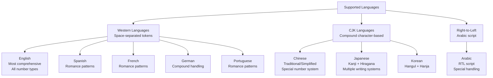

<!-- source: DeepWiki mcp.deepwiki.com · repo microsoft/Recognizers-Text · page 2.2 Number Recognition · fetched 2026-10-26 -->

# Number Recognition

<details>
<summary>Relevant source files</summary>

The following files were used as context for generating this wiki page:

- [.NET/Microsoft.Recognizers.Definitions.Common/Chinese/NumbersDefinitions.cs](.NET/Microsoft.Recognizers.Definitions.Common/Chinese/NumbersDefinitions.cs)
- [.NET/Microsoft.Recognizers.Definitions.Common/Chinese/NumbersWithUnitDefinitions.cs](.NET/Microsoft.Recognizers.Definitions.Common/Chinese/NumbersWithUnitDefinitions.cs)
- [.NET/Microsoft.Recognizers.Definitions.Common/English/NumbersDefinitions.cs](.NET/Microsoft.Recognizers.Definitions.Common/English/NumbersDefinitions.cs)
- [.NET/Microsoft.Recognizers.Definitions.Common/Japanese/NumbersDefinitions.cs](.NET/Microsoft.Recognizers.Definitions.Common/Japanese/NumbersDefinitions.cs)
- [.NET/Microsoft.Recognizers.Definitions.Common/Japanese/NumbersWithUnitDefinitions.cs](.NET/Microsoft.Recognizers.Definitions.Common/Japanese/NumbersWithUnitDefinitions.cs)
- [.NET/Microsoft.Recognizers.Text.DataDrivenTests/Number/TestNumber_English.cs](.NET/Microsoft.Recognizers.Text.DataDrivenTests/Number/TestNumber_English.cs)
- [.NET/Microsoft.Recognizers.Text.Number/Constants.cs](.NET/Microsoft.Recognizers.Text.Number/Constants.cs)
- [.NET/Microsoft.Recognizers.Text.Number/English/Extractors/NumberExtractor.cs](.NET/Microsoft.Recognizers.Text.Number/English/Extractors/NumberExtractor.cs)
- [.NET/Microsoft.Recognizers.Text.Number/English/Extractors/OrdinalExtractor.cs](.NET/Microsoft.Recognizers.Text.Number/English/Extractors/OrdinalExtractor.cs)
- [.NET/Microsoft.Recognizers.Text.Number/Extractors/BaseNumberExtractor.cs](.NET/Microsoft.Recognizers.Text.Number/Extractors/BaseNumberExtractor.cs)
- [.NET/Microsoft.Recognizers.Text.Number/Japanese/Extractors/CardinalExtractor.cs](.NET/Microsoft.Recognizers.Text.Number/Japanese/Extractors/CardinalExtractor.cs)
- [.NET/Microsoft.Recognizers.Text.Number/Japanese/Extractors/DoubleExtractor.cs](.NET/Microsoft.Recognizers.Text.Number/Japanese/Extractors/DoubleExtractor.cs)
- [.NET/Microsoft.Recognizers.Text.Number/Japanese/Extractors/IntegerExtractor.cs](.NET/Microsoft.Recognizers.Text.Number/Japanese/Extractors/IntegerExtractor.cs)
- [.NET/Microsoft.Recognizers.Text.Number/Japanese/Parsers/JapaneseNumberRangeParserConfiguration.cs](.NET/Microsoft.Recognizers.Text.Number/Japanese/Parsers/JapaneseNumberRangeParserConfiguration.cs)
- [.NET/Microsoft.Recognizers.Text.Number/Microsoft.Recognizers.Text.Number.xml](.NET/Microsoft.Recognizers.Text.Number/Microsoft.Recognizers.Text.Number.xml)
- [.NET/Microsoft.Recognizers.Text.Number/Models/AbstractNumberModel.cs](.NET/Microsoft.Recognizers.Text.Number/Models/AbstractNumberModel.cs)
- [.NET/Microsoft.Recognizers.Text.Number/NumberOptions.cs](.NET/Microsoft.Recognizers.Text.Number/NumberOptions.cs)
- [.NET/Microsoft.Recognizers.Text.Number/Parsers/BaseCJKNumberParser.cs](.NET/Microsoft.Recognizers.Text.Number/Parsers/BaseCJKNumberParser.cs)
- [.NET/Microsoft.Recognizers.Text.Number/Parsers/BaseNumberParser.cs](.NET/Microsoft.Recognizers.Text.Number/Parsers/BaseNumberParser.cs)
- [.NET/Microsoft.Recognizers.Text.NumberWithUnit/Constants.cs](.NET/Microsoft.Recognizers.Text.NumberWithUnit/Constants.cs)
- [.NET/Microsoft.Recognizers.Text.NumberWithUnit/Japanese/Extractors/DimensionExtractorConfiguration.cs](.NET/Microsoft.Recognizers.Text.NumberWithUnit/Japanese/Extractors/DimensionExtractorConfiguration.cs)
- [.NET/Microsoft.Recognizers.Text.NumberWithUnit/Japanese/Parsers/DimensionParserConfiguration.cs](.NET/Microsoft.Recognizers.Text.NumberWithUnit/Japanese/Parsers/DimensionParserConfiguration.cs)
- [Java/libraries/recognizers-text-number-with-unit/src/main/java/com/microsoft/recognizers/text/numberwithunit/resources/ChineseNumericWithUnit.java](Java/libraries/recognizers-text-number-with-unit/src/main/java/com/microsoft/recognizers/text/numberwithunit/resources/ChineseNumericWithUnit.java)
- [Java/libraries/recognizers-text-number-with-unit/src/main/java/com/microsoft/recognizers/text/numberwithunit/resources/FrenchNumericWithUnit.java](Java/libraries/recognizers-text-number-with-unit/src/main/java/com/microsoft/recognizers/text/numberwithunit/resources/FrenchNumericWithUnit.java)
- [Java/libraries/recognizers-text-number/src/main/java/com/microsoft/recognizers/text/number/resources/ChineseNumeric.java](Java/libraries/recognizers-text-number/src/main/java/com/microsoft/recognizers/text/number/resources/ChineseNumeric.java)
- [Java/libraries/recognizers-text-number/src/main/java/com/microsoft/recognizers/text/number/resources/EnglishNumeric.java](Java/libraries/recognizers-text-number/src/main/java/com/microsoft/recognizers/text/number/resources/EnglishNumeric.java)
- [JavaScript/packages/recognizers-number-with-unit/src/resources/chineseNumericWithUnit.ts](JavaScript/packages/recognizers-number-with-unit/src/resources/chineseNumericWithUnit.ts)
- [JavaScript/packages/recognizers-number-with-unit/src/resources/frenchNumericWithUnit.ts](JavaScript/packages/recognizers-number-with-unit/src/resources/frenchNumericWithUnit.ts)
- [JavaScript/packages/recognizers-number/src/culture.ts](JavaScript/packages/recognizers-number/src/culture.ts)
- [JavaScript/packages/recognizers-number/src/number/cjkParsers.ts](JavaScript/packages/recognizers-number/src/number/cjkParsers.ts)
- [JavaScript/packages/recognizers-number/src/number/parsers.ts](JavaScript/packages/recognizers-number/src/number/parsers.ts)
- [JavaScript/packages/recognizers-number/src/resources/chineseNumeric.ts](JavaScript/packages/recognizers-number/src/resources/chineseNumeric.ts)
- [JavaScript/packages/recognizers-number/src/resources/englishNumeric.ts](JavaScript/packages/recognizers-number/src/resources/englishNumeric.ts)
- [Patterns/Chinese/Chinese-Numbers.yaml](Patterns/Chinese/Chinese-Numbers.yaml)
- [Patterns/Chinese/Chinese-NumbersWithUnit.yaml](Patterns/Chinese/Chinese-NumbersWithUnit.yaml)
- [Patterns/English/English-Numbers.yaml](Patterns/English/English-Numbers.yaml)
- [Patterns/Japanese/Japanese-Numbers.yaml](Patterns/Japanese/Japanese-Numbers.yaml)
- [Patterns/Japanese/Japanese-NumbersWithUnit.yaml](Patterns/Japanese/Japanese-NumbersWithUnit.yaml)
- [Python/libraries/recognizers-number-with-unit/recognizers_number_with_unit/resources/chinese_numeric_with_unit.py](Python/libraries/recognizers-number-with-unit/recognizers_number_with_unit/resources/chinese_numeric_with_unit.py)
- [Python/libraries/recognizers-number-with-unit/recognizers_number_with_unit/resources/french_numeric_with_unit.py](Python/libraries/recognizers-number-with-unit/recognizers_number_with_unit/resources/french_numeric_with_unit.py)
- [Python/libraries/recognizers-number/recognizers_number/number/cjk_parsers.py](Python/libraries/recognizers-number/recognizers_number/number/cjk_parsers.py)
- [Python/libraries/recognizers-number/recognizers_number/resources/chinese_numeric.py](Python/libraries/recognizers-number/recognizers_number/resources/chinese_numeric.py)
- [Python/libraries/recognizers-number/recognizers_number/resources/english_numeric.py](Python/libraries/recognizers-number/recognizers_number/resources/english_numeric.py)
- [Specs/Number/Chinese/NumberModel.json](Specs/Number/Chinese/NumberModel.json)
- [Specs/Number/Chinese/NumberRangeModel.json](Specs/Number/Chinese/NumberRangeModel.json)
- [Specs/Number/Chinese/OrdinalModel.json](Specs/Number/Chinese/OrdinalModel.json)
- [Specs/Number/Chinese/PercentModel.json](Specs/Number/Chinese/PercentModel.json)
- [Specs/Number/English/NumberModel.json](Specs/Number/English/NumberModel.json)
- [Specs/Number/English/NumberModelExperimentalMode.json](Specs/Number/English/NumberModelExperimentalMode.json)
- [Specs/Number/English/NumberRangeModel.json](Specs/Number/English/NumberRangeModel.json)
- [Specs/Number/English/OrdinalModel.json](Specs/Number/English/OrdinalModel.json)
- [Specs/Number/English/OrdinalModelSuppressExtendedTypes.json](Specs/Number/English/OrdinalModelSuppressExtendedTypes.json)
- [Specs/Number/French/OrdinalModel.json](Specs/Number/French/OrdinalModel.json)
- [Specs/Number/Japanese/NumberModel.json](Specs/Number/Japanese/NumberModel.json)
- [Specs/Number/Japanese/OrdinalModel.json](Specs/Number/Japanese/OrdinalModel.json)
- [Specs/Number/Japanese/PercentModel.json](Specs/Number/Japanese/PercentModel.json)
- [Specs/Number/Portuguese/OrdinalModel.json](Specs/Number/Portuguese/OrdinalModel.json)
- [Specs/NumberWithUnit/Chinese/CurrencyModel.json](Specs/NumberWithUnit/Chinese/CurrencyModel.json)
- [Specs/NumberWithUnit/Chinese/DimensionModel.json](Specs/NumberWithUnit/Chinese/DimensionModel.json)
- [Specs/NumberWithUnit/Japanese/CurrencyModel.json](Specs/NumberWithUnit/Japanese/CurrencyModel.json)

</details>


Number Recognition is a core component of Microsoft Recognizers Text that identifies and extracts numeric values from natural language text across multiple languages and formats. This system handles various number representations including written numbers ("twenty-three"), numeric digits ("23"), fractions ("two thirds"), percentages ("15%"), and scientific notation ("1e10").

For information about numbers with associated units (like currency, dimensions, temperature), see [NumberWithUnit Recognition](#2.3). For sequence recognition of structured numeric patterns like phone numbers, see [Sequence Recognition](#2.4).

## Supported Number Types

The Number Recognition system identifies several distinct categories of numeric expressions, each with specialized extraction and parsing logic.

### Number Type Taxonomy

```mermaid
graph TD
    NumberRecognition["NumberRecognition"]
    
    NumberRecognition --> Cardinals["Cardinals<br/>Basic Numbers"]
    NumberRecognition --> Ordinals["Ordinals<br/>Positional Numbers"]
    NumberRecognition --> Fractions["Fractions<br/>Partial Numbers"]
    NumberRecognition --> Percentages["Percentages<br/>Ratio Values"]
    NumberRecognition --> NumberRanges["Number Ranges<br/>Bounded Values"]
    
    Cardinals --> WrittenCardinals["Written: 'twenty-three'"]
    Cardinals --> DigitCardinals["Digits: '23'"]
    Cardinals --> MultiplyerCardinals["With Multipliers: '2k', '3 million'"]
    Cardinals --> ScientificCardinals["Scientific: '1e10', '2.5^3'"]
    
    Ordinals --> WrittenOrdinals["Written: 'twenty-third'"]
    Ordinals --> DigitOrdinals["Numeric: '23rd'"]
    Ordinals --> RelativeOrdinals["Relative: 'last', 'next'"]
    
    Fractions --> WrittenFractions["Written: 'two thirds'"]
    Fractions --> NotationFractions["Notation: '2/3'"]
    Fractions --> MixedFractions["Mixed: '2 1/4'"]
    
    Percentages --> SuffixPercent["Suffix: '25%'"]
    Percentages --> WrittenPercent["Written: 'twenty-five percent'"]
    Percentages --> PrepositionPercent["Preposition: '5 in 100'"]
    
    NumberRanges --> BetweenRanges["Between: '20 to 30'"]
    NumberRanges --> ComparisonRanges["Comparison: 'more than 15'"]
    NumberRanges --> BoundedRanges["Bounded: 'between 10 and 20'"]
```



**Sources:** [Patterns/English/English-Numbers.yaml:1-471](), [Specs/Number/English/NumberModel.json:1-4000]()

### Cardinal Numbers

Cardinal numbers represent basic counting values and support multiple representations:

| Type | Examples | Pattern Source |
|------|----------|----------------|
| Written Numbers | "three", "twenty-one", "one hundred" | `AllIntRegex` |
| Digit Numbers | "123", "4,567", "1.5" | `NumbersWithPlaceHolder` |
| With Multipliers | "2k", "3 million", "1.5B" | `NumbersWithSuffix` |
| Scientific Notation | "1e10", "2.5^-3", "1x10^6" | `DoubleExponentialNotationRegex` |

**Sources:** [Patterns/English/English-Numbers.yaml:16-82](), [.NET/Microsoft.Recognizers.Definitions.Common/English/NumbersDefinitions.cs:127-184]()

### Ordinal Numbers

Ordinal numbers indicate position or sequence:

- **Basic Ordinals**: "first", "second", "23rd", "hundredth"
- **Relative Ordinals**: "last", "next", "previous", "current"
- **Complex Ordinals**: "twenty-first", "one hundred and third"

**Sources:** [Patterns/English/English-Numbers.yaml:66-94](), [.NET/Microsoft.Recognizers.Text.Number/Parsers/BaseNumberParser.cs:156-178]()

## Architecture Overview

The Number Recognition system follows a consistent extractor-parser pipeline architecture across all supported languages and platforms.

### Extractor-Parser Pipeline

```mermaid
graph LR
    Input["Natural Language Text<br/>'twenty-three and a half'"]
    
    subgraph ExtractionPhase["Extraction Phase"]
        Extractors["Number Extractors"]
        CardinalExt["CardinalExtractor"]
        OrdinalExt["OrdinalExtractor"] 
        FractionExt["FractionExtractor"]
        PercentExt["PercentageExtractor"]
        
        Extractors --> CardinalExt
        Extractors --> OrdinalExt
        Extractors --> FractionExt
        Extractors --> PercentExt
    end
    
    subgraph ParsingPhase["Parsing Phase"]
        Parsers["Number Parsers"]
        BaseParser["BaseNumberParser"]
        CJKParser["BaseCJKNumberParser"]
        
        Parsers --> BaseParser
        Parsers --> CJKParser
    end
    
    subgraph OutputPhase["Output Phase"]
        ModelResult["ModelResult"]
        Resolution["Resolution<br/>value: 23.5<br/>subtype: fraction"]
    end
    
    Input --> ExtractionPhase
    ExtractionPhase --> ExtractResult["ExtractResult<br/>Text: 'twenty-three and a half'<br/>Start: 0, End: 23<br/>Type: 'number'"]
    ExtractResult --> ParsingPhase
    ParsingPhase --> ParseResult["ParseResult<br/>Value: 23.5<br/>ResolutionStr: '23.5'"]
    ParseResult --> OutputPhase
    ModelResult --> Resolution
```



**Sources:** [.NET/Microsoft.Recognizers.Text.Number/Extractors/BaseNumberExtractor.cs:17-200](), [.NET/Microsoft.Recognizers.Text.Number/Parsers/BaseNumberParser.cs:24-187]()

### Core Components

| Component | Purpose | Key Classes |
|-----------|---------|-------------|
| **Extractors** | Pattern matching and text identification | `BaseNumberExtractor`, `BaseCJKNumberExtractor` |
| **Parsers** | Value conversion and resolution | `BaseNumberParser`, `BaseCJKNumberParser` |
| **Models** | Public API and result integration | `AbstractNumberModel`, `NumberModel` |
| **Configurations** | Language-specific patterns and rules | `INumberExtractorConfiguration`, `INumberParserConfiguration` |

**Sources:** [.NET/Microsoft.Recognizers.Text.Number/Models/AbstractNumberModel.cs:12-100](), [.NET/Microsoft.Recognizers.Text.Number/Parsers/BaseCJKNumberParser.cs:12-50]()

## Language-Specific Implementations

The Number Recognition system supports multiple languages with specialized handling for different linguistic patterns and number systems.

### Language Categories



**Sources:** [Patterns/English/English-Numbers.yaml:1-10](), [Patterns/Chinese/Chinese-Numbers.yaml:1-15](), [Patterns/Japanese/Japanese-Numbers.yaml:1-15]()

### CJK vs Western Language Differences

| Aspect | Western Languages | CJK Languages |
|--------|------------------|---------------|
| **Character Separation** | Space-separated tokens | Compound character-based |
| **Number System** | Base-10 with place values | Traditional counting systems |
| **Parser Implementation** | `BaseNumberParser` | `BaseCJKNumberParser` |
| **Pattern Complexity** | Moderate regex patterns | Complex character mappings |

**Sources:** [.NET/Microsoft.Recognizers.Text.Number/Parsers/BaseCJKNumberParser.cs:14-50](), [Patterns/Chinese/Chinese-Numbers.yaml:5-10]()

### Chinese Number System Example

Chinese number recognition includes special handling for traditional number characters and compound expressions:

- **Character Mappings**: `ZeroToNineMap` maps characters like '一' → 1, '二' → 2
- **Round Numbers**: `RoundNumberMapChar` maps '十' → 10, '百' → 100, '万' → 10000
- **Full-to-Half Conversion**: `FullToHalfMap` converts full-width to half-width digits
- **Unit Simplification**: `UnitMap` handles compound units like "万万" → "億"

**Sources:** [.NET/Microsoft.Recognizers.Definitions.Common/Chinese/NumbersDefinitions.cs:55-105](), [Patterns/Chinese/Chinese-Numbers.yaml:37-148]()

## Pattern Definition and Code Generation

The Number Recognition system uses a YAML-to-code generation approach to maintain consistency across languages and platforms.

### Pattern Generation Flow

```mermaid
graph LR
    subgraph PatternSources["Pattern Sources"]
        EnglishYAML["English-Numbers.yaml<br/>Comprehensive patterns<br/>All number types"]
        ChineseYAML["Chinese-Numbers.yaml<br/>CJK-specific patterns<br/>Character mappings"]
        JapaneseYAML["Japanese-Numbers.yaml<br/>Kanji + Hiragana<br/>Multiple scripts"]
    end
    
    subgraph CodeGeneration["Code Generation"]
        Generator["Build Process<br/>T4 Templates<br/>Resource Generators"]
    end
    
    subgraph GeneratedDefinitions["Generated Definitions"]
        NETDefs["NumbersDefinitions.cs<br/>.NET Constants<br/>Regex Patterns"]
        JSDefs["englishNumeric.ts<br/>JavaScript Resources<br/>Pattern Exports"]
        PythonDefs["english_numeric.py<br/>Python Resources<br/>Class Constants"]
        JavaDefs["EnglishNumeric.java<br/>Java Resources<br/>Static Members"]
    end
    
    subgraph RuntimeComponents["Runtime Components"]
        Extractors["Language Extractors<br/>Pattern Matching"]
        Parsers["Language Parsers<br/>Value Conversion"]
    end
    
    PatternSources --> Generator
    Generator --> GeneratedDefinitions
    GeneratedDefinitions --> RuntimeComponents
```



**Sources:** [Patterns/English/English-Numbers.yaml:1-471](), [.NET/Microsoft.Recognizers.Definitions.Common/English/NumbersDefinitions.cs:1-340](), [JavaScript/packages/recognizers-number/src/resources/englishNumeric.ts:1-150]()

### Pattern Examples

#### English Integer Patterns
```yaml
# From English-Numbers.yaml
ZeroToNineIntegerRegex: !simpleRegex
  def: (?:three|seven|eight|four|five|zero|n[ao]ught|nine|one|two|six)

TenToNineteenIntegerRegex: !simpleRegex
  def: (?:seventeen|thirteen|fourteen|eighteen|nineteen|fifteen|sixteen|eleven|twelve|ten)

AllIntRegex: !nestedRegex
  def: (?:((({TenToNineteenIntegerRegex}|({TensNumberIntegerRegex}(\s+(and\s+)?|\s*-\s*){ZeroToNineIntegerRegex})|{TensNumberIntegerRegex}|{ZeroToNineIntegerRegex}|{AnIntRegex})(\s+{RoundNumberIntegerRegex})+)\s+(and\s+)?)*{SeparaIntRegex})
```

#### Generated C# Constants
```csharp
// From NumbersDefinitions.cs
public const string ZeroToNineIntegerRegex = @"(?:three|seven|eight|four|five|zero|n[ao]ught|nine|one|two|six)";
public const string TenToNineteenIntegerRegex = @"(?:seventeen|thirteen|fourteen|eighteen|nineteen|fifteen|sixteen|eleven|twelve|ten)";
public static readonly string AllIntRegex = $@"(?:((({TenToNineteenIntegerRegex}|({TensNumberIntegerRegex}(\s+(and\s+)?|\s*-\s*){ZeroToNineIntegerRegex})|{TensNumberIntegerRegex}|{ZeroToNineIntegerRegex}|{AnIntRegex})(\s+{RoundNumberIntegerRegex})+)\s+(and\s+)?)*{SeparaIntRegex})";
```

**Sources:** [Patterns/English/English-Numbers.yaml:18-42](), [.NET/Microsoft.Recognizers.Definitions.Common/English/NumbersDefinitions.cs:34-42]()

## Cross-Platform Implementation

The Number Recognition system provides consistent APIs across .NET, JavaScript, Python, and Java platforms through generated code.

### Platform-Specific Generated Resources

| Platform | Resource File | Purpose |
|----------|---------------|---------|
| **.NET** | `NumbersDefinitions.cs` | Static constants and dictionaries |
| **JavaScript** | `englishNumeric.ts` | Exported constants and functions |
| **Python** | `english_numeric.py` | Class-based constants |
| **Java** | `EnglishNumeric.java` | Static final members |

**Sources:** [JavaScript/packages/recognizers-number/src/resources/englishNumeric.ts:13-150](), [Python/libraries/recognizers-number/recognizers_number/resources/english_numeric.py:16-200](), [Java/libraries/recognizers-text-number/src/main/java/com/microsoft/recognizers/text/number/resources/EnglishNumeric.java:12-100]()

### Runtime Processing Example

For the input text "twenty-three and a half":

1. **Extraction**: `FractionExtractor` identifies the entire phrase using `FractionNounRegex`
2. **Parsing**: `BaseNumberParser.TextNumberParse()` converts text to numeric value
3. **Resolution**: Returns `value: 23.5, subtype: "fraction"`

**Sources:** [.NET/Microsoft.Recognizers.Text.Number/Parsers/BaseNumberParser.cs:287-349](), [Specs/Number/English/NumberModel.json:136-148]()

### Test Specification Format

The system uses comprehensive JSON test specifications to validate recognition across all platforms:

```json
{
  "Input": "twenty-three and a half",
  "Results": [{
    "Text": "twenty-three and a half", 
    "TypeName": "number",
    "Resolution": {
      "subtype": "fraction",
      "value": "23.5"
    },
    "Start": 0,
    "End": 22
  }]
}
```

**Sources:** [Specs/Number/English/NumberModel.json:1-4000](), [Specs/Number/Chinese/NumberModel.json:1-2000](), [Specs/Number/Japanese/NumberModel.json:1-3000]()

---

