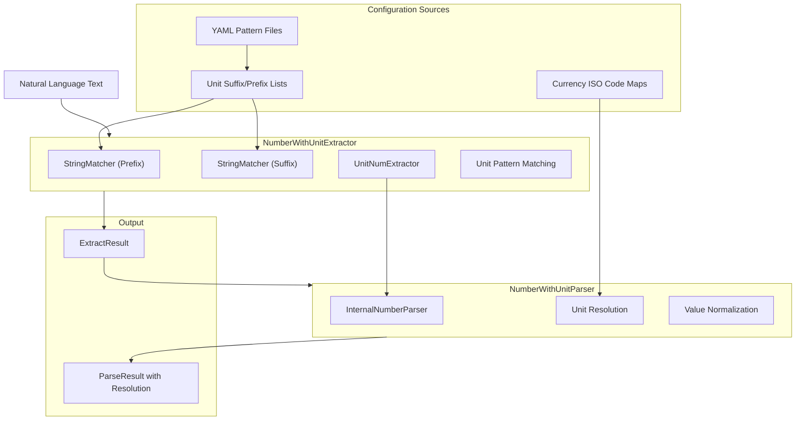
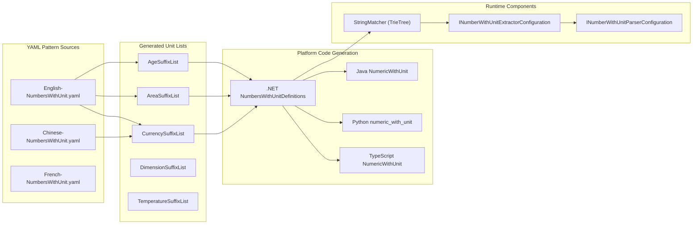
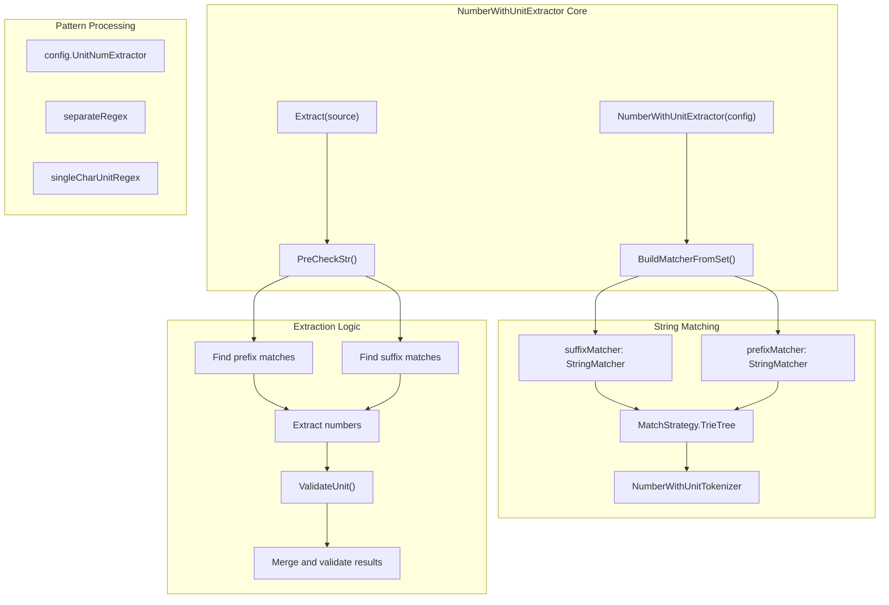

<!-- source: DeepWiki mcp.deepwiki.com · repo microsoft/Recognizers-Text · page 2.3 NumberWithUnit Recognition · fetched 2026-10-26 -->

# NumberWithUnit Recognition

Relevant source files

The following files were used as context for generating this wiki page:

- [.NET/Microsoft.Recognizers.Definitions.Common/Chinese/NumbersDefinitions.cs](.NET/Microsoft.Recognizers.Definitions.Common/Chinese/NumbersDefinitions.cs)
- [.NET/Microsoft.Recognizers.Definitions.Common/Chinese/NumbersWithUnitDefinitions.cs](.NET/Microsoft.Recognizers.Definitions.Common/Chinese/NumbersWithUnitDefinitions.cs)
- [.NET/Microsoft.Recognizers.Definitions.Common/English/NumbersWithUnitDefinitions.cs](.NET/Microsoft.Recognizers.Definitions.Common/English/NumbersWithUnitDefinitions.cs)
- [.NET/Microsoft.Recognizers.Text.NumberWithUnit/English/Extractors/DimensionExtractorConfiguration.cs](.NET/Microsoft.Recognizers.Text.NumberWithUnit/English/Extractors/DimensionExtractorConfiguration.cs)
- [.NET/Microsoft.Recognizers.Text.NumberWithUnit/English/Parsers/DimensionParserConfiguration.cs](.NET/Microsoft.Recognizers.Text.NumberWithUnit/English/Parsers/DimensionParserConfiguration.cs)
- [.NET/Microsoft.Recognizers.Text.NumberWithUnit/Extractors/NumberWithUnitExtractor.cs](.NET/Microsoft.Recognizers.Text.NumberWithUnit/Extractors/NumberWithUnitExtractor.cs)
- [.NET/Microsoft.Recognizers.Text.NumberWithUnit/Extractors/PrefixUnitResult.cs](.NET/Microsoft.Recognizers.Text.NumberWithUnit/Extractors/PrefixUnitResult.cs)
- [.NET/Microsoft.Recognizers.Text.NumberWithUnit/Microsoft.Recognizers.Text.NumberWithUnit.xml](.NET/Microsoft.Recognizers.Text.NumberWithUnit/Microsoft.Recognizers.Text.NumberWithUnit.xml)
- [.NET/Microsoft.Recognizers.Text.NumberWithUnit/Parsers/NumberWithUnitParser.cs](.NET/Microsoft.Recognizers.Text.NumberWithUnit/Parsers/NumberWithUnitParser.cs)
- [.NET/Microsoft.Recognizers.Text.NumberWithUnit/Utilities/StringComparer.cs](.NET/Microsoft.Recognizers.Text.NumberWithUnit/Utilities/StringComparer.cs)
- [.NET/Microsoft.Recognizers.Text.Sequence/Microsoft.Recognizers.Text.Sequence.xml](.NET/Microsoft.Recognizers.Text.Sequence/Microsoft.Recognizers.Text.Sequence.xml)
- [Java/libraries/recognizers-text-number-with-unit/src/main/java/com/microsoft/recognizers/text/numberwithunit/resources/ChineseNumericWithUnit.java](Java/libraries/recognizers-text-number-with-unit/src/main/java/com/microsoft/recognizers/text/numberwithunit/resources/ChineseNumericWithUnit.java)
- [Java/libraries/recognizers-text-number-with-unit/src/main/java/com/microsoft/recognizers/text/numberwithunit/resources/EnglishNumericWithUnit.java](Java/libraries/recognizers-text-number-with-unit/src/main/java/com/microsoft/recognizers/text/numberwithunit/resources/EnglishNumericWithUnit.java)
- [Java/libraries/recognizers-text-number-with-unit/src/main/java/com/microsoft/recognizers/text/numberwithunit/resources/FrenchNumericWithUnit.java](Java/libraries/recognizers-text-number-with-unit/src/main/java/com/microsoft/recognizers/text/numberwithunit/resources/FrenchNumericWithUnit.java)
- [Java/libraries/recognizers-text-number/src/main/java/com/microsoft/recognizers/text/number/resources/ChineseNumeric.java](Java/libraries/recognizers-text-number/src/main/java/com/microsoft/recognizers/text/number/resources/ChineseNumeric.java)
- [JavaScript/packages/recognizers-number-with-unit/src/resources/chineseNumericWithUnit.ts](JavaScript/packages/recognizers-number-with-unit/src/resources/chineseNumericWithUnit.ts)
- [JavaScript/packages/recognizers-number-with-unit/src/resources/englishNumericWithUnit.ts](JavaScript/packages/recognizers-number-with-unit/src/resources/englishNumericWithUnit.ts)
- [JavaScript/packages/recognizers-number-with-unit/src/resources/frenchNumericWithUnit.ts](JavaScript/packages/recognizers-number-with-unit/src/resources/frenchNumericWithUnit.ts)
- [JavaScript/packages/recognizers-number/src/resources/chineseNumeric.ts](JavaScript/packages/recognizers-number/src/resources/chineseNumeric.ts)
- [Patterns/Chinese/Chinese-Numbers.yaml](Patterns/Chinese/Chinese-Numbers.yaml)
- [Patterns/Chinese/Chinese-NumbersWithUnit.yaml](Patterns/Chinese/Chinese-NumbersWithUnit.yaml)
- [Patterns/English/English-NumbersWithUnit.yaml](Patterns/English/English-NumbersWithUnit.yaml)
- [Python/libraries/recognizers-number-with-unit/recognizers_number_with_unit/resources/chinese_numeric_with_unit.py](Python/libraries/recognizers-number-with-unit/recognizers_number_with_unit/resources/chinese_numeric_with_unit.py)
- [Python/libraries/recognizers-number-with-unit/recognizers_number_with_unit/resources/english_numeric_with_unit.py](Python/libraries/recognizers-number-with-unit/recognizers_number_with_unit/resources/english_numeric_with_unit.py)
- [Python/libraries/recognizers-number-with-unit/recognizers_number_with_unit/resources/french_numeric_with_unit.py](Python/libraries/recognizers-number-with-unit/recognizers_number_with_unit/resources/french_numeric_with_unit.py)
- [Python/libraries/recognizers-number/recognizers_number/resources/chinese_numeric.py](Python/libraries/recognizers-number/recognizers_number/resources/chinese_numeric.py)
- [Specs/Number/Chinese/NumberModel.json](Specs/Number/Chinese/NumberModel.json)
- [Specs/Number/Chinese/NumberRangeModel.json](Specs/Number/Chinese/NumberRangeModel.json)
- [Specs/Number/Chinese/PercentModel.json](Specs/Number/Chinese/PercentModel.json)
- [Specs/NumberWithUnit/Chinese/CurrencyModel.json](Specs/NumberWithUnit/Chinese/CurrencyModel.json)
- [Specs/NumberWithUnit/Chinese/DimensionModel.json](Specs/NumberWithUnit/Chinese/DimensionModel.json)
- [Specs/NumberWithUnit/English/CurrencyModel.json](Specs/NumberWithUnit/English/CurrencyModel.json)
- [Specs/NumberWithUnit/English/DimensionModel.json](Specs/NumberWithUnit/English/DimensionModel.json)
- [Specs/NumberWithUnit/English/TemperatureModel.json](Specs/NumberWithUnit/English/TemperatureModel.json)

NumberWithUnit Recognition identifies and extracts numerical values that are associated with specific units of measurement from natural language text. This system recognizes entities such as currency amounts ("$50 million"), physical dimensions ("200lbs", "3-inch"), temperatures ("40°C"), ages ("25 years old"), and areas ("5 square meters").

For basic number recognition without units, see [Number Recognition](#2.2). For sequence recognition of structured patterns, see [Sequence Recognition](#2.4).

## Supported Entity Types

NumberWithUnit Recognition supports five main categories of units across multiple languages:

| Entity Type | Examples | Unit Categories |
|-------------|----------|-----------------|
| **Currency** | "$75 million", "€100", "¥500" | Dollars, Euros, Yen, Pounds, and 100+ world currencies |
| **Dimensions** | "200lbs", "3-inch", "75ml", "2.5 miles" | Weight, Length, Volume, Area, Speed, Information |
| **Temperature** | "40°C", "98.6°F", "273K" | Celsius, Fahrenheit, Kelvin |
| **Age** | "25 years old", "3 months old", "5-year-old" | Years, months, weeks, days |
| **Area** | "5 sq meters", "2 acres", "100 km²" | Square units, hectares, acres |

Sources: [Patterns/English/English-NumbersWithUnit.yaml:1-1600](), [Specs/NumberWithUnit/English/DimensionModel.json:1-50](), [Specs/NumberWithUnit/English/CurrencyModel.json:1-50]()

## Architecture Overview

The NumberWithUnit recognition system follows the standard extractor-parser pipeline used throughout Microsoft Recognizers Text:

**NumberWithUnit Extraction and Parsing Pipeline**

Sources: [.NET/Microsoft.Recognizers.Text.NumberWithUnit/Extractors/NumberWithUnitExtractor.cs:15-60](), [.NET/Microsoft.Recognizers.Text.NumberWithUnit/Parsers/NumberWithUnitParser.cs:14-50]()

## Pattern Definition and Code Generation

NumberWithUnit patterns are defined in YAML files and automatically generated into platform-specific code. Each unit type has dedicated suffix and prefix lists that define the textual patterns to recognize:

**Pattern Definition to Runtime Components**

### Currency Configuration Example

Currency recognition includes comprehensive support for world currencies with ISO code mapping:

| Currency | Pattern Examples | ISO Code |
|----------|------------------|----------|
| US Dollar | `dollars\|dollar\|$` | USD |
| Euro | `euros\|euro\|€\|eur` | EUR |
| British Pound | `pounds\|pound\|£` | GBP |
| Chinese Yuan | `yuan\|kuai\|chinese yuan\|rmb\|￥\|元` | CNY |
| Japanese Yen | `japanese yen\|jpy\|yen\|¥\|yens` | JPY |

Sources: [Patterns/English/English-NumbersWithUnit.yaml:40-580](), [.NET/Microsoft.Recognizers.Definitions.Common/English/NumbersWithUnitDefinitions.cs:59-600]()

## Extractor Implementation

The `NumberWithUnitExtractor` uses `StringMatcher` with `TrieTree` strategy for efficient pattern matching:

**NumberWithUnitExtractor Processing Flow**

Sources: [.NET/Microsoft.Recognizers.Text.NumberWithUnit/Extractors/NumberWithUnitExtractor.cs:31-120]()

## Parser Implementation and Value Resolution

The `NumberWithUnitParser` resolves extracted text into structured values with normalized units:

| Resolution Property | Description | Example |
|-------------------|-------------|---------|
| `value` | Normalized numeric value | "75000000" |
| `unit` | Canonical unit name | "Dollar" |
| `subtype` | Unit category (dimensions only) | "Weight", "Length", "Volume" |
| `isoCurrency` | ISO currency code | "USD", "EUR", "CNY" |

### Parser Processing Steps

1. **Number Extraction**: Parse the numeric component using `InternalNumberParser`
2. **Unit Key Building**: Extract unit text separate from numbers
3. **Unit Resolution**: Map unit text to canonical unit names
4. **Value Normalization**: Convert to standard numeric representation
5. **ISO Code Mapping**: Add currency codes for financial units

Sources: [.NET/Microsoft.Recognizers.Text.NumberWithUnit/Parsers/NumberWithUnitParser.cs:40-120]()

## Language-Specific Implementations

NumberWithUnit recognition supports multiple languages with culturally appropriate unit patterns:

### English
- Comprehensive coverage of all unit types
- Imperial and metric units
- Informal currency expressions ("bucks", "quid")

### Chinese  
- Traditional and simplified characters
- Chinese-specific units (斤, 两, 里)
- Currency in yuan/kuai/rmb variants
- CJK number integration

### Multi-Language Unit Examples

| Unit Type | English | Chinese | 
|-----------|---------|---------|
| Currency | "dollars", "$", "USD" | "元", "人民币", "rmb" |
| Weight | "pounds", "lbs", "kg" | "斤", "公斤", "克" |
| Length | "meters", "feet", "miles" | "米", "公里", "英尺" |

Sources: [Patterns/English/English-NumbersWithUnit.yaml:1-1600](), [Patterns/Chinese/Chinese-NumbersWithUnit.yaml:1-600](), [Python/libraries/recognizers-number-with-unit/recognizers_number_with_unit/resources/chinese_numeric_with_unit.py:16-100]()

## Advanced Features

### Compound Unit Support
Recognition of complex unit expressions:
- "5 feet 2 inches" → `5.166666666666667 Foot`
- "1 hour 30 minutes" → Time duration parsing
- "3 tablespoons butter" → Volume measurements

### Currency Conflict Resolution
Special handling for currencies that can appear as both prefix and suffix:
- Chinese: "$20，300美圆" splits into "$20" and "300美圆"
- Prevents incorrect parsing of comma-separated values

### Ambiguous Unit Handling
Built-in disambiguation for units with multiple meanings:
- "mo" can be months or other abbreviations
- "yo" can be years old or other contexts
- Context-aware filtering using `AmbiguousUnitList`

Sources: [.NET/Microsoft.Recognizers.Text.NumberWithUnit/Extractors/NumberWithUnitExtractor.cs:100-140](), [Patterns/English/English-NumbersWithUnit.yaml:14-18]()

---

