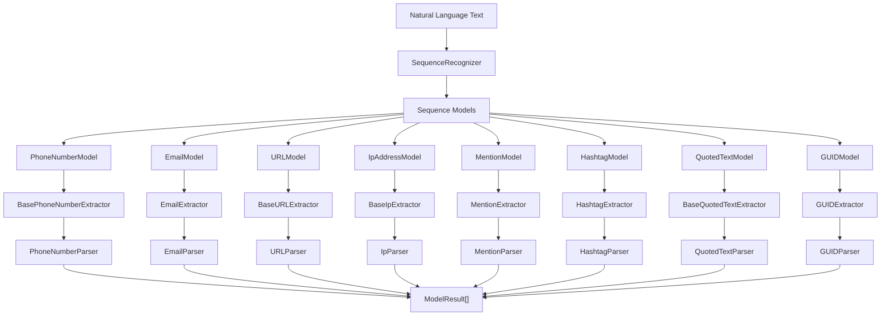
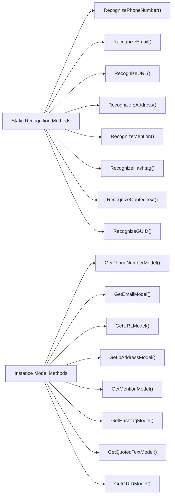
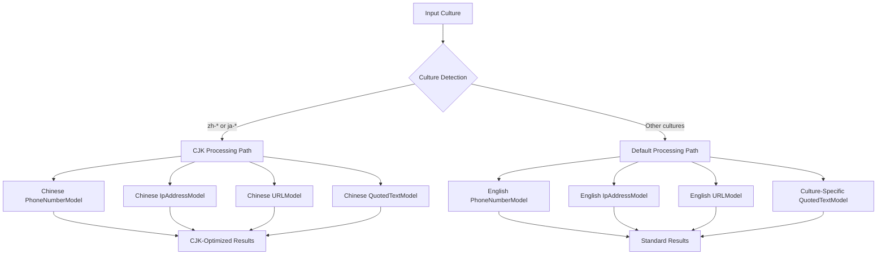

<!-- source: DeepWiki mcp.deepwiki.com · repo microsoft/Recognizers-Text · page 2.4 Sequence Recognition · fetched 2026-10-26 -->

# Sequence Recognition

<details>
<summary>Relevant source files</summary>

The following files were used as context for generating this wiki page:

- [.NET/Microsoft.Recognizers.Definitions.Common/Swedish/QuotedTextDefinitions.cs](.NET/Microsoft.Recognizers.Definitions.Common/Swedish/QuotedTextDefinitions.cs)
- [.NET/Microsoft.Recognizers.Definitions.Common/packages.config](.NET/Microsoft.Recognizers.Definitions.Common/packages.config)
- [.NET/Microsoft.Recognizers.Text.DataDrivenTests/Number/TestNumber_Chinese.cs](.NET/Microsoft.Recognizers.Text.DataDrivenTests/Number/TestNumber_Chinese.cs)
- [.NET/Microsoft.Recognizers.Text.DataDrivenTests/Number/TestNumber_Dutch.cs](.NET/Microsoft.Recognizers.Text.DataDrivenTests/Number/TestNumber_Dutch.cs)
- [.NET/Microsoft.Recognizers.Text.DataDrivenTests/Number/TestNumber_French.cs](.NET/Microsoft.Recognizers.Text.DataDrivenTests/Number/TestNumber_French.cs)
- [.NET/Microsoft.Recognizers.Text.DataDrivenTests/Number/TestNumber_German.cs](.NET/Microsoft.Recognizers.Text.DataDrivenTests/Number/TestNumber_German.cs)
- [.NET/Microsoft.Recognizers.Text.DataDrivenTests/Number/TestNumber_Italian.cs](.NET/Microsoft.Recognizers.Text.DataDrivenTests/Number/TestNumber_Italian.cs)
- [.NET/Microsoft.Recognizers.Text.DataDrivenTests/Number/TestNumber_Japanese.cs](.NET/Microsoft.Recognizers.Text.DataDrivenTests/Number/TestNumber_Japanese.cs)
- [.NET/Microsoft.Recognizers.Text.DataDrivenTests/Number/TestNumber_Korean.cs](.NET/Microsoft.Recognizers.Text.DataDrivenTests/Number/TestNumber_Korean.cs)
- [.NET/Microsoft.Recognizers.Text.DataDrivenTests/Number/TestNumber_Spanish.cs](.NET/Microsoft.Recognizers.Text.DataDrivenTests/Number/TestNumber_Spanish.cs)
- [.NET/Microsoft.Recognizers.Text.DateTime/DateTimeRecognizer.cs](.NET/Microsoft.Recognizers.Text.DateTime/DateTimeRecognizer.cs)
- [.NET/Microsoft.Recognizers.Text.Number/Italian/Extractors/NumberRangeExtractor.cs](.NET/Microsoft.Recognizers.Text.Number/Italian/Extractors/NumberRangeExtractor.cs)
- [.NET/Microsoft.Recognizers.Text.Number/Italian/Parsers/ItalianNumberRangeParserConfiguration.cs](.NET/Microsoft.Recognizers.Text.Number/Italian/Parsers/ItalianNumberRangeParserConfiguration.cs)
- [.NET/Microsoft.Recognizers.Text.Number/NumberRecognizer.cs](.NET/Microsoft.Recognizers.Text.Number/NumberRecognizer.cs)
- [.NET/Microsoft.Recognizers.Text.NumberWithUnit/Japanese/Extractors/TemperatureExtractorConfiguration.cs](.NET/Microsoft.Recognizers.Text.NumberWithUnit/Japanese/Extractors/TemperatureExtractorConfiguration.cs)
- [.NET/Microsoft.Recognizers.Text.NumberWithUnit/Japanese/Parsers/TemperatureParserConfiguration.cs](.NET/Microsoft.Recognizers.Text.NumberWithUnit/Japanese/Parsers/TemperatureParserConfiguration.cs)
- [.NET/Microsoft.Recognizers.Text.NumberWithUnit/NumberWithUnitRecognizer.cs](.NET/Microsoft.Recognizers.Text.NumberWithUnit/NumberWithUnitRecognizer.cs)
- [.NET/Microsoft.Recognizers.Text.Sequence/SequenceRecognizer.cs](.NET/Microsoft.Recognizers.Text.Sequence/SequenceRecognizer.cs)
- [.NET/Microsoft.Recognizers.Text/Recognizer.cs](.NET/Microsoft.Recognizers.Text/Recognizer.cs)
- [Java/README.md](Java/README.md)
- [Java/libraries/recognizers-text-date-time/pom.xml](Java/libraries/recognizers-text-date-time/pom.xml)
- [Java/libraries/recognizers-text/src/main/java/com/microsoft/recognizers/text/utilities/StringUtility.java](Java/libraries/recognizers-text/src/main/java/com/microsoft/recognizers/text/utilities/StringUtility.java)
- [Java/libraries/resource-generator/pom.xml](Java/libraries/resource-generator/pom.xml)
- [Java/linting-excluded-files.xml](Java/linting-excluded-files.xml)
- [Java/linting-rules.xml](Java/linting-rules.xml)
- [Java/pom.xml](Java/pom.xml)
- [Java/samples/simple-console/pom.xml](Java/samples/simple-console/pom.xml)
- [Java/samples/simple-console/src/main/java/com/microsoft/recognizers/text/samples/simpleconsole/Sample.java](Java/samples/simple-console/src/main/java/com/microsoft/recognizers/text/samples/simpleconsole/Sample.java)
- [Java/tests/pom.xml](Java/tests/pom.xml)
- [Specs/Number/German/OrdinalModel.json](Specs/Number/German/OrdinalModel.json)
- [Specs/Number/German/OrdinalModelEnablePreview.json](Specs/Number/German/OrdinalModelEnablePreview.json)
- [Specs/Number/Italian/NumberRangeModel.json](Specs/Number/Italian/NumberRangeModel.json)

</details>


## Purpose and Scope

Sequence Recognition identifies structured text patterns that follow specific formats, such as phone numbers, email addresses, URLs, IP addresses, and social media elements like mentions and hashtags. This system handles sequences that have predictable structural patterns but may vary in their exact representation across different languages and regions.

For number-based entity recognition, see [Number Recognition](#2.2). For date and time sequences, see [DateTime Recognition](#2.1). For boolean and choice sequences, see [Choice Recognition](#2.5).

## Supported Sequence Types

The sequence recognition system identifies eight primary sequence types:

| Sequence Type | Examples | Primary Use Cases |
|---------------|----------|-------------------|
| Phone Numbers | `(555) 123-4567`, `+1-555-123-4567` | Contact information extraction |
| Email Addresses | `user@domain.com`, `test.email+tag@example.org` | Communication data processing |
| URLs | `https://example.com`, `www.microsoft.com` | Link detection and validation |
| IP Addresses | `192.168.1.1`, `2001:db8::1` | Network configuration parsing |
| Mentions | `@username`, `@user_name` | Social media content analysis |
| Hashtags | `#hashtag`, `#multi_word_tag` | Content categorization |
| Quoted Text | `"quoted content"`, `'single quotes'` | Text extraction from documents |
| GUIDs | `{12345678-1234-5678-9012-123456789012}` | Identifier recognition |

Sources: [.NET/Microsoft.Recognizers.Text.Sequence/SequenceRecognizer.cs:49-87](), [Java/samples/simple-console/src/main/java/com/microsoft/recognizers/text/samples/simpleconsole/Sample.java:104-130]()

## Architecture Overview

### Core Recognition Pipeline



Sources: [.NET/Microsoft.Recognizers.Text.Sequence/SequenceRecognizer.cs:155-341]()

### Recognition API Structure



Sources: [.NET/Microsoft.Recognizers.Text.Sequence/SequenceRecognizer.cs:49-153]()

## Language Support and Fallback Strategy

The sequence recognition system implements a sophisticated language fallback strategy where certain sequence types use English patterns as defaults while others have language-specific implementations:

### Language-Specific vs Universal Patterns

| Sequence Type | Language Support | Fallback Strategy |
|---------------|------------------|-------------------|
| Phone Numbers | English, Chinese, Portuguese, Spanish, Dutch, French, German, Hindi, Italian, Korean, Turkish | Language-specific patterns with regional formatting |
| IP Addresses | English, Chinese | English default with CJK support |
| Email Addresses | English only | Universal English patterns |
| URLs | English, Chinese | English default with CJK domain support |
| Mentions | English only | Universal @ symbol pattern |
| Hashtags | English only | Universal # symbol pattern |
| GUIDs | English only | Universal format pattern |
| Quoted Text | Multi-language | Language-specific quote characters |

### Cultural Context Handling



Sources: [.NET/Microsoft.Recognizers.Text.Sequence/SequenceRecognizer.cs:91-147]()

## Implementation Details

### Model Registration Pattern

The `SequenceRecognizer` follows the standard recognizer pattern by registering models for each supported culture in the `InitializeConfiguration()` method. Each model combines an extractor and parser specific to the sequence type:

```csharp
RegisterModel<PhoneNumberModel>(
    Culture.English,
    (options) => new PhoneNumberModel(
        new PhoneNumberParser(),
        new BasePhoneNumberExtractor(new EnglishPhoneNumberExtractorConfiguration(options))));
```

Sources: [.NET/Microsoft.Recognizers.Text.Sequence/SequenceRecognizer.cs:157-161]()

### Configuration-Based Extraction

Most sequence extractors use configuration classes that define language-specific patterns and validation rules. For example, phone number extraction uses configurations like:

- `EnglishPhoneNumberExtractorConfiguration`
- `ChinesePhoneNumberExtractorConfiguration`
- `PortuguesePhoneNumberExtractorConfiguration`

These configurations contain regular expressions and validation logic specific to each language's formatting conventions.

Sources: [.NET/Microsoft.Recognizers.Text.Sequence/SequenceRecognizer.cs:157-221]()

### Multi-Platform Consistency

The sequence recognition system maintains consistent APIs across all supported platforms:

```mermaid
graph TB
    subgraph ".NET Implementation"
        NetSequenceRecognizer["SequenceRecognizer"]
        NetModels["PhoneNumberModel, EmailModel, etc."]
        NetExtractors["BasePhoneNumberExtractor, etc."]
    end
    
    subgraph "Java Implementation"  
        JavaSequenceRecognizer["SequenceRecognizer"]
        JavaModels["PhoneNumberModel, EmailModel, etc."]
        JavaExtractors["BasePhoneNumberExtractor, etc."]
    end
    
    subgraph "JavaScript Implementation"
        JSSequenceRecognizer["SequenceRecognizer"]
        JSModels["PhoneNumberModel, EmailModel, etc."]
        JSExtractors["BasePhoneNumberExtractor, etc."]
    end
    
    subgraph "Python Implementation"
        PySequenceRecognizer["SequenceRecognizer"]
        PyModels["PhoneNumberModel, EmailModel, etc."]
        PyExtractors["BasePhoneNumberExtractor, etc."]
    end
    
    SharedPatterns["Shared YAML Pattern Definitions"] --> NetSequenceRecognizer
    SharedPatterns --> JavaSequenceRecognizer
    SharedPatterns --> JSSequenceRecognizer
    SharedPatterns --> PySequenceRecognizer
```



Sources: [Java/libraries/resource-generator/pom.xml:64](), [Java/samples/simple-console/pom.xml:70-72](), [Java/tests/pom.xml:86-90]()

### Usage Patterns

The sequence recognizer supports both static and instance-based usage patterns:

**Static Usage (Recommended for single calls):**
```java
List<ModelResult> phoneResults = SequenceRecognizer.recognizePhoneNumber(
    "Call me at (555) 123-4567", Culture.English);
```

**Instance Usage (Recommended for multiple calls with same culture):**
```java
SequenceRecognizer recognizer = new SequenceRecognizer(Culture.English);
IModel phoneModel = recognizer.getPhoneNumberModel();
List<ModelResult> results = phoneModel.parse("Call me at (555) 123-4567");
```

Sources: [Java/samples/simple-console/src/main/java/com/microsoft/recognizers/text/samples/simpleconsole/Sample.java:106-130]()

---

