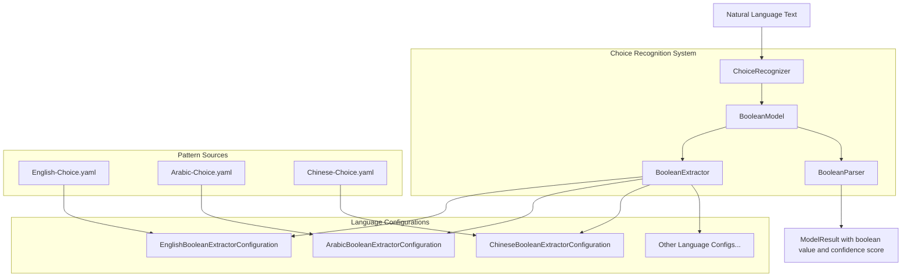
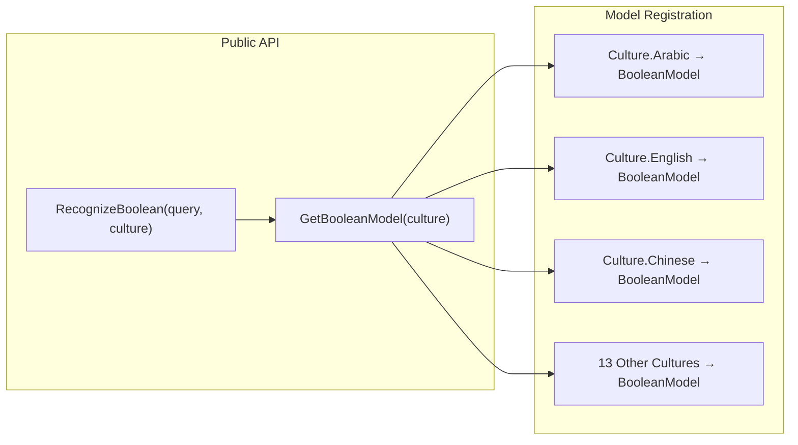
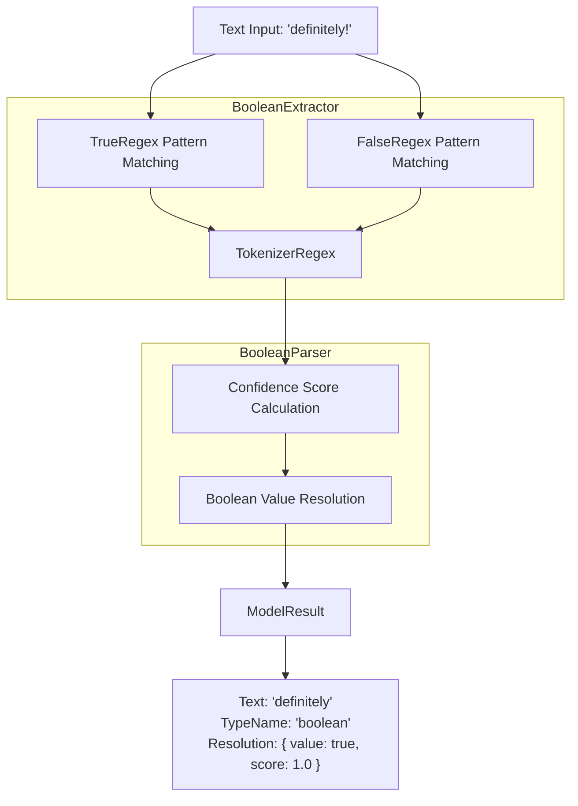
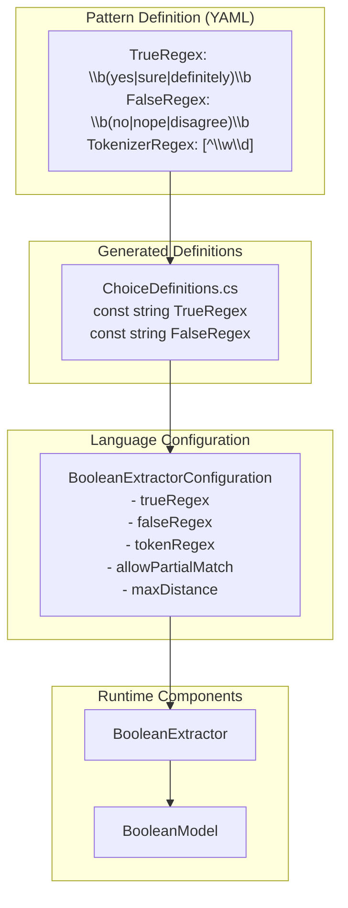
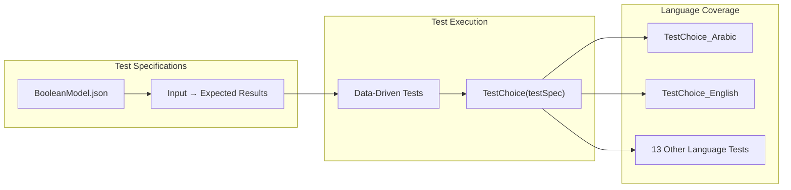

<!-- source: DeepWiki mcp.deepwiki.com · repo microsoft/Recognizers-Text · page 2.5 Choice Recognition · fetched 2026-10-26 -->

# Choice Recognition

<details>
<summary>Relevant source files</summary>

The following files were used as context for generating this wiki page:

- [.NET/Microsoft.Recognizers.Definitions.Common/Arabic/ChoiceDefinitions.cs](.NET/Microsoft.Recognizers.Definitions.Common/Arabic/ChoiceDefinitions.cs)
- [.NET/Microsoft.Recognizers.Definitions.Common/Arabic/ChoiceDefinitions.tt](.NET/Microsoft.Recognizers.Definitions.Common/Arabic/ChoiceDefinitions.tt)
- [.NET/Microsoft.Recognizers.Definitions.Common/Microsoft.Recognizers.Definitions.Common.csproj](.NET/Microsoft.Recognizers.Definitions.Common/Microsoft.Recognizers.Definitions.Common.csproj)
- [.NET/Microsoft.Recognizers.Definitions/Microsoft.Recognizers.Definitions.csproj](.NET/Microsoft.Recognizers.Definitions/Microsoft.Recognizers.Definitions.csproj)
- [.NET/Microsoft.Recognizers.Text.Choice/Arabic/Extractors/ArabicBooleanExtractorConfiguration.cs](.NET/Microsoft.Recognizers.Text.Choice/Arabic/Extractors/ArabicBooleanExtractorConfiguration.cs)
- [.NET/Microsoft.Recognizers.Text.Choice/ChoiceRecognizer.cs](.NET/Microsoft.Recognizers.Text.Choice/ChoiceRecognizer.cs)
- [.NET/Microsoft.Recognizers.Text.Choice/Microsoft.Recognizers.Text.Choice.csproj](.NET/Microsoft.Recognizers.Text.Choice/Microsoft.Recognizers.Text.Choice.csproj)
- [.NET/Microsoft.Recognizers.Text.DataDrivenTests/Choice/TestChoice_Arabic.cs](.NET/Microsoft.Recognizers.Text.DataDrivenTests/Choice/TestChoice_Arabic.cs)
- [.NET/Microsoft.Recognizers.Text.DataDrivenTests/Microsoft.Recognizers.Text.DataDrivenTests.csproj](.NET/Microsoft.Recognizers.Text.DataDrivenTests/Microsoft.Recognizers.Text.DataDrivenTests.csproj)
- [.NET/Microsoft.Recognizers.Text.DataDrivenTests/Number/TestNumber_Chinese.cs](.NET/Microsoft.Recognizers.Text.DataDrivenTests/Number/TestNumber_Chinese.cs)
- [.NET/Microsoft.Recognizers.Text.DataDrivenTests/Number/TestNumber_Dutch.cs](.NET/Microsoft.Recognizers.Text.DataDrivenTests/Number/TestNumber_Dutch.cs)
- [.NET/Microsoft.Recognizers.Text.DataDrivenTests/Number/TestNumber_French.cs](.NET/Microsoft.Recognizers.Text.DataDrivenTests/Number/TestNumber_French.cs)
- [.NET/Microsoft.Recognizers.Text.DataDrivenTests/Number/TestNumber_German.cs](.NET/Microsoft.Recognizers.Text.DataDrivenTests/Number/TestNumber_German.cs)
- [.NET/Microsoft.Recognizers.Text.DataDrivenTests/Number/TestNumber_Italian.cs](.NET/Microsoft.Recognizers.Text.DataDrivenTests/Number/TestNumber_Italian.cs)
- [.NET/Microsoft.Recognizers.Text.DataDrivenTests/Number/TestNumber_Japanese.cs](.NET/Microsoft.Recognizers.Text.DataDrivenTests/Number/TestNumber_Japanese.cs)
- [.NET/Microsoft.Recognizers.Text.DataDrivenTests/Number/TestNumber_Korean.cs](.NET/Microsoft.Recognizers.Text.DataDrivenTests/Number/TestNumber_Korean.cs)
- [.NET/Microsoft.Recognizers.Text.DataDrivenTests/Number/TestNumber_Spanish.cs](.NET/Microsoft.Recognizers.Text.DataDrivenTests/Number/TestNumber_Spanish.cs)
- [.NET/Microsoft.Recognizers.Text.DataTypes.DataDrivenTests/Microsoft.Recognizers.Text.DataTypes.DataDrivenTests.csproj](.NET/Microsoft.Recognizers.Text.DataTypes.DataDrivenTests/Microsoft.Recognizers.Text.DataTypes.DataDrivenTests.csproj)
- [.NET/Microsoft.Recognizers.Text.DataTypes.TimexExpression/Microsoft.Recognizers.Text.DataTypes.TimexExpression.csproj](.NET/Microsoft.Recognizers.Text.DataTypes.TimexExpression/Microsoft.Recognizers.Text.DataTypes.TimexExpression.csproj)
- [.NET/Microsoft.Recognizers.Text.DateTime/DateTimeRecognizer.cs](.NET/Microsoft.Recognizers.Text.DateTime/DateTimeRecognizer.cs)
- [.NET/Microsoft.Recognizers.Text.DateTime/Microsoft.Recognizers.Text.DateTime.csproj](.NET/Microsoft.Recognizers.Text.DateTime/Microsoft.Recognizers.Text.DateTime.csproj)
- [.NET/Microsoft.Recognizers.Text.Number/Italian/Extractors/NumberRangeExtractor.cs](.NET/Microsoft.Recognizers.Text.Number/Italian/Extractors/NumberRangeExtractor.cs)
- [.NET/Microsoft.Recognizers.Text.Number/Italian/Parsers/ItalianNumberRangeParserConfiguration.cs](.NET/Microsoft.Recognizers.Text.Number/Italian/Parsers/ItalianNumberRangeParserConfiguration.cs)
- [.NET/Microsoft.Recognizers.Text.Number/Microsoft.Recognizers.Text.Number.csproj](.NET/Microsoft.Recognizers.Text.Number/Microsoft.Recognizers.Text.Number.csproj)
- [.NET/Microsoft.Recognizers.Text.Number/NumberRecognizer.cs](.NET/Microsoft.Recognizers.Text.Number/NumberRecognizer.cs)
- [.NET/Microsoft.Recognizers.Text.NumberWithUnit/Microsoft.Recognizers.Text.NumberWithUnit.csproj](.NET/Microsoft.Recognizers.Text.NumberWithUnit/Microsoft.Recognizers.Text.NumberWithUnit.csproj)
- [.NET/Microsoft.Recognizers.Text.NumberWithUnit/NumberWithUnitRecognizer.cs](.NET/Microsoft.Recognizers.Text.NumberWithUnit/NumberWithUnitRecognizer.cs)
- [.NET/Microsoft.Recognizers.Text.Sequence/Microsoft.Recognizers.Text.Sequence.csproj](.NET/Microsoft.Recognizers.Text.Sequence/Microsoft.Recognizers.Text.Sequence.csproj)
- [.NET/Microsoft.Recognizers.Text.Sequence/SequenceRecognizer.cs](.NET/Microsoft.Recognizers.Text.Sequence/SequenceRecognizer.cs)
- [.NET/Microsoft.Recognizers.Text.sln](.NET/Microsoft.Recognizers.Text.sln)
- [.NET/Microsoft.Recognizers.Text/Culture.cs](.NET/Microsoft.Recognizers.Text/Culture.cs)
- [.NET/Microsoft.Recognizers.Text/Microsoft.Recognizers.Text.csproj](.NET/Microsoft.Recognizers.Text/Microsoft.Recognizers.Text.csproj)
- [.NET/Microsoft.Recognizers.Text/Recognizer.cs](.NET/Microsoft.Recognizers.Text/Recognizer.cs)
- [.NET/Samples/SimpleConsole/SimpleConsole.csproj](.NET/Samples/SimpleConsole/SimpleConsole.csproj)
- [Patterns/Arabic/Arabic-Choice.yaml](Patterns/Arabic/Arabic-Choice.yaml)
- [Specs/Choice/Arabic/BooleanModel.json](Specs/Choice/Arabic/BooleanModel.json)
- [Specs/Number/German/OrdinalModel.json](Specs/Number/German/OrdinalModel.json)
- [Specs/Number/German/OrdinalModelEnablePreview.json](Specs/Number/German/OrdinalModelEnablePreview.json)
- [Specs/Number/Italian/NumberRangeModel.json](Specs/Number/Italian/NumberRangeModel.json)

</details>


Choice Recognition provides robust identification and resolution of boolean values and yes/no responses expressed in natural language across multiple languages. This includes explicit boolean terms, agreement expressions, and emoji representations of affirmative or negative responses.

For information about other entity types, see [Number Recognition](#2.2), [DateTime Recognition](#2.1), [NumberWithUnit Recognition](#2.3), and [Sequence Recognition](#2.4).

## Architecture Overview

Choice Recognition follows the standard Microsoft Recognizers Text pattern with extractors identifying potential boolean expressions and parsers converting them to structured results. The system supports 15 languages with culture-specific boolean expressions and scoring mechanisms.



**Sources:** [.NET/Microsoft.Recognizers.Text.Choice/ChoiceRecognizer.cs:1-131](), [.NET/Microsoft.Recognizers.Text.Choice/Microsoft.Recognizers.Text.Choice.csproj:1-60]()

## Core Components

### ChoiceRecognizer

The `ChoiceRecognizer` class serves as the main entry point for boolean recognition, inheriting from the base `Recognizer<ChoiceOptions>` class. It registers `BooleanModel` instances for each supported culture.



**Sources:** [.NET/Microsoft.Recognizers.Text.Choice/ChoiceRecognizer.cs:51-56](), [.NET/Microsoft.Recognizers.Text.Choice/ChoiceRecognizer.cs:73-128]()

### BooleanModel and Processing Pipeline

Each `BooleanModel` contains a `BooleanParser` and `BooleanExtractor` with language-specific configuration. The extractor identifies potential boolean expressions using regex patterns, while the parser converts them to structured results with confidence scores.



**Sources:** [.NET/Microsoft.Recognizers.Text.Choice/ChoiceRecognizer.cs:74-75](), [Specs/Choice/Arabic/BooleanModel.json:1-20]()

## Language Support

Choice Recognition supports 15 languages with culture-specific boolean expressions. Each language has its own extractor configuration defining true/false patterns and tokenization rules.

| Language | Culture Code | True Patterns Example | False Patterns Example |
|----------|-------------|----------------------|------------------------|
| English | en-us | yes, sure, definitely | no, nope, disagree |
| Arabic | ar-* | نعم, بالتأكيد, موافق | لا, ليس صحيح, غير موافق |
| Chinese | zh-cn | 是, 对, 好的 | 不, 错, 不对 |
| Spanish | es-es | sí, por supuesto | no, para nada |
| French | fr-fr | oui, certainement | non, pas du tout |

**Sources:** [.NET/Microsoft.Recognizers.Text.Choice/ChoiceRecognizer.cs:73-128](), [.NET/Microsoft.Recognizers.Definitions.Common/Arabic/ChoiceDefinitions.cs:27-28](), [Patterns/Arabic/Arabic-Choice.yaml:8-12]()

### Language Configuration Architecture



**Sources:** [Patterns/Arabic/Arabic-Choice.yaml:1-12](), [.NET/Microsoft.Recognizers.Definitions.Common/Arabic/ChoiceDefinitions.cs:24-29](), [.NET/Microsoft.Recognizers.Text.Choice/Arabic/Extractors/ArabicBooleanExtractorConfiguration.cs:10-23]()

## Recognition Patterns

Choice Recognition identifies several types of boolean expressions:

### Text-Based Patterns
- **Explicit Boolean Terms**: "yes", "no", "true", "false"
- **Agreement Expressions**: "sure", "definitely", "of course", "I agree"
- **Disagreement Expressions**: "nope", "not really", "I disagree"

### Emoji Support
- **Positive Emojis**: 👍 (thumbs up), 👌 (OK hand)
- **Negative Emojis**: 👎 (thumbs down), ✋ (raised hand), 🖐️ (raised hand with fingers splayed)
- **Skin Tone Variations**: Supports Unicode skin tone modifiers

### Confidence Scoring
The system provides confidence scores based on:
- Pattern specificity (exact matches score higher)
- Context length (shorter texts with clear boolean intent score higher)
- Ambiguity resolution (words that could be boolean or other types)

**Sources:** [.NET/Microsoft.Recognizers.Definitions.Common/Arabic/ChoiceDefinitions.cs:27-28](), [Specs/Choice/Arabic/BooleanModel.json:3-20]()

## Usage Examples

### Basic Recognition
```csharp
var results = ChoiceRecognizer.RecognizeBoolean("definitely!", "en-us");
// Returns: Text="definitely", TypeName="boolean", Resolution={ value=true, score=1.0 }
```

### Multi-Language Support
```csharp
var arabicResults = ChoiceRecognizer.RecognizeBoolean("بالتأكيد!", "ar-*");
// Returns: Text="بالتأكيد", TypeName="boolean", Resolution={ value=true, score=1.0 }
```

### Instance-Based Usage
```csharp
var recognizer = new ChoiceRecognizer("en-us", ChoiceOptions.None);
var model = recognizer.GetBooleanModel();
var results = model.Parse("I agree with that statement");
```

**Sources:** [.NET/Microsoft.Recognizers.Text.Choice/ChoiceRecognizer.cs:51-56](), [Specs/Choice/Arabic/BooleanModel.json:3-13]()

## Testing Framework

Choice Recognition uses comprehensive test specifications for validation across languages:



**Sources:** [.NET/Microsoft.Recognizers.Text.DataDrivenTests/Choice/TestChoice_Arabic.cs:8-20](), [Specs/Choice/Arabic/BooleanModel.json:1-200]()

---

