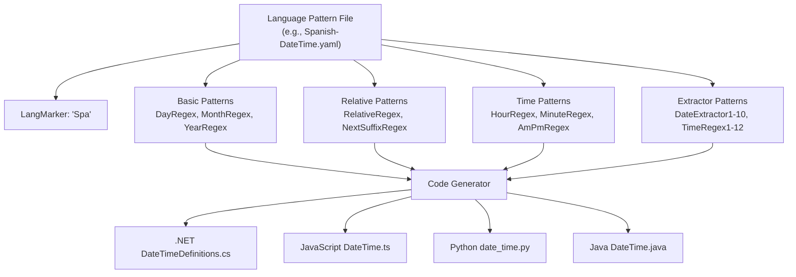
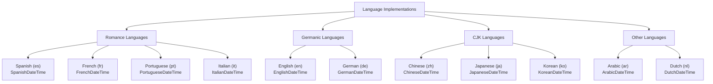
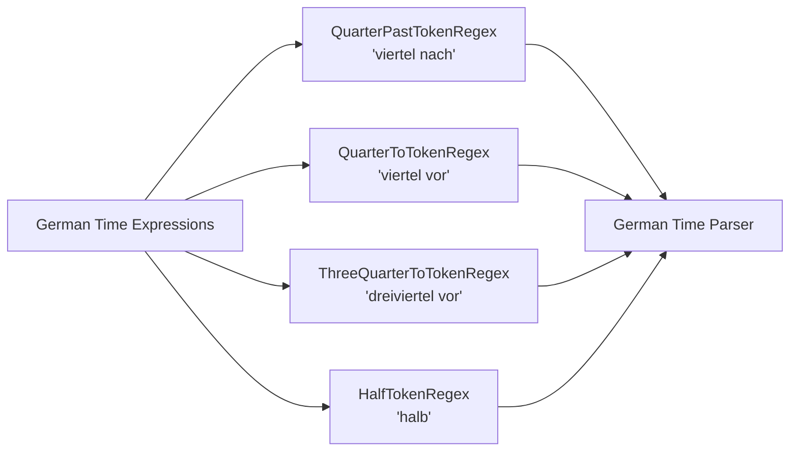
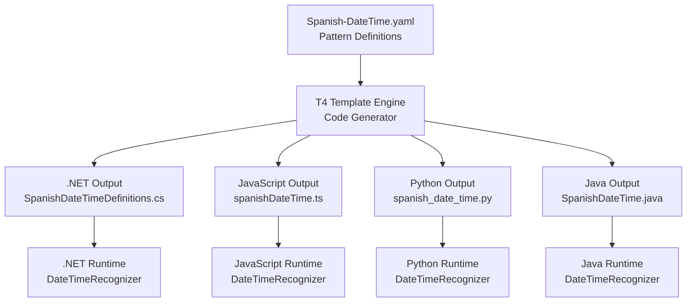

<!-- source: DeepWiki mcp.deepwiki.com · repo microsoft/Recognizers-Text · page 3 Language-Specific Implementations · fetched 2026-10-26 -->

# Language-Specific Implementations

<details>
<summary>Relevant source files</summary>

The following files were used as context for generating this wiki page:

- [.NET/Microsoft.Recognizers.Definitions.Common/French/DateTimeDefinitions.cs](.NET/Microsoft.Recognizers.Definitions.Common/French/DateTimeDefinitions.cs)
- [.NET/Microsoft.Recognizers.Definitions.Common/German/DateTimeDefinitions.cs](.NET/Microsoft.Recognizers.Definitions.Common/German/DateTimeDefinitions.cs)
- [.NET/Microsoft.Recognizers.Definitions.Common/Italian/DateTimeDefinitions.cs](.NET/Microsoft.Recognizers.Definitions.Common/Italian/DateTimeDefinitions.cs)
- [.NET/Microsoft.Recognizers.Definitions.Common/Portuguese/DateTimeDefinitions.cs](.NET/Microsoft.Recognizers.Definitions.Common/Portuguese/DateTimeDefinitions.cs)
- [.NET/Microsoft.Recognizers.Definitions.Common/Spanish/DateTimeDefinitions.cs](.NET/Microsoft.Recognizers.Definitions.Common/Spanish/DateTimeDefinitions.cs)
- [.NET/Microsoft.Recognizers.Text.DateTime/German/Parsers/GermanTimeParserConfiguration.cs](.NET/Microsoft.Recognizers.Text.DateTime/German/Parsers/GermanTimeParserConfiguration.cs)
- [Java/libraries/recognizers-text-date-time/src/main/java/com/microsoft/recognizers/text/datetime/german/parsers/GermanTimeParserConfiguration.java](Java/libraries/recognizers-text-date-time/src/main/java/com/microsoft/recognizers/text/datetime/german/parsers/GermanTimeParserConfiguration.java)
- [Java/libraries/recognizers-text-date-time/src/main/java/com/microsoft/recognizers/text/datetime/resources/FrenchDateTime.java](Java/libraries/recognizers-text-date-time/src/main/java/com/microsoft/recognizers/text/datetime/resources/FrenchDateTime.java)
- [Java/libraries/recognizers-text-date-time/src/main/java/com/microsoft/recognizers/text/datetime/resources/GermanDateTime.java](Java/libraries/recognizers-text-date-time/src/main/java/com/microsoft/recognizers/text/datetime/resources/GermanDateTime.java)
- [Java/libraries/recognizers-text-date-time/src/main/java/com/microsoft/recognizers/text/datetime/resources/PortugueseDateTime.java](Java/libraries/recognizers-text-date-time/src/main/java/com/microsoft/recognizers/text/datetime/resources/PortugueseDateTime.java)
- [Java/libraries/recognizers-text-date-time/src/main/java/com/microsoft/recognizers/text/datetime/resources/SpanishDateTime.java](Java/libraries/recognizers-text-date-time/src/main/java/com/microsoft/recognizers/text/datetime/resources/SpanishDateTime.java)
- [Java/libraries/recognizers-text-date-time/src/main/java/com/microsoft/recognizers/text/datetime/spanish/extractors/SpanishDatePeriodExtractorConfiguration.java](Java/libraries/recognizers-text-date-time/src/main/java/com/microsoft/recognizers/text/datetime/spanish/extractors/SpanishDatePeriodExtractorConfiguration.java)
- [Java/libraries/recognizers-text-number/src/main/java/com/microsoft/recognizers/text/number/spanish/extractors/OrdinalExtractor.java](Java/libraries/recognizers-text-number/src/main/java/com/microsoft/recognizers/text/number/spanish/extractors/OrdinalExtractor.java)
- [JavaScript/packages/recognizers-date-time/src/resources/frenchDateTime.ts](JavaScript/packages/recognizers-date-time/src/resources/frenchDateTime.ts)
- [JavaScript/packages/recognizers-date-time/src/resources/portugueseDateTime.ts](JavaScript/packages/recognizers-date-time/src/resources/portugueseDateTime.ts)
- [JavaScript/packages/recognizers-date-time/src/resources/spanishDateTime.ts](JavaScript/packages/recognizers-date-time/src/resources/spanishDateTime.ts)
- [Patterns/French/French-DateTime.yaml](Patterns/French/French-DateTime.yaml)
- [Patterns/German/German-DateTime.yaml](Patterns/German/German-DateTime.yaml)
- [Patterns/Italian/Italian-DateTime.yaml](Patterns/Italian/Italian-DateTime.yaml)
- [Patterns/Portuguese/Portuguese-DateTime.yaml](Patterns/Portuguese/Portuguese-DateTime.yaml)
- [Patterns/Spanish/Spanish-DateTime.yaml](Patterns/Spanish/Spanish-DateTime.yaml)
- [Python/libraries/recognizers-date-time/recognizers_date_time/date_time/german/time_parser_config.py](Python/libraries/recognizers-date-time/recognizers_date_time/date_time/german/time_parser_config.py)
- [Python/libraries/recognizers-date-time/recognizers_date_time/resources/french_date_time.py](Python/libraries/recognizers-date-time/recognizers_date_time/resources/french_date_time.py)
- [Python/libraries/recognizers-date-time/recognizers_date_time/resources/german_date_time.py](Python/libraries/recognizers-date-time/recognizers_date_time/resources/german_date_time.py)
- [Python/libraries/recognizers-date-time/recognizers_date_time/resources/portuguese_date_time.py](Python/libraries/recognizers-date-time/recognizers_date_time/resources/portuguese_date_time.py)
- [Python/libraries/recognizers-date-time/recognizers_date_time/resources/spanish_date_time.py](Python/libraries/recognizers-date-time/recognizers_date_time/resources/spanish_date_time.py)
- [Specs/DateTime/French/DateTimeModel.json](Specs/DateTime/French/DateTimeModel.json)
- [Specs/DateTime/German/DateTimeModel.json](Specs/DateTime/German/DateTimeModel.json)
- [Specs/DateTime/German/TimeExtractor.json](Specs/DateTime/German/TimeExtractor.json)
- [Specs/DateTime/German/TimeParser.json](Specs/DateTime/German/TimeParser.json)
- [Specs/DateTime/Italian/DateTimeModel.json](Specs/DateTime/Italian/DateTimeModel.json)
- [Specs/DateTime/Portuguese/DateTimeModel.json](Specs/DateTime/Portuguese/DateTimeModel.json)
- [Specs/DateTime/Spanish/DateExtractor.json](Specs/DateTime/Spanish/DateExtractor.json)
- [Specs/DateTime/Spanish/DatePeriodExtractor.json](Specs/DateTime/Spanish/DatePeriodExtractor.json)
- [Specs/DateTime/Spanish/DatePeriodParser.json](Specs/DateTime/Spanish/DatePeriodParser.json)
- [Specs/DateTime/Spanish/DateTimeModel.json](Specs/DateTime/Spanish/DateTimeModel.json)
- [Specs/DateTime/Spanish/DateTimePeriodExtractor.json](Specs/DateTime/Spanish/DateTimePeriodExtractor.json)
- [Specs/DateTime/Spanish/DateTimePeriodParser.json](Specs/DateTime/Spanish/DateTimePeriodParser.json)
- [Specs/DateTime/Spanish/DurationExtractor.json](Specs/DateTime/Spanish/DurationExtractor.json)
- [Specs/DateTime/Spanish/TimePeriodExtractor.json](Specs/DateTime/Spanish/TimePeriodExtractor.json)
- [Specs/DateTime/Spanish/TimePeriodParser.json](Specs/DateTime/Spanish/TimePeriodParser.json)

</details>


This page documents how Microsoft Recognizers Text implements support for different languages, each with their unique linguistic patterns, cultural date/time formats, and grammatical rules. The system uses a pattern-driven approach where language-specific regular expressions and rules are defined in YAML files and then code-generated across multiple platforms.

For information about the overall architecture and cross-platform design, see [Platform Implementations](#4). For details about the pattern definition system, see [Pattern Definition System](#5.1).

## Language Support Overview

The recognizers support multiple languages with varying levels of feature completeness. Each language implementation includes culturally-appropriate patterns for recognizing dates, times, numbers, and other entities.

### Language Coverage Matrix

| Language | Code | DateTime | Numbers | NumberWithUnit | Sequences | Choice |
|----------|------|----------|---------|----------------|-----------|--------|
| English | en | ✓ Complete | ✓ Complete | ✓ Complete | ✓ Complete | ✓ Complete |
| Spanish | es | ✓ Complete | ✓ Complete | ✓ Complete | ✓ Limited | ✓ Complete |
| French | fr | ✓ Complete | ✓ Complete | ✓ Complete | ✓ Limited | ✓ Complete |
| German | de | ✓ Complete | ✓ Complete | ✓ Limited | ✓ Limited | ✓ Limited |
| Portuguese | pt | ✓ Complete | ✓ Complete | ✓ Limited | ✓ Limited | ✓ Complete |
| Italian | it | ✓ Complete | ✓ Complete | ✓ Limited | ✓ Limited | ✓ Limited |
| Chinese | zh | ✓ Complete | ✓ Complete | ✓ Limited | ✓ Limited | ✓ Complete |
| Japanese | ja | ✓ Limited | ✓ Complete | ✓ Limited | ✓ Limited | ✓ Limited |
| Korean | ko | ✓ Limited | ✓ Complete | ✓ Limited | ✓ Limited | ✓ Limited |

Sources: [Patterns/Spanish/Spanish-DateTime.yaml:1-10](), [Patterns/German/German-DateTime.yaml:1-10](), [Patterns/French/French-DateTime.yaml:1-10]()

## Pattern Definition Architecture

Each language follows a consistent pattern definition structure but with language-specific adaptations for grammar, syntax, and cultural conventions.

### YAML Pattern Structure



Sources: [Patterns/Spanish/Spanish-DateTime.yaml:1-30](), [.NET/Microsoft.Recognizers.Definitions.Common/Spanish/DateTimeDefinitions.cs:1-30]()

### Language Groupings

Languages are implemented with consideration for their linguistic families and shared characteristics:



Sources: [Patterns/Spanish/Spanish-DateTime.yaml:3](), [Patterns/German/German-DateTime.yaml:3](), [Patterns/French/French-DateTime.yaml:3]()

## Romance Language Implementations

Romance languages (Spanish, French, Portuguese, Italian) share common patterns but have distinct regional and grammatical variations.

### Spanish Implementation Characteristics

Spanish uses gendered articles and complex verb conjugations that affect datetime recognition:

- **Gendered Time Expressions**: `"a las tres"` vs `"al mediodía"`
- **Regional Variations**: Different time formats across Spanish-speaking regions
- **Complex Relative Expressions**: `"el próximo martes"`, `"la semana pasada"`

Key Spanish patterns include:
- `TillRegex`: Handles `"hasta"`, `"hacia"`, `"al"` with optional articles
- `RelativeRegex`: Covers `"próximo"`, `"último"`, `"este"`, `"pasado"`
- `MonthRegex`: Abbreviated and full month names with optional periods

Sources: [Patterns/Spanish/Spanish-DateTime.yaml:5-15](), [Patterns/Spanish/Spanish-DateTime.yaml:44-52]()

### French Implementation Characteristics

French datetime patterns account for:

- **Liaison and Elision**: `"l'année"`, `"d'octobre"`
- **Complex Number System**: Unique patterns like `"quatre-vingt"` (80)
- **Formal vs Informal Time**: `"quinze heures"` vs `"trois heures de l'après-midi"`

Key French patterns:
- `TillRegex`: Handles `"au"`, `"jusqu'à"`, `"avant"`
- `WrittenTensRegex`: Includes `"quatre-vingt"`, `"soixante-dix"`, `"septante"`
- `RelativeMonthRegex`: Complex relative month expressions

Sources: [Patterns/French/French-DateTime.yaml:6-8](), [Patterns/French/French-DateTime.yaml:48-49]()

## Germanic Language Implementations

Germanic languages have distinct characteristics that require specialized pattern handling.

### German Implementation Characteristics

German has several unique features requiring special handling:

- **Compound Words**: `"Dienstagmorgen"`, `"Montagnachmittag"`
- **Quarter Hour Expressions**: `"viertel vor"`, `"dreiviertel"`, `"halb"`
- **Complex Declensions**: Case endings affect article and adjective forms



German-specific patterns:
- `HalfTokenRegex`: `"halb"` for 30 minutes past
- `QuarterToTokenRegex`: `"viertel vor"`, `"dreiviertel"`
- `WrittenDayNumRegex`: Ordinal numbers with case endings

Sources: [Patterns/German/German-DateTime.yaml:87-95](), [Patterns/German/German-DateTime.yaml:37-39]()

### English Implementation (Base Case)

English serves as the primary implementation with the most comprehensive feature set. Other languages often reference English patterns as a fallback or extension point.

Sources: [.NET/Microsoft.Recognizers.Definitions.Common/Spanish/DateTimeDefinitions.cs:33-36]()

## CJK Language Implementations

Chinese, Japanese, and Korean languages require special handling due to their unique characteristics:

- **No Whitespace Separation**: Words are not separated by spaces
- **Different Number Systems**: Traditional counting systems alongside Arabic numerals
- **Complex Calendar Systems**: Lunar calendar support for Chinese

### Chinese Implementation Features

- **Traditional/Simplified Characters**: Support for both character sets
- **Lunar Calendar**: Special handling for traditional Chinese calendar
- **Number Systems**: Both Arabic numerals and Chinese characters

Sources: Analysis of system architecture and language groupings

## Code Generation Process

The pattern-to-code generation process ensures consistency across platforms while maintaining language-specific optimizations:



Generated code structure example from Spanish implementation:
```csharp
public static class DateTimeDefinitions
{
    public const string LangMarker = @"Spa";
    public const string DayRegex = @"\b(?<day>01|02|03|...)\b";
    public const string MonthRegex = @"\b(?<month>abr(\.|(il)?\b)|ago...";
    // ... hundreds of other patterns
}
```

Sources: [.NET/Microsoft.Recognizers.Definitions.Common/Spanish/DateTimeDefinitions.cs:22-30](), [JavaScript/packages/recognizers-date-time/src/resources/spanishDateTime.ts:14-20]()

## Platform-Specific Adaptations

Each target platform receives generated code optimized for its ecosystem:

### .NET Implementation
- Strong typing with `const string` declarations
- Namespace organization by language
- Integration with `BaseDateTime` patterns

### JavaScript/TypeScript Implementation  
- ES6 module exports with namespace organization
- Template literal syntax for regex patterns
- TypeScript type definitions

### Python Implementation
- Class-based organization with static properties
- Pythonic naming conventions
- Integration with base classes

### Java Implementation
- Static final string constants
- Package organization by language
- Strong typing and null safety

Sources: [.NET/Microsoft.Recognizers.Definitions.Common/Spanish/DateTimeDefinitions.cs:17-22](), [JavaScript/packages/recognizers-date-time/src/resources/spanishDateTime.ts:12-14](), [Python/libraries/recognizers-date-time/recognizers_date_time/resources/spanish_date_time.py:16-17]()

## Testing and Validation

Each language implementation includes comprehensive test suites to validate recognition accuracy:

### Test Data Structure
- **Model Tests**: End-to-end recognition validation
- **Extractor Tests**: Pattern matching verification  
- **Parser Tests**: Value resolution confirmation

Example test from German implementation:
```json
{
  "Input": "Ich komme am 2. Oktober zurück.",
  "Context": { "ReferenceDateTime": "2016-11-07T00:00:00" },
  "Results": [{
    "Text": "2. oktober",
    "TypeName": "datetimeV2.date",
    "Resolution": {
      "values": [{"timex": "XXXX-10-02", "type": "date", "value": "2016-10-02"}]
    }
  }]
}
```

Sources: [Specs/DateTime/German/DateTimeModel.json:1-30](), [Specs/DateTime/Spanish/DateTimeModel.json:1-30](), [Specs/DateTime/French/DateTimeModel.json:1-30]()

## Language-Specific Cultural Considerations

Different languages require cultural adaptations beyond linguistic patterns:

- **Date Formats**: MM/DD vs DD/MM vs YYYY-MM-DD preferences
- **Time Systems**: 12-hour vs 24-hour clock usage
- **Calendar Systems**: Gregorian vs lunar calendar integration
- **Regional Variations**: Different patterns within the same language family

These cultural considerations are encoded in the pattern definitions and influence the resolution logic for ambiguous cases.

Sources: [Patterns/Spanish/Spanish-DateTime.yaml:105-118](), [Patterns/German/German-DateTime.yaml:108-120](), [Patterns/French/French-DateTime.yaml:94-100]()

---

