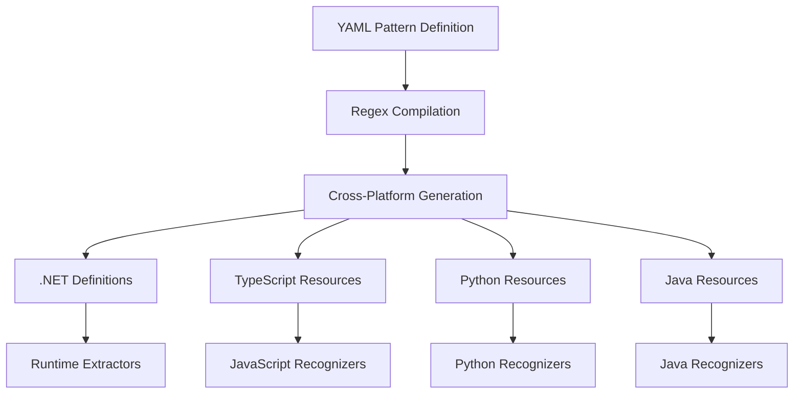
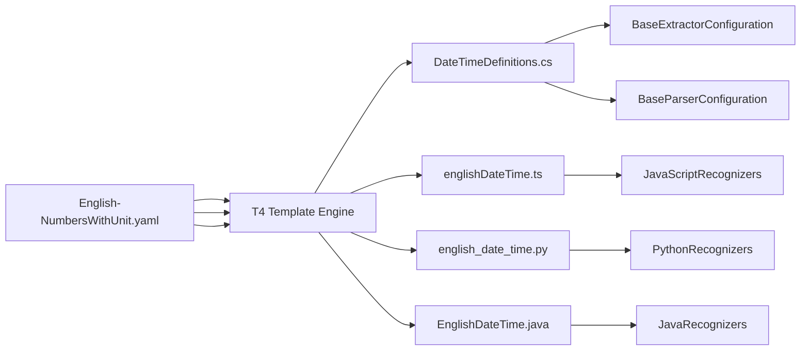
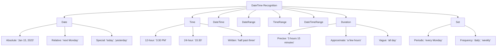
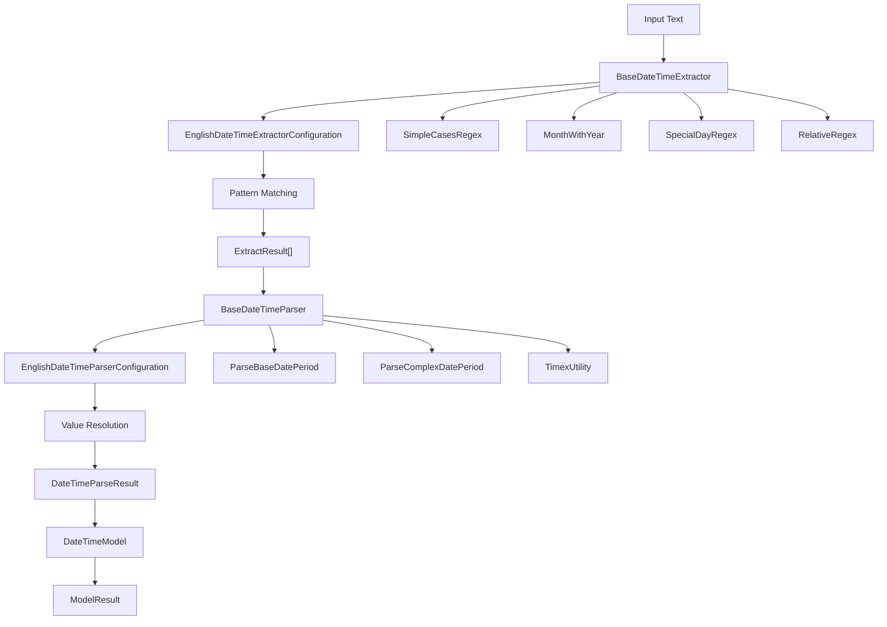

<!-- source: DeepWiki mcp.deepwiki.com · repo microsoft/Recognizers-Text · page 3.1 English Implementation · fetched 2026-10-26 -->

# English Implementation

<details>
<summary>Relevant source files</summary>

The following files were used as context for generating this wiki page:

- [.NET/Microsoft.Recognizers.Definitions.Common/English/DateTimeDefinitions.cs](.NET/Microsoft.Recognizers.Definitions.Common/English/DateTimeDefinitions.cs)
- [.NET/Microsoft.Recognizers.Definitions.Common/English/NumbersDefinitions.cs](.NET/Microsoft.Recognizers.Definitions.Common/English/NumbersDefinitions.cs)
- [.NET/Microsoft.Recognizers.Definitions.Common/English/NumbersWithUnitDefinitions.cs](.NET/Microsoft.Recognizers.Definitions.Common/English/NumbersWithUnitDefinitions.cs)
- [.NET/Microsoft.Recognizers.Text.DataDrivenTests/Number/TestNumber_English.cs](.NET/Microsoft.Recognizers.Text.DataDrivenTests/Number/TestNumber_English.cs)
- [.NET/Microsoft.Recognizers.Text.DateTime/Constants.cs](.NET/Microsoft.Recognizers.Text.DateTime/Constants.cs)
- [.NET/Microsoft.Recognizers.Text.DateTime/English/Extractors/EnglishDatePeriodExtractorConfiguration.cs](.NET/Microsoft.Recognizers.Text.DateTime/English/Extractors/EnglishDatePeriodExtractorConfiguration.cs)
- [.NET/Microsoft.Recognizers.Text.DateTime/English/Parsers/EnglishDatePeriodParserConfiguration.cs](.NET/Microsoft.Recognizers.Text.DateTime/English/Parsers/EnglishDatePeriodParserConfiguration.cs)
- [.NET/Microsoft.Recognizers.Text.DateTime/Extractors/BaseDatePeriodExtractor.cs](.NET/Microsoft.Recognizers.Text.DateTime/Extractors/BaseDatePeriodExtractor.cs)
- [.NET/Microsoft.Recognizers.Text.DateTime/Parsers/BaseDatePeriodParser.cs](.NET/Microsoft.Recognizers.Text.DateTime/Parsers/BaseDatePeriodParser.cs)
- [.NET/Microsoft.Recognizers.Text.DateTime/Parsers/BaseMergedDateTimeParser.cs](.NET/Microsoft.Recognizers.Text.DateTime/Parsers/BaseMergedDateTimeParser.cs)
- [.NET/Microsoft.Recognizers.Text.DateTime/Utilities/TimexUtility.cs](.NET/Microsoft.Recognizers.Text.DateTime/Utilities/TimexUtility.cs)
- [.NET/Microsoft.Recognizers.Text.Number/Constants.cs](.NET/Microsoft.Recognizers.Text.Number/Constants.cs)
- [.NET/Microsoft.Recognizers.Text.Number/English/Extractors/NumberExtractor.cs](.NET/Microsoft.Recognizers.Text.Number/English/Extractors/NumberExtractor.cs)
- [.NET/Microsoft.Recognizers.Text.Number/English/Extractors/OrdinalExtractor.cs](.NET/Microsoft.Recognizers.Text.Number/English/Extractors/OrdinalExtractor.cs)
- [.NET/Microsoft.Recognizers.Text.Number/Extractors/BaseNumberExtractor.cs](.NET/Microsoft.Recognizers.Text.Number/Extractors/BaseNumberExtractor.cs)
- [.NET/Microsoft.Recognizers.Text.Number/Microsoft.Recognizers.Text.Number.xml](.NET/Microsoft.Recognizers.Text.Number/Microsoft.Recognizers.Text.Number.xml)
- [.NET/Microsoft.Recognizers.Text.Number/Models/AbstractNumberModel.cs](.NET/Microsoft.Recognizers.Text.Number/Models/AbstractNumberModel.cs)
- [.NET/Microsoft.Recognizers.Text.Number/NumberOptions.cs](.NET/Microsoft.Recognizers.Text.Number/NumberOptions.cs)
- [.NET/Microsoft.Recognizers.Text.Number/Parsers/BaseNumberParser.cs](.NET/Microsoft.Recognizers.Text.Number/Parsers/BaseNumberParser.cs)
- [.NET/Microsoft.Recognizers.Text.NumberWithUnit/English/Extractors/DimensionExtractorConfiguration.cs](.NET/Microsoft.Recognizers.Text.NumberWithUnit/English/Extractors/DimensionExtractorConfiguration.cs)
- [.NET/Microsoft.Recognizers.Text.NumberWithUnit/English/Parsers/DimensionParserConfiguration.cs](.NET/Microsoft.Recognizers.Text.NumberWithUnit/English/Parsers/DimensionParserConfiguration.cs)
- [.NET/Microsoft.Recognizers.Text.NumberWithUnit/Extractors/NumberWithUnitExtractor.cs](.NET/Microsoft.Recognizers.Text.NumberWithUnit/Extractors/NumberWithUnitExtractor.cs)
- [.NET/Microsoft.Recognizers.Text.NumberWithUnit/Extractors/PrefixUnitResult.cs](.NET/Microsoft.Recognizers.Text.NumberWithUnit/Extractors/PrefixUnitResult.cs)
- [.NET/Microsoft.Recognizers.Text.NumberWithUnit/Microsoft.Recognizers.Text.NumberWithUnit.xml](.NET/Microsoft.Recognizers.Text.NumberWithUnit/Microsoft.Recognizers.Text.NumberWithUnit.xml)
- [.NET/Microsoft.Recognizers.Text.NumberWithUnit/Parsers/NumberWithUnitParser.cs](.NET/Microsoft.Recognizers.Text.NumberWithUnit/Parsers/NumberWithUnitParser.cs)
- [.NET/Microsoft.Recognizers.Text.NumberWithUnit/Utilities/StringComparer.cs](.NET/Microsoft.Recognizers.Text.NumberWithUnit/Utilities/StringComparer.cs)
- [.NET/Microsoft.Recognizers.Text.Sequence/Microsoft.Recognizers.Text.Sequence.xml](.NET/Microsoft.Recognizers.Text.Sequence/Microsoft.Recognizers.Text.Sequence.xml)
- [Java/libraries/recognizers-text-date-time/src/main/java/com/microsoft/recognizers/text/datetime/resources/EnglishDateTime.java](Java/libraries/recognizers-text-date-time/src/main/java/com/microsoft/recognizers/text/datetime/resources/EnglishDateTime.java)
- [Java/libraries/recognizers-text-number-with-unit/src/main/java/com/microsoft/recognizers/text/numberwithunit/resources/EnglishNumericWithUnit.java](Java/libraries/recognizers-text-number-with-unit/src/main/java/com/microsoft/recognizers/text/numberwithunit/resources/EnglishNumericWithUnit.java)
- [Java/libraries/recognizers-text-number/src/main/java/com/microsoft/recognizers/text/number/resources/EnglishNumeric.java](Java/libraries/recognizers-text-number/src/main/java/com/microsoft/recognizers/text/number/resources/EnglishNumeric.java)
- [JavaScript/packages/recognizers-date-time/src/resources/englishDateTime.ts](JavaScript/packages/recognizers-date-time/src/resources/englishDateTime.ts)
- [JavaScript/packages/recognizers-number-with-unit/src/resources/englishNumericWithUnit.ts](JavaScript/packages/recognizers-number-with-unit/src/resources/englishNumericWithUnit.ts)
- [JavaScript/packages/recognizers-number/src/resources/englishNumeric.ts](JavaScript/packages/recognizers-number/src/resources/englishNumeric.ts)
- [Patterns/English/English-DateTime.yaml](Patterns/English/English-DateTime.yaml)
- [Patterns/English/English-Numbers.yaml](Patterns/English/English-Numbers.yaml)
- [Patterns/English/English-NumbersWithUnit.yaml](Patterns/English/English-NumbersWithUnit.yaml)
- [Python/libraries/recognizers-date-time/recognizers_date_time/resources/english_date_time.py](Python/libraries/recognizers-date-time/recognizers_date_time/resources/english_date_time.py)
- [Python/libraries/recognizers-number-with-unit/recognizers_number_with_unit/resources/english_numeric_with_unit.py](Python/libraries/recognizers-number-with-unit/recognizers_number_with_unit/resources/english_numeric_with_unit.py)
- [Python/libraries/recognizers-number/recognizers_number/resources/english_numeric.py](Python/libraries/recognizers-number/recognizers_number/resources/english_numeric.py)
- [Specs/DateTime/English/DatePeriodExtractor.json](Specs/DateTime/English/DatePeriodExtractor.json)
- [Specs/DateTime/English/DatePeriodParser.json](Specs/DateTime/English/DatePeriodParser.json)
- [Specs/DateTime/English/DateTimeModel.json](Specs/DateTime/English/DateTimeModel.json)
- [Specs/DateTime/English/DateTimeModelComplexCalendar.json](Specs/DateTime/English/DateTimeModelComplexCalendar.json)
- [Specs/DateTime/English/DateTimeModelExperimentalMode.json](Specs/DateTime/English/DateTimeModelExperimentalMode.json)
- [Specs/DateTime/English/MergedExtractor.json](Specs/DateTime/English/MergedExtractor.json)
- [Specs/DateTime/English/MergedParser.json](Specs/DateTime/English/MergedParser.json)
- [Specs/Number/English/NumberModel.json](Specs/Number/English/NumberModel.json)
- [Specs/Number/English/NumberModelExperimentalMode.json](Specs/Number/English/NumberModelExperimentalMode.json)
- [Specs/Number/English/NumberRangeModel.json](Specs/Number/English/NumberRangeModel.json)
- [Specs/Number/English/OrdinalModel.json](Specs/Number/English/OrdinalModel.json)
- [Specs/Number/English/OrdinalModelSuppressExtendedTypes.json](Specs/Number/English/OrdinalModelSuppressExtendedTypes.json)
- [Specs/NumberWithUnit/English/CurrencyModel.json](Specs/NumberWithUnit/English/CurrencyModel.json)
- [Specs/NumberWithUnit/English/DimensionModel.json](Specs/NumberWithUnit/English/DimensionModel.json)
- [Specs/NumberWithUnit/English/TemperatureModel.json](Specs/NumberWithUnit/English/TemperatureModel.json)

</details>


## Purpose and Scope

This document covers the English language implementation of Microsoft Recognizers Text, which serves as the primary and most comprehensive implementation across all supported entity types. The English implementation includes full support for DateTime, Numbers, NumberWithUnit, Sequence, and Choice recognition with extensive pattern coverage and cultural adaptations.

For information about other language implementations, see [Chinese Implementation](#3.2), [Spanish and Portuguese Implementation](#3.3), and other language-specific pages. For details about the overall architecture and cross-platform design, see [Architecture Overview](#1.1).

## Pattern Definition System

The English implementation is driven by comprehensive YAML pattern files that define the recognition logic for all entity types. These patterns serve as the source of truth and are automatically converted into platform-specific code.

### Core Pattern Files

| Entity Type | Pattern File | Generated Classes |
|-------------|-------------|-------------------|
| DateTime | `English-DateTime.yaml` | `DateTimeDefinitions` |
| Numbers | `English-Numbers.yaml` | `NumbersDefinitions` |
| NumberWithUnit | `English-NumbersWithUnit.yaml` | `NumbersWithUnitDefinitions` |

### Pattern Categories

The DateTime patterns in [Patterns/English/English-DateTime.yaml:1-2000]() include:

- **Temporal Expressions**: `today`, `tomorrow`, `yesterday`, `next week`
- **Date Formats**: `MM/dd/yyyy`, `Jan 15, 2023`, `15th of March`
- **Time Formats**: `3:30 PM`, `half past seven`, `noon`
- **Relative Expressions**: `last month`, `next Friday`, `in 2 hours`
- **Range Expressions**: `from Monday to Friday`, `between 9-5 PM`
- **Duration Expressions**: `3 hours`, `two weeks`, `half a day`
- **Set Expressions**: `every Monday`, `daily`, `weekly`

**Pattern Structure Example**


Sources: [Patterns/English/English-DateTime.yaml:1-500](), [.NET/Microsoft.Recognizers.Definitions.Common/English/DateTimeDefinitions.cs:1-50]()

## Code Generation Process

The English patterns undergo automatic transformation into platform-specific code during the build process. This ensures consistency across all platforms while allowing for language-specific optimizations.

### Generation Pipeline



### Generated Code Structure

The generated [.NET/Microsoft.Recognizers.Definitions.Common/English/DateTimeDefinitions.cs:22-50]() contains:

- **Static Regex Patterns**: Pre-compiled expressions for extraction
- **Language Markers**: `LangMarker = "Eng"` for identification
- **Configuration Flags**: `CheckBothBeforeAfter = false` for parsing behavior
- **Reference Resolution**: Nested regex patterns with parameter substitution

Sources: [.NET/Microsoft.Recognizers.Definitions.Common/English/DateTimeDefinitions.cs:1-200](), [JavaScript/packages/recognizers-date-time/src/resources/englishDateTime.ts:1-100]()

## Entity Type Support

The English implementation provides comprehensive coverage across all recognizer entity types with sophisticated pattern matching and cultural awareness.

### DateTime Entity Hierarchy



### Number Recognition Capabilities

The English number system in [Patterns/English/English-Numbers.yaml:16-100]() supports:

- **Cardinal Numbers**: `one`, `twenty-three`, `1,234,567`
- **Ordinal Numbers**: `first`, `23rd`, `hundredth`
- **Fractions**: `two thirds`, `3 1/2`, `0.25`
- **Scientific Notation**: `1.5e10`, `3.2 × 10⁶`
- **Percentages**: `50%`, `three percent`
- **Negative Numbers**: `minus five`, `-123`

Sources: [Patterns/English/English-Numbers.yaml:16-150](), [Specs/Number/English/NumberModel.json:1-300]()

## Runtime Processing Architecture

The English implementation follows a consistent extractor-parser-model pipeline across all entity types, with specialized handling for English linguistic patterns.

### DateTime Processing Flow



### Key Processing Classes

The English DateTime implementation uses these core classes from [.NET/Microsoft.Recognizers.Text.DateTime/]():

- **`BaseDatePeriodExtractor`**: Identifies date range patterns
- **`BaseDatePeriodParser`**: Resolves date ranges to start/end values  
- **`BaseMergedDateTimeParser`**: Handles combined DateTime entities
- **`TimexUtility`**: Generates TIMEX temporal expressions

Sources: [.NET/Microsoft.Recognizers.Text.DateTime/Extractors/BaseDatePeriodExtractor.cs:15-50](), [.NET/Microsoft.Recognizers.Text.DateTime/Parsers/BaseDatePeriodParser.cs:16-100]()

## Test Framework and Validation

The English implementation includes extensive test coverage through JSON specification files that define expected behavior for thousands of test cases.

### Test Organization

| Test Suite | File | Coverage |
|------------|------|----------|
| DateTime Model | `DateTimeModel.json` | End-to-end recognition |
| DateTime Complex | `DateTimeModelComplexCalendar.json` | Calendar complexities |
| Date Periods | `DatePeriodParser.json` | Range parsing |
| Numbers | `NumberModel.json` | Numeric recognition |
| Dimensions | `DimensionModel.json` | Unit conversions |

### Test Case Structure

Each test case in [Specs/DateTime/English/DateTimeModel.json:1-50]() follows this format:

```json
{
  "Input": "I'll go back tomorrow",
  "Context": {
    "ReferenceDateTime": "2016-11-07T00:00:00"
  },
  "Results": [
    {
      "Text": "tomorrow",
      "Start": 13,
      "End": 20,
      "TypeName": "datetimeV2.date",
      "Resolution": {
        "values": [
          {
            "timex": "2016-11-08",
            "type": "date", 
            "value": "2016-11-08"
          }
        ]
      }
    }
  ]
}
```

### Cross-Platform Validation

Tests include platform-specific annotations:
- **`NotSupported`**: Indicates platforms that don't support specific features
- **`Context`**: Provides reference time for relative expressions
- **`Resolution`**: Expected output format with TIMEX values

Sources: [Specs/DateTime/English/DateTimeModel.json:1-300](), [Specs/DateTime/English/DateTimeModelComplexCalendar.json:1-200]()

## Platform-Specific Implementations

While the core patterns are shared, each platform has optimized implementations that leverage platform-specific features and conventions.

### .NET Implementation

The .NET version serves as the reference implementation with classes like:

- **Configuration Classes**: `EnglishDateTimeExtractorConfiguration`, `EnglishDateTimeParserConfiguration`  
- **Constants**: Defined in [.NET/Microsoft.Recognizers.Text.DateTime/Constants.cs:12-100]()
- **Utilities**: `TimexUtility`, `DateTimeFormatUtil`

### JavaScript/TypeScript Implementation  

The JavaScript version in [JavaScript/packages/recognizers-date-time/src/resources/englishDateTime.ts:1-200]() provides:

- **ES6 Module Structure**: Exported constants and functions
- **TypeScript Definitions**: Strong typing for recognition results
- **Browser Compatibility**: Optimized for both Node.js and browser environments

### Python Implementation

The Python version in [Python/libraries/recognizers-date-time/recognizers_date_time/resources/english_date_time.py:1-150]() features:

- **Class-Based Organization**: `EnglishDateTime` class containing all patterns
- **f-string Interpolation**: Dynamic pattern generation
- **Pythonic Conventions**: Snake_case naming and list comprehensions

### Java Implementation

The Java version in [Java/libraries/recognizers-text-date-time/src/main/java/com/microsoft/recognizers/text/datetime/resources/EnglishDateTime.java:1-200]() includes:

- **Static Final Fields**: Immutable pattern definitions
- **String Replacement**: Manual pattern substitution using `.replace()`
- **Google Guava Integration**: ImmutableMap usage for collections

Sources: [.NET/Microsoft.Recognizers.Text.DateTime/Constants.cs:1-100](), [JavaScript/packages/recognizers-date-time/src/resources/englishDateTime.ts:1-300](), [Python/libraries/recognizers-date-time/recognizers_date_time/resources/english_date_time.py:1-200]()

## Cultural Adaptations and Special Cases

The English implementation includes sophisticated handling for cultural variations and edge cases specific to English-speaking regions.

### Regional Variations

- **Date Formats**: Support for both MM/dd/yyyy (US) and dd/MM/yyyy patterns
- **Time Conventions**: 12-hour with AM/PM and 24-hour formats  
- **Holiday Recognition**: English-speaking country holidays
- **Business Calendar**: Weekday/weekend distinctions, business hours

### Advanced Features

- **Ambiguity Resolution**: Past/future value resolution for incomplete dates
- **Context Awareness**: Reference time handling for relative expressions
- **Modifier Support**: "before", "after", "since", "until" temporal modifiers
- **Alternative Expressions**: Multiple patterns for the same semantic meaning

Sources: [Patterns/English/English-DateTime.yaml:400-600](), [.NET/Microsoft.Recognizers.Text.DateTime/Parsers/BaseMergedDateTimeParser.cs:45-100]()

---

