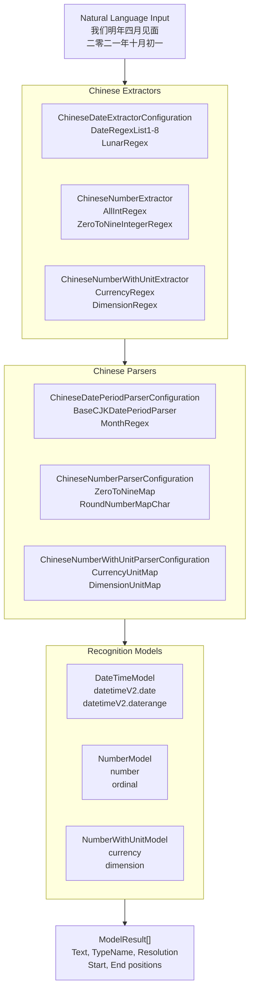
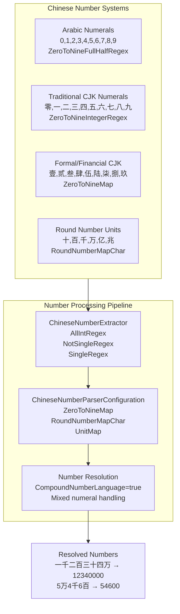
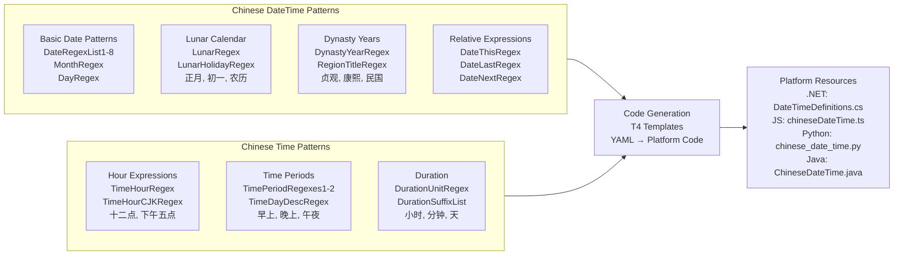
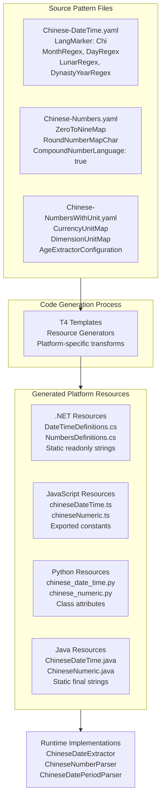
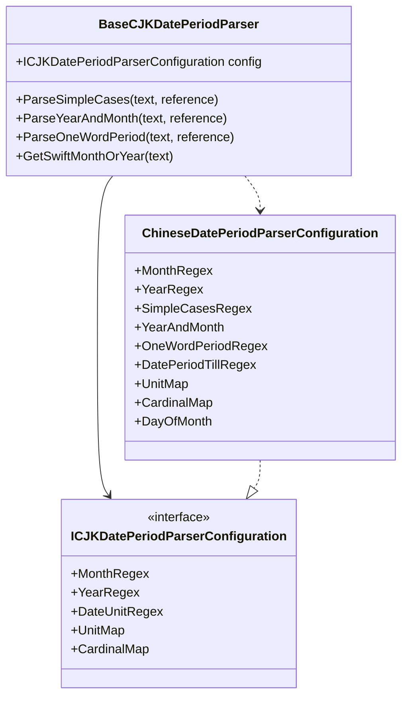
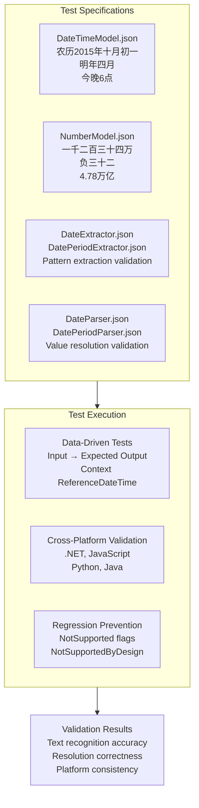

<!-- source: DeepWiki mcp.deepwiki.com · repo microsoft/Recognizers-Text · page 3.2 Chinese Implementation · fetched 2026-10-26 -->

# Chinese Implementation

Relevant source files

The following files were used as context for generating this wiki page:

- [.NET/Microsoft.Recognizers.Definitions.Common/Chinese/DateTimeDefinitions.cs](.NET/Microsoft.Recognizers.Definitions.Common/Chinese/DateTimeDefinitions.cs)
- [.NET/Microsoft.Recognizers.Definitions.Common/Chinese/NumbersDefinitions.cs](.NET/Microsoft.Recognizers.Definitions.Common/Chinese/NumbersDefinitions.cs)
- [.NET/Microsoft.Recognizers.Definitions.Common/Chinese/NumbersWithUnitDefinitions.cs](.NET/Microsoft.Recognizers.Definitions.Common/Chinese/NumbersWithUnitDefinitions.cs)
- [.NET/Microsoft.Recognizers.Text.DateTime/Chinese/Extractors/ChineseDateExtractorConfiguration.cs](.NET/Microsoft.Recognizers.Text.DateTime/Chinese/Extractors/ChineseDateExtractorConfiguration.cs)
- [.NET/Microsoft.Recognizers.Text.DateTime/Chinese/Extractors/ChineseDatePeriodExtractorConfiguration.cs](.NET/Microsoft.Recognizers.Text.DateTime/Chinese/Extractors/ChineseDatePeriodExtractorConfiguration.cs)
- [.NET/Microsoft.Recognizers.Text.DateTime/Chinese/Extractors/ChineseMergedExtractorConfiguration.cs](.NET/Microsoft.Recognizers.Text.DateTime/Chinese/Extractors/ChineseMergedExtractorConfiguration.cs)
- [.NET/Microsoft.Recognizers.Text.DateTime/Chinese/Parsers/ChineseDateParserConfiguration.cs](.NET/Microsoft.Recognizers.Text.DateTime/Chinese/Parsers/ChineseDateParserConfiguration.cs)
- [.NET/Microsoft.Recognizers.Text.DateTime/Chinese/Parsers/ChineseDatePeriodParserConfiguration.cs](.NET/Microsoft.Recognizers.Text.DateTime/Chinese/Parsers/ChineseDatePeriodParserConfiguration.cs)
- [.NET/Microsoft.Recognizers.Text.DateTime/Parsers/CJK/BaseCJKDatePeriodParser.cs](.NET/Microsoft.Recognizers.Text.DateTime/Parsers/CJK/BaseCJKDatePeriodParser.cs)
- [Java/libraries/recognizers-text-date-time/src/main/java/com/microsoft/recognizers/text/datetime/resources/ChineseDateTime.java](Java/libraries/recognizers-text-date-time/src/main/java/com/microsoft/recognizers/text/datetime/resources/ChineseDateTime.java)
- [Java/libraries/recognizers-text-number-with-unit/src/main/java/com/microsoft/recognizers/text/numberwithunit/resources/ChineseNumericWithUnit.java](Java/libraries/recognizers-text-number-with-unit/src/main/java/com/microsoft/recognizers/text/numberwithunit/resources/ChineseNumericWithUnit.java)
- [Java/libraries/recognizers-text-number-with-unit/src/main/java/com/microsoft/recognizers/text/numberwithunit/resources/FrenchNumericWithUnit.java](Java/libraries/recognizers-text-number-with-unit/src/main/java/com/microsoft/recognizers/text/numberwithunit/resources/FrenchNumericWithUnit.java)
- [Java/libraries/recognizers-text-number/src/main/java/com/microsoft/recognizers/text/number/resources/ChineseNumeric.java](Java/libraries/recognizers-text-number/src/main/java/com/microsoft/recognizers/text/number/resources/ChineseNumeric.java)
- [JavaScript/packages/recognizers-date-time/src/resources/chineseDateTime.ts](JavaScript/packages/recognizers-date-time/src/resources/chineseDateTime.ts)
- [JavaScript/packages/recognizers-number-with-unit/src/resources/chineseNumericWithUnit.ts](JavaScript/packages/recognizers-number-with-unit/src/resources/chineseNumericWithUnit.ts)
- [JavaScript/packages/recognizers-number-with-unit/src/resources/frenchNumericWithUnit.ts](JavaScript/packages/recognizers-number-with-unit/src/resources/frenchNumericWithUnit.ts)
- [JavaScript/packages/recognizers-number/src/resources/chineseNumeric.ts](JavaScript/packages/recognizers-number/src/resources/chineseNumeric.ts)
- [Patterns/Chinese/Chinese-DateTime.yaml](Patterns/Chinese/Chinese-DateTime.yaml)
- [Patterns/Chinese/Chinese-Numbers.yaml](Patterns/Chinese/Chinese-Numbers.yaml)
- [Patterns/Chinese/Chinese-NumbersWithUnit.yaml](Patterns/Chinese/Chinese-NumbersWithUnit.yaml)
- [Python/libraries/recognizers-date-time/recognizers_date_time/date_time/chinese/duration_extractor_config.py](Python/libraries/recognizers-date-time/recognizers_date_time/date_time/chinese/duration_extractor_config.py)
- [Python/libraries/recognizers-date-time/recognizers_date_time/resources/chinese_date_time.py](Python/libraries/recognizers-date-time/recognizers_date_time/resources/chinese_date_time.py)
- [Python/libraries/recognizers-number-with-unit/recognizers_number_with_unit/resources/chinese_numeric_with_unit.py](Python/libraries/recognizers-number-with-unit/recognizers_number_with_unit/resources/chinese_numeric_with_unit.py)
- [Python/libraries/recognizers-number-with-unit/recognizers_number_with_unit/resources/french_numeric_with_unit.py](Python/libraries/recognizers-number-with-unit/recognizers_number_with_unit/resources/french_numeric_with_unit.py)
- [Python/libraries/recognizers-number/recognizers_number/resources/chinese_numeric.py](Python/libraries/recognizers-number/recognizers_number/resources/chinese_numeric.py)
- [Specs/DateTime/Chinese/DateExtractor.json](Specs/DateTime/Chinese/DateExtractor.json)
- [Specs/DateTime/Chinese/DateParser.json](Specs/DateTime/Chinese/DateParser.json)
- [Specs/DateTime/Chinese/DatePeriodExtractor.json](Specs/DateTime/Chinese/DatePeriodExtractor.json)
- [Specs/DateTime/Chinese/DatePeriodParser.json](Specs/DateTime/Chinese/DatePeriodParser.json)
- [Specs/DateTime/Chinese/DateTimeExtractor.json](Specs/DateTime/Chinese/DateTimeExtractor.json)
- [Specs/DateTime/Chinese/DateTimeModel.json](Specs/DateTime/Chinese/DateTimeModel.json)
- [Specs/DateTime/Chinese/DateTimePeriodParser.json](Specs/DateTime/Chinese/DateTimePeriodParser.json)
- [Specs/DateTime/Chinese/TimeParser.json](Specs/DateTime/Chinese/TimeParser.json)
- [Specs/Number/Chinese/NumberModel.json](Specs/Number/Chinese/NumberModel.json)
- [Specs/Number/Chinese/NumberRangeModel.json](Specs/Number/Chinese/NumberRangeModel.json)
- [Specs/Number/Chinese/PercentModel.json](Specs/Number/Chinese/PercentModel.json)
- [Specs/NumberWithUnit/Chinese/CurrencyModel.json](Specs/NumberWithUnit/Chinese/CurrencyModel.json)
- [Specs/NumberWithUnit/Chinese/DimensionModel.json](Specs/NumberWithUnit/Chinese/DimensionModel.json)

This document covers the Chinese language implementation within Microsoft Recognizers Text, detailing the CJK-specific logic, pattern definitions, and cross-platform code generation for Chinese text recognition. This implementation handles both DateTime and Number recognition with support for traditional Chinese numerals, lunar calendar dates, dynasty years, and compound number expressions.

For information about other CJK language implementations, see [Japanese and Korean Implementation](#3.6). For general language implementation patterns, see [Language-Specific Implementations](#3).

## Architecture Overview

The Chinese implementation follows the standard recognizer architecture but includes CJK-specific enhancements for handling Chinese linguistic characteristics.

### Chinese Implementation in Recognizer Pipeline

**Sources:** [.NET/Microsoft.Recognizers.Text.DateTime/Chinese/Extractors/ChineseDatePeriodExtractorConfiguration.cs:1-50](), [.NET/Microsoft.Recognizers.Text.DateTime/Chinese/Parsers/ChineseDatePeriodParserConfiguration.cs:1-50](), [Specs/DateTime/Chinese/DateTimeModel.json:1-50]()

## CJK-Specific Features

Chinese implementation includes specialized handling for Chinese, Japanese, and Korean (CJK) language characteristics that differ significantly from Western languages.

### Key CJK Characteristics

| Feature | Chinese Implementation | Code Reference |
|---------|----------------------|----------------|
| **Compound Numbers** | No spaces between number words | `CompoundNumberLanguage: true` |
| **Character Systems** | Traditional/Simplified Chinese | `ZeroToNineMap`, `TratoSimMap` |
| **Lunar Calendar** | Support for 农历, 初一, 正月 | `LunarRegex`, `LunarHolidayRegex` |
| **Dynasty Years** | Historical Chinese eras | `DynastyYearRegex`, `RegionTitleRegex` |
| **Number Systems** | Mix of Arabic and Chinese numerals | `ZeroToNineIntegerRegex`, `DigitNumRegex` |

**Sources:** [Patterns/Chinese/Chinese-Numbers.yaml:6-7](), [Patterns/Chinese/Chinese-DateTime.yaml:40-41](), [.NET/Microsoft.Recognizers.Definitions.Common/Chinese/NumbersDefinitions.cs:25-26]()

### Chinese Number System Architecture

**Sources:** [Patterns/Chinese/Chinese-Numbers.yaml:16-31](), [.NET/Microsoft.Recognizers.Definitions.Common/Chinese/NumbersDefinitions.cs:41-54](), [Specs/Number/Chinese/NumberModel.json:350-361]()

## Pattern Definition System

Chinese patterns are defined in YAML files that serve as the source of truth for all platform implementations.

### DateTime Pattern Structure

The Chinese DateTime patterns include support for lunar calendar, dynasty years, and CJK-specific time expressions:

**Sources:** [Patterns/Chinese/Chinese-DateTime.yaml:106-136](), [Patterns/Chinese/Chinese-DateTime.yaml:411-495](), [Patterns/Chinese/Chinese-DateTime.yaml:325-396]()

### Number Pattern Categories

Chinese number patterns handle multiple numeral systems and compound expressions:

| Pattern Category | Purpose | Examples | Code Reference |
|-----------------|---------|----------|----------------|
| **AllIntRegex** | Complete integer matching | 一千二百三十四万 | `AllIntRegex` |
| **SingleRegex** | Single digit with context | 五个苹果, 三年 | `SingleRegex` |
| **DoubleSpecialsChars** | Decimal numbers | 3.14, 一点五 | `DoubleSpecialsChars` |
| **PercentageRegex** | Percentage expressions | 百分之三十, 30% | `PercentageRegex` |
| **FractionNotationRegex** | Fraction expressions | 三分之二, 1/3 | `FractionNotationRegex` |

**Sources:** [Patterns/Chinese/Chinese-Numbers.yaml:204-235](), [Patterns/Chinese/Chinese-Numbers.yaml:276-284](), [Patterns/Chinese/Chinese-Numbers.yaml:286-330]()

## Cross-Platform Code Generation

The YAML patterns are transformed into platform-specific resource files through an automated code generation process.

### Generation Pipeline Architecture

**Sources:** [.NET/Microsoft.Recognizers.Definitions.Common/Chinese/DateTimeDefinitions.cs:1-30](), [JavaScript/packages/recognizers-date-time/src/resources/chineseDateTime.ts:1-20](), [Python/libraries/recognizers-date-time/recognizers_date_time/resources/chinese_date_time.py:1-20]()

### Platform-Specific Implementations

Each platform maintains consistent APIs while adapting to platform conventions:

| Platform | Resource Pattern | Implementation Classes | Key Features |
|----------|------------------|----------------------|--------------|
| **.NET** | `public const string` | `ChineseDateExtractorConfiguration` `ChineseDatePeriodParserConfiguration` | Static readonly definitions Regex compilation |
| **JavaScript** | `export const` | `ChineseDateTimeExtractor` `ChineseDateTimeParser` | ES6 modules ReadonlyMap collections |
| **Python** | `class ChineseDateTime` | `BaseCJKDateExtractor` `BaseCJKDateParser` | Class attributes Dictionary mappings |
| **Java** | `public static final` | `ChineseDateExtractorConfiguration` `ChineseDateParserConfiguration` | ImmutableMap collections Static initialization |

**Sources:** [.NET/Microsoft.Recognizers.Text.DateTime/Chinese/Parsers/ChineseDatePeriodParserConfiguration.cs:13-50](), [JavaScript/packages/recognizers-date-time/src/resources/chineseDateTime.ts:13-50](), [Python/libraries/recognizers-date-time/recognizers_date_time/resources/chinese_date_time.py:16-50]()

## CJK Base Parser Integration

Chinese DateTime parsing leverages shared CJK infrastructure for common Asian language patterns.

### CJK Parser Hierarchy

**Sources:** [.NET/Microsoft.Recognizers.Text.DateTime/Parsers/CJK/BaseCJKDatePeriodParser.cs:1-50](), [.NET/Microsoft.Recognizers.Text.DateTime/Chinese/Parsers/ChineseDatePeriodParserConfiguration.cs:13-30]()

## Testing Framework

The Chinese implementation includes comprehensive test specifications that validate recognition accuracy across different input patterns.

### Test Structure and Coverage

**Sources:** [Specs/DateTime/Chinese/DateTimeModel.json:224-246](), [Specs/Number/Chinese/NumberModel.json:350-375](), [Specs/DateTime/Chinese/DateParser.json:1-30]()

### Example Test Cases

Key test patterns demonstrate Chinese-specific recognition capabilities:

| Input Pattern | Type | Expected Resolution | Special Features |
|---------------|------|-------------------|------------------|
| `农历2015年十月初一` | date | `2015-10-01` with `isLunar: "True"` | Lunar calendar |
| `一千二百三十四万` | number | `12340000` | Compound numbers |
| `二零零四年八月十五` | date | `2004-08-15` | CJK year notation |
| `负三十二` | number | `-32` | Negative numbers |
| `下下周末` | daterange | `2017-W14-WE` | Relative expressions |

**Sources:** [Specs/DateTime/Chinese/DateTimeModel.json:224-245](), [Specs/Number/Chinese/NumberModel.json:350-361](), [Specs/DateTime/Chinese/DateTimeModel.json:547-569]()

The Chinese implementation demonstrates the system's ability to handle complex linguistic features while maintaining consistency across multiple platforms through shared pattern definitions and systematic code generation.

---

