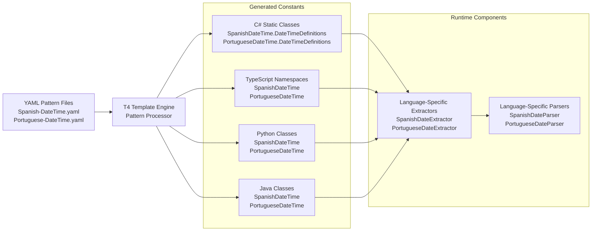
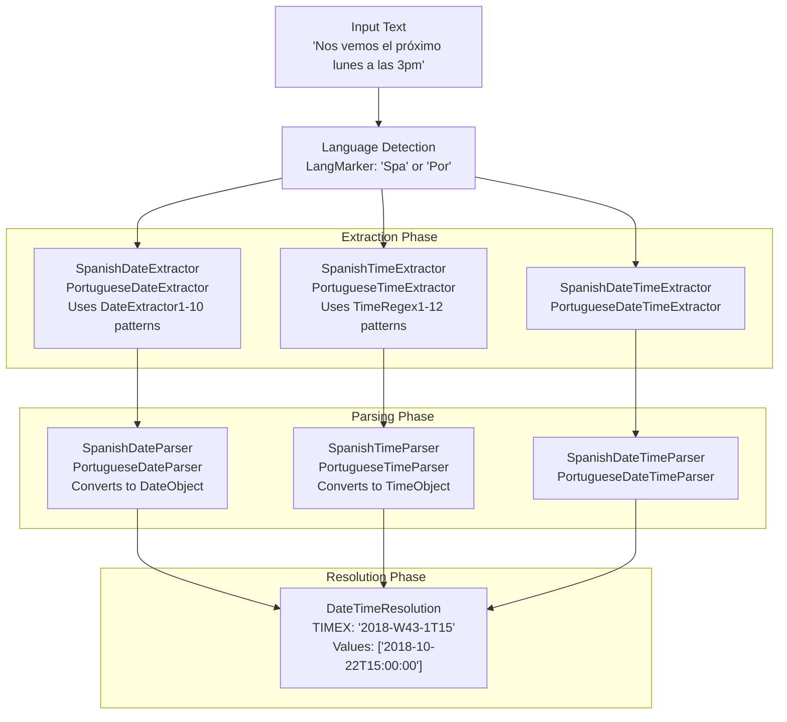

<!-- source: DeepWiki mcp.deepwiki.com · repo microsoft/Recognizers-Text · page 3.3 Spanish and Portuguese Implementation · fetched 2026-10-26 -->

# Spanish and Portuguese Implementation

<details>
<summary>Relevant source files</summary>

The following files were used as context for generating this wiki page:

- [.NET/Microsoft.Recognizers.Definitions.Common/French/DateTimeDefinitions.cs](.NET/Microsoft.Recognizers.Definitions.Common/French/DateTimeDefinitions.cs)
- [.NET/Microsoft.Recognizers.Definitions.Common/Italian/DateTimeDefinitions.cs](.NET/Microsoft.Recognizers.Definitions.Common/Italian/DateTimeDefinitions.cs)
- [.NET/Microsoft.Recognizers.Definitions.Common/Portuguese/DateTimeDefinitions.cs](.NET/Microsoft.Recognizers.Definitions.Common/Portuguese/DateTimeDefinitions.cs)
- [.NET/Microsoft.Recognizers.Definitions.Common/Spanish/DateTimeDefinitions.cs](.NET/Microsoft.Recognizers.Definitions.Common/Spanish/DateTimeDefinitions.cs)
- [Java/libraries/recognizers-text-date-time/src/main/java/com/microsoft/recognizers/text/datetime/resources/FrenchDateTime.java](Java/libraries/recognizers-text-date-time/src/main/java/com/microsoft/recognizers/text/datetime/resources/FrenchDateTime.java)
- [Java/libraries/recognizers-text-date-time/src/main/java/com/microsoft/recognizers/text/datetime/resources/PortugueseDateTime.java](Java/libraries/recognizers-text-date-time/src/main/java/com/microsoft/recognizers/text/datetime/resources/PortugueseDateTime.java)
- [Java/libraries/recognizers-text-date-time/src/main/java/com/microsoft/recognizers/text/datetime/resources/SpanishDateTime.java](Java/libraries/recognizers-text-date-time/src/main/java/com/microsoft/recognizers/text/datetime/resources/SpanishDateTime.java)
- [Java/libraries/recognizers-text-date-time/src/main/java/com/microsoft/recognizers/text/datetime/spanish/extractors/SpanishDatePeriodExtractorConfiguration.java](Java/libraries/recognizers-text-date-time/src/main/java/com/microsoft/recognizers/text/datetime/spanish/extractors/SpanishDatePeriodExtractorConfiguration.java)
- [Java/libraries/recognizers-text-number/src/main/java/com/microsoft/recognizers/text/number/spanish/extractors/OrdinalExtractor.java](Java/libraries/recognizers-text-number/src/main/java/com/microsoft/recognizers/text/number/spanish/extractors/OrdinalExtractor.java)
- [JavaScript/packages/recognizers-date-time/src/resources/frenchDateTime.ts](JavaScript/packages/recognizers-date-time/src/resources/frenchDateTime.ts)
- [JavaScript/packages/recognizers-date-time/src/resources/portugueseDateTime.ts](JavaScript/packages/recognizers-date-time/src/resources/portugueseDateTime.ts)
- [JavaScript/packages/recognizers-date-time/src/resources/spanishDateTime.ts](JavaScript/packages/recognizers-date-time/src/resources/spanishDateTime.ts)
- [Patterns/French/French-DateTime.yaml](Patterns/French/French-DateTime.yaml)
- [Patterns/Italian/Italian-DateTime.yaml](Patterns/Italian/Italian-DateTime.yaml)
- [Patterns/Portuguese/Portuguese-DateTime.yaml](Patterns/Portuguese/Portuguese-DateTime.yaml)
- [Patterns/Spanish/Spanish-DateTime.yaml](Patterns/Spanish/Spanish-DateTime.yaml)
- [Python/libraries/recognizers-date-time/recognizers_date_time/resources/french_date_time.py](Python/libraries/recognizers-date-time/recognizers_date_time/resources/french_date_time.py)
- [Python/libraries/recognizers-date-time/recognizers_date_time/resources/portuguese_date_time.py](Python/libraries/recognizers-date-time/recognizers_date_time/resources/portuguese_date_time.py)
- [Python/libraries/recognizers-date-time/recognizers_date_time/resources/spanish_date_time.py](Python/libraries/recognizers-date-time/recognizers_date_time/resources/spanish_date_time.py)
- [Specs/DateTime/French/DateTimeModel.json](Specs/DateTime/French/DateTimeModel.json)
- [Specs/DateTime/Italian/DateTimeModel.json](Specs/DateTime/Italian/DateTimeModel.json)
- [Specs/DateTime/Portuguese/DateTimeModel.json](Specs/DateTime/Portuguese/DateTimeModel.json)
- [Specs/DateTime/Spanish/DateExtractor.json](Specs/DateTime/Spanish/DateExtractor.json)
- [Specs/DateTime/Spanish/DatePeriodExtractor.json](Specs/DateTime/Spanish/DatePeriodExtractor.json)
- [Specs/DateTime/Spanish/DatePeriodParser.json](Specs/DateTime/Spanish/DatePeriodParser.json)
- [Specs/DateTime/Spanish/DateTimeModel.json](Specs/DateTime/Spanish/DateTimeModel.json)
- [Specs/DateTime/Spanish/DateTimePeriodExtractor.json](Specs/DateTime/Spanish/DateTimePeriodExtractor.json)
- [Specs/DateTime/Spanish/DateTimePeriodParser.json](Specs/DateTime/Spanish/DateTimePeriodParser.json)
- [Specs/DateTime/Spanish/DurationExtractor.json](Specs/DateTime/Spanish/DurationExtractor.json)
- [Specs/DateTime/Spanish/TimePeriodExtractor.json](Specs/DateTime/Spanish/TimePeriodExtractor.json)
- [Specs/DateTime/Spanish/TimePeriodParser.json](Specs/DateTime/Spanish/TimePeriodParser.json)

</details>


This document covers the implementation details for Spanish and Portuguese language support in Microsoft Recognizers Text. It focuses on the pattern definition system, code generation process, and runtime architecture specific to these Romance languages. For information about other Romance language implementations (French and Italian), see [French and Italian Implementation](#3.4). For the overall pattern definition system that drives all language implementations, see [Pattern Definition System](#5.1).

## Overview

Spanish and Portuguese share similar linguistic structures as Romance languages, but each has distinct patterns for date/time expressions, number formats, and cultural conventions. Both languages support comprehensive DateTime recognition including dates, times, durations, periods, and holiday detection.

### Language Coverage

| Feature Domain | Spanish Support | Portuguese Support |
|---|---|---|
| DateTime Recognition | ✅ Full | ✅ Full |
| Number Recognition | ✅ Full | ✅ Full |
| NumberWithUnit Recognition | ✅ Full | ✅ Full |
| Sequence Recognition | ❌ Limited | ❌ Limited |
| Choice Recognition | ✅ Basic | ❌ Not implemented |

**Pattern Definition Architecture**

```mermaid
graph TD
    SpanishYAML["Patterns/Spanish/Spanish-DateTime.yaml<br/>LangMarker: Spa"]
    PortugueseYAML["Patterns/Portuguese/Portuguese-DateTime.yaml<br/>LangMarker: Por"]
    
    Generator["Code Generation Pipeline<br/>T4 Templates/.NET"]
    
    SpanishNET[".NET/Microsoft.Recognizers.Definitions.Common/<br/>Spanish/DateTimeDefinitions.cs"]
    PortugueseNET[".NET/Microsoft.Recognizers.Definitions.Common/<br/>Portuguese/DateTimeDefinitions.cs"]
    
    SpanishJS["JavaScript/packages/recognizers-date-time/<br/>src/resources/spanishDateTime.ts"]
    PortugueseJS["JavaScript/packages/recognizers-date-time/<br/>src/resources/portugueseDateTime.ts"]
    
    SpanishPython["Python/libraries/recognizers-date-time/<br/>recognizers_date_time/resources/spanish_date_time.py"]
    PortuguesePython["Python/libraries/recognizers-date-time/<br/>recognizers_date_time/resources/portuguese_date_time.py"]
    
    SpanishJava["Java/libraries/recognizers-text-date-time/<br/>src/main/java/.../resources/SpanishDateTime.java"]
    PortugueseJava["Java/libraries/recognizers-text-date-time/<br/>src/main/java/.../resources/PortugueseDateTime.java"]
    
    SpanishYAML --> Generator
    PortugueseYAML --> Generator
    
    Generator --> SpanishNET
    Generator --> PortugueseNET
    Generator --> SpanishJS
    Generator --> PortugueseJS
    Generator --> SpanishPython
    Generator --> PortuguesePython
    Generator --> SpanishJava
    Generator --> PortugueseJava
```



Sources: [Patterns/Spanish/Spanish-DateTime.yaml:1-10](), [Patterns/Portuguese/Portuguese-DateTime.yaml:1-10](), [.NET/Microsoft.Recognizers.Definitions.Common/Spanish/DateTimeDefinitions.cs:1-25](), [.NET/Microsoft.Recognizers.Definitions.Common/Portuguese/DateTimeDefinitions.cs:1-25]()

## Pattern Definition System

### YAML Structure

Both Spanish and Portuguese follow the same YAML pattern structure with language-specific regex definitions:

**Spanish Pattern Example:**
```yaml
LangMarker: Spa
TillRegex: !nestedRegex
  def: (?<till>\b(hasta|hacia|al?)\b(\s+(el|la(s)?)\b)?|{BaseDateTime.RangeConnectorSymbolRegex})
  references: [ BaseDateTime.RangeConnectorSymbolRegex ]
```

**Portuguese Pattern Example:**
```yaml
LangMarker: Por  
TillRegex: !simpleRegex
  def: (?<till>\b(at[eé]h?|[aà]s|ao?)\b|--|-|—|——)(\s+\b(o|[aà](s)?)\b)?
```

### Key Pattern Categories

| Pattern Type | Spanish Examples | Portuguese Examples |
|---|---|---|
| Time Connectors | `hasta`, `hacia`, `al` | `até`, `às`, `ao` |
| Range Connectors | `y el`, `y la` | `e`, `às` |
| Month Names | `enero`, `febrero`, `marzo` | `janeiro`, `fevereiro`, `março` |
| Relative Terms | `próximo`, `último`, `este` | `próximo`, `último`, `este` |
| Written Numbers | `veintiuno`, `veintidós` | `vinte e um`, `vinte e dois` |

Sources: [Patterns/Spanish/Spanish-DateTime.yaml:5-12](), [Patterns/Portuguese/Portuguese-DateTime.yaml:5-10]()

## Code Generation Process

**Code Generation Flow for Romance Languages**



### Generated Code Structure

The code generator creates platform-specific constant definitions from the YAML patterns:

**Generated .NET Constants:**
```csharp
public static class DateTimeDefinitions
{
    public const string LangMarker = @"Spa";
    public static readonly string TillRegex = $@"(?<till>\b(hasta|hacia|al?)\b(\s+(el|la(s)?)\b)?|{BaseDateTime.RangeConnectorSymbolRegex})";
    public const string MonthRegex = @"\b(?<month>abr(\.|(il)?\b)|ago(\.|(sto)?\b)|dic(\.|(iembre)?\b)...)";
}
```

Sources: [.NET/Microsoft.Recognizers.Definitions.Common/Spanish/DateTimeDefinitions.cs:22-30](), [.NET/Microsoft.Recognizers.Definitions.Common/Portuguese/DateTimeDefinitions.cs:22-30]()

## Romance Language Specific Features

### Shared Characteristics

Both Spanish and Portuguese implementations leverage common Romance language patterns:

- **Gendered Articles**: `el/la` (Spanish), `o/a` (Portuguese)
- **Complex Date Prepositions**: `de`, `del`, `en`, `por`
- **Written Number Systems**: Both support full text numbers alongside digits
- **Month Name Variations**: Abbreviated and full forms

### Spanish-Specific Patterns

**Time Expression Patterns:**
- `a las cinco` (at five o'clock)
- `por la mañana/tarde/noche` (in the morning/afternoon/night)
- `en punto` (o'clock)

**Date Range Patterns:**
- `desde el 4 hasta el 22` (from the 4th to the 22nd)
- `entre lunes y viernes` (between Monday and Friday)

### Portuguese-Specific Patterns

**Time Expression Patterns:**
- `às cinco` (at five o'clock)  
- `de manhã/tarde/noite` (in the morning/afternoon/night)
- `em ponto` (o'clock)

**Date Range Patterns:**
- `desde o 4 até o 22` (from the 4th to the 22nd)
- `entre segunda e sexta` (between Monday and Friday)

Sources: [Patterns/Spanish/Spanish-DateTime.yaml:283-390](), [Patterns/Portuguese/Portuguese-DateTime.yaml:174-280]()

## Runtime Architecture

**DateTime Recognition Pipeline for Spanish/Portuguese**



### Extractor Pattern Usage

Spanish and Portuguese extractors use multiple regex patterns for robust recognition:

| Extractor Pattern | Purpose | Example Match |
|---|---|---|
| `DateExtractor1` | Basic date format | `5 de abril` |
| `DateExtractor2` | Date with year | `6 de abril, 2016` |
| `DateExtractor3` | Month-first format | `abril 5, 2016` |
| `TimeRegex1-12` | Various time formats | `3pm`, `tres de la tarde` |
| `SimpleCasesRegex` | Date ranges | `4 hasta 22 de este mes` |

Sources: [.NET/Microsoft.Recognizers.Definitions.Common/Spanish/DateTimeDefinitions.cs:119-128](), [Patterns/Spanish/Spanish-DateTime.yaml:242-282]()

## Testing Framework

Both Spanish and Portuguese implementations use comprehensive JSON test specifications:

**Test Structure:**
```json
{
  "Input": "Nos vemos el próximo lunes a las 3pm",
  "Context": {
    "ReferenceDateTime": "2018-09-28T01:00:00"
  },
  "Results": [
    {
      "Text": "el próximo lunes a las 3pm",
      "TypeName": "datetimeV2.datetime",
      "Resolution": {
        "values": [
          {
            "timex": "2018-10-01T15",
            "type": "datetime",
            "value": "2018-10-01 15:00:00"
          }
        ]
      }
    }
  ]
}
```

### Test Coverage Areas

- **Date Recognition**: Various date formats and relative dates
- **Time Recognition**: 12/24 hour formats, written times
- **DateTime Combinations**: Complex expressions with both date and time
- **Period Recognition**: Date ranges, time ranges, durations
- **Holiday Recognition**: Spanish/Portuguese holidays and cultural dates
- **Edge Cases**: Ambiguous expressions, boundary conditions

Sources: [Specs/DateTime/Spanish/DateTimeModel.json:1-50](), [Specs/DateTime/Portuguese/DateTimeModel.json:1-50]()

## Platform-Specific Implementations

### JavaScript/TypeScript Implementation

The JavaScript implementation exports namespace objects with pattern constants:

```typescript
export namespace SpanishDateTime {
    export const LangMarker = `Spa`;
    export const TillRegex = `(?<till>\\b(hasta|hacia|al?)\\b(\\s+(el|la(s)?)\\b)?|${BaseDateTime.RangeConnectorSymbolRegex})`;
    // ... other patterns
}
```

### Python Implementation

Python uses class-based pattern definitions:

```python
class SpanishDateTime:
    LangMarker = 'Spa'
    TillRegex = f'(?<till>\\b(hasta|hacia|al?)\\b(\\s+(el|la(s)?)\\b)?|{BaseDateTime.RangeConnectorSymbolRegex})'
    # ... other patterns
```

### Java Implementation

Java implements patterns as static final String constants:

```java
public final class SpanishDateTime {
    public static final String LangMarker = "Spa";
    public static final String TillRegex = "(?<till>\\b(hasta|hacia|al?)\\b(\\s+(el|la(s)?)\\b)?|" + BaseDateTime.RangeConnectorSymbolRegex + ")";
    // ... other patterns
}
```

Sources: [JavaScript/packages/recognizers-date-time/src/resources/spanishDateTime.ts:13-20](), [Python/libraries/recognizers-date-time/recognizers_date_time/resources/spanish_date_time.py:16-22](), [Java/libraries/recognizers-text-date-time/src/main/java/com/microsoft/recognizers/text/datetime/resources/SpanishDateTime.java:1-20]()

---

