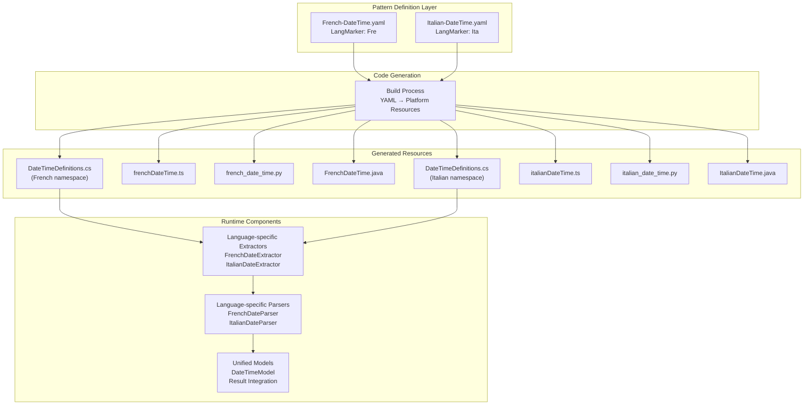
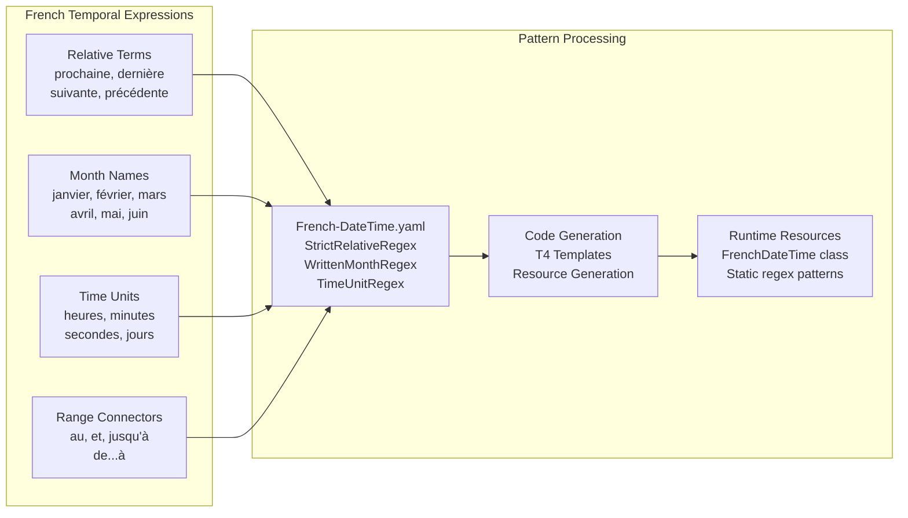
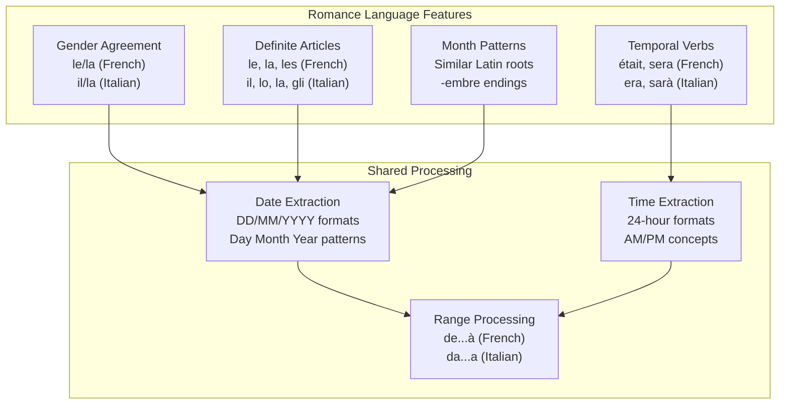
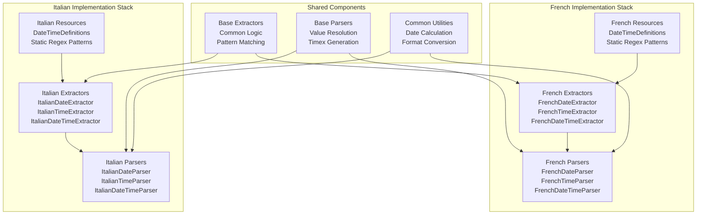

<!-- source: DeepWiki mcp.deepwiki.com · repo microsoft/Recognizers-Text · page 3.4 French and Italian Implementation · fetched 2026-10-26 -->

# French and Italian Implementation

<details>
<summary>Relevant source files</summary>

The following files were used as context for generating this wiki page:

- [.NET/Microsoft.Recognizers.Definitions.Common/French/DateTimeDefinitions.cs](.NET/Microsoft.Recognizers.Definitions.Common/French/DateTimeDefinitions.cs)
- [.NET/Microsoft.Recognizers.Definitions.Common/Italian/DateTimeDefinitions.cs](.NET/Microsoft.Recognizers.Definitions.Common/Italian/DateTimeDefinitions.cs)
- [.NET/Microsoft.Recognizers.Definitions.Common/Portuguese/DateTimeDefinitions.cs](.NET/Microsoft.Recognizers.Definitions.Common/Portuguese/DateTimeDefinitions.cs)
- [.NET/Microsoft.Recognizers.Definitions.Common/Spanish/DateTimeDefinitions.cs](.NET/Microsoft.Recognizers.Definitions.Common/Spanish/DateTimeDefinitions.cs)
- [Java/libraries/recognizers-text-date-time/src/main/java/com/microsoft/recognizers/text/datetime/resources/FrenchDateTime.java](Java/libraries/recognizers-text-date-time/src/main/java/com/microsoft/recognizers/text/datetime/resources/FrenchDateTime.java)
- [Java/libraries/recognizers-text-date-time/src/main/java/com/microsoft/recognizers/text/datetime/resources/PortugueseDateTime.java](Java/libraries/recognizers-text-date-time/src/main/java/com/microsoft/recognizers/text/datetime/resources/PortugueseDateTime.java)
- [Java/libraries/recognizers-text-date-time/src/main/java/com/microsoft/recognizers/text/datetime/resources/SpanishDateTime.java](Java/libraries/recognizers-text-date-time/src/main/java/com/microsoft/recognizers/text/datetime/resources/SpanishDateTime.java)
- [Java/libraries/recognizers-text-date-time/src/main/java/com/microsoft/recognizers/text/datetime/spanish/extractors/SpanishDatePeriodExtractorConfiguration.java](Java/libraries/recognizers-text-date-time/src/main/java/com/microsoft/recognizers/text/datetime/spanish/extractors/SpanishDatePeriodExtractorConfiguration.java)
- [Java/libraries/recognizers-text-number/src/main/java/com/microsoft/recognizers/text/number/spanish/extractors/OrdinalExtractor.java](Java/libraries/recognizers-text-number/src/main/java/com/microsoft/recognizers/text/number/spanish/extractors/OrdinalExtractor.java)
- [JavaScript/packages/recognizers-date-time/src/resources/frenchDateTime.ts](JavaScript/packages/recognizers-date-time/src/resources/frenchDateTime.ts)
- [JavaScript/packages/recognizers-date-time/src/resources/portugueseDateTime.ts](JavaScript/packages/recognizers-date-time/src/resources/portugueseDateTime.ts)
- [JavaScript/packages/recognizers-date-time/src/resources/spanishDateTime.ts](JavaScript/packages/recognizers-date-time/src/resources/spanishDateTime.ts)
- [Patterns/French/French-DateTime.yaml](Patterns/French/French-DateTime.yaml)
- [Patterns/Italian/Italian-DateTime.yaml](Patterns/Italian/Italian-DateTime.yaml)
- [Patterns/Portuguese/Portuguese-DateTime.yaml](Patterns/Portuguese/Portuguese-DateTime.yaml)
- [Patterns/Spanish/Spanish-DateTime.yaml](Patterns/Spanish/Spanish-DateTime.yaml)
- [Python/libraries/recognizers-date-time/recognizers_date_time/resources/french_date_time.py](Python/libraries/recognizers-date-time/recognizers_date_time/resources/french_date_time.py)
- [Python/libraries/recognizers-date-time/recognizers_date_time/resources/portuguese_date_time.py](Python/libraries/recognizers-date-time/recognizers_date_time/resources/portuguese_date_time.py)
- [Python/libraries/recognizers-date-time/recognizers_date_time/resources/spanish_date_time.py](Python/libraries/recognizers-date-time/recognizers_date_time/resources/spanish_date_time.py)
- [Specs/DateTime/French/DateTimeModel.json](Specs/DateTime/French/DateTimeModel.json)
- [Specs/DateTime/Italian/DateTimeModel.json](Specs/DateTime/Italian/DateTimeModel.json)
- [Specs/DateTime/Portuguese/DateTimeModel.json](Specs/DateTime/Portuguese/DateTimeModel.json)
- [Specs/DateTime/Spanish/DateExtractor.json](Specs/DateTime/Spanish/DateExtractor.json)
- [Specs/DateTime/Spanish/DatePeriodExtractor.json](Specs/DateTime/Spanish/DatePeriodExtractor.json)
- [Specs/DateTime/Spanish/DatePeriodParser.json](Specs/DateTime/Spanish/DatePeriodParser.json)
- [Specs/DateTime/Spanish/DateTimeModel.json](Specs/DateTime/Spanish/DateTimeModel.json)
- [Specs/DateTime/Spanish/DateTimePeriodExtractor.json](Specs/DateTime/Spanish/DateTimePeriodExtractor.json)
- [Specs/DateTime/Spanish/DateTimePeriodParser.json](Specs/DateTime/Spanish/DateTimePeriodParser.json)
- [Specs/DateTime/Spanish/DurationExtractor.json](Specs/DateTime/Spanish/DurationExtractor.json)
- [Specs/DateTime/Spanish/TimePeriodExtractor.json](Specs/DateTime/Spanish/TimePeriodExtractor.json)
- [Specs/DateTime/Spanish/TimePeriodParser.json](Specs/DateTime/Spanish/TimePeriodParser.json)

</details>


This document describes the implementation of French and Italian language support in Microsoft Recognizers Text, focusing on the DateTime recognition domain. Both languages follow the Romance language family patterns and share similar architectural approaches while maintaining their distinct linguistic characteristics.

For general language implementation patterns across the system, see [Language-Specific Implementations](#3). For broader Romance language patterns including Spanish and Portuguese, see [Spanish and Portuguese Implementation](#3.3).

## Architecture Overview

French and Italian implementations follow the established multi-layered architecture used across all supported languages in the recognizers system. Both languages implement comprehensive DateTime recognition capabilities including dates, times, date ranges, time ranges, durations, holidays, and recurring sets.



Sources: [Patterns/French/French-DateTime.yaml:1-10](), [Patterns/Italian/Italian-DateTime.yaml:1-10](), [.NET/Microsoft.Recognizers.Definitions.Common/French/DateTimeDefinitions.cs:1-25](), [.NET/Microsoft.Recognizers.Definitions.Common/Italian/DateTimeDefinitions.cs:1-25]()

## Pattern Definition System

### French Pattern Structure

French patterns are defined in the YAML configuration with language marker `Fre` and include comprehensive regex patterns for various temporal expressions. The implementation supports both formal and colloquial French date/time expressions.

Key French pattern categories include:

| Pattern Type | Examples | Regex Pattern |
|--------------|----------|---------------|
| Months | avril, février, janvier | `(?<month>avril\|avr(\.)?...)`  |
| Weekdays | dimanche, lundi, mardi | `(?<weekday>dimanche\|lundi...)`|
| Relative Terms | prochaine, dernière | `(?<order>prochaine?\|derni[eè]re...)`|
| Time Units | heures, minutes | `(?<unit>h\|(heure\|hr\|minute...)`|



Sources: [Patterns/French/French-DateTime.yaml:9-30](), [Patterns/French/French-DateTime.yaml:54-80](), [Patterns/French/French-DateTime.yaml:110-150]()

### Italian Pattern Structure

Italian patterns follow a similar structure with language marker `Ita`, incorporating Italian-specific grammatical constructions and temporal expressions. The implementation handles Italian articles, prepositions, and gender agreements.

Key Italian pattern features:

| Pattern Type | Examples | Regex Pattern |
|--------------|----------|---------------|
| Months | aprile, febbraio, gennaio | `(?<month>apr(ile)?\|feb(braio)?...)`|
| Weekdays | domenica, lunedì, martedì | `(?<weekday>domenica\|lunedì...)`|
| Relative Terms | prossimo, scorso, ultimo | `(?<order>prossim['oaie]\|scors[oaie]...)`|
| Articles/Prepositions | il, la, nel, della | Complex patterns for agreement |

Sources: [Patterns/Italian/Italian-DateTime.yaml:12-35](), [Patterns/Italian/Italian-DateTime.yaml:54-90](), [Patterns/Italian/Italian-DateTime.yaml:200-250]()

## Romance Language Commonalities

Both French and Italian share structural similarities as Romance languages, allowing for pattern reuse and similar processing approaches:



Sources: [Patterns/French/French-DateTime.yaml:70-100](), [Patterns/Italian/Italian-DateTime.yaml:55-85](), [Patterns/Spanish/Spanish-DateTime.yaml:70-100]()

## Code Generation and Platform Resources

### Generated Resource Files

The YAML patterns are transformed into platform-specific resource files through the build process:

**French Resources:**
- `.NET`: `Microsoft.Recognizers.Definitions.French.DateTimeDefinitions`
- `JavaScript`: `FrenchDateTime` namespace in `frenchDateTime.ts`
- `Python`: `FrenchDateTime` class in `french_date_time.py`
- `Java`: `FrenchDateTime` class in `com.microsoft.recognizers.text.datetime.resources`

**Italian Resources:**
- `.NET`: `Microsoft.Recognizers.Definitions.Italian.DateTimeDefinitions`
- `JavaScript`: `ItalianDateTime` namespace in `italianDateTime.ts`
- `Python`: `ItalianDateTime` class in `italian_date_time.py`
- `Java`: `ItalianDateTime` class in `com.microsoft.recognizers.text.datetime.resources`

```mermaid
graph TD
    subgraph "Pattern Flow Example"
        YAMLPattern["YAML Pattern<br/>WrittenMonthRegex: avril|mai|juin"]
        
        NETGenerated["C# Generated<br/>public const string WrittenMonthRegex =<br/>@\"(?<month>avril|mai|juin...)\""]
        
        JSGenerated["TypeScript Generated<br/>export const WrittenMonthRegex =<br/>`(?<month>avril|mai|juin...)`"]
        
        PyGenerated["Python Generated<br/>WrittenMonthRegex = f'(?<month>avril|mai|juin...)'"]
        
        JavaGenerated["Java Generated<br/>public static final String WrittenMonthRegex =<br/>\"(?<month>avril|mai|juin...)\""]
    end
    
    YAMLPattern --> NETGenerated
    YAMLPattern --> JSGenerated
    YAMLPattern --> PyGenerated
    YAMLPattern --> JavaGenerated
```

Sources: [.NET/Microsoft.Recognizers.Definitions.Common/French/DateTimeDefinitions.cs:54-80](), [JavaScript/packages/recognizers-date-time/src/resources/frenchDateTime.ts:40-60](), [Python/libraries/recognizers-date-time/recognizers_date_time/resources/french_date_time.py:30-50]()

## Language-Specific Implementation Details

### French-Specific Features

French implementation includes several language-specific characteristics:

1. **Elision Handling**: Patterns accommodate French elision rules (`l'année`, `d'avril`)
2. **Liaison Support**: Recognition of liaison in spoken/written forms
3. **Regional Variations**: Support for Belgian French number systems (`septante`, `octante`, `nonante`)
4. **Complex Time Expressions**: Handling of `quart`, `demie`, `trois quarts` for time fractions

Key French patterns:
- `TillRegex`: `(?<till>\b(au|et|(jusqu')?a|avant)\b|(jusqu')?à|--|-|—|——)`
- `WrittenTimeRegex`: Supports written time expressions like "trois heures et demie"
- `RelativeMonthRegex`: Handles "ce mois", "mois dernier", "mois prochain"

Sources: [Patterns/French/French-DateTime.yaml:5-8](), [Patterns/French/French-DateTime.yaml:240-280](), [.NET/Microsoft.Recognizers.Definitions.Common/French/DateTimeDefinitions.cs:26-28]()

### Italian-Specific Features

Italian implementation addresses Italian grammatical complexity:

1. **Article Agreement**: Complex patterns for `il/lo/la/gli/le` agreement with temporal nouns
2. **Preposition Contractions**: Handling of contracted prepositions (`del`, `dello`, `della`, `nell'`)
3. **Ordinal Numbers**: Support for Italian ordinal patterns (`primo`, `secondo`, `ultimo`)
4. **Regional Time Formats**: Recognition of both Northern and Southern Italian time expressions

Key Italian patterns:
- `TillRegex`: `(?<till>\b(fino\s+a(l(l[aoe'])?|gli|i|d)?|a(l(l[aoe'])?|gli|i|d)?|e\s+(il?|l[aoe']|gli))\b|--|-|—|——|~)`
- `RelativeRegex`: Comprehensive pattern for relative terms with article agreement
- `MonthSuffixRegex`: Handles preposition and article combinations with months

Sources: [Patterns/Italian/Italian-DateTime.yaml:5-11](), [Patterns/Italian/Italian-DateTime.yaml:64-66](), [.NET/Microsoft.Recognizers.Definitions.Common/Italian/DateTimeDefinitions.cs:26-30]()

## Testing and Validation

Both French and Italian implementations include comprehensive test suites to validate recognition accuracy:

### French Test Coverage

French test specifications cover various scenarios including:
- Basic date/time recognition
- Duration expressions (`3heures`, `vingt-quatre heures`)
- Time ranges (`5 a 6pm`, `entre 17 et 18`)
- Recurring patterns (`hebdomadaire`, `tous les jours`)
- Complex date ranges with prepositions

Sources: [Specs/DateTime/French/DateTimeModel.json:100-150](), [Specs/DateTime/French/DateTimeModel.json:350-400]()

### Italian Test Coverage

Italian test specifications validate:
- Date format recognition (`Ott/2`, month abbreviations)
- Time expression parsing
- Relative date expressions
- Duration and range recognition
- Holiday and special date handling

Sources: [Specs/DateTime/Italian/DateTimeModel.json:1-50]()

## Platform Implementation Architecture

The runtime architecture for both French and Italian follows the established extractor-parser pattern:



Both languages leverage shared base classes and utilities while implementing language-specific extraction and parsing logic. The resource files generated from YAML patterns provide the language-specific regex patterns and constants used by the extractors and parsers.

Sources: [.NET/Microsoft.Recognizers.Definitions.Common/French/DateTimeDefinitions.cs:20-25](), [.NET/Microsoft.Recognizers.Definitions.Common/Italian/DateTimeDefinitions.cs:20-25]()

---

