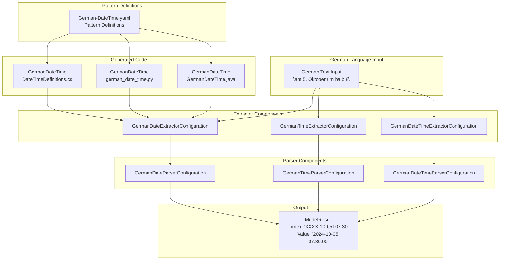
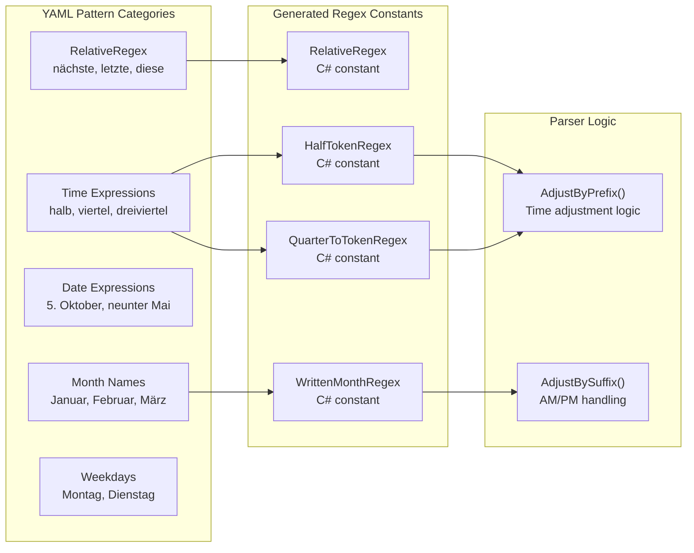
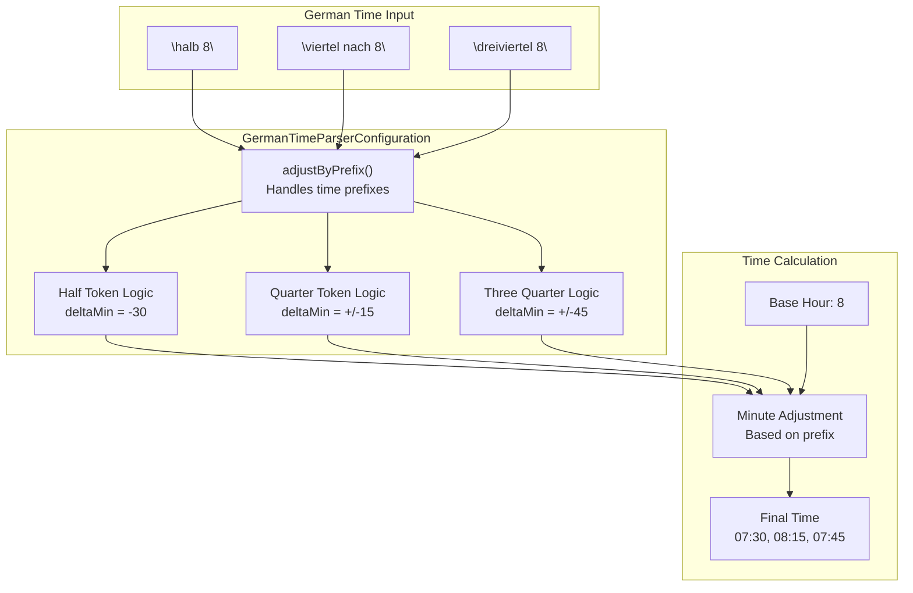
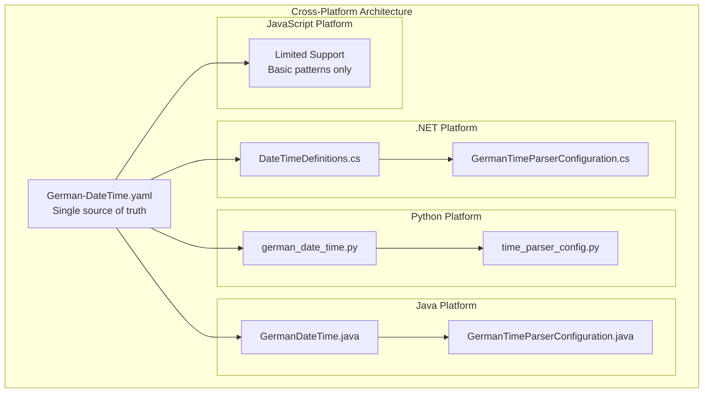

<!-- source: DeepWiki mcp.deepwiki.com · repo microsoft/Recognizers-Text · page 3.5 German Implementation · fetched 2026-10-26 -->

# German Implementation

<details>
<summary>Relevant source files</summary>

The following files were used as context for generating this wiki page:

- [.NET/Microsoft.Recognizers.Definitions.Common/German/DateTimeDefinitions.cs](.NET/Microsoft.Recognizers.Definitions.Common/German/DateTimeDefinitions.cs)
- [.NET/Microsoft.Recognizers.Text.DateTime/German/Parsers/GermanTimeParserConfiguration.cs](.NET/Microsoft.Recognizers.Text.DateTime/German/Parsers/GermanTimeParserConfiguration.cs)
- [Java/libraries/recognizers-text-date-time/src/main/java/com/microsoft/recognizers/text/datetime/german/parsers/GermanTimeParserConfiguration.java](Java/libraries/recognizers-text-date-time/src/main/java/com/microsoft/recognizers/text/datetime/german/parsers/GermanTimeParserConfiguration.java)
- [Java/libraries/recognizers-text-date-time/src/main/java/com/microsoft/recognizers/text/datetime/resources/GermanDateTime.java](Java/libraries/recognizers-text-date-time/src/main/java/com/microsoft/recognizers/text/datetime/resources/GermanDateTime.java)
- [Patterns/German/German-DateTime.yaml](Patterns/German/German-DateTime.yaml)
- [Python/libraries/recognizers-date-time/recognizers_date_time/date_time/german/time_parser_config.py](Python/libraries/recognizers-date-time/recognizers_date_time/date_time/german/time_parser_config.py)
- [Python/libraries/recognizers-date-time/recognizers_date_time/resources/german_date_time.py](Python/libraries/recognizers-date-time/recognizers_date_time/resources/german_date_time.py)
- [Specs/DateTime/German/DateTimeModel.json](Specs/DateTime/German/DateTimeModel.json)
- [Specs/DateTime/German/TimeExtractor.json](Specs/DateTime/German/TimeExtractor.json)
- [Specs/DateTime/German/TimeParser.json](Specs/DateTime/German/TimeParser.json)

</details>


This document covers the German language implementation within Microsoft Recognizers Text, focusing on DateTime recognition capabilities. The German implementation provides comprehensive support for recognizing dates, times, durations, and recurring patterns in German text across multiple platforms.

For information about other language implementations, see [Chinese Implementation](#3.2), [Spanish and Portuguese Implementation](#3.3), and [French and Italian Implementation](#3.4). For general DateTime recognition concepts, see [DateTime Recognition](#2.1).

## Architecture Overview

The German implementation follows the standard recognizer architecture with language-specific customizations for German grammar and cultural conventions.



Sources: [Patterns/German/German-DateTime.yaml:1-600](), [.NET/Microsoft.Recognizers.Definitions.Common/German/DateTimeDefinitions.cs:1-50]()

## Pattern Definition System

German DateTime patterns are defined in YAML format and automatically generated into platform-specific code. The system handles German-specific linguistic features including grammatical cases, compound words, and cultural date/time conventions.



Key pattern definitions include:

- **RelativeRegex**: `\b(?<order>(über)?nächste[rmns]?|kommende[rns]?|diese[rmns]?|letzte[rmns]?|vergangene[rns]?...)` for relative time expressions
- **HalfTokenRegex**: `^(halb)` for half-hour expressions
- **QuarterToTokenRegex**: `^(viertel\s+vor|dreiviertel)\s*$` for quarter-hour expressions
- **WrittenMonthRegex**: Captures German month names with proper grammatical cases

Sources: [Patterns/German/German-DateTime.yaml:9-12](), [Patterns/German/German-DateTime.yaml:86-95](), [.NET/Microsoft.Recognizers.Definitions.Common/German/DateTimeDefinitions.cs:28-29]()

## German-Specific Language Features

The German implementation handles several unique linguistic characteristics:

### Grammatical Cases and Gender Agreement
German nouns change form based on grammatical case. The patterns accommodate multiple forms:

- **Definite articles**: `de[rmsn]` captures der/die/das/des/dem/den variations
- **Month variations**: `j[äa]n(uar|ner|\.)` handles Januar/Jänner variations
- **Adjective endings**: `letzte[rmns]?` covers letzter/letzte/letztes/letzten forms

### Compound Time Expressions
German allows compound words for time expressions:

- `montagnachmittag` (Monday afternoon) as a single word
- `dienstagmorgen` (Tuesday morning) as a compound
- `wochenende` (weekend) as a compound noun

### German-Specific Time Conventions
- **"halb" logic**: "halb 8" means 7:30 (half to 8), not 8:30
- **"viertel" expressions**: "viertel 6" means 5:15, "dreiviertel 6" means 5:45
- **24-hour cultural preference**: Germans commonly use 24-hour time format

Sources: [Patterns/German/German-DateTime.yaml:38-40](), [Patterns/German/German-DateTime.yaml:86-95](), [Specs/DateTime/German/DateTimeModel.json:902-928]()

## Time Expression Handling

The German time parser implements sophisticated logic for handling German time expressions, particularly the "halb" and "viertel" patterns.



### Time Prefix Adjustment Logic

The `AdjustByPrefix` method in `GermanTimeParserConfiguration` handles German time prefixes:

```csharp
if (HalfTokenRegex.IsMatch(trimmedPrefix))
{
    deltaMin = -30;  // "halb 8" = 7:30
}
else if (QuarterToTokenRegex.IsMatch(trimmedPrefix))
{
    deltaMin = -15;  // "viertel vor 8" = 7:45
}
else if (QuarterPastTokenRegex.IsMatch(trimmedPrefix))
{
    deltaMin = 15;   // "viertel nach 8" = 8:15
}
```

### AM/PM and Time of Day Handling

German time expressions include specific patterns for time of day:

- **morgens/vormittags**: Morning (AM)
- **nachmittags**: Afternoon (PM) 
- **abends**: Evening (PM)
- **nachts**: Night (special handling for ambiguous hours)

Sources: [.NET/Microsoft.Recognizers.Text.DateTime/German/Parsers/GermanTimeParserConfiguration.cs:70-125](), [Python/libraries/recognizers-date-time/recognizers_date_time/date_time/german/time_parser_config.py:68-103]()

## Platform Implementations

The German implementation is available across all supported platforms with consistent behavior:

### .NET Implementation
- **Main class**: `GermanTimeParserConfiguration` in [.NET/Microsoft.Recognizers.Text.DateTime/German/Parsers/GermanTimeParserConfiguration.cs]()
- **Generated definitions**: `DateTimeDefinitions` in [.NET/Microsoft.Recognizers.Definitions.Common/German/DateTimeDefinitions.cs]()
- **Regex compilation**: Uses `RegexOptions.Singleline | RegexOptions.ExplicitCapture`

### Python Implementation  
- **Main class**: `GermanTimeParserConfiguration` in [Python/libraries/recognizers-date-time/recognizers_date_time/date_time/german/time_parser_config.py]()
- **Generated resources**: `GermanDateTime` in [Python/libraries/recognizers-date-time/recognizers_date_time/resources/german_date_time.py]()
- **Regex handling**: Uses `regex` library for advanced pattern matching

### Java Implementation
- **Main class**: `GermanTimeParserConfiguration` in [Java/libraries/recognizers-text-date-time/src/main/java/com/microsoft/recognizers/text/datetime/german/parsers/GermanTimeParserConfiguration.java]()
- **Generated resources**: `GermanDateTime` in [Java/libraries/recognizers-text-date-time/src/main/java/com/microsoft/recognizers/text/datetime/resources/GermanDateTime.java]()
- **Pattern compilation**: Uses `Pattern.compile()` with appropriate flags



Sources: [.NET/Microsoft.Recognizers.Text.DateTime/German/Parsers/GermanTimeParserConfiguration.cs:16-54](), [Python/libraries/recognizers-date-time/recognizers_date_time/date_time/german/time_parser_config.py:15-40](), [Java/libraries/recognizers-text-date-time/src/main/java/com/microsoft/recognizers/text/datetime/german/parsers/GermanTimeParserConfiguration.java:27-54]()

## Testing and Validation

The German implementation includes comprehensive test suites to validate recognition accuracy:

### Test Structure
- **Model Tests**: End-to-end validation in [Specs/DateTime/German/DateTimeModel.json]()
- **Parser Tests**: Component-level testing in [Specs/DateTime/German/TimeParser.json]()
- **Extractor Tests**: Pattern matching validation in [Specs/DateTime/German/TimeExtractor.json]()

### Key Test Cases

| Input | Expected Output | Type |
|-------|----------------|------|
| "am 2. Oktober" | `2016-10-02` or `2017-10-02` | Date |
| "halb 8" | `T07:30` and `T19:30` | Time |
| "viertel nach 8 Abends" | `T20:15` | Time |
| "nächsten Montag Nachmittag" | `2016-11-14TAF` | DateTimeRange |
| "alle zwei Tage" | `P2D` (Set) | Set |

### Platform Support Matrix

| Feature | .NET | Python | Java | JavaScript |
|---------|------|--------|------|------------|
| Basic Time Recognition | ✓ | ✓ | ✓ | Limited |
| "halb" expressions | ✓ | ✓ | ✓ | ✗ |
| "viertel" expressions | ✓ | Limited | Limited | ✗ |
| Compound time expressions | ✓ | Limited | ✗ | ✗ |

Sources: [Specs/DateTime/German/DateTimeModel.json:1-30](), [Specs/DateTime/German/TimeParser.json:1-50](), [Specs/DateTime/German/TimeExtractor.json:1-30]()

---

