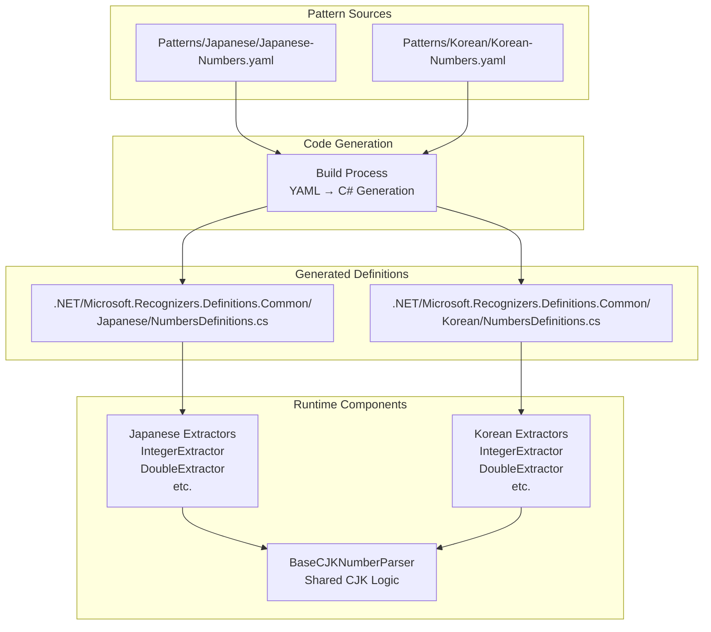
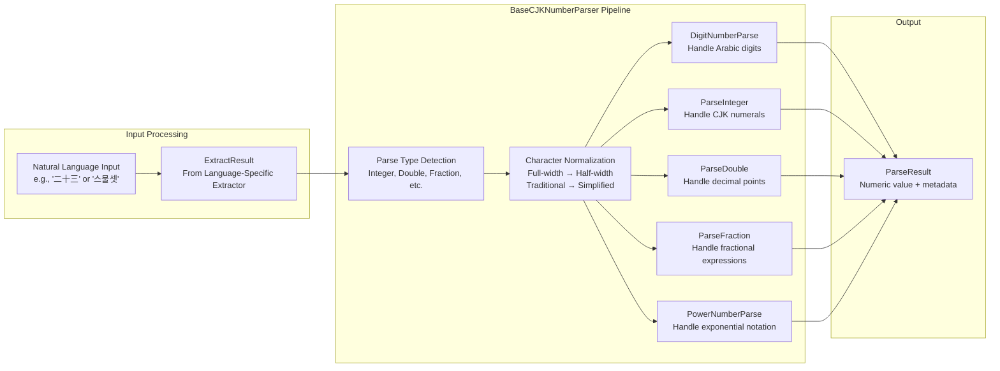
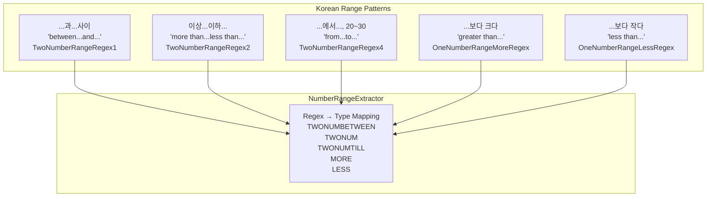

<!-- source: DeepWiki mcp.deepwiki.com · repo microsoft/Recognizers-Text · page 3.6 Japanese and Korean Implementation · fetched 2026-10-26 -->

# Japanese and Korean Implementation

<details>
<summary>Relevant source files</summary>

The following files were used as context for generating this wiki page:

- [.NET/Microsoft.Recognizers.Definitions.Common/Japanese/NumbersDefinitions.cs](.NET/Microsoft.Recognizers.Definitions.Common/Japanese/NumbersDefinitions.cs)
- [.NET/Microsoft.Recognizers.Definitions.Common/Japanese/NumbersWithUnitDefinitions.cs](.NET/Microsoft.Recognizers.Definitions.Common/Japanese/NumbersWithUnitDefinitions.cs)
- [.NET/Microsoft.Recognizers.Definitions.Common/Korean/NumbersDefinitions.cs](.NET/Microsoft.Recognizers.Definitions.Common/Korean/NumbersDefinitions.cs)
- [.NET/Microsoft.Recognizers.Text.DateTime/Korean/Parsers/KoreanCommonDateTimeParserConfiguration.cs](.NET/Microsoft.Recognizers.Text.DateTime/Korean/Parsers/KoreanCommonDateTimeParserConfiguration.cs)
- [.NET/Microsoft.Recognizers.Text.Number/Japanese/Extractors/CardinalExtractor.cs](.NET/Microsoft.Recognizers.Text.Number/Japanese/Extractors/CardinalExtractor.cs)
- [.NET/Microsoft.Recognizers.Text.Number/Japanese/Extractors/DoubleExtractor.cs](.NET/Microsoft.Recognizers.Text.Number/Japanese/Extractors/DoubleExtractor.cs)
- [.NET/Microsoft.Recognizers.Text.Number/Japanese/Extractors/IntegerExtractor.cs](.NET/Microsoft.Recognizers.Text.Number/Japanese/Extractors/IntegerExtractor.cs)
- [.NET/Microsoft.Recognizers.Text.Number/Japanese/Parsers/JapaneseNumberRangeParserConfiguration.cs](.NET/Microsoft.Recognizers.Text.Number/Japanese/Parsers/JapaneseNumberRangeParserConfiguration.cs)
- [.NET/Microsoft.Recognizers.Text.Number/Korean/Extractors/CardinalExtractor.cs](.NET/Microsoft.Recognizers.Text.Number/Korean/Extractors/CardinalExtractor.cs)
- [.NET/Microsoft.Recognizers.Text.Number/Korean/Extractors/DoubleExtractor.cs](.NET/Microsoft.Recognizers.Text.Number/Korean/Extractors/DoubleExtractor.cs)
- [.NET/Microsoft.Recognizers.Text.Number/Korean/Extractors/FractionExtractor.cs](.NET/Microsoft.Recognizers.Text.Number/Korean/Extractors/FractionExtractor.cs)
- [.NET/Microsoft.Recognizers.Text.Number/Korean/Extractors/IntegerExtractor.cs](.NET/Microsoft.Recognizers.Text.Number/Korean/Extractors/IntegerExtractor.cs)
- [.NET/Microsoft.Recognizers.Text.Number/Korean/Extractors/NumberExtractor.cs](.NET/Microsoft.Recognizers.Text.Number/Korean/Extractors/NumberExtractor.cs)
- [.NET/Microsoft.Recognizers.Text.Number/Korean/Extractors/NumberRangeExtractor.cs](.NET/Microsoft.Recognizers.Text.Number/Korean/Extractors/NumberRangeExtractor.cs)
- [.NET/Microsoft.Recognizers.Text.Number/Korean/Extractors/OrdinalExtractor.cs](.NET/Microsoft.Recognizers.Text.Number/Korean/Extractors/OrdinalExtractor.cs)
- [.NET/Microsoft.Recognizers.Text.Number/Korean/Extractors/PercentageExtractor.cs](.NET/Microsoft.Recognizers.Text.Number/Korean/Extractors/PercentageExtractor.cs)
- [.NET/Microsoft.Recognizers.Text.Number/Korean/Parsers/KoreanNumberRangeParserConfiguration.cs](.NET/Microsoft.Recognizers.Text.Number/Korean/Parsers/KoreanNumberRangeParserConfiguration.cs)
- [.NET/Microsoft.Recognizers.Text.Number/Parsers/BaseCJKNumberParser.cs](.NET/Microsoft.Recognizers.Text.Number/Parsers/BaseCJKNumberParser.cs)
- [.NET/Microsoft.Recognizers.Text.NumberWithUnit/Constants.cs](.NET/Microsoft.Recognizers.Text.NumberWithUnit/Constants.cs)
- [.NET/Microsoft.Recognizers.Text.NumberWithUnit/Japanese/Extractors/DimensionExtractorConfiguration.cs](.NET/Microsoft.Recognizers.Text.NumberWithUnit/Japanese/Extractors/DimensionExtractorConfiguration.cs)
- [.NET/Microsoft.Recognizers.Text.NumberWithUnit/Japanese/Parsers/DimensionParserConfiguration.cs](.NET/Microsoft.Recognizers.Text.NumberWithUnit/Japanese/Parsers/DimensionParserConfiguration.cs)
- [JavaScript/packages/recognizers-number/src/culture.ts](JavaScript/packages/recognizers-number/src/culture.ts)
- [JavaScript/packages/recognizers-number/src/number/cjkParsers.ts](JavaScript/packages/recognizers-number/src/number/cjkParsers.ts)
- [JavaScript/packages/recognizers-number/src/number/parsers.ts](JavaScript/packages/recognizers-number/src/number/parsers.ts)
- [Patterns/Japanese/Japanese-Numbers.yaml](Patterns/Japanese/Japanese-Numbers.yaml)
- [Patterns/Japanese/Japanese-NumbersWithUnit.yaml](Patterns/Japanese/Japanese-NumbersWithUnit.yaml)
- [Patterns/Korean/Korean-Numbers.yaml](Patterns/Korean/Korean-Numbers.yaml)
- [Python/libraries/recognizers-number/recognizers_number/number/cjk_parsers.py](Python/libraries/recognizers-number/recognizers_number/number/cjk_parsers.py)
- [Specs/Number/Chinese/OrdinalModel.json](Specs/Number/Chinese/OrdinalModel.json)
- [Specs/Number/French/OrdinalModel.json](Specs/Number/French/OrdinalModel.json)
- [Specs/Number/Japanese/NumberModel.json](Specs/Number/Japanese/NumberModel.json)
- [Specs/Number/Japanese/OrdinalModel.json](Specs/Number/Japanese/OrdinalModel.json)
- [Specs/Number/Japanese/PercentModel.json](Specs/Number/Japanese/PercentModel.json)
- [Specs/Number/Korean/NumberModel.json](Specs/Number/Korean/NumberModel.json)
- [Specs/Number/Korean/NumberModelPercentMode.json](Specs/Number/Korean/NumberModelPercentMode.json)
- [Specs/Number/Korean/NumberRangeModel.json](Specs/Number/Korean/NumberRangeModel.json)
- [Specs/Number/Korean/OrdinalModel.json](Specs/Number/Korean/OrdinalModel.json)
- [Specs/Number/Korean/PercentModel.json](Specs/Number/Korean/PercentModel.json)
- [Specs/Number/Korean/PercentModelPercentMode.json](Specs/Number/Korean/PercentModelPercentMode.json)
- [Specs/Number/Portuguese/OrdinalModel.json](Specs/Number/Portuguese/OrdinalModel.json)
- [Specs/NumberWithUnit/Japanese/CurrencyModel.json](Specs/NumberWithUnit/Japanese/CurrencyModel.json)

</details>


This document covers the implementation of Japanese and Korean language support in Microsoft Recognizers Text. Both languages are part of the CJK (Chinese, Japanese, Korean) family and share common number system characteristics while maintaining language-specific patterns and vocabulary.

For information about Chinese implementation, see [Chinese Implementation](#3.2). For general CJK parsing concepts that apply across all three languages, refer to the shared `BaseCJKNumberParser` implementation detailed in this document.

## CJK Language Characteristics

Japanese and Korean implementations share several key characteristics that distinguish them from Western languages:

- **Compound Number Language**: Numbers are written without whitespace separation between components
- **Complex Number Systems**: Use traditional CJK numerals alongside Arabic digits
- **Character-Based Multipliers**: Employ characters like 十 (10), 百 (100), 千 (1000), 万 (10,000)
- **Multiple Writing Systems**: Support both traditional characters and full-width/half-width digits

## Pattern Definition Architecture

Both Japanese and Korean implementations follow the same pattern-driven architecture, with YAML files defining language-specific patterns that generate corresponding C# definition classes.



Sources: [Patterns/Japanese/Japanese-Numbers.yaml:1-469](), [Patterns/Korean/Korean-Numbers.yaml:1-470](), [.NET/Microsoft.Recognizers.Definitions.Common/Japanese/NumbersDefinitions.cs:1-299](), [.NET/Microsoft.Recognizers.Definitions.Common/Korean/NumbersDefinitions.cs:1-300]()

## Shared CJK Parsing Infrastructure

Both Japanese and Korean implementations utilize the `BaseCJKNumberParser` class, which provides specialized parsing logic for CJK number systems.



The `BaseCJKNumberParser` handles culture-specific processing and delegates to appropriate parsing methods based on the `ExtractResult.Data` field:

| Data Value | Parsing Method | Purpose |
|------------|---------------|---------|
| "Integer" | `ParseInteger` | CJK numeral parsing |
| "Dou" | `ParseDouble` | Decimal number parsing |
| "Frac" | `ParseFraction` | Fractional expression parsing |
| "Num" | `DigitNumberParse` | Arabic digit parsing |
| "Pow" | `PowerNumberParse` | Exponential notation |
| "Per" | `ParsePercentage` | Percentage expressions |
| "Ordinal" | `ParseOrdinal` | Ordinal number parsing |

Sources: [.NET/Microsoft.Recognizers.Text.Number/Parsers/BaseCJKNumberParser.cs:22-130](), [.NET/Microsoft.Recognizers.Text.Number/Parsers/BaseCJKNumberParser.cs:54-90]()

## Japanese Implementation

### Character Mappings and Patterns

Japanese number recognition supports multiple character systems with comprehensive mappings defined in the YAML configuration:

| Character Type | Examples | Purpose |
|---------------|----------|---------|
| CJK Numerals | 零〇一二三四五六七八九 | Traditional Japanese numerals |
| Arabic Digits | 0123456789 | Standard digits |
| Full-width Digits | ０１２３４５６７８９ | Japanese typography |
| Multipliers | 十百千万億兆 | Powers of 10 |
| Special Values | 半 (0.5) | Fractional expressions |

The Japanese implementation includes unique vocabulary mappings through the `UnitMap`:

```yaml
UnitMap: !dictionary
  types: [string, string]
  entries:
    いち: 一    # "ichi" → kanji "1"
    に: 二      # "ni" → kanji "2"
    さん: 三    # "san" → kanji "3"
    じゅう: 十  # "juu" → kanji "10"
    ひゃく: 百  # "hyaku" → kanji "100"
```

### Japanese-Specific Extractors

Japanese extractors are implemented in dedicated classes that handle language-specific patterns:

- `IntegerExtractor`: Handles Japanese integer patterns including kanji numerals
- `DoubleExtractor`: Processes decimal numbers with Japanese decimal points (・．.)
- `PercentageExtractor`: Recognizes パーセント (percent) and percentage symbols
- `FractionExtractor`: Handles Japanese fractional expressions with 分の

Sources: [Patterns/Japanese/Japanese-Numbers.yaml:99-135](), [.NET/Microsoft.Recognizers.Definitions.Common/Japanese/NumbersDefinitions.cs:99-135](), [.NET/Microsoft.Recognizers.Text.Number/Japanese/Extractors/IntegerExtractor.cs:1-136]()

### Japanese Number Examples

The Japanese implementation recognizes various number formats as demonstrated in test specifications:

| Input | Recognized Value | Type |
|-------|------------------|------|
| 二十億 | 2,000,000,000 | Integer |
| ５万４千６百 | 54,600 | Integer |
| マイナス10000 | -10,000 | Negative Integer |
| 一ダース | 12 | Dozen conversion |
| 半ダース | 6 | Half dozen |

Sources: [Specs/Number/Japanese/NumberModel.json:108-262]()

## Korean Implementation

### Character Mappings and Patterns

Korean number recognition supports both Sino-Korean and native Korean number systems:

| Number System | Examples | Usage |
|--------------|----------|-------|
| Sino-Korean | 일이삼사오육칠팔구 | Formal counting, dates |
| Native Korean | 하나둘셋넷다섯여섯일곱여덟아홉 | Informal counting |
| Mixed Forms | 스물 (20), 서른 (30), 마흔 (40) | Native tens |

The Korean `UnitMap` includes extensive native-to-Sino-Korean conversions:

```yaml
UnitMap: !dictionary
  entries:
    하나: 일     # "hana" → "il" (1)
    둘: 이       # "dul" → "i" (2)
    셋: 삼       # "set" → "sam" (3)
    스물: 이십   # "seumul" → "isip" (20)
    서른: 삼십   # "seoreun" → "samsip" (30)
```

### Korean-Specific Features

Korean includes unique linguistic patterns:

- **Negative expressions**: 마이너스 (minus) and 음수 (negative number)
- **Percentage terms**: 백분의 (percent of), 퍼센트 (percent)
- **Ordinal expressions**: 번째 (ordinal suffix), 등 (rank)
- **Fraction expressions**: 분의 (fraction of), 중 (among)

### Korean Number Range Support

Korean implements comprehensive number range recognition with specific patterns:



Sources: [.NET/Microsoft.Recognizers.Text.Number/Korean/Extractors/NumberRangeExtractor.cs:23-75](), [Patterns/Korean/Korean-Numbers.yaml:411-470]()

### Korean Number Examples

Korean number recognition handles both number systems effectively:

| Input | Recognized Value | Number System |
|-------|------------------|---------------|
| 십육 | 16 | Sino-Korean |
| 일백십육 | 116 | Sino-Korean |
| 스물한 번째 | 21st | Mixed (native + ordinal) |
| 삼분의 이 | 2/3 | Fraction |
| 백분의 오십 | 50% | Percentage |

Sources: [Specs/Number/Korean/NumberModel.json:186-226](), [Specs/Number/Korean/OrdinalModel.json:63-76]()

## Testing and Validation

Both Japanese and Korean implementations include comprehensive test suites that validate number recognition across different formats and contexts:

### Test Coverage Areas

- **Basic Number Recognition**: Single digits to large numbers
- **Negative Numbers**: Various negative expression formats
- **Fractions**: Fractional expressions in native language patterns
- **Percentages**: Percentage symbols and written forms
- **Ordinals**: Ordinal number expressions with appropriate suffixes
- **Number Ranges**: Range expressions with comparative language
- **Edge Cases**: Ambiguous contexts and special formatting

The test specifications demonstrate expected behavior and serve as regression tests for both languages.

Sources: [Specs/Number/Japanese/NumberModel.json:1-400](), [Specs/Number/Korean/NumberModel.json:1-400](), [Specs/Number/Korean/NumberRangeModel.json:1-200](), [Specs/Number/Japanese/OrdinalModel.json:1-200]()

---

